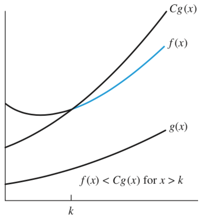
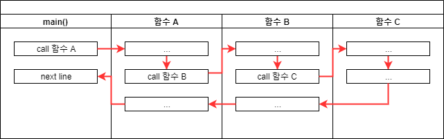
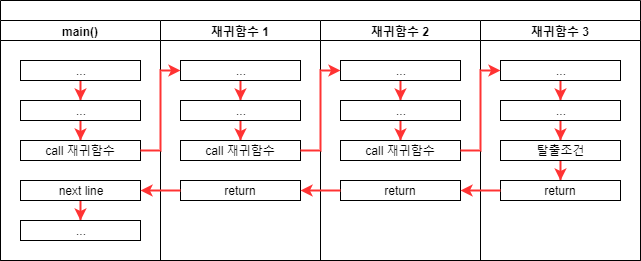
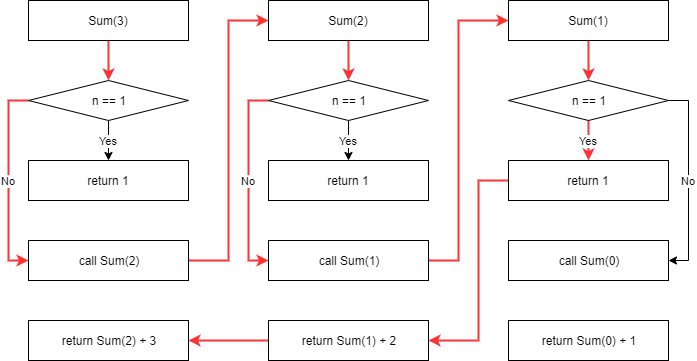
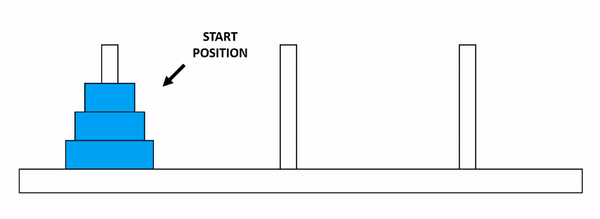
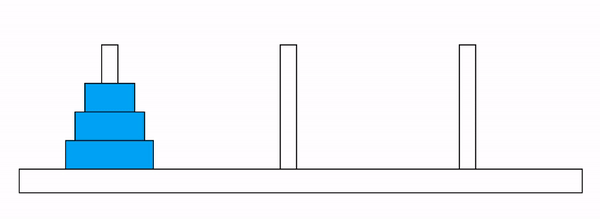

```{r setup, include=FALSE}
library(knitr)

# 슬라이드는 폭이 좁다. 출력 폭을 46자로 접는다.
options(linewidth = 46, width = 46)
hook_output <- knitr::knit_hooks$get("output")
knit_hooks$set(output = function(x, options) {
  if (!is.null(n <- options$linewidth)) {
    x <- knitr:::split_lines(x)
    if (any(nchar(x) > n)) x <- strwrap(x, width = n)
    x <- paste(x, collapse = "\n")
  }
  hook_output(x, options)
})
```


## 이 수업에서 다루는 것

::: {.keypoint}
알고리즘 **암기**가 아니라, 구현의 **정확성**과 **수행 시간, 메모리 요구량**을 판단하는 능력
:::

<br>

| | 절 | 내용 |
|:--|:--|:--|
| 1 | 알고리즘과 계산 비용 | 일상 속 알고리즘, 수행 시간, 메모리, 빅오 표기법 |
| 2 | 재귀 | 종료 조건, 계승, 하노이 탑 |
| 3 | 탐색 알고리즘 | 선형 탐색과 이진 탐색, 구현의 정확성 검증 |
| 4 | 정렬 알고리즘 | 정렬 네 가지(버블, 삽입, 병합, 퀵), 입력에 따른 비용 |
| 5 | 뉴턴-랩슨 알고리즘 | 점화식, 초기값 의존성, 회귀와 로지스틱 회귀의 계수 추정, 경사하강법 |
| 6 | AI와 함께 | 생성 코드의 검증 |

: {tbl-colwidths="[6,32,62]"}

::: {.notes}
오늘 다룰 여섯 절입니다.

1절은 전화번호부와 청소 로봇 예로 알고리즘의 정의와 다섯 조건을 정하고, 수행 시간과 메모리를 비교하는 빅오 표기법을 배웁니다.
2절은 함수가 자기 자신을 호출하는 재귀와, 호출 깊이만큼 늘어나는 메모리 사용을 봅니다.

3절부터 5절까지는 빅오 표기법과 검증 절차를 탐색, 정렬, 수치 계산 세 가지 영역에 적용합니다.
같은 질문 두 개를 반복합니다. "이 구현이 맞는가", "이 구현의 연산 횟수와 메모리는 입력 크기에 따라 얼마나 늘어나는가."

6절은 같은 질문을 AI가 만들어 준 코드에 적용합니다.

표에서 3절과 6절을 짚으면서: 두 절은 같은 검증 절차, 곧 모든 원소 넣어 보기, 경계 사례, 정답이 알려진 함수와 대조하기를 씁니다. 3절은 사람이 쓴 코드에, 6절은 AI가 쓴 코드에 적용합니다.
:::


# [1]{.secno} 알고리즘과 계산 비용 {.section-title}

::: {.columns}
::: {.column width="54%"}
**알고리즘 = 약속된 절차**: 일상의 예에서 출발해 **수행 시간과 메모리를 비교하는 기준**을 세우는 절

결과가 같은 두 코드가 서로 다른 수행 시간, 메모리를 요구하는 이유와
그 차이를 비교하는 방법
:::
::: {.column width="46%"}
[이 절에서]{.label}

- 일상 속 알고리즘: 전화번호부, 청소 로봇
- 알고리즘의 다섯 조건
- 비용 = 수행 시간 + 메모리
- 시간 복잡도, 공간 복잡도
- 빅오 표기법과 세 규칙
- 차수별 연산 횟수 비교
:::
:::

::: {.keypoint .teal}
**이 절이 답하는 질문**: 같은 결과를 내는 두 코드의 수행 시간과 메모리를 **무엇으로 비교하는가**?
:::

::: {.notes}
1절입니다. 전화번호부와 청소 로봇 예로 알고리즘의 뜻을 정하고, 비용을 수행 시간과 메모리 두 가지로 정의합니다. 그다음 빅오 표기법으로 연산 횟수가 늘어나는 비율을 비교합니다.
:::


## [1.1]{.secno} 전화번호부에서 '이아무개' 찾기

::: {.columns}
::: {.column width="50%"}
[방법 A, 한 쪽씩 넘기기]{.label .label-note}

1. 첫 쪽 펼치기
2. 찾는 이름이 있으면 멈춤
3. 없으면 다음 쪽으로 넘기고 2로

1,000쪽이면 최악 **1,000번** 확인
:::
::: {.column width="50%"}
[방법 B, 가운데 펼치기]{.label .label-slide}

1. 남은 부분의 가운데 펼치기
2. 찾는 이름이 있으면 멈춤
3. '이'보다 앞 이름이면 뒤쪽 절반만, 뒤 이름이면 앞쪽 절반만 남기고 1로

1,000쪽이면 최대 **10번** 펼침
:::
:::

::: {.keypoint .teal}
두 방법 모두 **같은 결과**, 확인하는 **쪽수는 다름**<br>
방법 B 는 이름이 **가나다순으로 정렬**되어 있다는 약속이 있어야 가능 → 3절 이진 탐색
:::

::: {.notes}
전화번호부에서 이름을 찾는 일로 시작합니다.

전화번호부는 이름과 전화번호를 가나다순으로 인쇄한 책으로, 스마트폰 이전에는 집마다 한 권씩 있었습니다.
1,000쪽짜리 전화번호부에서 '이아무개'를 찾는다고 해 봅시다.

방법 A는 첫 쪽부터 한 쪽씩 넘기는 겁니다. 이름이 책에 있으면 반드시 찾습니다. 다만 이름이 마지막 쪽에 있으면
1,000쪽을 다 봐야 합니다.

방법 B는 가운데를 펼치는 겁니다. 펼친 쪽에 '박'씨가 나오면, '이'는 그보다 뒤에 있으니까
앞쪽 절반은 볼 필요가 없지요. 남은 뒤쪽 절반의 가운데를 또 펼칩니다. 이렇게 하면
1,000쪽이라도 열 번 안쪽에서 끝납니다.

방법 A와 B처럼 정해 둔 순서대로 따라 하면 결과가 나오는 절차를 알고리즘이라고 부릅니다.

이 예에서 볼 점은 두 가지입니다. 첫째, 두 방법은 같은 쪽을 찾고, 확인하는 쪽수만 다릅니다. 최악의 경우 방법 A 는 1,000번, 방법 B 는 10번입니다.
1절은 이 확인 횟수를 연산 횟수로 세어 비교하는 방법을 다룹니다.

둘째, 방법 B는 이름이 가나다순으로 정렬되어 있어야 쓸 수 있습니다. 동아리 가입 순서대로 적은 명단이라면
펼친 쪽의 이름과 비교해도 찾는 이름이 앞쪽에 있는지 뒤쪽에 있는지 알 수 없으므로 방법 B를 못 씁니다.
3절 이진 탐색에도 벡터가 정렬되어 있어야 한다는 조건이 붙습니다.

실제로 사람은 가운데가 아니라 'ㅇ'이 있을 만한 뒤쪽을 짐작해서 펼칩니다.
찾는 값의 크기로 위치를 짐작해 펼치는 이 방법은 보간 탐색이라는 별도의 알고리즘입니다.
:::


## 예측해 보자 {.predict}

전화번호부가 **10,000쪽**이면 방법 B 는 최대 몇 번 펼쳐야 하는가?

::: {.options}
::: {}
**A** 약 5,000번
:::
::: {}
**B** 약 100번
:::
::: {}
**C** 약 14번
:::
:::

::: {.why}
힌트: 한 번 펼칠 때마다 남은 쪽수가 **절반**으로 줄어듦
:::

::: {.notes}
1,000쪽일 때 방법 B는 열 번이었습니다. 그럼 쪽수가 열 배, 10,000쪽이면 몇 번일까요?

A, B, C 중에 골라서 적으세요. 30초 드리겠습니다.

(30초 후) 손 들어 볼까요. A? B? C? 확인해 보겠습니다.
:::


## [1.1]{.secno} 절반씩 줄이면 몇 번 만에 끝나는가

::: {.columns}
::: {.column width="56%"}
```{r phonebook-halving}
half_count <- function(pages) {
  count <- 0
  while (pages > 1) {
    pages <- ceiling(pages / 2)   # 없는 쪽 절반을 버림
    count <- count + 1
  }
  count
}
sapply(c(1000, 10000, 1e6), half_count)
```
:::
::: {.column width="44%"}
| 쪽수 | 방법 A | 방법 B |
|--:|--:|--:|
| 1,000 | 1,000 | **10** |
| 10,000 | 10,000 | **14** |
| 1,000,000 | 1,000,000 | **20** |

: {tbl-colwidths="[36,36,28]"}
:::
:::

::: {.keypoint .teal}
쪽수가 **10배**가 되어도 방법 B 는 **4번**만 증가, 방법 A 는 쪽수에 **정비례** → 3절 이진 탐색, $\mathcal{O}(\log n)$
:::

::: {.notes}
방법 B를 R 코드로 옮겼습니다. while 문이 남은 쪽이 1보다 많은 동안 반복하면서, 남은 쪽수를 절반으로 줄이고
(ceiling 으로 올림) count 를 1 늘립니다.

결과를 보세요. 1,000쪽이면 10번, 10,000쪽이면 14번, 100만 쪽이어도 20번입니다.
쪽수가 열 배가 되어도 네 번만 늘어납니다.

방법 A는 어떨까요? 쪽수만큼, 그러니까 1,000번, 10,000번, 100만 번입니다.
1.4절에서 두 방법의 증가 양상을 빅오 표기법으로 적습니다. 방법 A 는 O(n), 방법 B 는 O(log n) 입니다.
:::


## [1.1]{.secno} 청소 로봇에게 청소를 시키려면

::: {.columns}
::: {.column width="44%"}
[사람에게 하는 말]{.label .label-note}

"방을 깨끗이 청소해": 로봇에게는 정해지지 않은 항목 셋

- **어디서** 시작?
- **깨끗이**의 기준?
- **언제** 멈춤?

[로봇에게 주는 약속된 절차]{.label .label-slide}

1. 방을 칸으로 나누고 왼쪽 위에서 시작
2. 한 줄 끝까지 이동하며 청소
3. 줄 끝에서 아래로 한 칸, 방향 반대로
4. 마지막 칸을 청소하면 멈춤
:::
::: {.column width="56%"}
```{r clean-room}
clean_room <- function(n_row, n_col) {
  visit <- matrix(0L, n_row, n_col)  # 청소 순서
  step <- 0L
  for (i in seq_len(n_row)) {          # 1. 한 줄씩
    cols <- seq_len(n_col)
    if (i %% 2 == 0) cols <- rev(cols) # 3. 방향 반대로
    for (j in cols) {                  # 2. 줄 끝까지
      step <- step + 1L
      visit[i, j] <- step
    }
  }
  visit                                # 4. 멈춤
}
clean_room(4, 6)
```
:::
:::

::: {.notes}
두 번째 예입니다. 청소 로봇을 샀다고 해 봅시다. 사람은 "방 좀 깨끗이 치워"라는 말만 듣고도 청소를 합니다.
로봇에게 이 말은 절차가 아닙니다.

어디서 시작하는지, 깨끗이는 어느 정도인지, 언제 멈추는지가 정해져 있지 않습니다. 사람은 이 세 가지를 경험으로
정합니다. 로봇에게는 시작 위치, 청소 범위, 멈추는 시점을 모두 정해 둔 절차를 주어야 합니다.

왼쪽 아래 네 단계가 그 절차입니다. 방을 칸으로 나누고, 한 줄씩 지그재그로 갑니다.
잔디 깎는 기계가 움직이는 방식이에요.

오른쪽은 그 네 단계를 R로 옮긴 겁니다. 주석의 번호가 왼쪽 단계 번호와 같습니다.
for 반복문 두 개와 if 문 하나로 씁니다. 결과 행렬의 숫자가 각 칸을 몇 번째로 청소했는지입니다.
둘째 줄은 오른쪽 끝에서 7번으로 시작해서 왼쪽으로 갑니다.

방 한가운데에 소파가 있으면, 소파가 놓인 칸에서 로봇은 무엇을 합니까?
(잠시 기다린 뒤) 이 절차에는 정해져 있지 않습니다. 다음 슬라이드의 일반성 조건이 가구가 놓인 방을 다룹니다.
:::


## [1.1]{.secno} 알고리즘이라 부르려면

::: {.callout-note}
**알고리즘(algorithm)**: 문제를 해결하기 위해 **약속된 일련의 절차**, 입력이 같으면 누가 실행해도 같은 결과
:::

| 조건 | 뜻 | 청소 로봇에서 |
|:--|:--|:--|
| **명확성** | 각 단계가 모호하지 않음 | "깨끗이" 대신 "모든 칸을 한 번씩" |
| **유일성** | 다음 단계가 하나로 결정됨 | 줄 끝에서는 "아래로 한 칸, 방향 반대로"뿐 |
| **입력과 출력** | 정의된 입력을 받아 결과 산출 | 가로, 세로 칸 수 → 칸별 청소 순서 |
| **유한성** | 유한한 단계 뒤 반드시 종료 | 가로 × 세로 번 이동 후 종료 |
| **일반성** | 정의된 입력 **전체**에 대해 동작 | 크기가 다른 방은 가능, **가구 놓인 방**은? |

: {tbl-colwidths="[17,35,48]"}

::: {.keypoint}
이 장의 코드가 어기는 조건: **유한성**(2절 재귀 합), **일반성**(3절 이진 탐색)<br>
"내 예제에서 동작" ≠ "정의된 입력 전체에서 동작"
:::

::: {.notes}
청소 로봇 예를 알고리즘의 정의와 다섯 조건으로 정리합니다.

알고리즘은 문제를 풀기 위한 단계와 그 순서를 미리 정해 둔 절차입니다. 상자의 '약속된'은 이 뜻입니다.
단계가 정해져 있으므로 같은 입력이면 사람이 실행하든 로봇이나 컴퓨터가 실행하든 결과가 같습니다.

표의 오른쪽 칸은 각 조건을 청소 로봇에 대응시킨 것입니다. 앞의 세 조건은 명확성, 유일성, 입력과 출력으로,
각 단계가 모호하지 않고, 다음 단계가 하나로 정해지고, 정의된 입력을 받아 결과를 낸다는 뜻입니다.
청소 로봇의 절차는 "깨끗이" 대신 "모든 칸을 한 번씩"을 쓰고, 줄 끝에서 할 일이 하나뿐이고, 가로와 세로 칸 수를 받아 칸별 청소 순서를 내므로 세 조건을 만족합니다.

이 장의 코드가 어기는 것은 뒤의 두 조건입니다. 유한성은 유한한 단계 뒤에 반드시 멈춰야 한다는 조건입니다. "깨끗해질 때까지 청소해"라고
정하면, 먼지 센서 값이 0이 되지 않는 한 로봇은 멈추지 않습니다.

일반성은 정의된 입력 **전체**에서 동작해야 한다는 겁니다. 우리 로봇은 크기가 다른 방에서도
모든 칸을 한 번씩 청소합니다. 그런데 소파가 놓인 방은 다루지 못합니다. 우리 절차에는 가구라는 입력이 없습니다.
만든 사람이 떠올리지 못한 입력이지요. 이 장의 코드에서는 3절 이진 탐색에서 탐색 범위에 원소가 하나만 남은 경우가 이런 입력입니다.
:::


## [1.1]{.secno} 이 장의 코드가 어기는 두 조건

::: {.columns}
::: {.column width="50%"}
[유한성 위반, 오늘 2절]{.label .label-note}

```r
recursive_sum <- function(n) {
  if (n == 1) return(n)     # n = 0 이면?
  n + recursive_sum(n - 1)
}
```

n = 0 이면 −1, −2, … 로 종료 조건을 **지나쳐 내려가** 멈추지 않음
:::
::: {.column width="50%"}
[일반성 위반, 오늘 3절]{.label .label-note}

```r
rbinary_search <- function(target, ovec, minL, maxL) {
  if (maxL <= minL) return(NA_integer_)   # 원소 1개면?
  ...
}
```

원소가 하나 남으면 그 원소를 **보지 않고** 탐색 종료 → 3절 예제에서 20개 중 8개를 못 찾음
:::
:::

::: {.keypoint .teal}
청소 로봇의 "가구 놓인 방"과 같은 문제: 코드를 만든 사람이 **떠올리지 못한 입력**
:::

::: {.notes}
이 장에는 이 두 조건을 어기는 코드가 하나씩 나옵니다.

왼쪽은 유한성 위반입니다. 1부터 n까지 더하는 재귀 함수인데, n이 0이면 종료 조건을
지나쳐 내려가서 멈추지 않습니다. 오늘 2절에서 직접 보여 드리겠습니다.

오른쪽은 일반성 위반입니다. 예제 한두 개에서 정답이 나왔다는 것은 그 예제에서 동작한다는 뜻이고,
정의된 입력 전체에서 동작한다는 뜻은 아닙니다.
청소 로봇에게 소파 놓인 방이 그랬듯, 이 코드도 만든 사람이 떠올리지 못한 입력에서 틀립니다.
탐색 범위에 원소가 하나 남으면 그 원소를 확인하지 않고 NA 를 돌려줍니다.

3절에서 이 함수에 벡터의 모든 원소를 넣어 20개 중 8개를 못 찾는 것을 확인하고, 6절에서 같은 검사를 AI 코드에 적용합니다.
:::


## [1.2]{.secno} 비용이란 무엇인가

::: {.keypoint}
이 수업에서 **비용**: 알고리즘이 요구하는 **수행 시간**과 **메모리**
:::

::: {.columns}
::: {.column width="50%"}
[수행 시간]{.label .label-note}

- 재는 단위: **연산 횟수**
- 사칙연산, 비교연산, 반복, 함수 호출
- 시계로 잰 초는 하드웨어, 부하에 따라 변동
- 연산 횟수는 입력이 같으면 **항상 같은 값**
:::
::: {.column width="50%"}
[메모리]{.label .label-slide}

- 재는 단위: **동시에 확보해야 하는 공간의 크기**
- 변수, 자료 구조, 호출 스택 프레임
- 재귀 깊이가 여기에 직접 들어감
:::
:::

::: {.keypoint .teal}
"이 코드가 비싸다" = "**연산 횟수가 많다**" 또는 "**메모리를 많이 잡는다**"<br>
둘 중 어느 쪽인지 항상 구분해서 말할 것
:::

::: {.notes}
이 수업에서 비용은 알고리즘이 요구하는 수행 시간과 메모리, 두 가지를 합쳐 부르는 말입니다.

수행 시간은 초가 아니라 **연산 횟수**로 잽니다. 초시계로 잰 초는 같은 코드라도 여러분 노트북과 제 노트북에서 다르고,
같은 노트북에서도 함께 실행 중인 다른 프로그램에 따라 달라집니다.
사칙연산, 비교, 반복, 함수 호출의 횟수는 입력이 같으면 어느 기기에서 세어도 같은 값입니다.

메모리는 실행 중에 동시에 확보해야 하는 공간의 크기입니다. 변수, 자료 구조, 호출 스택 프레임이 여기에 들어갑니다.
2절의 재귀는 호출할 때마다 호출 스택에 프레임을 하나씩 쌓으므로, 호출 깊이에 비례해 메모리를 씁니다.

맨 아래 상자입니다. "이 코드가 비싸다"는 말을 들으면 연산 횟수가 많다는 뜻인지 메모리를 많이 잡는다는 뜻인지 확인합니다.
한쪽을 줄이면 다른 쪽이 늘기도 합니다.
4절의 병합 정렬은 비교 횟수를 n log n 수준으로 줄이는 대신 길이 n 의 임시 벡터만큼 메모리를 더 씁니다.
:::


## [1.2]{.secno} 결과가 같은 두 프로그램

::: {.columns}
::: {.column width="50%"}
[프로그램 1, 사전 할당]{.label .label-slide}

```{r prealloc, eval=FALSE}
prealloc_vec <- function(n) {
  x <- numeric(n)
  for (i in seq_len(n)) {
    x[i] <- i
  }
  x
}
```
:::
::: {.column width="50%"}
[프로그램 2, 이어 붙이기]{.label .label-note}

```{r grow, eval=FALSE}
grow_vec <- function(n) {
  x <- NULL
  for (i in seq_len(n)) {
    x <- c(x, i)
  }
  x
}
```
:::
:::

```{r both-defs, echo=FALSE}
prealloc_vec <- function(n) {
  x <- numeric(n)
  for (i in seq_len(n)) x[i] <- i
  x
}
grow_vec <- function(n) {
  x <- NULL
  for (i in seq_len(n)) x <- c(x, i)
  x
}
```

```{r same-result}
identical(prealloc_vec(1000), as.numeric(grow_vec(1000)))
```

::: {.notes}
두 프로그램을 보겠습니다. 둘 다 1부터 n까지 숫자를 담은 벡터를 만듭니다.

왼쪽은 `numeric(n)` 으로 길이 n 의 벡터를 먼저 만들고 i 번째 자리에 i 를 넣습니다.
오른쪽은 `NULL` 에서 시작해서 `c(x, i)` 로 하나씩 붙입니다.

R을 처음 배우면 오른쪽처럼 쓰기 쉽습니다. 결과의 길이를 미리 몰라도 값을 얻을 때마다 뒤에 붙이면 되기 때문입니다.

맨 아래 `identical()` 이 TRUE 입니다. 오른쪽 함수의 결과는 정수형이라 `as.numeric()` 으로 자료형을 맞췄고,
그 뒤로 n = 1000 에서 두 벡터의 길이와 값이 모두 같다는 뜻입니다.

수행 시간도 같은지는 다음 슬라이드에서 예측해 봅니다.
:::


## 예측해 보자 {.predict}

`n` 이 5만일 때 두 프로그램의 실행 시간 차이는?

::: {.columns}
::: {.column width="50%"}
```r
prealloc_vec <- function(n) {
  x <- numeric(n)               # 자리를 먼저 확보
  for (i in seq_len(n)) x[i] <- i
  x
}
```
:::
::: {.column width="50%"}
```r
grow_vec <- function(n) {
  x <- NULL
  for (i in seq_len(n)) x <- c(x, i)   # 이어 붙이기
  x
}
```
:::
:::

::: {.options}
::: {}
**A** 비슷한 수준
:::
::: {}
**B** 두 배 정도
:::
::: {}
**C** 그보다 큼
:::
:::

::: {.why}
실행 전에 답을 적을 것: 다음 슬라이드의 측정값과 대조
:::

::: {.notes}
예측 슬라이드입니다. 제목 줄에 '예측해 보자' 띠가 붙은 슬라이드가 오늘 일곱 번 나오고, 이번이 두 번째입니다.
이 슬라이드에서는 실행 결과를 보기 전에 **답을 종이에 적습니다.**

적어 두면 실행 결과와 대조해 예측이 맞았는지 확인할 수 있습니다.
적지 않으면 결과를 본 뒤 처음 생각을 결과 쪽으로 고쳐 기억하기 쉽습니다.

n이 5만입니다. A, B, C 중에 골라서 적으세요. 30초 드리겠습니다.

(30초 후) 손 들어 볼까요. A라고 생각하신 분? B? C?

다음 슬라이드에서 실행합니다.
:::


## [1.2]{.secno} 실행과 대조

```{r cost-time}
#| output-location: fragment
n <- 50000
data.frame(
  방식 = c("사전 할당", "이어 붙이기"),
  초 = c(system.time(prealloc_vec(n))[["elapsed"]],
         system.time(grow_vec(n))[["elapsed"]])
)
```

. . .

::: {.keypoint}
`x <- c(x, i)`: 반복마다 **길이가 1 늘어난 새 벡터를 할당하고 기존 원소 전부 복사**

$i$ 번째 반복에서 기존 원소 $i-1$ 개 복사 → 전체 복사량 $0 + 1 + \cdots + (n-1) = n(n-1)/2$ 에 비례

사전 할당: 이미 확보된 메모리에 값 대입, 반복당 연산 횟수 일정
:::

::: {.notes}
(클릭) 결과입니다.

사전 할당은 0.01초도 안 걸리고, 이어 붙이기는 초 단위가 걸립니다.
두 배가 아니라 수백 배 넘게 차이 나므로 답은 C입니다.

(클릭) 왜 그런지 보겠습니다.

R에서 `c(x, i)` 는 x 의 자리를 늘려 i를 덧붙이는 게 아닙니다. 반복할 때마다 **길이가 하나 더 긴 새 벡터를 만들어서,
기존 원소를 전부 복사해 넣고, 마지막에 i를 넣습니다.**

그러면 백 번째 반복에서는 99개를 복사하고, 천 번째 반복에서는 999개를 복사합니다.
다 더하면 n의 제곱에 비례하는 양이 됩니다. 오만 개면 12억 5천만 번쯤 복사한 셈입니다.

왼쪽은 `numeric(n)` 으로 만들어 둔 자리에 값을 씁니다. 반복마다 대입 한 번이고, 기존 원소를 복사하지 않습니다.

정리하면, 결과가 같은 두 코드의 수행 시간이 n = 5만에서 초 단위로 갈립니다.
n이 천이면 이어 붙이기의 복사량은 약 50만 번이라 두 함수 모두 0.1초 안쪽에 끝납니다.
n을 50배 키우면 복사량은 약 2,500배가 되어 초 단위 차이로 드러납니다.
:::


## [1.3]{.secno} 시간 복잡도와 공간 복잡도

::: {.columns}
::: {.column width="50%"}
::: {.callout-note}
**시간 복잡도(time complexity)**

종료할 때까지 수행하는 **연산 횟수**

계수 대상: 사칙연산, 비교연산, 반복, 함수 호출
:::
:::
::: {.column width="50%"}
::: {.callout-note}
**공간 복잡도(space complexity)**

종료할 때까지 필요한 **메모리 크기**

대상: 변수 개수, 자료 구조, 스택 프레임
:::
:::
:::

| | 수행 시간 | 메모리 |
|:--|:--|:--|
| 프로그램 1, 사전 할당 | $n$ 에 비례 | 증가 없음 |
| 프로그램 2, 이어 붙이기 | $n^2$ 에 비례 | $n$ 까지 증가 |

: {tbl-colwidths="[34,33,33]"}

::: {.keypoint}
평가 기준은 **최악의 경우(worst case)**: 최선은 특정 입력에서만 성립, 평균은 입력 분포 가정 필요,
최악은 임의의 입력에 항상 성립하는 **상한**
:::

::: {.notes}
시간 복잡도는 종료할 때까지의 연산 횟수, 공간 복잡도는 종료할 때까지 필요한 메모리 크기입니다.
앞 슬라이드에서 두 프로그램의 복사 횟수와 벡터 길이로 따진 것이 이 둘입니다.

가운데 표를 보세요. 프로그램 1은 시간이 n에 비례하고, 처음에 길이 n 의 벡터를 한 번 확보한 뒤로 메모리가 늘지 않습니다.
프로그램 2는 시간이 n 제곱에 비례하고, 반복마다 길이가 1, 2, ..., n 인 벡터를 새로 할당합니다.
**시간은 n 대 n² 으로 차수가 다르고, 메모리는 프로그램 2만 반복마다 새로 할당합니다.**

맨 아래 상자는 왜 최악의 경우로 재는지입니다.

최선의 경우는 선형 탐색에서 찾는 값이 첫 원소일 때처럼 특정 입력에서만 성립합니다. 다른 입력에서는 그 횟수를 넘습니다.
평균은 입력이 어떤 분포로 들어오는지 가정해야 구할 수 있고, 가정이 틀리면 평균도 틀립니다.
최악의 경우의 연산 횟수는 어떤 입력에서도 넘지 않는 상한입니다.

그래서 이 장에서는 알고리즘을 최악의 경우로 비교합니다.
:::


## [1.4]{.secno} 빅오 표기법

::: {.columns}
::: {.column width="54%"}
::: {.callout-note}
**정의**: 상수 $C$, $k$ 가 존재해\
$x \geq k$ 인 모든 $x$ 에서 $|f(x)| \leq C|g(x)|$

$\Rightarrow$ $f(x) = \mathcal{O}(g(x))$, "$f$ 는 $g$ 의 빅오"
:::

[그림 읽기]{.label .label-slide}

- $f(x)$: 알고리즘의 실제 연산 횟수
- $Cg(x)$: 기준 함수 $g$ 에 상수 $C$ 를 곱한 선
- $k$ 이후 (파란 구간): $f(x)$ 가 $Cg(x)$ 아래에 머묾
- $k$ 이전: $f(x)$ 가 위에 있어도 무관

::: {.keypoint}
$n$ 이 충분히 커지면 **저차항의 비중이 0 에 수렴**, 증가율이 가장 큰 항만 남음

$g$ 는 $f$ 의 **점근적 상한**
:::
:::
::: {.column width="46%"}
{height="510px" fig-align="center"}
:::
:::

::: {.notes}
빅오 표기법입니다. 정의부터 보시죠.

오른쪽 그림이 이 정의를 그린 것입니다.
그림은 johngrib.github.io 의 빅오 표기법 글에서 가져왔습니다.

끝이 파랗게 칠해진 곡선이 f(x), 우리가 재려는 알고리즘의 실제 연산 횟수입니다.
그 위로 가장 가파르게 올라가는 검은 선이 Cg(x), 우리가 고른 기준 함수 g 에 상수 C 를 곱한 겁니다.
맨 아래 선이 g(x) 자체입니다. g 는 f 보다 낮아도 됩니다. 상수 C 를 곱해 위로 올리면 되니까요.

x축의 k 지점을 보세요. 두 곡선이 거기서 만나고, 그 뒤로는 f(x) 가 Cg(x) 아래에 있습니다.
파랗게 칠한 부분이 그 구간입니다. k 이후의 모든 x 에서 f(x) ≤ Cg(x) 이면 "f는 g의 빅오다" 라고 하고, Cg(x) 를 f(x) 의 상한이라고 부릅니다.
k 앞에서는 f(x) 가 Cg(x) 보다 위에 있어도 정의에 영향이 없습니다.

정의에는 "x가 k보다 클 때" 라는 조건이 붙습니다. k보다 작은 구간은 따지지 않습니다.
n이 10이면 n² 은 100번, n log₂n 은 약 33번이라 차이가 67번이고, n이 백만이면 두 슬라이드 뒤의 표처럼
초당 10억 연산 기준 0.02초와 약 17분으로 벌어집니다.
그래서 빅오는 **n 이 k 보다 클 때의 증가 양상**만 봅니다. 저차항을 버리는 이유도 같습니다. n² + n 에서 n 의 비중은 n 이 백만이면 약 백만분의 일입니다.
:::


## [1.4]{.secno} 실제로 쓰는 것은 세 규칙 {.dense}

::: {.columns}
::: {.column width="33%"}
[규칙 1, 계수 법칙]{.label .label-note}

계수 소거

$\mathcal{O}(5n) = \mathcal{O}(n)$

반복이 $5n$ 번이든 $100n$ 번이든 모두 $\mathcal{O}(n)$
:::
::: {.column width="33%"}
[규칙 2, 합의 법칙]{.label .label-note}

순차 실행 시 증가율이 큰 쪽만 잔존

$\mathcal{O}(n) + \mathcal{O}(n^2) = \mathcal{O}(n^2)$

단, 입력 변수가 다르면 $\mathcal{O}(n + m)$
:::
::: {.column width="33%"}
[규칙 3, 곱의 법칙]{.label .label-note}

반복문 중첩 시 반복 횟수 곱

$\mathcal{O}(n) \times \mathcal{O}(n) = \mathcal{O}(n^2)$
:::
:::

::: {.columns}
::: {.column width="62%"}
```r
case1 <- function(n) {              # (가)
  s <- 0; for (i in seq_len(n)) s <- s + i; s
}
case2 <- function(n) {              # (나)
  s <- 0; for (i in seq_len(5 * n)) s <- s + i; s
}
case3 <- function(n, m) {           # (다)
  s <- 0
  for (i in seq_len(n)) s <- s + i
  for (j in seq_len(m)) s <- s + j
  s
}
case4 <- function(n) {              # (라)
  s <- 0; for (i in seq_len(n)) for (j in seq_len(n)) s <- s + j; s
}
```
:::
::: {.column width="38%"}
::: {.keypoint}
**(가)** $\mathcal{O}(n)$

**(나)** $\mathcal{O}(5n) = \mathcal{O}(n)$: 규칙 1

**(다)** $\mathcal{O}(n + m)$: 규칙 2의 단서

**(라)** $\mathcal{O}(n^2)$: 규칙 3
:::

코드 읽을 때 쓰는 것은 정의가 아니라 이 세 규칙: **반복이 몇 번 도는지만** 세면 됨
:::
:::

::: {.notes}
코드를 읽고 차수를 정할 때는 정의 대신 이 세 규칙을 씁니다.

규칙 1. 계수는 버립니다. 반복을 5n번 돌든 100n번 돌든 O(n)입니다.
정의에서 상수 C 를 100 으로 잡으면 100n ≤ Cn 이 성립하기 때문입니다. 5n 이든 100n 이든 n 이 두 배가 되면 연산 횟수도 두 배가 됩니다.

규칙 2. 두 부분이 이어서 실행되면 증가율이 큰 쪽만 남깁니다. for문 하나 돌고 그다음에
이중 for문 돌면, 앞의 for문의 n 은 차수에 넣지 않습니다. n 이 천이면 n 은 n² 의 천분의 일이고, n 이 커질수록 그 비중은 0 에 가까워지기 때문입니다.
단서가 하나 있습니다. 입력 변수가 다르면 못 합칩니다. n짜리 반복 다음에 m짜리 반복이면
O(n + m)이고, 이건 더 못 줄입니다. n과 m 중 뭐가 큰지 모르니까요.

규칙 3. 중첩되면 곱합니다. n 번 도는 반복 안에 n 번 도는 반복이 있으면 n × n = n² 번이고, n 이 천이면 백만 번입니다.

코드를 읽을 때는 각 반복문이 몇 번 도는지 세고, 이어지면 큰 쪽을, 중첩되면 곱을 취합니다. 오른쪽 (가)부터 (라)까지가 그 예입니다.
:::


## [1.4]{.secno} 차수가 다르면 무엇이 달라지는가

```{r big-o-table, echo=FALSE}
n <- c(10, 100, 1000, 1e6)
fmt <- function(x) format(x, big.mark = ",", scientific = FALSE)
tab <- data.frame(
  n = fmt(n),
  o1 = c("1", "1", "1", "1"),
  ologn = c("3", "7", "10", "20"),
  on = fmt(n),
  onlogn = fmt(round(n * log2(n))),
  on2 = c(fmt(n[1:3]^2), "1e+12"),
  o2n = c("1,024", "1.3e+30", "1.1e+301", "9.9e+301029")
)
names(tab) <- c("n", "O(1)", "O(log n)", "O(n)", "O(n log n)", "O(n^2)", "O(2^n)")
kable(tab, align = rep("r", 7))
```

::: {.columns}
::: {.column width="58%"}
| 차수 | 오늘 만나는 알고리즘 |
|:--|:--|
| $\mathcal{O}(1)$ | 벡터 인덱싱 `x[i]`, 사전 할당한 자리에 대입 |
| $\mathcal{O}(\log n)$ | **이진 탐색** |
| $\mathcal{O}(n)$ | **선형 탐색**, 벡터 한 번 순회 |
| $\mathcal{O}(n\log n)$ | **병합 정렬**, R 의 `sort()` |
| $\mathcal{O}(n^2)$ | **버블 정렬**, `c(x, i)` 로 벡터 이어 붙이기 |
| $\mathcal{O}(2^n)$ | **하노이 탑** |

: {tbl-colwidths="[24,76]"}
:::
::: {.column width="42%"}
::: {.keypoint .teal}
$n = 1{,}000$: $\mathcal{O}(n)$ 대 $\mathcal{O}(n^2)$ **천 배**
:::

::: {.keypoint .teal}
$n = 10^6$, 초당 10억 연산 가정<br>
$\mathcal{O}(n\log n)$ **0.02초** 대 $\mathcal{O}(n^2)$ **약 17분**
:::

::: {.keypoint}
**컴퓨터가 100배 빨라져도** $\mathcal{O}(n^2)$ **약 10초**: 차수 차이는 하드웨어 성능 향상으로 메워지지 않음
:::
:::
:::

::: {.notes}
표를 보겠습니다. 가로가 복잡도 차수, 세로가 입력 크기입니다.

n이 천일 때 줄을 따라가 보세요. O(n)은 천 번, O(n²)은 백만 번입니다. 천 배 차이입니다.

맨 오른쪽 O(2ⁿ) 열에서 n이 백이면 1.3 곱하기 10의 30승입니다.
초당 10억 번 연산하는 컴퓨터로 1.3 곱하기 10의 21승 초, 약 4 곱하기 10의 13승 년입니다.
n이 천이면 1.1 곱하기 10의 301승이라, 같은 컴퓨터로 1.1 곱하기 10의 292승 초가 걸립니다.

오른쪽 아래 상자가 이 절의 결론입니다.

컴퓨터를 빠른 것으로 바꿔도 알고리즘의 차수는 그대로입니다.
컴퓨터가 백 배 빨라져도 O(n²)은 여전히 O(n²)입니다. 17분이 10초로 줄 뿐이고, O(n log n)의 0.02초와는
여전히 500배 차이입니다. 컴퓨터가 100배 빨라지는 것은 수행 시간에 상수 100분의 1을 곱하는 것과 같고, 규칙 1에 따라 상수는 차수를 바꾸지 않습니다.
n을 10배 키우면 O(n²)의 연산 횟수는 100배가 되어 10초가 다시 17분이 됩니다.

**수행 시간을 줄이려면 O(n²) 정렬을 O(n log n) 정렬로 바꾸는 것처럼 차수가 낮은 알고리즘을 씁니다. n 이 백만이면 17분이 0.02초가 됩니다.**
:::


## [1.4]{.secno} 차수의 증가 양상

::: {.complexity-fig}
```{r complexity-plot, echo=FALSE, fig.width=9, fig.height=4.1}
op <- par(mar = c(4.2, 4.4, 0.6, 2.6))
nn <- seq(1, 40, by = 0.5)
plot(range(nn), c(0, 200), xlim = c(1, 46), type = "n", xlab = "n (입력 크기)",
     ylab = "연산 횟수", bty = "l", cex.lab = 1.25, cex.axis = 1.1)
lines(nn, rep(1, length(nn)), lwd = 3, col = "grey45")
lines(nn, log2(nn), lwd = 3, col = "#1F6F7A")
lines(nn, nn, lwd = 3, col = "#2E7D32")
lines(nn, nn * log2(nn), lwd = 3, col = "#B58900")
lines(nn, nn^2, lwd = 3, col = "#A64B32")
text(40, 1, expression(O(1)), pos = 4, offset = 0.4, col = "grey45", cex = 1.3)
text(40, 17, expression(O(log~n)), pos = 4, offset = 0.4, col = "#1F6F7A", cex = 1.3)
text(40, 40, expression(O(n)), pos = 4, offset = 0.4, col = "#2E7D32", cex = 1.3)
text(33, 33 * log2(33), expression(O(n~log~n)), pos = 2, col = "#B58900", cex = 1.3)
text(14, 190, expression(O(n^2)), pos = 4, col = "#A64B32", cex = 1.3)
par(op)
```
:::

::: {.keypoint .teal}
$n = 40$ 에서 $\mathcal{O}(n)$ 은 40, $\mathcal{O}(n^2)$ 은 **1,600**: 세로축 상한 200 을 $n = 15$ 에서 넘음
:::

::: {.notes}
앞 표의 차수를 n 이 1 부터 40 까지인 구간에서 그림으로 그렸습니다. 가로가 입력 크기, 세로가 연산 횟수입니다.

회색 O(1)은 n 과 관계없이 1 이라 바닥에 붙어 있습니다.
청록색 O(log n)은 n이 40일 때 5.3입니다.
초록색 O(n)은 직선으로 올라갑니다.
노란색 O(n log n)은 n이 38 근처에서 세로축 끝 200을 넘고, n이 40이면 213으로 O(n)의 5.3배입니다.
빨간색 O(n²)은 n이 15일 때 225로 세로축 끝 200을 넘어 그림 밖으로 나가고, n이 40이면 1,600입니다.

이 그림의 가로축은 **n이 40까지**이고, 앞 표는 n이 백만까지입니다.

n이 백만이면 앞 표처럼 O(n)은 백만 번, O(n²)은 10의 12승 번으로 백만 배 차이입니다.

여기까지가 1절입니다. 잠깐 쉬었다가 재귀로 넘어가겠습니다.
:::


# [2]{.secno} 재귀 {.section-title}

::: {.columns}
::: {.column width="54%"}
함수가 자기 자신을 호출해 문제를 **같은 모양의 작은 문제**로 줄이는 방법

재귀 함수를 쓰는 **세 단계**: 종료 조건, 한 단계 작게, 결과 합치기<br>
1부터 n 까지의 합, 계승, 하노이 탑에 같은 순서 적용
:::
::: {.column width="46%"}
[이 절에서]{.label}

- 함수 호출과 재귀 호출
- 재귀 함수를 쓰는 세 단계
- 호출과 반환 순서 추적
- 종료 조건의 한계: 경계 바깥
- 계승, 하노이 탑에 같은 틀 적용
- 재귀의 비용: 호출 깊이
:::
:::

::: {.keypoint .teal}
**이 절이 답하는 질문**: 재귀 함수는 **어떤 순서로 쓰며**, 그 함수가 **반드시 멈추는지** 어떻게 확인하는가?
:::

::: {.notes}
2절 재귀입니다. 함수가 자기 자신을 호출하는 구조를 먼저 보고, 재귀 함수를 쓰는 순서를 세 단계로 정합니다. 종료 조건을 먼저 쓰고, 문제를 한 단계 작게 만들어 자기 자신을 부르고, 돌아온 결과를 합칩니다.

이 세 단계를 1부터 n 까지의 합, 계승, 하노이 탑에 차례로 적용합니다. 중간에 종료 조건이 모든 입력에서 함수를 멈추게 하는지 확인하고, 절 끝에서 호출 깊이에 따른 메모리 사용을 봅니다.
:::


## [2]{.secno} 함수 호출과 재귀 호출

::: {.columns}
::: {.column width="50%"}
[일반 함수 호출]{.label .label-note}

{width="100%"}

호출 지점으로 **복귀**
:::
::: {.column width="50%"}
[재귀 호출]{.label .label-slide}

{width="100%"}

복귀 지점이 **자기 자신**
:::
:::

::: {.keypoint}
호출마다 **호출 스택(call stack)** 에 새 프레임 누적 → 중단 조건 없으면 종료되지 않음
:::

::: {.notes}
두 그림을 나란히 놓았습니다. 출처는 10bun.tv 입니다.

왼쪽이 여러분이 아는 함수 호출입니다. main이 A를 부르고, A가 B를 부르고, B가 C를 부르고.
C가 끝나면 B로 돌아오고, B가 끝나면 A로 돌아오고, A가 끝나면 main으로 돌아옵니다.
불렀던 자리로 되돌아오지요.

오른쪽이 재귀입니다. 불린 함수가 끝나면 부른 자리로 되돌아오는 것은 왼쪽과 같습니다.
다른 점은 부르는 함수와 불리는 함수가 같은 함수라서 **되돌아올 자리가 자기 자신**이라는 것입니다.

아래 상자는 호출 스택입니다. 함수를 부를 때마다 R 은 돌아갈 위치와 지역 변수를
프레임 하나에 기록해 호출 스택에 쌓고, 함수가 끝나면 그 프레임을 내립니다.

재귀는 앞의 호출이 끝나기 전에 다음 호출을 하므로 프레임이 호출 깊이만큼 쌓입니다. 열 번 부르면 열 개, 천 번 부르면 천 개입니다.
그래서 두 가지 문제가 생깁니다. 하나는 안 멈추면 R 의 중첩 한계(기본 5000)에 걸려 오류가 날 때까지 쌓인다는 것,
또 하나는 멈추더라도 호출 깊이만큼 메모리를 쓴다는 것. 앞의 것은 2.2절에서, 뒤의 것은 이 절 끝에서 실행해 봅니다.
:::


## [2.1]{.secno} 재귀 함수를 쓰는 세 단계

```{r recursive-sum-def, include=FALSE}
recursive_sum <- function(n) {
  if (n == 1) return(n)      # 1. 종료 조건
  n + recursive_sum(n - 1)   # 2. 작게 호출, 3. n 을 더함
}
```

::: {.columns}
::: {.column width="45%"}
[쓰는 순서]{.label .label-note}

1. **종료 조건 먼저**: 더 쪼개지 않고 답을 바로 아는 입력 (base case)
2. **한 단계 작게**: 입력을 줄여 자기 자신 호출 (recursive step)
3. **결과 합치기**: 작은 문제의 답으로 원래 문제의 답 계산

[예: S(n) = 1 + 2 + ... + n]{.label}

| 단계 | S(n) 에 적용 |
|:--|:--|
| 1 | n = 1 이면 답은 1 |
| 2 | S(n − 1) 호출 |
| 3 | 돌아온 값에 n 을 더함 |

: {tbl-colwidths="[22,78]"}
:::
::: {.column width="55%"}
[R 코드: 주석 번호 = 단계 번호]{.label .label-slide}

::: {.r-stack}
::: {style="width:100%"}
```r
recursive_sum <- function(n) {
  if (n == 1) return(n)      # 1. 종료 조건
                             # 2, 3 은 다음에
}
```
:::
::: {.fragment style="width:100%"}
```r
recursive_sum <- function(n) {
  if (n == 1) return(n)      # 1. 종료 조건
  recursive_sum(n - 1)       # 2. 한 단계 작게
}
```
:::
::: {.fragment style="width:100%"}
```r
recursive_sum <- function(n) {
  if (n == 1) return(n)      # 1. 종료 조건
  n + recursive_sum(n - 1)   # 2. 작게 호출, 3. n 을 더함
}
```
:::
:::

::: {.fragment}
[실행]{.label}

```{r recursive-sum-run}
#| collapse: true
recursive_sum(3)
recursive_sum(10)      # 1 + 2 + ... + 10
```
:::
:::
:::

::: {.notes}
재귀 함수를 쓰는 순서를 세 단계로 정합니다.

첫째, 종료 조건을 먼저 씁니다. 더 쪼개지 않아도 답을 바로 아는 입력입니다. 1부터 n 까지의 합이라면 n 이 1 일 때 답은 1 입니다.
둘째, 문제를 한 단계 작게 만들어 자기 자신을 부릅니다. 1부터 n 까지의 합보다 한 단계 작은 문제는 1부터 n - 1 까지의 합입니다.
셋째, 돌아온 답으로 원래 문제의 답을 만듭니다. 1부터 n - 1 까지의 합에 n 을 더하면 1부터 n 까지의 합입니다.

왼쪽 아래 표가 세 단계를 합 문제에 대응시킨 것입니다.

오른쪽 코드도 같은 순서로 씁니다. 처음에는 함수 머리와 종료 조건 한 줄만 씁니다. 주석의 번호가 왼쪽 단계 번호입니다.

(클릭) 2단계, 한 단계 작은 문제를 부르는 줄을 씁니다. 이 상태로 실행하면 recursive_sum(n - 1) 의 값을 그대로 돌려주므로 n 이 3 이든 10 이든 결과는 1 입니다. 합치는 단계가 빠졌기 때문입니다.

(클릭) 3단계, 돌아온 값에 n 을 더합니다. 이 함수에서는 2단계와 3단계가 한 줄에 들어갑니다.

(클릭) 실행하면 3 에서 6, 10 에서 55 입니다. 1부터 10 까지 더한 값 55 와 같습니다.

종료 조건을 먼저 쓰는 이유는 재귀 호출이 마지막에 도착할 곳을 먼저 정해 두기 위해서입니다. 종료 조건이 없는 재귀는 멈추지 않습니다.
:::


## [2.1]{.secno} 호출과 반환 순서 추적

::: {.columns}
::: {.column width="46%"}
[recursive_sum(3) 의 호출과 반환]{.label .label-note}

{width="100%"}

- 내려갈 때: **호출만**, n 을 하나씩 줄임
- 올라올 때: **덧셈**, 2 + 1 = 3, 3 + 3 = 6
:::
::: {.column width="54%"}
[호출과 반환마다 cat() 으로 찍기]{.label .label-slide}

```{r sum-trace}
sum_trace <- function(n, depth = 0) {
  pad <- strrep("  ", depth)          # 깊이만큼 들여쓰기
  cat(pad, "S(", n, ") 호출\n", sep = "")
  if (n == 1) s <- n                  # 1. 종료 조건
  else s <- n + sum_trace(n - 1, depth + 1)   # 2, 3
  cat(pad, "S(", n, ") = ", s, " 반환\n", sep = "")
  s
}
sum_trace(3)
```
:::
:::

::: {.notes}
앞 슬라이드의 recursive_sum(3) 이 6 을 돌려주기까지 어떤 순서로 호출하고 반환하는지 따라가 보겠습니다.

왼쪽 그림이 호출 흐름입니다. 출처는 10bun.tv 입니다. Sum(3) 은 n 이 1 이 아니므로 Sum(2) 를 부르고, Sum(2) 는 Sum(1) 을 부릅니다.
Sum(1) 은 종료 조건에 걸려 1 을 반환합니다. 그다음 거슬러 올라오며 2 더하기 1 은 3, 3 더하기 3 은 6 을 계산합니다.

화살표 방향을 보면, 내려갈 때는 n 을 하나씩 줄여 호출만 하고, 덧셈은 **올라올 때** 일어납니다.
recursive_sum(3) 의 3 + 3 은 recursive_sum(2) 가 3 을 돌려준 뒤에 계산됩니다.

이 순서를 그림 없이 확인하는 방법이 오른쪽입니다. 함수 안에 cat() 을 두 줄 넣어, 호출될 때 한 번, 값을 돌려줄 때 한 번 화면에 찍습니다.
depth 인수는 호출 깊이입니다. 자기 자신을 부를 때 depth + 1 을 넘기고, 깊이만큼 공백을 넣어 들여씁니다.

출력을 보면 S(3), S(2), S(1) 순서로 호출되고, S(1), S(2), S(3) 순서로 반환됩니다. 마지막 줄의 6 이 함수가 돌려준 값입니다.

재귀 함수가 예상과 다른 값을 내면 이렇게 호출과 반환을 찍어 손으로 따라간 순서와 비교합니다. 확인이 끝나면 cat() 줄은 지웁니다.
:::


## 예측해 보자 {.predict}

`recursive_sum(0)` 의 반환값은?

::: {.columns}
::: {.column width="52%"}
```r
recursive_sum <- function(n) {
  if (n == 1) return(n)     # 종료 조건
  n + recursive_sum(n - 1)  # 재귀 단계
}

recursive_sum(3)   # 6: 정상 동작
```
:::
::: {.column width="48%"}
::: {.options}
::: {}
**A** `0`
:::
::: {}
**B** `1`
:::
::: {}
**C** 오류
:::
:::
:::
:::

::: {.why}
방금 확인: `recursive_sum(3)` 은 정답 6 반환<br>
그런데 "정의된 입력 **전체**"에 대해서도 그러한가?<br>
힌트: 알고리즘의 다섯 조건 중 **유한성**
:::

::: {.notes}
다시 예측 시간입니다. 적으세요.

방금 `recursive_sum(3)` 이 6을 돌려줬습니다. 1 + 2 + 3 과 같습니다.

그런데 0을 넣으면요?

힌트를 하나 드리겠습니다. 1.1절에서 이 장의 코드가 어기는 조건으로 유한성과 일반성을 꼽았습니다.
이 문제는 그중 유한성, 곧 함수가 반드시 멈추는가를 묻습니다.

30초 드리겠습니다. A, B, C.
:::


## [2.2]{.secno} 종료 조건의 한계

```{r rec-zero}
#| output-location: fragment
tryCatch(recursive_sum(0),
         error = function(e) cat("오류:", conditionMessage(e), "\n"))
```

. . .

- `n` 이 0이면 `n == 1` 은 **결코 참이 되지 않음**
- 인수가 `0, -1, -2, ...` 로 계속 감소 → R 의 중첩 한계에 도달해서야 중단
- 올바른 종료 조건: "`n` 이 **1 이하**일 때"

. . .

```{r rec-fixed}
recursive_sum2 <- function(n) {
  if (n <= 1) return(n)          # 경계 조건을 포함한다
  n + recursive_sum2(n - 1)
}
c(recursive_sum2(0), recursive_sum2(1), recursive_sum2(100))
```

::: {.keypoint}
종료 조건 점검: 2단계로 작아진 입력이 **반드시 종료 조건에 닿는가**, 정의역 **경계 바로 바깥**(0, 음수)까지 확인
:::

::: {.notes}
(클릭) 답은 C, 오류입니다.

메시지를 읽어 보세요. "evaluation nested too deeply", 식의 중첩 깊이가 R 의 한계를 넘었다는 뜻입니다.
여기서는 재귀 호출이 끝나지 않아서 한계에 닿았습니다.

(클릭) 왜 그럴까요.

n이 0입니다. 종료 조건이 `n == 1` 이지요. 0은 1이 아닙니다. 그래서 `recursive_sum(-1)`을 부릅니다.
-1도 1이 아니지요. `recursive_sum(-2)`. -2도 아니지요...

**n 은 0, -1, -2 로 줄기만 하므로 n == 1 이 참이 되는 일이 없습니다.**
호출 깊이가 R 의 중첩 한계에 닿으면 오류로 멈춥니다.

고칠 곳은 종료 조건 한 줄입니다. `n == 1` 을 `n <= 1` 로 바꾸면 0 이하의 n 에서도 종료 조건이 참이 됩니다.
(클릭) 이렇게요. 0, 1, 100 을 넣으면 0, 1, 5050 이 나옵니다.

맨 아래 상자를 보겠습니다. 세 단계 가운데 1단계 종료 조건을 쓸 때 확인할 것입니다.

2단계에서 입력을 줄였을 때 그 입력이 반드시 종료 조건에 닿아야 합니다. n 에서 1 씩 빼면 1 이상의 정수는 언젠가 1 이 되지만, 0 이나 음수는 1 을 지나쳐 내려갑니다.
이 결함은 입력이 작은 쪽, 곧 종료 조건의 1 바로 아래인 0 에서 드러났습니다. 입력이 커질 때의 문제는 이 절 끝에서 n = 5000 으로 봅니다.

함수를 짠 뒤에는 정의역 끝의 입력을 넣어 봅니다.
수치 인수에는 0 과 음수, 벡터 인수에는 빈 벡터와 길이 1 인 벡터입니다.
:::


## [2.3]{.secno} 계승: 같은 세 단계로 쓰기

::: {.columns}
::: {.column width="44%"}
[점화식]{.label .label-note}

$$
n! = \begin{cases} n \times (n-1)!, & n \geq 1 \\ 1, & n = 0 \end{cases}
$$

| 단계 | 계승에 적용 |
|:--|:--|
| 1 | n = 0 이면 답은 1 |
| 2 | (n − 1)! 호출 |
| 3 | 돌아온 값에 n 을 곱함 |

: {tbl-colwidths="[22,78]"}

[손으로 따라가기: 4!]{.label}

- 내려가기: 4!, 3!, 2!, 1!, 0! = 1
- 올라오기: 1! = 1, 2! = 2, 3! = 6, 4! = **24**
:::
::: {.column width="56%"}
[R 코드: 주석 번호 = 단계 번호]{.label .label-slide}

```{r factorial-manual}
#| collapse: true
factorial_manual <- function(n) {
  if (n == 0) return(1)          # 1. 종료 조건
  n * factorial_manual(n - 1)    # 2. 작게 호출, 3. 곱함
}
factorial_manual(4)
factorial_manual(10)
factorial(10)                    # 내장 함수로 대조
all(sapply(0:10, factorial_manual) == factorial(0:10))
```

::: {.keypoint}
경계 입력 n = −1: 0 을 지나쳐 내려감 → 2.2 와 같은 중첩 한계 오류
:::
:::
:::

::: {.notes}
같은 세 단계를 계승에 적용합니다. 계승은 n! = n × (n - 1)! 이고 0! = 1 로 정의합니다.

1단계, 종료 조건. 답을 바로 아는 입력은 n 이 0 일 때이고 답은 1 입니다.
2단계, 한 단계 작게. n! 보다 한 단계 작은 문제는 (n - 1)! 입니다.
3단계, 합치기. 돌아온 (n - 1)! 에 n 을 곱합니다.

4! 을 손으로 따라가 보겠습니다. 내려갈 때는 4!, 3!, 2!, 1!, 0! 순서로 호출하고 0! 에서 1 을 받습니다.
올라올 때 1! 은 1 × 1, 2! 은 2 × 1, 3! 은 3 × 2, 4! 은 4 × 6 으로 24 가 됩니다.

오른쪽 코드는 표를 한 줄씩 옮긴 것입니다. 2.1 의 합과 다른 곳은 종료 조건의 값과, 더하기 대신 곱하기입니다.

factorial_manual(4) 가 24 로 손 계산과 같습니다. 10 을 넣은 값 3628800 은 R 내장 함수 factorial(10) 과 같고,
마지막 줄은 0 부터 10 까지 열한 개 입력에서 모두 내장 함수와 같은지 확인해 TRUE 를 얻습니다.
직접 구현한 함수는 이렇게 정답이 알려진 함수와 대조합니다.

아래 상자는 경계 입력입니다. -1 을 넣으면 n 이 -1, -2, -3 으로 줄어 n == 0 을 지나쳐 내려갑니다.
2.2 의 recursive_sum(0) 과 같은 중첩 한계 오류입니다. 계승의 정의역은 0 이상의 정수이므로, 이 함수에는 그 범위의 입력만 넣습니다.
:::


## [2.4]{.secno} 하노이 탑

::: {.columns}
::: {.column width="50%"}
{width="100%"}

**규칙**

- 한 번에 원판 하나만 이동
- 큰 원판을 작은 원판 위에 올릴 수 없음
:::
::: {.column width="50%"}
**분해: 한 단계 작은 같은 문제 두 번과 원판 하나**

1. 위쪽 $n-1$ 개를 A $\rightarrow$ B<br>
   <span class="tiny">(크기만 하나 작은 같은 문제)</span>
2. 가장 큰 원판을 A $\rightarrow$ C
3. B 의 $n-1$ 개를 B $\rightarrow$ C<br>
   <span class="tiny">(역시 같은 문제)</span>

종료 조건: 원판이 1 개면 바로 이동

{width="100%"}
:::
:::

::: {.notes}
하노이 탑입니다. 재귀 단계에서 자기 자신을 두 번 부르는 예입니다.

왼쪽 애니메이션을 보세요. 기둥이 세 개 있고, 원판이 크기 순으로 쌓여 있습니다.
이걸 전부 오른쪽 기둥으로 옮기는 게 목표입니다.

규칙은 두 개. 한 번에 하나씩만 옮긴다. 큰 걸 작은 것 위에 올리면 안 된다.

원판이 세 개면 7번 옮기면 되므로 손으로 순서를 찾을 수 있습니다.
열 개면 1,023번이라 순서를 손으로 정하기 어렵습니다.

재귀로 풀 때는 원판 전체의 이동 순서를 한꺼번에 정하지 않습니다.
가장 큰 원판을 C로 옮기기 직전의 상태부터 정합니다.

그 직전에는 위에 있는 n-1개가 전부 B에 가 있어야 합니다. 그래야 가장 큰 원판 위가 비고, C 도 비어 있습니다.

그러면 세 단계입니다. n-1개를 B로. 큰 거 하나를 C로. B의 n-1개를 C로.

1번과 3번은 원판이 n-1개인 **하노이 탑 문제**이고, 출발, 도착, 경유 기둥만 바뀝니다.
2.1 의 세 단계로 말하면, 원판이 1 개면 바로 옮기는 것이 종료 조건이고, 원판 n-1 개 문제를 두 번 부르는 것이 한 단계 작게, 세 이동을 이 순서로 이어 붙이는 것이 합치기입니다.

오른쪽 아래 애니메이션이 원판 세 개짜리 정답입니다. 일곱 번 움직이지요. 다음 슬라이드에서 이 일곱 번을 분해와 맞춰 손으로 따라갑니다.
:::


## [2.4]{.secno} 원판 3개를 손으로 따라가기

::: {.columns}
::: {.column width="42%"}
[분해 기록]{.label .label-note}

H(k, X→Y): 원판 k 개를 X 에서 Y 로

- **H(3, A→C)**
  - H(2, A→B): 이동 1~3
  - 원판 3, A→C: 이동 4
  - H(2, B→C): 이동 5~7
- **H(2, A→B)**, 경유 C
  - H(1, A→C), 원판 2 A→B, H(1, C→B)
- **H(2, B→C)**, 경유 A
  - H(1, B→A), 원판 2 B→C, H(1, A→C)
:::
::: {.column width="58%"}
[이동이 끝날 때마다 세 기둥, 아래부터 위로]{.label}

| 순서 | 이동 | A | B | C |
|:-:|:--|:--|:--|:--|
| 0 | 시작 상태 | 3 2 1 | 비어 있음 | 비어 있음 |
| 1 | 원판 1, A→C | 3 2 | 비어 있음 | 1 |
| 2 | 원판 2, A→B | 3 | 2 | 1 |
| 3 | 원판 1, C→B | 3 | 2 1 | 비어 있음 |
| **4** | **원판 3, A→C** | 비어 있음 | 2 1 | 3 |
| 5 | 원판 1, B→A | 1 | 2 | 3 |
| 6 | 원판 2, B→C | 1 | 비어 있음 | 3 2 |
| 7 | 원판 1, A→C | 비어 있음 | 비어 있음 | 3 2 1 |

: {tbl-colwidths="[11,29,20,20,20]"}
:::
:::

::: {.notes}
앞 슬라이드의 분해를 원판 3개로 손으로 따라가 보겠습니다. 왼쪽의 H(k, X→Y) 는 원판 k 개를 X 에서 Y 로 옮기는 문제를 줄여 쓴 것입니다.

H(3, A→C) 는 세 부분입니다. 위의 2개를 A 에서 B 로 옮기는 H(2, A→B), 가장 큰 원판 3 을 A 에서 C 로, B 의 2개를 C 로 옮기는 H(2, B→C).

H(2, A→B) 를 한 번 더 분해합니다. 원판 1 을 A 에서 C 로 비켜 두고, 원판 2 를 A 에서 B 로, 원판 1 을 C 에서 B 로 옮깁니다. 이때는 C 가 경유 기둥입니다.
H(2, B→C) 도 같은 모양이고, 이때는 A 가 경유 기둥입니다. H(1, ...) 은 종료 조건이라 더 분해하지 않고 바로 옮깁니다.

오른쪽 표는 이동이 끝날 때마다 세 기둥에 남은 원판을 아래부터 적은 것입니다.
1번부터 3번까지가 H(2, A→B) 입니다. 3번이 끝나면 B 에 2 1 이 쌓이고 A 에는 원판 3 만 남습니다.
굵게 표시한 4번이 가장 큰 원판의 이동입니다. C 가 비어 있으므로 옮길 수 있습니다.
5번부터 7번이 H(2, B→C) 입니다. 1번부터 3번과 같은 모양의 세 이동을 기둥 이름만 바꿔 반복합니다.

모든 행에서 큰 원판이 작은 원판 위에 오지 않는지 확인해 보세요. 일곱 번 만에 C 에 3 2 1 이 쌓입니다.

다음 슬라이드에서 이 분해를 함수로 옮기고, 함수의 출력을 이 표의 이동 열과 대조합니다.
:::


## [2.4]{.secno} 하노이 탑을 함수로 옮기기 {.dense}

[함수 설계]{.label}

| 입력 | 출력 | 1. 종료 조건 | 2. 한 단계 작게 | 3. 결과 합치기 |
|:--|:--|:--|:--|:--|
| 원판 수 k, 기둥 역할 3개 | 이동 순서 출력 | k = 1: 바로 이동 | k − 1 개 문제 두 번 | 세 이동을 순서대로 |

: {tbl-colwidths="[24,17,18,20,21]"}

```{r hanoi}
#| output-location: column
move_hanoi <- function(k, from, to, via) {
  if (k == 1) {                                         # 1. 종료 조건
    cat(sprintf("원판 1: %s -> %s\n", from, to))
  } else {                                              # 3. 세 줄을 이 순서로
    move_hanoi(k - 1, from = from, to = via, via = to)  # 2. 위 k-1 개
    cat(sprintf("원판 %d: %s -> %s\n", k, from, to))     #    가장 큰 원판
    move_hanoi(k - 1, from = via, to = to, via = from)  # 2. 나머지 k-1 개
  }
}
move_hanoi(3, "A", "C", "B")
```

::: {.keypoint}
출력 7줄 = 손 추적 표의 이동 1~7, 순서까지 일치<br>
원판 n 개: 이동 2ⁿ − 1 회, 호출이 매번 둘로 갈라짐 → O(2ⁿ), 원판 64개면 1초에 하나씩 옮겨도 **5천억 년** 초과
:::

::: {.notes}
분해를 함수로 옮깁니다. 위의 표가 함수 설계입니다.

입력은 원판 수 k 와 기둥 세 개의 역할입니다. from 이 출발, to 가 도착, via 가 거쳐 가는 기둥입니다.
출력은 이동 순서를 화면에 찍는 것이고, 값을 돌려주지는 않습니다.

1단계 종료 조건은 원판이 하나일 때로, 바로 옮기고 끝냅니다.
2단계는 원판 k - 1 개 문제를 두 번 부르는 것입니다. 첫 번째는 위의 k - 1 개를 via 로, 두 번째는 via 에 있는 k - 1 개를 to 로 옮깁니다.
3단계 합치기는 else 안의 세 줄을 이 순서로 실행하는 것입니다. 하노이 탑에서는 돌아온 값을 더하거나 곱하지 않고, 이동을 순서대로 이어 붙이는 것이 합치기입니다.

인수를 이름으로 넘긴 것을 보세요. 첫 호출은 to = via, via = to 로 도착 기둥과 경유 기둥의 역할을 바꾸고,
두 번째 호출은 from = via, via = from 으로 출발 기둥과 경유 기둥의 역할을 바꿉니다.
손 추적에서 H(2, A→B) 는 C 를 경유하고 H(2, B→C) 는 A 를 경유했지요. 그 교체가 이 두 줄입니다.

오른쪽 출력을 앞 슬라이드 표의 이동 열과 한 줄씩 대조해 보세요. 일곱 줄이 순서까지 같습니다.

아래 상자. 원판이 n 개면 이동 횟수는 2의 n승 빼기 1입니다. 함수가 자기를 **두 번** 부르므로 원판이 하나 늘 때마다 이동 횟수가 두 배에 1 을 더한 값이 됩니다.
전설에서는 원판이 64개라고 합니다. 2의 64승 빼기 1번이라, 1초에 하나씩 옮겨도 약 5,850억 년이 걸립니다.

이 이동 횟수 2ⁿ - 1 은 규칙이 요구하는 **최소 이동 횟수**입니다. 구현을 바꿔도 줄지 않습니다.
필요한 연산 횟수가 n 에 대한 지수 함수로 늘어나는 문제를 지수 시간 문제라고 합니다.
:::


## [2.2–2.4]{.secno} 재귀의 비용: 호출 깊이

```{r rec-depth}
#| output-location: fragment
recursive_sum2(1000)                     # 깊이 1000: 정상

tryCatch(recursive_sum2(5000),           # 깊이 5000: 중첩 한계
         error = function(e) cat("오류:", conditionMessage(e), "\n"))
```

. . .

::: {.columns}
::: {.column width="46%"}
[재귀]{.label .label-note}

- 공간 복잡도 $\mathcal{O}(n)$: 호출마다 스택 프레임 누적
- 중첩 깊이 제한: `options(expressions)`, 기본 5000
- 작은 입력에서 재귀로 확인, 깊이가 크면 반복문으로 옮기고 결과 대조
:::
::: {.column width="54%"}
[반복문으로 옮기기]{.label .label-slide}

```{r iter-sum}
#| collapse: true
iterative_sum <- function(n) {
  s <- 0                          # 누적 변수 하나: O(1)
  for (i in seq_len(n)) s <- s + i
  s
}
iterative_sum(5000)               # 깊이 제한 없음
```
:::
:::

::: {.notes}
2절 첫 슬라이드에서 재귀는 호출 깊이만큼 메모리를 쓴다고 했습니다. 실행해서 확인하겠습니다.

(클릭) n이 천이면 500500 을 돌려줍니다.
그런데 n이 오천이면 앞에서 본 recursive_sum(0) 과 같은 evaluation nested too deeply 오류로 멈춥니다.

이번엔 무한 재귀가 아닙니다. 종료 조건은 n <= 1 로 고쳤습니다.
**호출 깊이가 오천이라 R 의 중첩 한계를 넘은** 겁니다. 호출마다 스택 프레임이 쌓이므로,
R 은 메모리를 다 쓰기 전에 깊이를 제한합니다.

R은 중첩 깊이를 기본 5000으로 제한합니다. `options(expressions)` 로 최대 500000 까지 늘릴 수는 있지만,
깊이를 제한하는 한계가 이것 하나가 아닙니다. 이 자료를 만든 기기(R 4.6.1)에서 500000 으로 늘려도 recursive_sum2(6000) 은 4.4절에서 볼 node stack overflow 오류로 멈췄습니다.

(클릭) 정리하면 이렇습니다.

재귀는 공간 복잡도가 O(n)입니다. n번 부르면 프레임이 n개 쌓이니까요.
오른쪽은 같은 계산을 for 문으로 옮긴 것입니다. 누적 변수 s 하나만 갱신하므로 공간 복잡도가 O(1) 이고, 호출이 쌓이지 않으므로 깊이 제한도 없습니다.
n 이 5000 이어도 12502500 을 돌려줍니다.

그러면 재귀를 왜 씁니까? **코드가 문제의 점화식과 같은 모양이 되기 때문**입니다.
recursive_sum 의 두 줄은 S(1) = 1, S(n) = n + S(n - 1) 을 그대로 옮긴 것입니다.
하노이 탑은 재귀로 다섯 줄이지만, 반복문으로 쓰려면 매번 옮길 원판과 기둥을 정하는 규칙을 따로 세워야 합니다.

작업 순서는 이렇습니다. 점화식을 재귀로 옮겨 작은 입력에서 결과를 확인합니다.
호출 깊이가 중첩 한계 5000 에 가까운 입력을 다뤄야 하면 반복문으로 옮기고, 작은 입력에서 두 결과가 같은지 대조합니다.

여기까지가 2절입니다.
:::


# [3]{.secno} 탐색 알고리즘 {.section-title}

::: {.columns}
::: {.column width="54%"}
**찾는 절차를 함수로 옮기고, 옮긴 함수가 맞는지 확인하는 절**

선형 탐색과 이진 탐색: 말로 쓴 절차 → 함수 설계 → R 코드 → 실행 추적<br>
모든 원소를 넣어 보는 검사로 재귀 이진 탐색의 결함 확인
:::
::: {.column width="46%"}
[이 절에서]{.label}

- 선형 탐색: 절차에서 코드로
- 이진 탐색: lo, hi, mid 손 추적
- 이진 탐색의 함수 설계와 코드
- 실행 추적과 정렬 조건
- 구현의 정확성 검증: 전수 검사
- 두 탐색의 비용 비교
:::
:::

::: {.keypoint .teal}
**이 절이 답하는 질문**: 탐색 절차를 **어떻게 함수로 옮기고**, 그 함수가 맞다는 것을 **무엇으로 아는가**?
:::

::: {.notes}
3절입니다. 1.1절의 전화번호부 두 방법을 R 함수로 옮깁니다. 방법 A 가 선형 탐색, 방법 B 가 이진 탐색입니다.

각각 말로 쓴 절차에서 출발해 함수의 입력, 출력, 상태 변수, 멈추는 조건을 정하고, 코드로 옮긴 뒤 작은 예로 실행해 손으로 따라간 결과와 대조합니다.
그다음 이진 탐색 구현에 벡터의 모든 원소를 넣어 보고, 오류 메시지 없이 틀린 답을 내는 코드를 찾습니다. 두 탐색의 비교 횟수는 절 끝에서 비교합니다.
:::


## [3.1]{.secno} 선형 탐색: 절차에서 코드로

::: {.columns}
::: {.column width="44%"}
[구현 아이디어: 1.1 의 방법 A]{.label .label-note}

1. 첫 원소부터 하나씩 꺼냄
2. 찾는 값과 같으면 그 위치 반환
3. 끝까지 없으면 NA 반환

[함수 설계]{.label}

| 항목 | 정한 것 |
|:--|:--|
| 입력 | 찾는 값 `target`, 벡터 `vec` |
| 출력 | 위치, 없으면 `NA` |
| 상태 변수 | 지금 보는 위치 `i` |
| 멈춤 | 찾은 즉시, 또는 끝에서 |
| 경계 입력 | 빈 벡터: 반복 0회, `NA` |

: {tbl-colwidths="[30,70]"}
:::
::: {.column width="56%"}
[R 코드: 주석 번호 = 절차 번호]{.label .label-slide}

```{r linear-search}
linear_search <- function(target, vec) {
  for (i in seq_along(vec)) {         # 1. 하나씩
    if (vec[i] == target) return(i)   # 2. 찾으면 위치
  }
  NA_integer_                         # 3. 끝까지 없음
}
```

[실행과 대조]{.label}

```{r linear-run}
#| collapse: true
v8 <- c(3, 8, 15, 21, 30, 42, 57, 64)
linear_search(42, v8)          # 6번 비교
linear_search(10, v8)          # 8번 모두 비교
linear_search(10, numeric(0))  # 빈 벡터
```
:::
:::

::: {.notes}
3.1 선형 탐색입니다. 1.1 의 방법 A, 첫 쪽부터 한 쪽씩 넘기는 방법을 함수로 옮깁니다.

왼쪽 위가 말로 쓴 절차 세 단계입니다. 하나씩 꺼내고, 같으면 위치를 돌려주고, 끝까지 없으면 NA 를 돌려줍니다.

코드를 쓰기 전에 함수 설계를 정합니다. 표의 다섯 항목입니다.
입력은 찾는 값과 벡터, 출력은 위치입니다. 없을 때 무엇을 돌려줄지도 여기서 정합니다. 여기서는 정수형 NA 입니다.
상태 변수는 반복하면서 바뀌는 값으로, 선형 탐색에서는 지금 보고 있는 위치 i 하나입니다.
멈추는 곳은 두 군데입니다. 찾으면 그 자리에서 return() 으로 함수를 끝내고, 못 찾으면 반복문이 끝까지 돈 뒤 마지막 줄에서 NA 를 돌려줍니다.

경계 입력으로 빈 벡터를 정해 둡니다. seq_along() 은 길이 0 인 벡터에서 아무 값도 내지 않아, 반복을 한 번도 하지 않고 NA 로 갑니다.
1:length(vec) 로 쓰면 길이 0 일 때 1:0, 곧 1 과 0 을 돌고, vec[1] 이 NA 라서 if 문에서 "missing value where TRUE/FALSE needed" 오류가 납니다.

오른쪽 코드의 주석 번호가 왼쪽 절차 번호입니다.

실행해 봅니다. v8 은 길이 8 인 정렬된 벡터로, 3절의 손 추적에 계속 씁니다.
42 는 3, 8, 15, 21, 30, 42 순서로 여섯 번 비교해 6 을 돌려줍니다. 10 은 없으므로 여덟 번 모두 비교하고 NA 입니다. 빈 벡터에서도 오류 없이 NA 입니다.

찾는 값이 맨 뒤에 있거나 없으면 n 번을 모두 비교합니다. 이것이 선형 탐색의 최악의 경우이고, 비교 횟수는 절 끝에서 이진 탐색과 비교합니다.
:::


## [3.2]{.secno} 이진 탐색: 가운데를 보고 절반 버리기

::: {.columns}
::: {.column width="40%"}
[구현 아이디어: 1.1 의 방법 B]{.label .label-note}

1. 범위를 전체로: lo = 1, hi = n
2. 가운데 위치 mid 의 값 확인
3. 찾는 값과 같으면 mid 반환
4. 찾는 값이 작으면 오른쪽 반, 크면 왼쪽 반 버림
5. 범위가 비면(lo > hi) NA, 아니면 2로

{width="74%"}
:::
::: {.column width="60%"}
[손으로 따라가기: v8 에서 57 과 10 찾기]{.label}

v8 = 3, 8, 15, 21, 30, 42, 57, 64 (위치 1~8)

| 찾는 값 | lo | hi | mid | v8[mid] | 판단과 버리는 쪽 |
|:-:|:-:|:-:|:-:|:-:|:--|
| 57 | 1 | 8 | 4 | 21 | 21 < 57: 위치 1~4 버림 |
| 57 | 5 | 8 | 6 | 42 | 42 < 57: 위치 5~6 버림 |
| 57 | 7 | 8 | 7 | **57** | 같음: **7 반환** |
| 10 | 1 | 8 | 4 | 21 | 21 > 10: 위치 4~8 버림 |
| 10 | 1 | 3 | 2 | 8 | 8 < 10: 위치 1~2 버림 |
| 10 | 3 | 3 | 3 | 15 | 15 > 10: 위치 3 버림, lo 3 > hi 2 → **NA** |

: {tbl-colwidths="[13,8,8,9,13,49]"}

왼쪽 그림: 원소 17개에서 37 찾기, 위 이진 탐색, 아래 선형 탐색
:::
:::

::: {.notes}
3.2 이진 탐색입니다. 1.1 의 방법 B, 가운데를 펼치는 방법입니다.

왼쪽이 말로 쓴 절차 다섯 단계입니다. 전화번호부의 '남은 쪽'을 코드에서는 두 위치 lo 와 hi 로 나타냅니다.
lo 는 남은 범위의 첫 위치, hi 는 마지막 위치이고, 처음에는 1 과 n 입니다.
가운데 위치 mid 의 값을 보고, 같으면 끝입니다. 찾는 값이 더 작으면 mid 를 포함한 오른쪽을 버리고, 더 크면 mid 를 포함한 왼쪽을 버립니다.
버린다는 것은 lo 나 hi 를 옮긴다는 뜻입니다. 범위가 비면, 곧 lo 가 hi 보다 커지면 없는 값이므로 NA 입니다.

오른쪽 표로 손으로 따라가 보겠습니다. v8 은 앞 슬라이드의 길이 8 인 정렬된 벡터입니다.

57 을 찾습니다. lo 1, hi 8, mid 는 1 + 8 을 2 로 나눈 몫 4 입니다. 4번째 값 21 은 57 보다 작으므로 57 은 21 의 오른쪽에 있습니다. 1번부터 4번까지 버리고 lo 를 5 로 옮깁니다.
lo 5, hi 8, mid 6. 42 도 작으니 5, 6번을 버리고 lo 를 7 로 옮깁니다.
lo 7, hi 8, mid 7. 57 이므로 7 을 돌려줍니다. 세 번 비교했습니다. 선형 탐색이었다면 일곱 번입니다.

10 을 찾으면 21 이 10 보다 크므로 4번부터 8번까지 버리고 hi 를 3 으로 옮깁니다.
다음은 8 이 작아서 lo 를 3 으로, 다음은 15 가 커서 hi 를 2 로 옮깁니다. lo 3 이 hi 2 보다 커졌으므로 범위가 비었고 NA 입니다.

왼쪽 아래 애니메이션은 원소 17개에서 37 을 찾는 과정입니다. 위가 이진 탐색, 아래가 선형 탐색이고, 화면 오른쪽 위의 steps 값이 이진 탐색 3, 선형 탐색 11 입니다.
:::


## [3.2]{.secno} 이진 탐색을 함수로 옮기기

::: {.columns}
::: {.column width="38%"}
[함수 설계]{.label}

| 항목 | 정한 것 |
|:--|:--|
| 입력 | `target`, **정렬된** 벡터 `ovec` |
| 출력 | 위치, 없으면 `NA` |
| 상태 변수 | `lo`, `hi`, `mid` |
| 반복 | `while`: 범위가 남은 동안 |
| 멈춤 | 찾음: `return(mid)`<br>범위 빔: `NA` |
| 경계 입력 | 빈 벡터: `hi` 가 0, 반복 0회 |

: {tbl-colwidths="[32,68]"}
:::
::: {.column width="62%"}
[R 코드: 뼈대 → 비교와 갱신 → 반환]{.label .label-slide}

::: {.r-stack}
::: {style="width:100%"}
```r
binary_search <- function(target, ovec) {
  lo <- 1L; hi <- length(ovec)              # 1. 범위 = 전체
  while (lo <= hi) {                        # 5. 범위가 남은 동안
    # 2. 가운데 위치 mid
    # 3. 같으면 mid 반환
    # 4. 작으면 오른쪽 반,
    #    크면 왼쪽 반 버림
  }
  # 5. 범위가 비면?
}
```
:::
::: {.fragment style="width:100%"}
```r
binary_search <- function(target, ovec) {
  lo <- 1L; hi <- length(ovec)              # 1. 범위 = 전체
  while (lo <= hi) {                        # 5. 범위가 남은 동안
    mid <- (lo + hi) %/% 2L                 # 2. 가운데 위치
    if (ovec[mid] == target) return(mid)    # 3. 찾음
    if (ovec[mid] > target) hi <- mid - 1L  # 4. 오른쪽 반 버림
    else lo <- mid + 1L                     #    왼쪽 반 버림
  }
  # 5. 범위가 비면?
}
```
:::
::: {.fragment style="width:100%"}
```r
binary_search <- function(target, ovec) {
  lo <- 1L; hi <- length(ovec)              # 1. 범위 = 전체
  while (lo <= hi) {                        # 5. 범위가 남은 동안
    mid <- (lo + hi) %/% 2L                 # 2. 가운데 위치
    if (ovec[mid] == target) return(mid)    # 3. 찾음
    if (ovec[mid] > target) hi <- mid - 1L  # 4. 오른쪽 반 버림
    else lo <- mid + 1L                     #    왼쪽 반 버림
  }
  NA_integer_                               # 5. 범위가 비면 NA
}
```
:::
:::
:::
:::

::: {.fragment}
::: {.keypoint}
**정렬 조건이 필요한 줄: 4번 두 줄**<br>
`ovec[mid] > target` 이면 mid 오른쪽을 통째로 버림: 오른쪽 값이 모두 `ovec[mid]` 이상이라는 가정, 정렬된 벡터에서만 참
:::
:::

::: {.notes}
절차를 함수로 옮깁니다. 왼쪽 표가 함수 설계입니다.

입력은 찾는 값과 벡터인데, 벡터가 정렬되어 있어야 한다는 조건을 입력에 붙입니다. 인수 이름 ovec 의 o 는 ordered, 정렬되었다는 뜻입니다.
상태 변수는 lo, hi, mid 세 개로, 손 추적 표의 열 이름과 같습니다.
반복은 while 로 씁니다. 선형 탐색은 몇 번 돌지 미리 알아서 for 를 썼지만, 이진 탐색은 범위가 언제 빌지 미리 모르므로 '범위가 남아 있는 동안' 이라는 조건으로 반복합니다.
멈추는 곳은 두 군데입니다. 찾으면 return(mid), 범위가 비면 반복문을 빠져나와 NA 입니다.
경계 입력으로 빈 벡터를 넣으면 hi 가 0 이라 lo <= hi 가 처음부터 거짓이고 바로 NA 입니다.

오른쪽 코드는 세 번에 나누어 씁니다. 처음에는 뼈대입니다. 함수 머리, 범위를 정하는 1번 줄, 반복 조건인 5번 줄만 쓰고, 반복문 안에서 할 일은 주석으로 적어 둡니다. 주석 번호가 앞 슬라이드의 절차 번호입니다.

(클릭) 반복문 안을 채웁니다. 주석 2, 3, 4 를 한 줄씩 코드로 바꿉니다.
2번은 가운데 위치로, %/% 는 나눗셈의 몫입니다. 1L 의 L 은 정수형이라는 표시입니다.
4번은 두 줄입니다. 가운데 값이 찾는 값보다 크면 hi 를 mid - 1 로, 아니면 lo 를 mid + 1 로 옮깁니다. 손 추적 표의 '버리는 쪽' 열이 이 두 줄입니다.

(클릭) 마지막으로 반복문을 빠져나온 뒤 돌려줄 값, NA 를 씁니다.

(클릭) 아래 상자. 4번 두 줄이 정렬 조건의 근거입니다. ovec[mid] 가 찾는 값보다 크면 hi 를 mid - 1 로 옮겨 mid 의 오른쪽을 한 번에 버립니다.
mid 오른쪽 값이 모두 ovec[mid] 이상이라고 보는 것이고, 이것은 벡터가 정렬되어 있을 때만 참입니다. 다음 슬라이드에서 이 가정을 어긴 입력을 넣어 봅니다.
:::


## [3.2]{.secno} 실행해서 손 추적과 대조 {.dense}

```{r binary-search, include=FALSE}
binary_search <- function(target, ovec, verbose = FALSE) {
  lo <- 1L; hi <- length(ovec)
  while (lo <= hi) {
    mid <- (lo + hi) %/% 2L
    if (verbose) cat(sprintf("lo=%d hi=%d mid=%d 값=%g\n",
                             lo, hi, mid, ovec[mid]))
    if (ovec[mid] == target) return(mid)
    if (ovec[mid] > target) hi <- mid - 1L
    else lo <- mid + 1L
  }
  NA_integer_
}
```

::: {.columns}
::: {.column width="56%"}
[디버그용 인수 verbose: 바뀐 곳만]{.label .label-slide}

```r
binary_search <- function(target, ovec, verbose = FALSE) {
  ...
    mid <- (lo + hi) %/% 2L
    if (verbose) cat(sprintf("lo=%d hi=%d mid=%d 값=%g\n",
                             lo, hi, mid, ovec[mid]))
  ...
```

```{r bin-trace}
#| collapse: true
binary_search(57, v8, verbose = TRUE)
binary_search(10, v8, verbose = TRUE)
```
:::
::: {.column width="44%"}
[정렬 조건을 어긴 입력]{.label .label-note}

v8 에서 21 과 64 만 자리 교환

```{r bin-unsorted}
#| collapse: true
u8 <- c(3, 8, 15, 64, 30, 42, 57, 21)
binary_search(21, u8, verbose = TRUE)
which(u8 == 21)
```

- 첫 비교 64 > 21: 위치 4~8 버림, 21 은 8번
- 오류 없이 **NA**: 정렬 여부는 함수가 검사하지 않는 **입력 조건**
:::
:::

::: {.notes}
앞 슬라이드의 함수를 실행해 손 추적 표와 대조합니다.

반복마다 lo, hi, mid 가 어떻게 바뀌는지 보려면 반복문 안에서 cat() 으로 찍습니다. 2절에서는 cat() 을 넣었다가 확인 뒤 지웠는데, 여기서는 verbose 라는 인수를 하나 더 두었습니다.
기본값이 FALSE 라 평소에는 아무것도 찍지 않고, verbose = TRUE 로 부를 때만 반복마다 한 줄씩 찍습니다. 함수를 고치지 않고 추적을 켜고 끌 수 있습니다.
왼쪽 위 코드는 바뀐 곳만 보인 것입니다. 함수 머리에 인수 하나, mid 를 구한 다음에 cat 한 줄이 늘었고, 나머지는 앞 슬라이드와 같습니다.

출력을 손 추적 표와 비교해 보세요. 57 을 찾을 때 lo, hi, mid 가 1 8 4, 5 8 6, 7 8 7 로 표의 세 줄과 같고 7 을 돌려줍니다.
10 을 찾을 때는 1 8 4, 1 3 2, 3 3 3 다음에 반복이 끝나고 NA 입니다. 표와 같습니다.

오른쪽은 정렬 조건을 어긴 입력입니다. v8 에서 21 과 64 두 값만 자리를 바꿨습니다.
21 을 찾으면 첫 비교에서 가운데 값이 64 입니다. 64 가 21 보다 크니 4번 줄에 따라 4번부터 8번까지 버립니다. 그런데 21 은 8번에 있습니다.
남은 1번부터 3번에서 찾지 못하고 NA 를 돌려줍니다. which() 로 확인하면 8번에 있습니다.

오류 메시지는 나오지 않습니다. 함수가 벡터의 정렬 여부를 검사하지 않기 때문입니다.
정렬은 이 함수를 쓰는 쪽이 지켜야 하는 입력 조건입니다. 함수 설명에 적어 두거나, 함수 첫 줄에서 is.unsorted() 로 검사해 멈추게 할 수 있습니다.
:::


## 예측해 보자 {.predict}

아래 재귀 구현에 벡터의 **모든 원소**를 입력하면 몇 개나 정확히 찾아내는가?

```r
rbinary_search <- function(target, ovec, minL, maxL) {
  if (maxL <= minL) return(NA_integer_)
  midL <- floor((minL + maxL) / 2)
  ...
}
```

::: {.columns}
::: {.column width="46%"}
[검사 대상]{.label}

```r
set.seed(1)
x <- sort(sample(1:100, 20))
# 정렬된 서로 다른 20개

for (i in seq_along(x))
  rbinary_search(x[i], x, 1, length(x))
```

모든 원소가 **분명히 들어 있는** 벡터
:::
::: {.column width="54%"}
::: {.options}
::: {}
**A** 전부
:::
::: {}
**B** 절반쯤
:::
::: {}
**C** 하나도 못 찾음
:::
:::

::: {.why}
힌트: 탐색 범위가 **원소 하나로** 좁혀지면 `minL` 과 `maxL` 은 어떻게 되는가?
:::
:::
:::

::: {.notes}
방금 반복문 구현은 예 두 개에서 손 추적과 같은 결과를 냈습니다. 그런데 예 몇 개가 맞는다고 모든 입력에서 맞는다는 보장은 없습니다.
이번 예측은 3.3절의 검증 방법, 곧 벡터의 모든 원소를 넣어 보는 검사를 미리 해 보는 것입니다.

같은 이진 탐색을 재귀로 쓴 겁니다. 우리 강의노트에 2021년부터 실려 있던 코드예요.
minL 과 maxL 이 반복문 구현의 lo 와 hi, midL 이 mid 에 해당합니다.

첫 줄을 보세요. `if (maxL <= minL) return(NA_integer_)`.
탐색 범위가 비었으면 NA 를 반환해 못 찾았다고 알리는 종료 조건입니다.

이 함수에 벡터의 **모든 원소**를 하나씩 넣어 보면 몇 개나 제대로 찾을까요?

A 전부, B 절반쯤, C 하나도 못 찾음.

슬라이드 아래 힌트처럼, 탐색 범위가 원소 하나로 좁혀졌을 때 첫 줄의 조건이 참인지 거짓인지 따져 보세요.

적으셨으면 넘어가겠습니다.
:::


## [3.3]{.secno} 구현의 정확성 검증

```{r rbin-def, echo=FALSE}
rbinary_search <- function(target, ovec, minL, maxL) {
  if (maxL <= minL) return(NA_integer_)
  midL <- floor((minL + maxL) / 2)
  if (ovec[midL] > target) {
    rbinary_search(target, ovec, minL, midL - 1)
  } else if (ovec[midL] < target) {
    rbinary_search(target, ovec, midL + 1, maxL)
  } else {
    return(midL)
  }
}
set.seed(1)
x <- sort(sample(1:100, 20))
```

::: {.columns}
::: {.column width="54%"}
[전수 검사: 모든 원소를 차례로 입력]{.label .label-slide}

```{r rbin-exhaustive}
#| collapse: true
# 3.2 의 반복문 구현
all(sapply(x, binary_search, ovec = x) == seq_along(x))

# 재귀 구현
found <- sapply(x, rbinary_search, ovec = x,
                minL = 1, maxL = length(x))
sum(is.na(found))
which(is.na(found))
```
:::
::: {.column width="46%"}
[못 찾은 첫 원소 1 의 호출 기록]{.label .label-note}

| 호출 | minL | maxL | midL | 판단 |
|:-:|:-:|:-:|:-:|:--|
| 1 | 1 | 20 | 10 | x[10] = 54 > 1 |
| 2 | 1 | 9 | 5 | x[5] = 34 > 1 |
| 3 | 1 | 4 | 2 | x[2] = 7 > 1 |
| 4 | 1 | 1 | 계산 전 종료 | maxL <= minL: **x[1] 을 보지 않고 NA** |

: {tbl-colwidths="[13,13,13,19,42]"}
:::
:::

::: {.keypoint}
원인: 첫 줄의 `if (maxL <= minL) return(NA_integer_)`<br>
범위가 원소 하나로 좁혀지면 `minL == maxL` → **남은 원소를 검사하지 않고 종료**, 범위가 실제로 비는 조건은 `minL > maxL`
:::

::: {.notes}
답은 B입니다.

먼저 위 두 줄입니다. 3.2 의 반복문 구현에 x 의 원소 20개를 모두 넣어 보면 모두 제 위치를 돌려줍니다.
x 는 정렬된 서로 다른 값이라 i 번째 원소의 정답 위치는 i 이므로 seq_along(x) 와 비교합니다.

재귀 구현은 스무 개 중에 여덟 개를 못 찾습니다. 40퍼센트요. 못 찾은 위치는 1, 4, 6, 9, 11, 14, 17, 20번입니다.

이 코드는 **2021년부터 강의노트에 실려 있었습니다.**
2026년 감사에서 전수 검사를 돌리기 전까지 저도 이 결함을 찾지 못했습니다.
노트에 있던 예제는 `set.seed(2)` 로 값 하나를 뽑아 넣어 보는 것이었고, 그 값은 **우연히 정답이 나오는 값**이었습니다.
예제 하나가 통과해서 다른 값은 넣어 보지 않았습니다.

못 찾은 첫 원소 1 을 손 추적 표와 같은 방식으로 따라가 보겠습니다. 오른쪽 표입니다.
범위가 1~20, 1~9, 1~4 로 줄고, 네 번째 호출에서 minL 과 maxL 이 모두 1 이 됩니다. 남은 원소는 x[1], 곧 찾는 값 1 입니다.
그런데 첫 줄 조건 maxL <= minL 이 참이라 그 원소를 보지 않고 NA 를 돌려줍니다.
못 찾은 여덟 개는 모두 이렇게 범위가 원소 하나로 좁혀진 뒤에야 만나는 값입니다.

아래 상자가 원인입니다. 범위에 원소가 하나 남으면 minL 과 maxL 이 같아집니다.
범위가 실제로 비는 건 minL 이 maxL 보다 **커졌을** 때입니다. 등호 하나 차이로 40퍼센트를 못 찾습니다.
:::


## [3.3]{.secno} 오류 메시지 없이 틀린 코드 {.dense}

```{r rbin-fixed}
#| collapse: true
rbinary_search2 <- function(target, ovec, lo = 1L, hi = length(ovec)) {
  if (lo > hi) return(NA_integer_)          # 탐색 범위가 비었을 때만 종료
  mid <- (lo + hi) %/% 2L
  if (ovec[mid] == target) mid
  else if (ovec[mid] > target) rbinary_search2(target, ovec, lo, mid - 1L)
  else rbinary_search2(target, ovec, mid + 1L, hi)
}
all(sapply(x, rbinary_search2, ovec = x) == seq_along(x))   # 전수 검사
c(rbinary_search2(5, numeric(0)),     # 경계 사례: 빈 벡터,
  rbinary_search2(5, 5),              # 길이 1 인 벡터,
  rbinary_search2(101, x))            # 없는 값
```

::: {.keypoint}
`rbinary_search()`: 문법 오류 없음, 오류 메시지 없음, 저자가 고른 예제에서는 정답 반환.
**그럼에도 20개 중 8개를 못 찾는 잘못된 구현**

이런 결함은 오류 메시지가 아니라 **검증 절차로만** 발견됨<br>
→ 전수 검사, 경계 사례 검토, 정답이 알려진 기준과의 대조
:::

::: {.notes}
고친 코드입니다. 종료 조건을 `maxL <= minL` 에서 `lo > hi` 로 바꿨습니다.
인수 이름을 lo, hi 로 바꾸고 기본값을 준 것, 가운데 위치를 `%/%` 로 구한 것은 결과에 영향을 주지 않습니다.

전수 검사 결과 TRUE. 스무 개 다 찾습니다.
그 아래 줄은 경계 사례 세 가지입니다. 빈 벡터에서는 범위가 처음부터 비어 NA, 길이 1 인 벡터에서는 그 원소를 확인해 1, 없는 값 101 은 NA 입니다.
고치기 전 함수였다면 길이 1 인 벡터에서 minL 과 maxL 이 모두 1 이라 원소를 보지 않고 NA 를 돌려줍니다. 경계 사례 하나만 넣어 봤어도 이 결함이 드러났습니다.

이제 아래 상자를 같이 읽겠습니다. 6절에서 AI 코드를 검증할 때 이 상자의 세 방법을 그대로 씁니다.

원래 코드는 문법 오류가 없습니다.
실행하면 오류 메시지도 안 납니다. 찾지 못한 원소에 NA를 반환합니다.
그리고 저자가 고른 예제에서는 정답을 냅니다.

그런데 20개 중 8개를 못 찾습니다.

이 결함은 오류 메시지가 나지 않고 실행도 끝까지 되므로, **실행해 보는 것만으로는 드러나지 않습니다.**
결과를 정답과 맞춰 보는 **검증 절차**를 돌려야 드러납니다.

검증 절차는 세 가지입니다.
전수 검사. 벡터의 모든 원소를 하나씩 넣어 봅니다.
경계 사례. 빈 벡터, 길이 1, 없는 값을 넣어 봅니다.
대조. 결과가 맞다고 알려진 함수와 맞춰 봅니다. 탐색이면 `which()`, 정렬이면 내장 `sort()` 입니다.
:::


## [3.4]{.secno} 두 탐색의 비용 비교

실행 시간 대신 **연산 횟수를 계수** → 하드웨어 성능과 무관한 값

```{r search-cost, echo=FALSE}
count_linear <- function(target, vec) {
  n <- 0L
  for (i in seq_along(vec)) { n <- n + 1L; if (vec[i] == target) return(n) }
  n
}
count_binary <- function(target, ovec) {
  lo <- 1L; hi <- length(ovec); n <- 0L
  while (lo <= hi) {
    n <- n + 1L
    mid <- (lo + hi) %/% 2L
    if (ovec[mid] == target) return(n)
    if (ovec[mid] > target) hi <- mid - 1L else lo <- mid + 1L
  }
  n
}
set.seed(1)
sizes <- c(100, 1000, 10000)
cmp <- t(sapply(sizes, function(n) {
  v <- seq_len(n); ks <- sample(v, 100)
  c(선형 = mean(sapply(ks, count_linear, vec = v)),
    이진 = mean(sapply(ks, count_binary, ovec = v)))
}))
kable(data.frame(n = format(sizes, big.mark = ","), round(cmp, 1)), align = "r")
```

::: {.columns}
::: {.column width="50%"}
::: {.keypoint .teal}
선형 $\mathcal{O}(n)$, 이진 $\mathcal{O}(\log n)$: 이진은 후보가 n, n/2, n/4, ... 로 줄어 약 log₂ n 번이면 1개

$n$ 100배 증가 → 선형 약 **100배**, 이진 **두 배 남짓**

$n = 10^6$: 선형 평균 **50만 회**, 이진 약 **20회**
:::
:::
::: {.column width="50%"}
::: {.keypoint}
**정렬 비용까지 더하면 이진 탐색의 비교 횟수가 항상 적지는 않음**

- 전제: 자료가 **정렬**되어 있어야 적용 가능
- 정렬 자체의 비용 $\mathcal{O}(n \log n)$
- 탐색 **1회**: 선형 최대 $n$ 회 < 정렬 $n \log n$ 회
- 탐색 **반복**: 탐색마다 $n$ 회 대 $\log n$ 회, 반복 횟수가 늘면 정렬 비용 상쇄
:::
:::
:::

::: {.notes}
이제 비용을 재 보겠습니다. 1.2절에서 정한 대로 시간이 아니라 **비교 횟수**를 셉니다.
비교 횟수는 하드웨어와 관계없이 입력이 같으면 같은 값입니다.

표를 보세요. n이 백일 때 선형은 평균 50.5번, 이진은 5.8번입니다.
n이 만일 때 선형은 5,251번, 이진은 12.4번.

n을 백 배 키웠더니 선형은 50.5에서 5,250.9로 약 104배 늘었습니다.
이진은 5.8에서 12.4로 2.1배, 횟수로는 6.6번 늘었습니다. log₂100 이 약 6.6 입니다.

n 에 비례해 느는 선형과, n 이 백 배가 될 때 log₂100 번만 느는 이진의 차이가 O(n)과 O(log n)의 차이입니다.
이진 탐색이 왜 log n 인지는 왼쪽 상자 첫 줄입니다. 비교 한 번마다 후보가 n, n/2, n/4 로 절반씩 줄고, k 번 비교한 뒤 후보가 1개가 되면 n 을 2 로 k 번 나눈 값이 1 이므로 k 는 log₂ n 입니다. 3.2 의 손 추적에서 길이 8 인 v8 은 범위가 8, 4 또는 3, 2 또는 1 개로 줄며 세 번 비교했습니다.
백만 개면 선형은 평균 50만 번, 이진은 스무 번입니다.

오른쪽 상자는 정렬 비용을 더한 비교입니다.

"이진 탐색이 비교 횟수가 적으니까 항상 이진 탐색을 쓰면 된다" 는 틀립니다.
이진 탐색을 쓰려면 정렬이 되어 있어야 하지요. 정렬에도 연산이 듭니다.
정렬 자체가 O(n log n) 입니다. 선형 탐색 한 번의 O(n) 보다 연산 횟수가 많습니다.

데이터를 받아서 값 하나만 찾고 버릴 거면 처음부터 훑는 선형 탐색이 비교 횟수가 적습니다.
선형 탐색은 최대 n 번이고, 정렬만 해도 n log n 번이기 때문입니다.
같은 데이터에서 여러 번 찾아야 하면 한 번 정렬해 두는 쪽이 전체 비교 횟수가 적어집니다.
탐색 한 번이 최대 n 번에서 log n 번으로 줄어서, 탐색 횟수가 늘수록 정렬 비용이 메워집니다.
n 이 백만이면 정렬에 약 2천만 번이 들고 탐색 한 번마다 최대 약 백만 번을 줄이므로, 스무 번 넘게 찾으면 정렬하는 쪽이 적습니다.

그래서 탐색 방법을 고를 때는 "어느 쪽 비교 횟수가 적은가" 보다
"같은 자료에서 몇 번 찾을 것인가" 를 먼저 정하고, 정렬 비용을 포함한 전체 비교 횟수로 비교합니다.
:::


# [4]{.secno} 정렬 알고리즘 {.section-title}

::: {.columns}
::: {.column width="54%"}
네 정렬을 **같은 순서로** 구현: 말로 쓴 절차 → 손 추적 → 함수 설계 → R 코드 → `sort()` 와 대조

손 추적 입력은 네 정렬 모두 v6 = 5, 2, 4, 6, 1, 3<br>
비교 횟수는 절 끝에서: 쌍과 쌍 사이 **차수**, 쌍 안에서 **입력 상태**
:::
::: {.column width="46%"}
[이 절에서]{.label}

- 버블 정렬: 옆과 비교해 교환
- 삽입 정렬: 제자리에 끼워 넣기
- 병합 정렬: 합치는 함수 먼저, 재귀로 감싸기
- 퀵 정렬: 기준값으로 나누고 재귀
- 정렬된 입력과 퀵 정렬의 최악
- 비용 비교: 이론값, 입력 상태
:::
:::

::: {.keypoint .teal}
**이 절이 답하는 질문**: 정렬 절차를 **어떤 순서로 함수로 옮기며**, 입력이 달라지면 **비교 횟수가 몇 배 달라지는가**?
:::

::: {.notes}
4절 정렬입니다. 정렬 알고리즘은 수십 가지가 있는데, 오늘은 버블, 삽입, 병합, 퀵 네 개를 봅니다.

네 정렬 모두 3절과 같은 순서로 만듭니다. 일상의 비유로 절차를 말로 쓰고, 같은 입력 v6, 곧 5, 2, 4, 6, 1, 3 으로 손으로 따라가고,
함수의 입력, 출력, 상태 변수, 멈추는 조건을 정한 뒤 코드로 옮기고, 실행해서 손 추적 결과와 내장 sort() 의 결과에 대조합니다.

비교 횟수는 절 끝에서 한꺼번에 셉니다. 버블과 삽입이 O(n²) 쌍, 병합과 퀵이 O(n log n) 쌍입니다.
쌍과 쌍을 비교하면 차수 차이가 비교 횟수로 몇 배인지 보이고, 쌍 안에서 비교하면 같은 차수라도 입력 상태에 따라 비교 횟수가 달라지는 것이 보입니다.
:::


## [4.1]{.secno} 버블 정렬: 옆과 비교해 교환

::: {.columns}
::: {.column width="42%"}
[구현 아이디어: 옆 사람과만 키 비교]{.label .label-note}

1. 앞에서부터 이웃한 두 값 비교
2. 앞 값이 크면 두 값 교환
3. 한 바퀴가 끝나면 가장 큰 값이 맨 뒤에 고정
4. 고정된 뒤쪽을 빼고 1로, 모두 n − 1 바퀴

{width="62%"}
:::
::: {.column width="58%"}
[손으로 따라가기: v6 = 5, 2, 4, 6, 1, 3]{.label}

1바퀴 안: (5, 2) 교환, (5, 4) 교환, (5, 6) 그대로, (6, 1) 교환, (6, 3) 교환

| 바퀴 i | 비교 위치 j | 교환 | 바퀴가 끝난 뒤 |
|:-:|:-:|:-:|:--|
| 1 | 1~5 | 4번 | 2 4 5 1 3 **6** |
| 2 | 1~4 | 2번 | 2 4 1 3 **5 6** |
| 3 | 1~3 | 2번 | 2 1 3 **4 5 6** |
| 4 | 1~2 | 1번 | 1 2 **3 4 5 6** |
| 5 | 1 | 0번 | 1 **2 3 4 5 6** |

: {tbl-colwidths="[18,22,16,44]"}

굵은 글씨: 제자리에 고정된 값<br>
비교 5 + 4 + 3 + 2 + 1 = **15번** = 6 × 5 / 2
:::
:::

::: {.notes}
버블 정렬입니다. 키 순서로 줄을 세우는데, 옆 사람하고만 키를 비교할 수 있다고 해 봅시다.
앞사람이 더 크면 자리를 바꿉니다. 줄 끝까지 이렇게 하면 제일 큰 사람이 맨 뒤로 가 있지요.
이름이 왜 버블이냐면, 큰 값이 거품처럼 뒤로 떠오르는 모양이라 그렇습니다. 왼쪽 위가 이 절차를 네 단계로 쓴 것이고, 아래 애니메이션도 같은 동작입니다.

오른쪽은 v6 으로 손으로 따라간 기록입니다. 첫 바퀴 안을 한 칸씩 보면, 5 와 2 를 바꾸고, 5 와 4 를 바꾸고, 5 와 6 은 그대로, 6 과 1, 6 과 3 을 바꿉니다.
첫 바퀴가 끝나면 가장 큰 6 이 맨 뒤에 고정됩니다.

둘째 바퀴는 고정된 6 을 빼고 1번부터 4번 위치까지만 비교합니다. 그러면 5 가 6 앞에 고정됩니다.
바퀴마다 비교 범위가 하나씩 줄어서 다섯 바퀴 동안 5, 4, 3, 2, 1 번, 모두 15 번 비교합니다. 6 × 5 ÷ 2 와 같습니다.

다섯째 바퀴는 교환이 한 번도 없었습니다. 넷째 바퀴가 끝났을 때 이미 정렬이 끝나 있었지만, 이 절차는 바퀴 수를 미리 정해 두었으므로 끝까지 비교합니다.
:::


## [4.1]{.secno} 버블 정렬을 함수로 옮기기 {.dense}

```{r bubble, include=FALSE}
bubble_sort <- function(x) {
  n <- length(x)
  if (n < 2) return(x)
  for (i in seq_len(n - 1)) {
    for (j in seq_len(n - i)) {
      if (x[j] > x[j + 1]) {
        temp <- x[j]
        x[j] <- x[j + 1]
        x[j + 1] <- temp
      }
    }
  }
  x
}
```

::: {.columns}
::: {.column width="38%"}
[함수 설계]{.label}

| 항목 | 정한 것 |
|:--|:--|
| 입력 | 수치형 벡터 `x` |
| 출력 | 정렬된 벡터 |
| 상태 변수 | 바퀴 `i`, 비교 위치 `j` |
| 반복 | `for` 두 겹: 바퀴, 바퀴 안의 비교 |
| 멈춤 | n − 1 바퀴를 다 돌면 |
| 경계 입력 | 길이 0, 1: 그대로 반환 |

: {tbl-colwidths="[32,68]"}
:::
::: {.column width="62%"}
[R 코드: 뼈대 → 비교와 교환 → 반환]{.label .label-slide}

::: {.r-stack}
::: {style="width:100%"}
```r
bubble_sort <- function(x) {
  n <- length(x)
  if (n < 2) return(x)                # 경계: 길이 0, 1
  for (i in seq_len(n - 1)) {         # 4. n - 1 바퀴
    for (j in seq_len(n - i)) {       # 1, 3. 고정된 뒤쪽 제외
      # 2. 앞 값이 크면 교환
      #
      #
      #
      #
    }
  }
  # 반환
}
```
:::
::: {.fragment style="width:100%"}
```r
bubble_sort <- function(x) {
  n <- length(x)
  if (n < 2) return(x)                # 경계: 길이 0, 1
  for (i in seq_len(n - 1)) {         # 4. n - 1 바퀴
    for (j in seq_len(n - i)) {       # 1, 3. 고정된 뒤쪽 제외
      if (x[j] > x[j + 1]) {          # 2. 앞 값이 크면
        temp <- x[j]                  #    temp 에 잠시 두고
        x[j] <- x[j + 1]              #    교환
        x[j + 1] <- temp
      }
    }
  }
  # 반환
}
```
:::
::: {.fragment style="width:100%"}
```r
bubble_sort <- function(x) {
  n <- length(x)
  if (n < 2) return(x)                # 경계: 길이 0, 1
  for (i in seq_len(n - 1)) {         # 4. n - 1 바퀴
    for (j in seq_len(n - i)) {       # 1, 3. 고정된 뒤쪽 제외
      if (x[j] > x[j + 1]) {          # 2. 앞 값이 크면
        temp <- x[j]                  #    temp 에 잠시 두고
        x[j] <- x[j + 1]              #    교환
        x[j + 1] <- temp
      }
    }
  }
  x                                   # 정렬된 벡터 반환
}
```
:::
:::

::: {.fragment}
```{r bubble-run}
#| collapse: true
v6 <- c(5, 2, 4, 6, 1, 3)
bubble_sort(v6)
set.seed(1234); v <- sample(1:100, 15)
identical(bubble_sort(v), sort(v))     # 내장 sort() 와 대조
```
:::
:::
:::

::: {.notes}
절차를 함수로 옮깁니다. 왼쪽 표가 함수 설계입니다.

입력은 수치형 벡터 하나, 출력은 정렬된 벡터입니다. 상태 변수는 몇 번째 바퀴인지를 나타내는 i 와, 바퀴 안에서 지금 비교하는 위치 j 입니다.
반복은 for 문 두 겹입니다. 바깥 for 가 바퀴, 안쪽 for 가 바퀴 안의 비교입니다. 몇 번 돌지 미리 알기 때문에 while 이 아니라 for 를 씁니다.
경계 입력은 길이 0 과 1 인 벡터로, 이미 정렬된 상태이므로 그대로 돌려줍니다.

오른쪽 코드는 세 번에 나누어 씁니다. 처음에는 뼈대입니다. 두 겹의 for 문과 경계 처리만 쓰고, 안쪽에서 할 일은 주석으로 둡니다.
안쪽 for 의 범위 seq_len(n - i) 가 '고정된 뒤쪽 빼기' 입니다. i 번째 바퀴에서는 뒤쪽 i - 1 개가 이미 고정되어 있으므로 n - i 번만 비교합니다.

(클릭) 2번, 비교와 교환을 채웁니다. 두 값을 바꿀 때 x[j] 에 x[j + 1] 을 바로 넣으면 원래 x[j] 가 지워집니다. 그래서 temp 에 잠시 옮겨 둡니다.

(클릭) 마지막 줄에 정렬된 x 를 돌려줍니다.

(클릭) 실행합니다. v6 은 1 2 3 4 5 6 으로 손 추적의 마지막 줄과 같습니다.
그다음은 1 부터 100 사이에서 뽑은 15 개를 내장 sort() 와 대조한 것으로 TRUE 입니다. 노트의 예제와 같은 벡터입니다.
:::


## [4.2]{.secno} 삽입 정렬: 제자리에 끼워 넣기

::: {.columns}
::: {.column width="42%"}
[구현 아이디어: 카드를 한 장씩 끼워 넣기]{.label .label-note}

1. 앞의 i − 1 개는 정렬된 손패
2. i 번째 값을 key 로 꺼냄
3. key 보다 큰 값을 한 칸씩 뒤로 밂
4. 빈자리에 key 를 넣고 i = 2, ..., n 반복

{width="66%"}
:::
::: {.column width="58%"}
[손으로 따라가기: v6 = 5, 2, 4, 6, 1, 3]{.label}

| i | key | 뒤로 민 값 | 끝난 뒤, 굵게: 정렬된 앞부분 | 비교 |
|:-:|:-:|:--|:--|:-:|
| 2 | 2 | 5 | **2 5** 4 6 1 3 | 1 |
| 3 | 4 | 5 | **2 4 5** 6 1 3 | 2 |
| 4 | 6 | 밀지 않음 | **2 4 5 6** 1 3 | 1 |
| 5 | 1 | 6 5 4 2 | **1 2 4 5 6** 3 | 4 |
| 6 | 3 | 6 5 4 | **1 2 3 4 5 6** | 4 |

: {tbl-colwidths="[8,10,22,48,12]"}

비교 **12번** (버블은 15번)<br>
i = 4: 바로 앞 5 가 6 보다 작아 비교 한 번으로 끝
:::
:::

::: {.notes}
삽입 정렬입니다. 카드 게임에서 카드를 한 장씩 받아서 손에 쥘 때, 새 카드를 이미 쥔 카드들 사이 제자리에 끼워 넣습니다.
손에 든 카드는 항상 정렬된 상태이고, 마지막 카드를 끼우면 끝납니다. 왼쪽 위 네 단계가 이 절차입니다.

코드에서는 x 의 앞부분, 1번부터 i - 1 번까지가 손에 쥔 카드입니다. i 번째 값을 key 로 꺼내 들고, 앞에서 key 보다 큰 값들을 한 칸씩 뒤로 밀어 자리를 만든 다음, 거기에 key 를 넣습니다.

오른쪽 표로 따라가 보겠습니다. i 가 2 일 때 key 는 2 입니다. 앞의 5 가 더 크니 5 를 한 칸 뒤로 밀고, 맨 앞에 2 를 넣습니다. 앞 두 개가 2 5 로 정렬됩니다.
i 가 3 이면 key 4. 5 를 밀고, 2 는 4 보다 작으니 멈추고 그 뒤에 4 를 넣습니다. 비교는 두 번입니다.
i 가 4 이면 key 6. 바로 앞 5 가 6 보다 작으므로 아무것도 밀지 않고 한 번 비교로 끝납니다.
i 가 5 이면 key 1. 6, 5, 4, 2 를 모두 밀고 맨 앞에 넣습니다. i 가 6 이면 key 3. 6, 5, 4 를 밀고 2 뒤에 넣습니다.

비교는 모두 12 번으로 버블의 15 번보다 적습니다. i 가 4 일 때처럼 key 가 이미 제자리에 가까우면 비교가 적게 끝나기 때문입니다.
이 차이가 절 끝에서 입력 상태에 따른 비교 횟수의 차이로 나타납니다.
:::


## [4.2]{.secno} 삽입 정렬을 함수로 옮기기 {.dense}

```{r insertion, include=FALSE}
insertion_sort <- function(x) {
  n <- length(x)
  if (n < 2) return(x)
  for (i in 2:n) {
    key <- x[i]
    j <- i - 1
    while (j >= 1 && x[j] > key) {
      x[j + 1] <- x[j]
      j <- j - 1
    }
    x[j + 1] <- key
  }
  x
}
```

::: {.columns}
::: {.column width="38%"}
[함수 설계]{.label}

| 항목 | 정한 것 |
|:--|:--|
| 입력 | 수치형 벡터 `x` |
| 출력 | 정렬된 벡터 |
| 상태 변수 | `i`, 꺼낸 값 `key`, 비교 위치 `j` |
| 반복 | `for (i)` 안에 `while (j)` |
| 멈춤 | `while`: j 가 0 이 되거나 key 이하인 값을 만나면 |
| 경계 입력 | `j >= 1` 검사: `x[0]` 비교 방지 |

: {tbl-colwidths="[32,68]"}
:::
::: {.column width="62%"}
[R 코드: 뼈대 → 밀기 → 끼워 넣기]{.label .label-slide}

::: {.r-stack}
::: {style="width:100%"}
```r
insertion_sort <- function(x) {
  n <- length(x)
  if (n < 2) return(x)                  # 경계: 길이 0, 1
  for (i in 2:n) {                      # 4. i = 2, ..., n
    key <- x[i]                         # 2. key 꺼내기
    j <- i - 1                          #    바로 앞부터 비교
    # 3. key 보다 큰 값을 뒤로 밀기
    #
    #
    #
    # 4. 빈자리에 key 넣기
  }
  x
}
```
:::
::: {.fragment style="width:100%"}
```r
insertion_sort <- function(x) {
  n <- length(x)
  if (n < 2) return(x)                  # 경계: 길이 0, 1
  for (i in 2:n) {                      # 4. i = 2, ..., n
    key <- x[i]                         # 2. key 꺼내기
    j <- i - 1                          #    바로 앞부터 비교
    while (j >= 1 && x[j] > key) {      # 3. 앞이 남아 있고 더 크면
      x[j + 1] <- x[j]                  #    한 칸 뒤로
      j <- j - 1                        #    한 칸 앞을 보러
    }
    # 4. 빈자리에 key 넣기
  }
  x
}
```
:::
::: {.fragment style="width:100%"}
```r
insertion_sort <- function(x) {
  n <- length(x)
  if (n < 2) return(x)                  # 경계: 길이 0, 1
  for (i in 2:n) {                      # 4. i = 2, ..., n
    key <- x[i]                         # 2. key 꺼내기
    j <- i - 1                          #    바로 앞부터 비교
    while (j >= 1 && x[j] > key) {      # 3. 앞이 남아 있고 더 크면
      x[j + 1] <- x[j]                  #    한 칸 뒤로
      j <- j - 1                        #    한 칸 앞을 보러
    }
    x[j + 1] <- key                     # 4. 빈자리에 key 넣기
  }
  x
}
```
:::
:::

::: {.fragment}
```{r insertion-run}
#| collapse: true
insertion_sort(v6)
identical(insertion_sort(v), sort(v))
```
:::
:::
:::

::: {.notes}
왼쪽 표가 함수 설계입니다. 상태 변수가 셋입니다. 몇 번째 값을 끼워 넣는지 i, 꺼내 든 값 key, 지금 비교하는 위치 j.
반복은 for 안에 while 입니다. 끼워 넣을 값은 2번부터 n번까지 정해져 있으니 for, 몇 칸을 밀지는 값에 따라 달라지니 while 입니다.

오른쪽 뼈대부터 봅니다. for 문과 key 꺼내기까지 쓰고, 밀기와 끼워 넣기는 주석으로 둡니다.

(클릭) 3번, 밀기입니다. while 조건 j >= 1 && x[j] > key 를 보세요. 앞쪽 검사가 왜 필요할까요?
key 가 제일 작은 값이면 j 가 0 까지 내려갑니다. 그런데 R 에서 x[0] 은 오류가 아니라 길이 0 인 벡터를 돌려줍니다.
그 값과 key 를 비교한 결과도 길이 0 이라 while 이 참인지 거짓인지 정할 수 없어서 "argument is of length zero" 라는 오류가 납니다.
이 메시지에는 원인인 x[0] 이 나오지 않습니다. &&는 왼쪽이 거짓이면 오른쪽을 계산하지 않으므로, j 가 0 이 되면 x[j] 를 보지 않고 while 을 끝냅니다.
손 추적에서 i 가 5 일 때, key 1 이 맨 앞까지 가서 j 가 0 이 된 경우가 이 검사에 걸립니다.

(클릭) 4번, while 이 끝난 자리 j + 1 에 key 를 넣습니다. while 이 멈춘 j 는 key 보다 작거나 같은 값의 위치이거나 0 이므로, 그 바로 뒤가 빈자리입니다.

(클릭) 실행하면 v6 이 정렬되고, 15 개짜리 v 도 sort() 와 같습니다.
:::


## [4.3]{.secno} 병합 정렬: 나누고 합치기

::: {.columns}
::: {.column width="42%"}
[구현 아이디어: 답안지 두 묶음 합치기]{.label .label-note}

1. 길이 1 이하면 이미 정렬됨
2. 반으로 나눔
3. 두 반을 각각 병합 정렬 (재귀)
4. 정렬된 두 반을 **맨 앞끼리 비교하며** 합침

{width="70%"}
:::
::: {.column width="58%"}
[손으로 따라가기: v6 = 5, 2, 4, 6, 1, 3]{.label}

| 단계 | 결과 |
|:--|:--|
| 나누기 1 | 5 2 4 와 6 1 3 |
| 나누기 2 | 5 와 2 4, 6 과 1 3 |
| 나누기 3 | 2 와 4, 1 과 3 |
| 합치기 1 | 2 + 4 → 2 4, 1 + 3 → 1 3 |
| 합치기 2 | 5 + 2 4 → 2 4 5, 6 + 1 3 → 1 3 6 |
| 합치기 3 | 2 4 5 + 1 3 6 → **1 2 3 4 5 6** |

: {tbl-colwidths="[24,76]"}

::: {.keypoint}
나눌 때는 위치로 자를 뿐, 값의 순서는 **합칠 때** 정해짐 → 합치는 함수를 먼저 만들고 검증
:::
:::
:::

::: {.notes}
병합 정렬입니다. 두 반의 답안지를 번호순으로 한 묶음으로 합친다고 해 봅시다.
두 묶음이 각각 번호순으로 정리돼 있으면 맨 위 장끼리만 비교하면 됩니다. 번호가 빠른 쪽을 한 장씩 내려놓으면 끝이지요.
정리가 안 된 묶음이면 반으로 나눠서 각각 정리하고 이렇게 합칩니다. 나눈 묶음도 두 장 이상이면 또 반으로 나누고요.
왼쪽 위 네 단계가 이 절차이고, 1번이 2절의 종료 조건, 3번이 재귀 호출입니다.

오른쪽 표가 v6 의 손 추적입니다. 여섯 개를 세 개씩, 세 개를 하나와 둘로, 둘을 하나씩으로 나눕니다.
그다음 거꾸로 합칩니다. 2 와 4 를 합쳐 2 4, 1 과 3 을 합쳐 1 3. 5 와 2 4 를 합쳐 2 4 5, 6 과 1 3 을 합쳐 1 3 6. 마지막으로 2 4 5 와 1 3 6 을 합쳐 1 2 3 4 5 6.
왼쪽 애니메이션도 위에서 아래로 쪼갠 다음 아래에서 위로 합칩니다.

나누기 세 줄에는 값의 비교가 없습니다. 위치로 반을 자를 뿐입니다. 값의 순서는 합치기 단계에서 정해집니다.
그래서 코드는 합치는 함수부터 따로 만들어 검증하고, 그다음 재귀로 감쌉니다. 다음 슬라이드입니다.
:::


## [4.3]{.secno} 합치는 함수 smerge() 먼저 {.dense}

::: {.columns}
::: {.column width="40%"}
[함수 설계]{.label}

| 항목 | 정한 것 |
|:--|:--|
| 입력 | 각각 정렬된 벡터 `left`, `right` |
| 출력 | 둘을 합친 정렬된 벡터 |
| 상태 변수 | 다음에 볼 위치 `l`, `r`, 채울 자리 `i` |
| 반복 | `for`: 결과 길이만큼 |
| 고르는 규칙 | 오른쪽이 바닥났거나 왼쪽 값이 작거나 같으면 왼쪽에서 꺼냄 |
| 경계 입력 | 한쪽이 빈 벡터 |

: {tbl-colwidths="[30,70]"}

[손으로 따라가기: 2 4 5 와 1 3 6]{.label}

꺼낸 값: 1(오른쪽), 2(왼쪽), 3(오른쪽), 4(왼쪽), 5(왼쪽), 6(왼쪽이 바닥나 오른쪽)
:::
::: {.column width="60%"}
[R 코드와 검증]{.label .label-slide}

```{r merge}
smerge <- function(left, right) {
  temp <- numeric(length(left) + length(right))  # 결과를 담을 벡터
  l <- r <- 1L                                   # 두 벡터의 맨 앞
  for (i in seq_along(temp)) {
    if (r > length(right) ||                     # 오른쪽이 바닥났거나
        (l <= length(left) && left[l] <= right[r])) {  # 왼쪽이 작거나 같으면
      temp[i] <- left[l]; l <- l + 1L            # 왼쪽에서 꺼냄
    } else {
      temp[i] <- right[r]; r <- r + 1L           # 오른쪽에서 꺼냄
    }
  }
  temp
}
```

```{r merge-check}
#| collapse: true
smerge(c(2, 4, 5), c(1, 3, 6))          # 손 추적과 대조
smerge(c(1, 4, 9), c(2, 3, 10))
smerge(numeric(0), c(1, 3))             # 경계: 한쪽이 빈 벡터
```
:::
:::

::: {.notes}
합치는 함수부터 만듭니다. 이름을 smerge 로 한 것은 R 에 데이터 프레임을 합치는 merge() 가 이미 있기 때문입니다.

왼쪽 표가 설계입니다. 입력은 각각 정렬된 두 벡터, 출력은 둘을 합친 정렬된 벡터입니다.
상태 변수는 세 개입니다. 왼쪽 벡터에서 다음에 볼 위치 l, 오른쪽 벡터에서 다음에 볼 위치 r, 결과 벡터에서 채울 자리 i.
결과의 길이는 두 벡터 길이의 합으로 미리 알 수 있으니 for 로 그만큼 돕니다.

고르는 규칙이 이 함수의 핵심입니다. 오른쪽이 바닥났으면 왼쪽에서, 왼쪽이 남아 있고 그 값이 작거나 같으면 왼쪽에서, 그 밖에는 오른쪽에서 꺼냅니다.
왼쪽 아래가 2 4 5 와 1 3 6 을 손으로 합친 순서입니다. 마지막 6 은 왼쪽이 바닥났으므로 비교 없이 오른쪽에서 꺼냅니다.

코드의 if 조건이 그 규칙을 그대로 옮긴 것입니다. 오른쪽이 바닥났으면 || 의 앞쪽이 참이라 뒤쪽을 계산하지 않으므로, 없는 위치의 right[r] 과 비교하지 않습니다.
왼쪽이 바닥났을 때도 && 의 앞쪽 l <= length(left) 가 거짓이라 left[l] 을 보지 않습니다. 4.2 의 j >= 1 검사와 같은 단락 평가입니다.

left[l] <= right[r] 의 등호를 보세요. 값이 같으면 왼쪽 것을 먼저 꺼냅니다. 그래서 같은 값끼리는 원래 순서가 유지되고, 이런 정렬을 안정 정렬이라고 합니다.
데이터 프레임을 한 열로 정렬한 뒤 다른 열로 다시 정렬할 때, 안정 정렬이어야 같은 값 안에서 앞의 정렬 순서가 남습니다.

오른쪽 아래가 검증입니다. 손으로 합친 2 4 5 와 1 3 6 이 같은 결과이고, 노트의 예 1 4 9 와 2 3 10 도 맞습니다. 한쪽이 빈 벡터여도 다른 쪽을 그대로 돌려줍니다.
:::


## [4.3]{.secno} 재귀로 감싸 병합 정렬 완성

::: {.columns}
::: {.column width="42%"}
[2절의 세 단계로 설계]{.label}

| 단계 | 병합 정렬에서 |
|:--|:--|
| 1. 종료 조건 | 길이 1 이하면 그대로 |
| 2. 한 단계 작게 | 반으로 나눠 각각 `merge_sort()` |
| 3. 결과 합치기 | `smerge()` 로 합침 |

: {tbl-colwidths="[38,62]"}

::: {.keypoint}
시간 O(n log n): 깊이 약 log₂ n, 깊이마다 원소 n 개<br>
추가 메모리 O(n): `smerge()` 의 `temp`
:::
:::
::: {.column width="58%"}
[R 코드: 주석 번호 = 단계 번호]{.label .label-slide}

```{r merge-sort}
#| collapse: true
merge_sort <- function(x) {
  n <- length(x)
  if (n <= 1) return(x)                   # 1. 종료 조건
  mid <- n %/% 2L
  left  <- merge_sort(x[1:mid])           # 2. 앞 절반
  right <- merge_sort(x[(mid + 1):n])     # 2. 뒤 절반
  smerge(left, right)                     # 3. 합치기
}
merge_sort(v6)
identical(merge_sort(v), as.numeric(sort(v)))
```
:::
:::

::: {.notes}
검증한 smerge() 를 재귀로 감쌉니다. 2절에서 정한 재귀 함수의 세 단계를 그대로 씁니다.

1단계 종료 조건. 길이가 1 이하면 이미 정렬되어 있으니 그대로 돌려줍니다.
2단계 한 단계 작게. 반으로 나눠 앞 절반과 뒤 절반을 각각 merge_sort() 로 정렬합니다. 2절의 하노이 탑처럼 자기 자신을 두 번 부릅니다.
3단계 합치기. 정렬되어 돌아온 두 절반을 smerge() 로 합칩니다. 하노이 탑에서는 이동을 이어 붙이는 것이 합치기였고, 여기서는 smerge() 가 합치기입니다.

오른쪽 코드의 주석 번호가 표의 단계 번호입니다. mid 는 n 을 2 로 나눈 몫이라, 길이 6 이면 3, 길이 3 이면 1 입니다. 손 추적 표의 나누기 줄과 같습니다.

실행하면 v6 이 정렬되고, v 도 sort() 와 같습니다. as.numeric() 을 붙인 이유는 v 가 정수형인데 smerge() 의 temp 가 numeric() 으로 만든 실수형이라, 값이 같아도 identical() 이 FALSE 를 내기 때문입니다.

왼쪽 아래 상자는 비용입니다. 반씩 쪼개니까 깊이가 log₂ n, 각 깊이에서 원소 전체를 한 번씩 훑으니까 n, 곱하면 n log n 입니다.
대신 smerge() 가 합칠 때마다 temp 벡터를 만들므로 메모리를 O(n) 더 씁니다. 비교 횟수는 줄고 메모리는 느는 이런 경우 때문에 1.2절에서 비용을 수행 시간과 메모리로 나눠 말했습니다.
:::


## [4.4]{.secno} 퀵 정렬: 기준값으로 나누기

::: {.columns}
::: {.column width="42%"}
[구현 아이디어: 기준 학생 세우기]{.label .label-note}

1. 원소가 하나 이하면 그대로
2. 첫 원소를 기준값(pivot)으로
3. 기준값보다 작은 무리, 같은 값, 큰 무리로 나눔
4. 두 무리를 각각 퀵 정렬 (재귀)
5. 작은 무리, 기준값, 큰 무리 순서로 이어 붙임
:::
::: {.column width="58%"}
[손으로 따라가기: v6 = 5, 2, 4, 6, 1, 3]{.label}

| 깊이 | 나눌 무리 | 기준값 | 작은 무리 | 큰 무리 |
|:-:|:--|:-:|:--|:--|
| 0 | 5 2 4 6 1 3 | 5 | 2 4 1 3 | 6 |
| 1 | 2 4 1 3 | 2 | 1 | 4 3 |
| 2 | 4 3 | 4 | 3 | 비어 있음 |

: {tbl-colwidths="[12,30,14,24,20]"}

이어 붙이기, 깊은 쪽부터

- 깊이 2: 3, 4 → 3 4
- 깊이 1: 1, 2, 3 4 → 1 2 3 4
- 깊이 0: 1 2 3 4, 5, 6 → **1 2 3 4 5 6**
:::
:::

::: {.keypoint}
병합 정렬과 같은 분할 정복, 그러나 값의 순서는 **나눌 때** 정해짐: 합치기는 이어 붙이기뿐
:::

::: {.notes}
퀵 정렬입니다. 체육 시간에 키 순서로 줄 세우는 걸 떠올려 보세요.
선생님이 한 학생을 기준으로 세웁니다. 그보다 작은 학생은 왼쪽, 큰 학생은 오른쪽으로 가라고 하지요.
그러면 기준 학생은 이미 제자리입니다. 이제 왼쪽 무리와 오른쪽 무리 안에서 각각 기준 학생을 새로 세워 같은 방식으로 나눕니다.
무리가 한 명 이하가 되면 끝납니다. 왼쪽 다섯 단계가 이 절차이고, 이 장에서는 첫 원소를 기준값으로 삼습니다. 영어로 pivot 이라고 합니다.

오른쪽 표로 v6 을 따라가 봅니다. 첫 원소 5 가 기준값입니다. 5 보다 작은 2 4 1 3 과 큰 6 으로 나뉩니다.
작은 무리 2 4 1 3 에서는 첫 원소 2 가 기준값이라 1 과 4 3 으로 나뉩니다. 4 3 에서는 4 가 기준값이라 3 과 빈 무리로 나뉩니다.
원소가 하나 이하인 무리는 더 나누지 않습니다.

이어 붙이기는 깊은 쪽부터입니다. 3 과 4 를 붙여 3 4, 1 과 2 와 3 4 를 붙여 1 2 3 4, 마지막으로 1 2 3 4 와 5 와 6 을 붙여 정렬이 끝납니다.

아래 상자. 병합 정렬과 같은 분할 정복인데, 값을 비교하는 단계가 반대입니다. 병합 정렬은 위치로 반을 자르고 합칠 때 값을 비교했지요.
퀵 정렬은 기준값보다 작은지 큰지 비교하면서 나누므로 나눌 때 순서가 정해지고, 합칠 때는 이어 붙이기만 합니다.
:::


## [4.4]{.secno} 퀵 정렬을 함수로 옮기기

```{r quick, include=FALSE}
quick_sort <- function(x) {
  if (length(x) <= 1) return(x)
  pivot <- x[1]
  small <- x[x < pivot]
  same  <- x[x == pivot]
  big   <- x[x > pivot]
  c(quick_sort(small), same, quick_sort(big))
}
```

```{r quick-trace-def, include=FALSE}
quick_trace <- function(x, depth = 0) {
  if (length(x) <= 1) return(x)
  pivot <- x[1]
  small <- x[x < pivot]
  big <- x[x > pivot]
  cat(strrep("  ", depth), "[", paste(small, collapse = " "), "] ", pivot,
      " [", paste(big, collapse = " "), "]\n", sep = "")
  c(quick_trace(small, depth + 1), x[x == pivot], quick_trace(big, depth + 1))
}
```

::: {.columns}
::: {.column width="38%"}
[함수 설계]{.label}

| 항목 | 정한 것 |
|:--|:--|
| 입력 | 수치형 벡터 `x` |
| 출력 | 정렬된 벡터 |
| 1. 종료 조건 | 길이 1 이하 |
| 2. 기준값 | 첫 원소 `x[1]` |
| 3. 나누기 | 논리값 색인 `x[x < pivot]` |
| 4, 5. 재귀와 이어 붙이기 | `c()` |

: {tbl-colwidths="[40,60]"}
:::
::: {.column width="62%"}
[R 코드: 기준값 → 나누기 → 재귀와 이어 붙이기]{.label .label-slide}

::: {.r-stack}
::: {style="width:100%"}
```r
quick_sort <- function(x) {
  if (length(x) <= 1) return(x)    # 1. 종료 조건
  pivot <- x[1]                    # 2. 기준값 = 첫 원소
  # 3. 작은 무리, 같은 값, 큰 무리로 나누기
  #
  #
  # 4, 5. 두 무리를 재귀로 정렬해 이어 붙이기
}
```
:::
::: {.fragment style="width:100%"}
```r
quick_sort <- function(x) {
  if (length(x) <= 1) return(x)    # 1. 종료 조건
  pivot <- x[1]                    # 2. 기준값 = 첫 원소
  small <- x[x < pivot]            # 3. 논리값 색인으로 나누기
  same  <- x[x == pivot]
  big   <- x[x > pivot]
  # 4, 5. 두 무리를 재귀로 정렬해 이어 붙이기
}
```
:::
::: {.fragment style="width:100%"}
```r
quick_sort <- function(x) {
  if (length(x) <= 1) return(x)    # 1. 종료 조건
  pivot <- x[1]                    # 2. 기준값 = 첫 원소
  small <- x[x < pivot]            # 3. 논리값 색인으로 나누기
  same  <- x[x == pivot]
  big   <- x[x > pivot]
  c(quick_sort(small), same, quick_sort(big))   # 4, 5.
}
```
:::
:::

::: {.fragment}
[실행과 대조: 나눌 때마다 cat() 으로 찍는 quick_trace()]{.label}

```{r quick-run}
#| collapse: true
quick_sort(v6)
identical(quick_sort(v), sort(v))
res <- quick_trace(v6)    # [작은 무리] 기준값 [큰 무리]
```
:::
:::
:::

::: {.notes}
함수로 옮깁니다. 왼쪽 표가 설계이고, 표의 번호가 앞 슬라이드 절차의 번호입니다.

오른쪽 코드는 세 번에 나누어 씁니다. 먼저 종료 조건과 기준값 고르기입니다. 첫 원소를 기준값으로 정합니다.

(클릭) 3번, 나누기입니다. x < pivot 은 원소마다 기준값보다 작은지를 TRUE, FALSE 로 돌려주고, 그 논리값 벡터로 색인하면 TRUE 인 원소만 남습니다.
같은 방식으로 같은 값과 큰 값을 골라냅니다. 기준값과 같은 값을 따로 모으는 이유는, 같은 값이 여러 개일 때 그 값들을 작은 무리나 큰 무리에 넣으면 무리가 줄지 않아 멈추지 않을 수 있기 때문입니다.

(클릭) 4번과 5번은 한 줄입니다. 작은 무리와 큰 무리를 각각 quick_sort() 로 정렬하고, 가운데에 같은 값을 두어 c() 로 이어 붙입니다.

(클릭) 실행합니다. v6 과 v 모두 sort() 와 같습니다.
마지막 줄의 quick_trace() 는 quick_sort() 와 같은 계산에 cat() 한 줄을 넣어, 나눌 때마다 작은 무리, 기준값, 큰 무리를 찍고 깊이만큼 들여쓴 함수입니다.
출력 세 줄이 앞 슬라이드 손 추적 표의 세 줄과 같습니다. 2절에서 호출과 반환을 찍은 방법과 같습니다.
:::


## 예측해 보자 {.predict}

이미 정렬된 `1:6` 을 넣으면 나누는 과정은 어떤 모양일까?

::: {.columns}
::: {.column width="54%"}
```r
quick_sort <- function(x) {
  if (length(x) <= 1) return(x)
  pivot <- x[1]                # 기준값 = 첫 원소
  small <- x[x < pivot]
  same  <- x[x == pivot]
  big   <- x[x > pivot]
  c(quick_sort(small), same, quick_sort(big))
}
```
:::
::: {.column width="46%"}
[v6 에서는 세 줄, 깊이 2]{.label}

```text
[2 4 1 3] 5 [6]
  [1] 2 [4 3]
    [3] 4 []
```

```r
res <- quick_trace(1:6)   # ?
```
:::
:::

::: {.options}
::: {}
**A** v6 처럼 두세 단계에서 끝남
:::
::: {}
**B** 한쪽으로만 쌓이는 다섯 단계 **계단**
:::
::: {}
**C** 이미 정렬되어 있으므로 한 단계로 끝남
:::
:::

::: {.why}
힌트: 정렬된 입력에서 첫 원소는 그 무리에서 **몇 번째로 작은 값**인가?
:::

::: {.notes}
예측입니다. 왼쪽이 방금 만든 quick_sort() 이고, 오른쪽 위가 v6 을 넣었을 때 나누는 과정입니다. 세 줄, 깊이 2 였습니다.

이번에는 이미 정렬된 1부터 6까지를 넣습니다. 어떻게 나뉠까요?
이미 정렬되어 있으니 나눌 일이 없다고 보면 C 를 고르게 됩니다. A, B, C 중에서 골라 적습니다.

힌트를 하나 드리면, 기준값은 첫 원소입니다. 정렬된 입력에서 첫 원소는 어떤 값입니까?
:::


## [4.4]{.secno} 정렬된 입력이 퀵 정렬의 최악

::: {.columns}
::: {.column width="46%"}
[quick_trace(1:6) 출력]{.label .label-note}

```{r quick-trace-sorted, echo=FALSE}
res <- quick_trace(1:6)
```

- 작은 무리는 늘 **비고**, 큰 무리는 **하나씩만** 줄어듦
- 깊이 $n-1$, 비교 $(n-1) + \cdots + 1 = n(n-1)/2$: **버블과 같음**
- 평균 $\mathcal{O}(n \log n)$ 이지만 최악 $\mathcal{O}(n^2)$
:::
::: {.column width="54%"}
[같은 5,000개, 순서만 다름]{.label .label-slide}

```{r quick-depth}
#| output-location: fragment
set.seed(1)
identical(quick_sort(sample(5000)), 1:5000)
tryCatch(quick_sort(1:5000),
         error = function(e) conditionMessage(e))
```

::: {.keypoint}
정렬된 5,000개: 재귀가 4,999 단계까지 쌓이기 전에 **R 의 한계**에 닿음<br>
오류 메시지: 여기는 `node stack overflow`<br>
2.2절은 `evaluation nested too deeply`<br>
닿은 한계가 달라 메시지가 다를 뿐, 원인은 같은 **호출 깊이**

**기준값을 고르는 규칙이 최악의 입력을 정함**: 가운데 원소나 무작위 선택이면 정렬된 입력이 최악이 아님
:::
:::
:::

::: {.notes}
답은 B입니다. 계단이 생깁니다.

왜 그럴까요? 첫 원소를 기준값으로 잡는데, 정렬된 입력에서 첫 원소는 항상 제일 작은 값입니다.
그러면 작은 무리는 늘 비어 있고, 큰 무리는 하나씩만 줄어듭니다. 무리가 반씩 줄어야 깊이가
log n 인데, 하나씩 줄어서 깊이가 n-1이 되고, 비교 횟수는 n-1 더하기 n-2 더하기 ...
버블 정렬과 같은 n(n-1)/2 입니다.

오른쪽을 보세요. 같은 5,000개의 값을 순서만 바꿔서 넣었습니다.
(클릭) 무작위 순서면 정렬 결과가 1:5000 과 같아 TRUE 입니다. 정렬된 순서로 넣으면 오류로 멈춥니다.
정렬된 5,000개면 재귀가 4,999 단계까지 쌓여야 하는데, 그 전에 R 의 한계에 닿은 겁니다. 오류 메시지는 node stack overflow 로 2.2절의 evaluation nested too deeply 와 다릅니다.
R 은 재귀 호출이 쌓이는 공간에 한계를 여러 개 두고 있어서 어느 한계에 먼저 닿느냐에 따라 메시지가 달라지지만, 2.2절의 recursive_sum2(5000)이 멈췄던 것과 원인은 같은 호출 깊이입니다.

정렬해 둔 자료에 값 몇 개를 덧붙여 다시 정렬하는 것처럼, 이미 거의 정렬된 자료를 정렬하는 일이 있습니다. 기준값을
가운데 원소나 무작위로 고르면 정렬된 입력이 최악이 되지 않습니다. 다만 어떤 규칙이든 비교 횟수가 n(n-1)/2 가 되는 입력이 있습니다.
가운데 원소를 기준값으로 바꿔 보는 것이 노트 연습문제 10번입니다.

'평균 O(n log n)' 에 '평균'이 붙는 것은, 기준값이 늘 가장 작거나 가장 큰 값이 되는 입력에서는 n(n-1)/2 번 비교하기 때문입니다.
:::


## [4.5]{.secno} 비교 횟수와 이론값의 일치

```{r sort-count, echo=FALSE}
bubble_count <- function(x) {
  n <- length(x); cnt <- 0
  for (i in seq_len(n - 1)) for (j in seq_len(n - i)) {
    cnt <- cnt + 1
    if (x[j] > x[j + 1]) { temp <- x[j]; x[j] <- x[j + 1]; x[j + 1] <- temp }
  }
  cnt
}
insertion_count <- function(x) {
  n <- length(x); cnt <- 0
  if (n < 2) return(cnt)
  for (i in 2:n) {
    key <- x[i]; j <- i - 1
    while (j >= 1) {
      cnt <- cnt + 1
      if (x[j] <= key) break
      x[j + 1] <- x[j]; j <- j - 1
    }
    x[j + 1] <- key
  }
  cnt
}
merge_count <- function(x) {
  sort_count <- function(x) {
    n <- length(x)
    if (n <= 1) return(list(x = x, cnt = 0))
    mid <- n %/% 2L
    a <- sort_count(x[1:mid]); b <- sort_count(x[(mid + 1):n])
    left <- a$x; right <- b$x
    out <- numeric(n); l <- r <- 1L; cnt <- a$cnt + b$cnt
    for (i in seq_len(n)) {
      both <- l <= length(left) && r <= length(right)
      if (both) cnt <- cnt + 1
      if ((both && left[l] <= right[r]) || r > length(right)) {
        out[i] <- left[l]; l <- l + 1L
      } else {
        out[i] <- right[r]; r <- r + 1L
      }
    }
    list(x = out, cnt = cnt)
  }
  sort_count(x)$cnt
}
quick_count <- function(x) {
  if (length(x) <= 1) return(0)
  pivot <- x[1]
  (length(x) - 1) + quick_count(x[x < pivot]) + quick_count(x[x > pivot])
}
set.seed(1234)
sizes <- c(500, 1000, 2000)
cnt <- t(sapply(sizes, function(n) {
  v <- sample(n)
  c(bubble_count(v), insertion_count(v), merge_count(v), quick_count(v))
}))
f2 <- function(x) format(x, big.mark = ",", scientific = FALSE)
kable(data.frame(
  n = f2(sizes),
  버블 = f2(cnt[, 1]),
  `n(n-1)/2` = f2(sizes * (sizes - 1) / 2),
  삽입 = f2(cnt[, 2]),
  `n²/4` = f2(sizes^2 / 4),
  병합 = f2(cnt[, 3]),
  퀵 = f2(cnt[, 4]),
  `n log₂n` = f2(round(sizes * log2(sizes))),
  check.names = FALSE), align = "r")
```

::: {.columns}
::: {.column width="44%"}
[실행 시간(초)도 같은 방향]{.label .label-slide}

```{r sort-time, echo=FALSE}
set.seed(1234)
tm <- t(sapply(sizes, function(n) {
  v <- sample(n)
  c(버블 = system.time(bubble_sort(v))[["elapsed"]],
    삽입 = system.time(insertion_sort(v))[["elapsed"]],
    병합 = system.time(merge_sort(v))[["elapsed"]],
    퀵 = system.time(quick_sort(v))[["elapsed"]])
}))
kable(data.frame(n = f2(sizes), tm), align = "r")
```

<span class="tiny">측정값은 환경에 따라 변동: 그래서 배율은 비교 횟수로 판단</span>
:::
::: {.column width="56%"}
::: {.keypoint}
$n$ 두 배 → 버블과 삽입 **약 네 배**, 병합과 퀵 **두 배 남짓**

버블 = $n(n-1)/2$ **정확히 일치**, 삽입 ≈ $n^2/4$<br>
병합은 $n\log_2 n$ 의 약 0.9배, 퀵은 약 1.0–1.1배: **계수만 다름**

**이론적으로 분석한 복잡도가 실제 연산 횟수와 일치하는지 확인하는 것도 검증**
:::
:::
:::

::: {.notes}
이제 네 정렬의 비교 횟수를 셉니다. 표를 보기 전에 먼저 생각해 보세요. 원소 수를 두 배로 늘리면 비교 횟수는 몇 배가 될까요?
버블과 삽입이 O(n²) 이므로 (2n)² = 4n², 네 배입니다. 병합과 퀵은 O(n log n) 이므로 2n log₂(2n) = 2n(log₂n + 1), n 이 천이면 약 2.2배로 두 배보다 조금 큽니다.

실행 시간이 아니라 비교 횟수를 세는 이유도 짚어 둡니다. 실행 시간은 하드웨어와 부하에 따라 달라지고, 병합과 퀵은 0.02초 아래로 측정되어 배율을 계산하기 어렵습니다.
제가 처음에 실행 시간으로 재 봤을 때 병합 정렬이 0.00초로 찍혀서 배율 계산이 안 됐습니다. 비교 횟수는 0 으로 찍히지 않고, 같은 입력이면 항상 같은 값입니다.
위 표의 버블, 삽입, 병합, 퀵 열은 각 정렬 함수에서 두 값을 비교하는 곳마다 1 을 더하도록 고친 함수로 센 값입니다.

표를 보시죠.

버블 열을 따라가 보세요. 124,750 → 499,500 → 1,999,000. 나눠 보면 4배씩입니다.
옆에 n(n-1)/2 열을 붙여 놨는데, 세 행 모두 **버블 열과 값이 같습니다.** 손으로 계산한 공식과 실제로 센 횟수가
일치합니다.

삽입 열은 64,544 → 253,599 → 990,270 으로 약 3.9배씩 늘어납니다. 값은 n²/4 근처, 버블의 절반쯤이지요.
끼워 넣을 때 평균적으로 앞부분의 절반쯤을 지나가니까 그렇습니다. 같은 O(n²)라도 계수가 다른 겁니다.

병합과 퀵은 2.2배에서 2.4배씩 늘어납니다. 병합은 n log₂n 의 약 0.9배, 퀵은 약 1.0에서 1.1배로, 앞에 붙는 계수만 다릅니다.
빅오가 계수를 무시한다고 했지요. n이 두 배가 될 때 늘어나는 배율은 2n log₂(2n) ÷ n log₂n 으로 차수가 정하고, 앞에 붙는 계수 0.9 나 1.1 과는 관계가 없습니다.

왼쪽 아래 실행 시간도 같은 방향입니다. 그런데 병합과 퀵을 비교하면 비교 횟수와 시간의 순서가 다릅니다.
퀵이 비교를 더 많이 하는데 시간은 더 짧게 나옵니다. 퀵 정렬 코드는 `x[x < pivot]` 같은 벡터 연산이라
원소 단위 반복이 내부의 C 코드에서 돌고, 병합 정렬의 smerge는 R의 for문이라 원소 하나마다 R 코드를 한 번씩 해석해 실행합니다.
차수가 같으면 벡터 연산이냐 R 의 for 문이냐 같은 구현의 차이가 실행 시간의 차이를 만듭니다.

오른쪽 상자 맨 아래가 이 슬라이드의 요점입니다. 우리가 손으로 "버블은 n(n-1)/2번 비교한다" 고
분석했지요. 그 분석이 맞는지 **실제로 세서 확인**했습니다. 코드가 맞는지 확인하는 것만 검증이 아니라,
내가 한 분석이 맞는지 확인하는 것도 검증이에요.
:::


## [4.5]{.secno} 입력 상태별 비교 횟수

::: {.columns}
::: {.column width="52%"}
[비교 횟수, n = 1,000]{.label .label-slide}

```{r sort-input, echo=FALSE}
set.seed(1234)
n <- 1000
inputs <- list(무작위 = sample(n), 정렬됨 = 1:n, 역순 = n:1)
tab <- t(sapply(inputs, function(v) {
  c(버블 = bubble_count(v), 삽입 = insertion_count(v),
    병합 = merge_count(v), 퀵 = quick_count(v))
}))
kable(data.frame(입력 = names(inputs), apply(tab, 2, f2),
                 check.names = FALSE), align = "lrrrr", row.names = FALSE)
```

::: {.keypoint .teal}
**정렬된 입력**: 삽입 **999회** (최선), 퀵 **499,500회** (최악)

**역순 입력**: 삽입도 **499,500회** (최악), 병합만 입력과 무관하게 $n \log_2 n$ 이하
:::
:::
::: {.column width="48%"}
[네 정렬의 차수, 이 장의 구현 기준]{.label .label-note}

| 정렬 | 최선 | 평균 | 최악 | 추가 메모리 |
|:--|:-:|:-:|:-:|:-:|
| 버블 | $n^2$ | $n^2$ | $n^2$ | $1$ |
| 삽입 | $n$ | $n^2$ | $n^2$ | $1$ |
| 병합 | $n \log n$ | $n \log n$ | $n \log n$ | $n$ |
| 퀵 | $n \log n$ | $n \log n$ | $n^2$ | $n$ (최악 $n^2$) |

::: {.keypoint}
**비교 횟수를 말할 때는 어떤 입력에서의 값인지 함께**: 평가 기준이 **최악의 경우**인 이유 (1.3절)
:::
:::
:::

<span class="tiny">R 의 sort() 기본값은 이 넷이 아닌 **기수 정렬**(radix sort, 원소끼리 비교하지 않음), method = "quick" 으로 퀵 정렬 지정 가능</span>

::: {.notes}
이번에는 원소 수를 1,000개로 고정하고 입력의 상태를 바꿨습니다.
무작위, 이미 정렬된 것, 거꾸로 정렬된 것.

버블은 셋 다 499,500번입니다. 이 구현은 입력과 관계없이 바퀴마다 정해진 범위를 끝까지 비교하기 때문입니다.

삽입을 보세요. 정렬된 입력에서 999번. 네 개 중에 제일 적습니다.
key마다 바로 앞 값하고 한 번씩만 비교하고 멈추니까 n-1번이지요.
그런데 역순이면 499,500번, 버블과 같은 최악으로 떨어집니다.

퀵은 정렬된 입력에서 499,500번. 조금 전에 계단 모양에서 본 그대로입니다. 역순도 마찬가지고요.

병합만 입력 상태와 상관없이 n log₂n 인 9,966 이하입니다. 무작위 8,730, 정렬됨 4,932, 역순 5,044 번입니다.

오른쪽 표는 네 정렬을 한 번에 정리한 겁니다. 최선, 평균, 최악, 그리고 추가 메모리.
삽입의 최선과 퀵의 최악은 둘 다 정렬된 입력에서 나옵니다.

그래서 오른쪽 아래 상자입니다. 비교 횟수를 말할 때는 어떤 입력에서 센 값인지를 함께 말합니다.
1절에서 수행 시간은 최악의 경우를 기준으로 평가한다고 했지요. 삽입 정렬은 같은 1,000개에서 999번부터 499,500번까지,
입력에 따라 500배 달라집니다. 최악의 값은 어떤 입력에서도 넘지 않는 상한이므로, 입력을 미리 모를 때는 최악의 값으로 비교합니다.

맨 아래 한 줄. R의 sort()는 이 넷 중 어느 것도 기본으로 쓰지 않습니다. 숫자 벡터에는 기수 정렬이라는,
원소끼리 비교하지 않는 방법을 씁니다. 실제 분석에서는 sort()를 씁니다.
오늘 직접 짜 본 건 비교 횟수와 메모리가 코드의 어느 줄에서 생기는지 확인하고, 남이 짠 코드를 검증하기 위해서입니다.
:::


# [5]{.secno} 뉴턴-랩슨 알고리즘 {.section-title}

::: {.columns}
::: {.column width="54%"}
값을 찾거나 정렬하는 대신 **방정식의 해를 계산하는** 알고리즘

$f(x) = 0$ 의 해를 반복 계산으로 근사, 함수 `newton()` 하나를 만들어 **넣는 두 함수만 바꿔** 다시 사용

통계의 추정은 대부분 **최적화 문제**: 최소제곱, 최대가능도.
최소, 최대인 점에서 도함수가 0 → 결국 방정식의 해를 찾는 문제
:::
::: {.column width="46%"}
[이 절에서]{.label}

- 원리와 점화식
- 함수 설계: 입력, 멈추는 조건 둘, 반환값
- 반복 기록으로 수렴 과정 보기
- 해의 검증과 초기값
- 같은 `newton()` 으로 극값, 회귀, 로지스틱 회귀
- 경사하강법 맛보기
:::
:::

::: {.keypoint .teal}
**이 절이 답하는 질문**: 반복 계산을 **어떻게 함수로 옮기며**, 나온 값이 **내가 찾던 해인지** 어떻게 확인하는가?
:::

::: {.notes}
5절입니다. 앞의 절들은 벡터에서 값을 찾고 정렬했습니다. 이번엔 방정식의 해를 반복 계산으로 구하는 알고리즘입니다.
glm() 이 로지스틱 회귀의 계수를 구할 때 하는 계산이 이 알고리즘과 같습니다.

통계에서 추정이라고 부르는 일은 대부분 최적화입니다. 최소제곱은 잔차제곱합을 가장 작게,
최대가능도는 가능도를 가장 크게 만드는 값을 찾지요. 가장 작거나 가장 큰 곳에서는 도함수가 0입니다.
그러니 결국 방정식의 해를 찾는 문제가 됩니다.

5.1절에서 원리를 보고, 5.2절에서 newton() 이라는 함수를 설계부터 만듭니다. 5.3절에서 그 결과를 검증하고,
5.4절부터 5.6절까지는 같은 newton() 에 넣는 두 함수만 바꿔 극값, 회귀계수, 로지스틱 회귀계수를 구해 D(), lm(), glm() 의 결과와 대조합니다.
5.7절에서 경사하강법을 뉴턴-랩슨과 비교합니다.
:::


## [5.1]{.secno} 원리와 점화식

::: {.columns}
::: {.column width="46%"}
$f(x) = 0$ 을 만족하는 $x$ 를 **반복 계산**으로 근사

1. 초기값 $x_0$ 설정
2. $x_n$ 에서 접선 계산: 기울기 $f'(x_n)$
3. 접선과 $x$ 축의 교점을 $x_{n+1}$ 로 채택
4. 종료 조건까지 2\~3 반복

$$x_{n+1} = x_n - \frac{f(x_n)}{f'(x_n)}$$

::: {.keypoint}
**종료 조건**: 최대 반복 횟수 초과 / $x$ 갱신 폭이 허용 오차보다 작음 / $|f(x)|$ 가 허용 오차 이내
:::
:::
::: {.column width="54%"}
<video src="video/newton-raphson-ex.mp4" controls loop muted style="display:block; width:100%; max-height:470px; object-fit:contain;"></video>
:::
:::

::: {.notes}
뉴턴-랩슨입니다. 방정식의 해를 수치적으로 찾는 방법이에요.

통계에서는 최대가능도추정량을 구할 때 이걸 씁니다.
로그가능도를 미분해서 0이 되는 지점을 찾아야 하는데, 5.6절의 로지스틱 회귀처럼 그 식을 손으로
풀 수 없는 모형이 있습니다. 그때 반복 계산으로 근사하는 방법이 이겁니다.

오른쪽 동영상을 재생해 보겠습니다. (재생)

초기값으로 점을 하나 찍습니다. 그 점에서 접선을 긋습니다.
그 접선이 x축과 만나는 지점으로 옮겨갑니다. 거기서 또 접선을 긋습니다. 또 옮깁니다.

반복할수록 해에 가까워집니다. 5.2절의 예에서는 -5 에서 출발해 여섯 번 만에 갱신 폭이 10의 -8승보다 작아집니다.

수식은 그 과정을 그대로 적은 겁니다. 현재 위치에서 함수값을 기울기로 나눈 만큼 빼라.

한 번에 움직이는 거리는 f(x) 를 f'(x) 로 나눈 값입니다. 기울기가 같으면 함수값이 0 에서 멀수록 멀리 움직이고,
함수값이 같으면 기울기가 완만할수록 멀리 움직입니다.

종료 조건은 상자의 세 가지입니다. 반복이 최대 횟수에 닿으면 멈추고, x 가 허용 오차보다 작게 바뀌면 멈추고, |f(x)| 가 허용 오차보다 작으면 멈춥니다.
구현마다 이 가운데 일부를 고릅니다. 다음 슬라이드의 구현은 최대 반복 횟수와 갱신 폭 두 가지를 씁니다.
:::


## [5.2]{.secno} 뉴턴-랩슨을 함수로 옮기기 {.dense}

```{r newton, include=FALSE}
newton <- function(f, fp, x0, tol = 1e-8, max_iter = 50) {
  x <- x0
  path <- matrix(x0, nrow = 1)
  for (iter in seq_len(max_iter)) {
    step <- as.vector(solve(fp(x), f(x)))
    x <- x - step
    path <- rbind(path, x)
    if (max(abs(step)) < tol) break
  }
  list(x = x, iter = iter, path = unname(path))
}
```

::: {.columns}
::: {.column width="38%"}
[함수 설계]{.label}

| 항목 | 정한 것 |
|:--|:--|
| 입력 | 함수 `f`, 도함수 `fp`, 초기값 `x0`, 허용 오차 `tol`, 최대 반복 `max_iter` |
| 출력 | 리스트: 해 `x`, 반복 횟수 `iter`, 반복 기록 `path` |
| 상태 변수 | 현재 위치 `x`, 갱신량 `step` |
| 반복마다 | `step` = f(x) ÷ f′(x), `x` 에서 뺌, 기록 |
| 멈춤 둘 | 수렴: 갱신 폭 < `tol`<br>실패: `max_iter` 도달 |
| 경계 입력 | f′(x) = 0: 나눌 수 없어 오류 |

: {tbl-colwidths="[28,72]"}
:::
::: {.column width="62%"}
[R 코드: 뼈대 → 갱신과 수렴 판정 → 반환]{.label .label-slide}

::: {.r-stack}
::: {style="width:100%"}
```r
newton <- function(f, fp, x0, tol = 1e-8, max_iter = 50) {
  x <- x0                                  # 1. 초기값
  path <- matrix(x0, nrow = 1)             #    반복 기록의 첫 줄
  for (iter in seq_len(max_iter)) {        # 4. 멈춤 1: 최대 반복
    # 2. 갱신량 f(x) / f'(x)
    # 3. 접선과 x 축의 교점으로 이동
    #    기록에 한 줄 추가
    # 4. 멈춤 2: 갱신 폭이 tol 보다 작으면 수렴
  }
  # 반환
}
```
:::
::: {.fragment style="width:100%"}
```r
newton <- function(f, fp, x0, tol = 1e-8, max_iter = 50) {
  x <- x0                                  # 1. 초기값
  path <- matrix(x0, nrow = 1)             #    반복 기록의 첫 줄
  for (iter in seq_len(max_iter)) {        # 4. 멈춤 1: 최대 반복
    step <- as.vector(solve(fp(x), f(x)))  # 2. 갱신량 f(x) / f'(x)
    x <- x - step                          # 3. 다음 위치
    path <- rbind(path, x)                 #    기록에 한 줄 추가
    if (max(abs(step)) < tol) break        # 4. 멈춤 2: 수렴
  }
  # 반환
}
```
:::
::: {.fragment style="width:100%"}
```r
newton <- function(f, fp, x0, tol = 1e-8, max_iter = 50) {
  x <- x0                                  # 1. 초기값
  path <- matrix(x0, nrow = 1)             #    반복 기록의 첫 줄
  for (iter in seq_len(max_iter)) {        # 4. 멈춤 1: 최대 반복
    step <- as.vector(solve(fp(x), f(x)))  # 2. 갱신량 f(x) / f'(x)
    x <- x - step                          # 3. 다음 위치
    path <- rbind(path, x)                 #    기록에 한 줄 추가
    if (max(abs(step)) < tol) break        # 4. 멈춤 2: 수렴
  }
  list(x = x, iter = iter, path = unname(path))   # 해, 횟수, 기록
}
```
:::
:::

::: {.fragment}
::: {.keypoint .teal}
`solve(a, b)`: a × d = b 의 d. 수 하나면 b ÷ a 와 같고, **행렬이면 연립방정식** → 5.5, 5.6 에서 그대로 재사용
:::
:::
:::
:::

::: {.notes}
5.1 의 절차를 함수로 옮깁니다. 왼쪽 표가 함수 설계입니다.

입력은 다섯 개입니다. 해를 찾을 함수 f, 그 도함수 fp, 초기값 x0, 허용 오차 tol, 최대 반복 횟수 max_iter.
도함수는 손으로 구해 함수로 넘깁니다. 이렇게 f 와 fp 를 인수로 받아 두면, 5.4절부터 다른 문제에 쓸 때 이 두 함수만 바꿔 넣으면 됩니다.

출력은 리스트입니다. 해 x, 몇 번 반복했는지 iter, 반복마다의 위치를 모은 기록 path. 반복 횟수와 기록을 함께 돌려주는 것은 다음 슬라이드에서 수렴 과정을 확인하기 위해서입니다.

멈추는 조건은 두 가지입니다. 갱신 폭이 tol 보다 작아지면 수렴한 것으로 보고 멈춥니다. 수렴하지 않더라도 max_iter 번 반복하면 멈춥니다.
두 번째 조건이 없으면 수렴하지 않는 초기값에서 함수가 끝나지 않습니다. 1절의 유한성 조건입니다.

오른쪽 코드는 세 번에 나누어 씁니다. 처음은 뼈대입니다. 초기값을 정하고, 기록의 첫 줄을 만들고, 최대 반복까지 도는 for 문만 씁니다.
주석 번호가 5.1 의 네 단계 번호입니다.

(클릭) 반복문 안을 채웁니다. 2번 갱신량은 f(x) 를 f'(x) 로 나눈 값인데, 나눗셈 대신 solve() 를 썼습니다. 아래 상자에서 설명합니다.
3번 x 에서 갱신량을 빼서 다음 위치로 옮기고, 그 위치를 기록에 한 줄 붙입니다. 4번 갱신 폭이 tol 보다 작으면 break 로 반복문을 빠져나갑니다.

(클릭) 반복문이 끝나면 해, 반복 횟수, 기록을 리스트로 돌려줍니다.

(클릭) 아래 상자. solve(a, b) 는 a 곱하기 d 가 b 가 되는 d 를 구합니다. a 와 b 가 수 하나면 b 나누기 a 와 같습니다.
a 가 행렬이면 연립방정식을 풉니다. 모수가 여러 개인 5.5, 5.6 에서 f 자리에 기울기 벡터, fp 자리에 헤세 행렬을 넣으면 이 줄이 그대로 동작합니다.
as.vector() 는 solve() 가 행렬 모양으로 돌려준 결과를 벡터로 바꾸는 것입니다.
:::


## [5.2]{.secno} 실행과 반복 기록 {.dense}

::: {.columns}
::: {.column width="52%"}
[실행: 5x³ − 7x² − 40x + 100 = 0]{.label .label-slide}

```{r nr-run}
#| collapse: true
f  <- function(x) 5 * x^3 - 7 * x^2 - 40 * x + 100
fp <- function(x) 15 * x^2 - 14 * x - 40   # 손으로 미분
r <- newton(f, fp, x0 = -5)
r$x
r$iter
f(r$x)                                      # 해에서 f 는 0 인가
```

::: {.keypoint}
6번째 갱신 폭이 10⁻⁸ 보다 작아 **수렴으로 멈춤**, 해에서 f(x) = 0
:::
:::
::: {.column width="48%"}
[반복 기록 r$path 를 표로]{.label}

```{r nr-path}
data.frame(반복 = 0:r$iter, x = r$path[, 1],
           fx = f(r$path[, 1]))
```

해 근처에서 x 의 맞는 자릿수가 빠르게 늘어남: 2차 수렴 (5.6 에서 다시)
:::
:::

::: {.notes}
만든 함수를 실행합니다. 5x³ - 7x² - 40x + 100 = 0 의 해를 찾습니다. 도함수 15x² - 14x - 40 은 손으로 구해 fp 로 넘깁니다.

-5 에서 출발해 해 -3.151719 를 얻었고, 반복은 6 번입니다. 해를 f 에 다시 넣으면 0 입니다.

오른쪽은 함수가 돌려준 반복 기록 path 를 표로 만든 것입니다. 2절에서는 cat() 으로, 3절에서는 verbose 인수로 중간 상태를 화면에 찍었습니다.
여기서는 반복마다 위치를 저장해 두었다가 끝난 뒤 표로 봅니다. 저장해 두면 다른 계산에 다시 쓸 수 있습니다. 표의 fx 열도 저장한 위치에 f 를 다시 계산해 붙인 것입니다.

x 가 -5 에서 -3.77, -3.25, -3.155, -3.15172, -3.151719 로 다가갑니다. 함수값은 -500 에서 -116, -16, -0.53, -0.00064, 10의 -9승 수준으로 줄어듭니다.
해 근처에 오면 함수값의 자릿수가 한 번에 두 배 가까이 줄어듭니다. 2차 수렴이라고 하며, 5.6 의 로지스틱 회귀에서 다시 봅니다.

6번째 반복에서 갱신 폭이 10의 -8승보다 작아져 수렴 조건으로 멈췄습니다. 최대 반복 50 번에 닿아 멈춘 것이 아닙니다.
어느 조건으로 멈췄는지는 iter 가 max_iter 보다 작은지로 확인합니다. 다음 슬라이드에서 이 확인이 필요한 경우가 나옵니다.
:::


## [5.3]{.secno} 해의 검증과 초기값

::: {.columns}
::: {.column width="44%"}
[검증 1: polyroot() 로 모든 근]{.label .label-note}

```{r nr-polyroot}
#| collapse: true
roots <- polyroot(c(100, -40, -7, 5))
Re(roots)[abs(Im(roots)) < 1e-8]     # 실근만
```

- 실근은 **하나뿐**: `newton()` 의 해와 일치
- 나머지 두 근은 켤레 복소수
:::
::: {.column width="56%"}
[검증 2: 초기값 다섯 개]{.label .label-slide}

```{r nr-inits}
t(sapply(c(-5, -1, 0, 1, 5), function(x0) {
  r <- newton(f, fp, x0)
  c(x0 = x0, x = r$x, iter = r$iter, fx = f(r$x))
}))
```
:::
:::

::: {.callout-caution}
**x0 = −1: 50번(최대 반복)에서 멈춤, f(x) = 56.8 → 해가 아님**

- 반환된 x 만 보지 않음: **iter 가 max_iter 에 닿았는지, f(x) 가 0 에 가까운지** 확인
- 같은 해라도 반복 횟수는 초기값에 따라 6번에서 32번
- 해가 여러 개인 함수 → **어느 해로 수렴하는지를 초기값이 결정**
:::

::: {.notes}
결과를 검증합니다. 두 가지입니다.

왼쪽은 다른 방법과 대조하는 것입니다. 3차 다항식이므로 polyroot() 로 모든 근을 구할 수 있습니다. 계수를 상수항부터 차례로 넣습니다.
허수부가 0 인 것만 골라 냈더니 -3.151719 하나만 나옵니다. 실근이 하나뿐이고, newton() 이 구한 값과 같습니다.
나머지 두 개는 켤레 복소수라 x축 위의 점이 아닙니다. 동영상에서 곡선이 x축을 한 번만 가로지른 이유가 이겁니다.

오른쪽은 초기값을 바꿔 가며 돌려 본 것입니다. 열은 초기값, 얻은 x, 반복 횟수, 그 x 에서의 f 값입니다.

-5, 0, 1, 5 에서는 모두 -3.151719 에 도착했습니다. 반복 횟수는 6, 18, 18, 32 번으로 다릅니다.
1 에서 출발하면 네 번째 걸음에서 극대점 -1.23 근처, 곧 기울기가 0 에 가까운 곳을 지나면서 -90 까지 튀었다가 돌아옵니다. f/f' 의 분모가 0 에 가까우면 한 걸음이 커지기 때문입니다.

-1 에서 출발한 줄을 보세요. 반복이 50 번, 곧 max_iter 에 닿아 멈췄고, x 는 1.03, f(x) 는 56.8 입니다. 해가 아닙니다.
이 함수는 2.165 에서 극소를 갖는데 그 값이 31.3 으로 0 보다 커서, 그 근처에는 x 축과 만나는 점이 없습니다. -1 에서 출발한 경로는 그 근처에서 맴돌다가 최대 반복에 닿았습니다.
함수는 오류 없이 x 를 돌려줍니다. 반환된 x 만 보면 해로 착각합니다. 그래서 iter 가 max_iter 에 닿았는지, f(x) 가 0 에 가까운지를 함께 확인합니다.

해가 여러 개인 함수라면 어느 해로 갈지를 초기값이 결정합니다. 최대가능도추정에서 로그가능도에 봉우리가 여러 개면,
초기값에 따라 전역 최대점이 아닌 다른 봉우리에서 멈출 수 있습니다. 그래서 실무에서는 초기값을 여러 개 잡아 돌려 보고 비교합니다.
:::


## [5.4]{.secno} 같은 newton() 에 f′ 와 f″ 넣기: 극값

::: {.columns}
::: {.column width="44%"}
극값에서 접선은 **수평** → $f'(x) = 0$ 의 근 찾기

$$x_{n+1} = x_n - \frac{f'(x_n)}{f''(x_n)}$$

[newton() 에 넣는 두 함수]{.label}

| 문제 | `f` 자리 | `fp` 자리 |
|:--|:--|:--|
| 5.2 방정식의 해 | f | f′ |
| 5.4 극값 | f′ | f″ |
| 5.5 회귀 | 기울기 ∇S | 헤세 행렬 H |
| 5.6 로지스틱 | 기울기 ∇ℓ | 헤세 행렬 H |

: {tbl-colwidths="[42,26,32]"}
:::
::: {.column width="56%"}
[같은 f 의 극값, 초기값 다섯 개]{.label .label-slide}

```{r opt-run}
#| collapse: true
fpp <- function(x) 30 * x - 14       # 손으로 구한 f''
D(D(body(f), "x"), "x")              # 기호 미분과 대조
t(sapply(c(-5, -1, 0, 1, 5), function(x0) {
  r <- newton(fp, fpp, x0)           # f, fp 자리에 fp, fpp
  c(x0 = x0, x = r$x, iter = r$iter, f2 = fpp(r$x))
}))
```

::: {.callout-caution}
**f′(x) = 0 은 극값의 후보일 뿐**: f″ > 0 이면 극소(2.165), f″ < 0 이면 극대(−1.232), 극소가 전체의 최소는 아님
:::
:::
:::

::: {.notes}
이제 방정식의 해 찾기를 최적화로 바꿉니다. 함수를 새로 만들지 않고, 같은 newton() 에 넣는 두 함수만 바꿉니다.

함수가 가장 작거나 가장 큰 곳, 극값에서는 접선이 수평입니다. 기울기가 0이지요. f'(x) = 0.
그러면 f' 의 근을 찾으면 됩니다. 5.1 의 점화식에서 f 자리에 f', f' 자리에 f'' 을 넣은 게 위의 식입니다.

왼쪽 아래 표가 이 절에서 newton() 에 넣는 두 함수의 목록입니다. 방정식의 해에는 f 와 f', 극값에는 f' 와 f'', 회귀와 로지스틱 회귀에는 기울기 벡터와 헤세 행렬을 넣습니다.

오른쪽 코드. 5.2 에서 쓴 f 와 fp 를 그대로 쓰고, 2계 도함수 fpp 만 손으로 구해 새로 만듭니다. 맞게 미분했는지 D() 를 두 번 써서 확인합니다.
R 이 기호로 미분해 주는 함수입니다. 출력 5 * (3 * (2 * x)) - 7 * 2 를 정리하면 30x - 14 로 같습니다. 이것도 대조입니다.

그리고 newton() 의 f 자리에 fp, fp 자리에 fpp 를 넣습니다. 출력을 보세요. 초기값 다섯 개가 두 곳으로 갈라집니다.
2.165 쪽은 f'' 이 양수라 극소, -1.232 쪽은 f'' 이 음수라 극대입니다. 알고리즘은 기울기가 0 인 곳을 찾을 뿐, 거기가 극소인지 극대인지는 알려 주지 않습니다.
마지막 열처럼 2계 도함수의 부호를 따로 계산해 확인합니다.

게다가 극소라고 해서 전체에서 제일 작은 값은 아닙니다. 이 f 는 x가 작아지면 끝없이 내려갑니다.
로그가능도에 봉우리가 여러 개면 초기값에 따라 다른 봉우리에 올라갑니다. 초기값이 도달하는 해를 정한다는 5.3절의 내용이 최적화에서도 성립합니다.
:::


## [5.5]{.secno} 회귀: 같은 newton() 에 ∇S 와 H 넣기

::: {.columns}
::: {.column width="44%"}
`mpg` 를 `wt` 로 설명, 잔차제곱합 **최소화**

$$S(\boldsymbol\beta) = (\mathbf{y} - \mathbf{X}\boldsymbol\beta)^\top(\mathbf{y} - \mathbf{X}\boldsymbol\beta)$$

$$\nabla S = -2\mathbf{X}^\top(\mathbf{y} - \mathbf{X}\boldsymbol\beta), \quad \mathbf{H} = 2\mathbf{X}^\top\mathbf{X}$$

점화식에 대입하면 초기값이 **소거**됨

$$\boldsymbol\beta_1 = (\mathbf{X}^\top\mathbf{X})^{-1}\mathbf{X}^\top\mathbf{y}$$

::: {.keypoint}
**정규방정식** $\mathbf{X}^\top\mathbf{X}\boldsymbol\beta = \mathbf{X}^\top\mathbf{y}$ 의 해: 원래 2차 함수이므로 **한 걸음**에 끝남
:::
:::
::: {.column width="56%"}
```{r ls-step}
#| collapse: true
X <- cbind(1, mtcars$wt)                 # 첫 열 = 절편
y <- mtcars$mpg
grad_S <- function(b) -2 * t(X) %*% (y - X %*% b)
hess_S <- function(b) 2 * t(X) %*% X     # b 가 없다
r <- newton(grad_S, hess_S, c(0, 0))
r$path                                   # 0, 1, 2번째 위치
```

```{r ls-lm}
#| output-location: fragment
coef(lm(mpg ~ wt, data = mtcars))
```
:::
:::

::: {.notes}
이제 통계 문제입니다. mtcars 에서 연비를 무게로 설명하는 단순선형회귀.
최소제곱은 잔차제곱합을 최소로 만드는 계수를 찾는 겁니다. 행렬로 쓰면 왼쪽 위 식입니다.
X는 첫 열이 전부 1인 행렬이에요. 절편 때문입니다.

기울기와 헤세 행렬을 구하면 그 아래 식입니다. 오른쪽 코드에서 이 두 식을 그대로 함수 grad_S 와 hess_S 로 옮겼습니다.
헤세 행렬 2X'X 에는 베타가 들어 있지 않습니다. 그래서 hess_S 는 인수 b 를 받기만 하고 쓰지 않습니다.

그리고 5.2 에서 만든 newton() 의 f 자리에 grad_S, fp 자리에 hess_S 를 넣고 (0, 0) 에서 출발합니다. 함수는 한 줄도 고치지 않았습니다. solve() 가 2×2 연립방정식을 풉니다.

r$path 를 보세요. 첫 줄이 출발점 (0, 0), 둘째 줄이 한 걸음 뒤 37.29, -5.34, 셋째 줄도 같습니다.
한 걸음 만에 도착했고, 두 번째 걸음은 갱신 폭이 0 에 가까워 수렴 조건으로 멈췄습니다.

(클릭) lm() 과 대조하면 같습니다.

왜 한 걸음일까요? 왼쪽 가운데. 점화식에 대입하면 초기값이 지워지고 (X'X)⁻¹X'y 만 남습니다.
회귀분석에서 배우는 최소제곱추정량 공식, 정규방정식의 해 그대로입니다.
잔차제곱합이 베타의 2차 함수라서 그렇습니다. 뉴턴-랩슨은 매 걸음 함수를 2차 함수로 근사하는데,
원래 함수가 2차 함수면 근사한 함수가 원래 함수와 같으므로 한 걸음에 최소점에 닿습니다.

그러니까 여러분이 배운 정규방정식은, 뉴턴-랩슨이 한 걸음에 끝나는 특별한 경우라고 볼 수 있습니다.
참고로 lm()은 정규방정식을 그대로 풀지 않고 QR 분해를 씁니다. X'X 를 직접 만들어 풀 때보다 반올림 오차가 작습니다.
:::


## [5.6]{.secno} 로지스틱 회귀: 같은 newton() 으로 반복 {.dense}

::: {.columns}
::: {.column width="44%"}
`am`: 자동 0, 수동 1 → 수동일 확률을 무게로 설명

$$p_i = \frac{1}{1 + \exp\{-(\beta_0 + \beta_1 x_i)\}}$$

로그가능도를 **최대화**

$$\ell(\boldsymbol\beta) = \sum_i \{ y_i \log p_i + (1 - y_i)\log(1 - p_i) \}$$

$$\nabla\ell = \mathbf{X}^\top(\mathbf{y} - \mathbf{p}), \quad \mathbf{H} = -\mathbf{X}^\top\mathbf{W}\mathbf{X}$$

$\mathbf{W} = \mathrm{diag}\{p_i(1-p_i)\}$

::: {.keypoint}
$\mathbf{H}$ 안에 $\boldsymbol\beta$ 가 있음 → 걸음마다 달라짐 → **반복 필요**
:::
:::
::: {.column width="56%"}
[기울기와 헤세 행렬만 새로 작성]{.label .label-slide}

```{r logit-nr}
#| collapse: true
am <- mtcars$am
prob <- function(b) as.vector(1 / (1 + exp(-X %*% b)))
grad_l <- function(b) t(X) %*% (am - prob(b))      # 기울기
hess_l <- function(b) {                            # 헤세 행렬
  p <- prob(b)
  -t(X) %*% (X * (p * (1 - p)))   # X 의 각 행에 p(1-p) 를 곱함
}
r_logit <- newton(grad_l, hess_l, c(0, 0))
r_logit$x
r_logit$iter
```

반복은 `newton()` 의 `for` 문이 맡음: 걸음마다 확률 p 를 새로 계산해 H 를 다시 만듦
:::
:::

::: {.notes}
이번엔 반응변수가 0 아니면 1인 경우입니다. 합격과 불합격, 발병 여부 같은 거요.
mtcars 의 am 은 자동 변속기면 0, 수동이면 1입니다. 수동일 확률을 무게로 설명하는 모형이
로지스틱 회귀모형입니다. 위의 식처럼 확률을 S자 곡선으로 놓습니다.

계수는 로그가능도를 최대로 만드는 값입니다. 기울기와 헤세 행렬을 구하면 가운데 식이 나오는데,
앞의 회귀와 다른 점은 헤세 행렬 안에 베타의 함수인 p 가 들어 있다는 겁니다. 회귀모형에서는 헤세 행렬이 상수였지요.
여기서는 걸음마다 헤세 행렬이 바뀝니다. 그래서 한 걸음에 안 끝나고 반복해야 합니다.
정규방정식처럼 한 번에 계산하는 공식도 없습니다.

오른쪽 코드에서 새로 쓴 것은 세 함수뿐입니다. prob 은 계수 b 에서 확률 p 를 계산하고, grad_l 과 hess_l 은 왼쪽 두 식을 그대로 옮긴 것입니다.
X * (p * (1 - p)) 는 X 의 각 행에 p(1-p) 를 곱하는 것으로, 대각행렬 W 를 만들지 않고 W 를 곱한 것과 같은 결과를 냅니다.

반복은 newton() 의 for 문이 맡습니다. 걸음마다 grad_l 과 hess_l 이 현재 계수로 확률을 새로 계산하므로, 헤세 행렬이 걸음마다 바뀌는 계산이 됩니다.
갱신 폭이 10의 -8승보다 작아지면 멈춥니다.

결과는 12.04와 -4.02, 8번 반복했습니다. 최대 반복 50 번보다 작으니 수렴 조건으로 멈춘 것입니다.
:::


## [5.6]{.secno} 반복 기록과 `glm()` 대조

::: {.columns}
::: {.column width="56%"}
[r_logit$path 에 로그가능도와 갱신 폭을 붙인 표]{.label .label-slide}

```{r logit-hist, echo=FALSE}
loglik <- function(b) sum(am * log(prob(b)) + (1 - am) * log(1 - prob(b)))
P <- r_logit$path
kable(data.frame(
  반복 = 0:r_logit$iter, b0 = sprintf("%.6f", P[, 1]), b1 = sprintf("%.6f", P[, 2]),
  로그가능도 = sprintf("%.6f", apply(P, 1, loglik)),
  갱신폭 = c("출발점", sprintf("%.1e", apply(abs(diff(P)), 1, max)))), align = "rrrrr")
```
:::
::: {.column width="44%"}
```{r logit-glm}
#| output-location: fragment
fit <- glm(am ~ wt, family = binomial,
           data = mtcars)
coef(fit)
```

::: {.keypoint}
갱신폭의 자릿수가 반복마다 약 **두 배**씩: 해 근처에서 오차가 제곱으로 줄어드는 **2차 수렴**

`glm()` 도 같은 계산: **반복 재가중 최소제곱(IRLS)**

무게 계수가 음수 → 무거울수록 수동일 확률이 낮음
:::
:::
:::

::: {.notes}
newton() 이 돌려준 반복 기록 path 에 로그가능도와 갱신 폭을 붙여 표로 만들었습니다. 5.2 와 같은 방법입니다.
(0, 0)에서 출발해서 계수가 12.04, -4.02 로 다가갑니다. 로그가능도는 매번 커지다가 -9.588 에서 멈춥니다. 최대점에 올라간 거지요.

오른쪽 끝 갱신폭을 보세요. 처음 네 번은 4.2, 3.4, 2.9, 1.4 이고, 그다음 0.21, 0.0043, 0.0000017,
2.7 곱하기 10의 -13승입니다. 해 근처에 오면 0이 아닌 첫 자리가 소수 첫째, 셋째, 여섯째, 열셋째 자리로 약 두 배씩 뒤로 밀려납니다. 오차가 제곱으로
줄어드는 거예요. 이걸 2차 수렴이라고 합니다. 뉴턴-랩슨이 8번 반복으로 끝난 이유입니다.

(클릭) glm() 과 대조하면 같습니다. glm()은 이 계산을 반복 재가중 최소제곱, IRLS라는 이름으로 합니다.
로지스틱 회귀에서는 뉴턴-랩슨과 같은 계산이에요. summary() 맨 아래 'Fisher Scoring iterations' 가
glm() 의 반복 횟수이고, 이 자료에서는 6번입니다. 이 표의 8번과 다른 것은 glm() 이 갱신폭이 아니라 이탈도의 변화로 멈추기 때문입니다.

무게 계수가 음수니까, 무거운 차일수록 수동 변속기일 확률이 낮다는 뜻입니다.

정리하면 5.2 에서 만든 newton() 하나로 방정식의 해, 극값, 회귀계수, 로지스틱 회귀계수를 모두 구했습니다. 문제마다 바뀐 것은 넣는 두 함수뿐입니다.
:::


## [5.7]{.secno} 경사하강법: 한 걸음을 정하는 방법

```{r gd-helpers, include=FALSE}
brick <- "#A64B32"; teal <- "#1F6F7A"; ink <- "#241F1A"

# 1차원: 5.4 의 f(x) 에서 한 걸음
f1   <- function(x) 5 * x^3 - 7 * x^2 - 40 * x + 100
f1p  <- function(x) 15 * x^2 - 14 * x - 40
f1pp <- function(x) 30 * x - 14

# 2차원: 5.5 의 회귀, 평균제곱오차의 등고선과 경로
gd_X <- cbind(1, mtcars$wt); gd_y <- mtcars$mpg
gd_grad <- function(b) as.vector(-2 / nrow(gd_X) * t(gd_X) %*% (gd_y - gd_X %*% b))
gd_bhat <- as.vector(solve(t(gd_X) %*% gd_X, t(gd_X) %*% gd_y))
gd_walk <- function(eta, steps) {
  path <- matrix(0, steps + 1, 2)
  for (k in seq_len(steps)) path[k + 1, ] <- path[k, ] - eta * gd_grad(path[k, ])
  path
}
gd_b0 <- seq(-5, 45, length.out = 150)
gd_b1 <- seq(-12, 18, length.out = 150)
gd_mse <- outer(gd_b0, gd_b1, Vectorize(function(a, b) mean((gd_y - a - b * mtcars$wt)^2)))
gd_draw <- function(path, k, eta, note = "") {
  op <- par(mar = c(4.2, 4.2, 3, 1))
  on.exit(par(op))
  contour(gd_b0, gd_b1, gd_mse, levels = c(9, 10, 12, 16, 25, 40, 70, 120, 200, 350, 600, 1000),
          drawlabels = FALSE, col = "#D5CABB", bty = "l",
          xlab = expression(beta[0] * " (절편)"), ylab = expression(beta[1] * " (기울기)"))
  title(main = sprintf("경사하강법 (η = %s): %s걸음%s", eta, format(k, big.mark = ","), note),
        col.main = teal, font.main = 1, adj = 0)
  arrows(0, 0, gd_bhat[1], gd_bhat[2], length = 0.12, lwd = 2.5, col = brick)
  text(15, -3.6, "뉴턴-랩슨: 1걸음", col = brick)
  if (k > 0) {
    lines(path[1:(k + 1), 1], path[1:(k + 1), 2], col = teal, lwd = 1.4)
    points(path[2:(k + 1), 1], path[2:(k + 1), 2], col = teal, pch = 19, cex = 0.55)
    points(path[k + 1, 1], path[k + 1, 2], col = teal, pch = 19, cex = 1.3)
  }
  points(0, 0, pch = 19, col = ink, cex = 1.3)
  text(0, 0, "출발 (0, 0)", pos = 1)
  points(gd_bhat[1], gd_bhat[2], pch = 4, col = ink, cex = 1.8, lwd = 2.5)
}
```

::: {}
```{r gd-nr-step, echo=FALSE, fig.width=12, fig.height=4.2}
op <- par(mfrow = c(1, 2), mar = c(4.2, 4.2, 3.2, 1), cex = 1.05)
x0 <- 3.5
xs <- seq(1.3, 3.8, length.out = 300)
plot(xs, f1(xs), type = "l", lwd = 2.5, col = ink, ylim = c(10, 105), xlab = "x", ylab = "f(x)",
     bty = "l", main = "뉴턴-랩슨: 포물선으로 근사해 꼭짓점으로", font.main = 1)
q <- function(x) f1(x0) + f1p(x0) * (x - x0) + f1pp(x0) / 2 * (x - x0)^2
xq <- seq(1.85, 3.75, length.out = 200)
lines(xq, q(xq), lty = 2, lwd = 2, col = brick)
x1 <- x0 - f1p(x0) / f1pp(x0)
segments(x1, q(x1), x1, f1(x1), lty = 3, col = brick)
points(x1, q(x1), pch = 1, col = brick, cex = 1.5, lwd = 2)
points(c(x0, x1), f1(c(x0, x1)), pch = 19, col = c(ink, brick), cex = 1.4)
text(x0, f1(x0), "출발점", pos = 4)
segments(x1, q(x1) + 1.5, 2.25, 62, col = brick)
text(2.25, 62, "포물선의 꼭짓점 = 다음 위치", pos = 3, col = brick)
arrows(x0, 16, x1, 16, length = 0.1, lwd = 2, col = brick)
text(1.3, 100, "보폭 = f '(x) ÷ f ''(x): 곡률이 정함", pos = 4, col = brick)

plot(xs, f1(xs), type = "l", lwd = 2.5, col = ink, ylim = c(10, 105), xlab = "x", ylab = "f(x)",
     bty = "l", main = "경사하강법: 기울기에 학습률 η 를 곱한 만큼", font.main = 1)
xt <- seq(x0 - 0.3, x0 + 0.15, length.out = 20)
lines(xt, f1(x0) + f1p(x0) * (xt - x0), lty = 2, lwd = 2, col = teal)
x_small <- x0 - 0.005 * f1p(x0)
x_big <- x0 - 0.02 * f1p(x0)
points(c(x0, x_small, x_big), f1(c(x0, x_small, x_big)), pch = 19, col = c(ink, teal, teal), cex = 1.4)
text(x0, f1(x0), "출발점", pos = 4)
text(x_small, f1(x_small), "η = 0.005", pos = 4, col = teal)
text(1.32, 58, "η = 0.02:\n최소점을 넘어감", pos = 4, col = teal)
arrows(x0, 22, x_small, 22, length = 0.1, lwd = 2, col = teal)
arrows(x0, 14, x_big, 14, length = 0.1, lwd = 2, col = teal)
text(1.3, 100, "보폭 = η × f '(x): 사람이 정함", pos = 4, col = teal)
par(op)
```
:::

::: {.columns}
::: {.column width="50%"}
::: {.keypoint}
**뉴턴-랩슨**: 보폭 = f′(x) ÷ f″(x), **곡률**로 정해짐, **4걸음**
:::
:::
::: {.column width="50%"}
::: {.keypoint .teal}
**경사하강법**: 보폭은 **학습률 η**, 0.005 는 47걸음, 0.04 는 도착 못 함
:::
:::
:::

::: {.notes}
뉴턴-랩슨과 비교할 방법이 하나 더 있습니다. 경사하강법입니다. 두 방법이 한 걸음을 어떻게 정하는지부터 보겠습니다.

그림은 5.4 에서 극값을 찾았던 3차 함수입니다. 오른쪽 위 3.5 에서 출발해 아래쪽 극소점을 찾습니다.

왼쪽이 뉴턴-랩슨입니다. 출발점에서 함수값, 기울기, 휜 정도가 모두 같은 포물선을 그립니다. 점선이지요. 그리고 그 포물선의 꼭짓점으로 곧장 갑니다. 곡선이 휜 정도, 곧 2계 도함수를 쓰므로 보폭이 f'(x) 나누기 f''(x) 로 정해집니다. 극소점과의 차이가 10의 -8승보다 작아질 때까지 네 걸음이 걸립니다.

오른쪽이 경사하강법입니다. 2계 도함수를 쓰지 않고 기울기만 씁니다. 그래서 기울기에 에타라는 수를 곱한 만큼 갑니다. 출발점의 기울기가 94.75 라서, 에타가 0.005 면 0.47 만큼 가서 3.03 에 닿고, 0.02 면 1.9 만큼 가서 극소점 2.165 를 지나 1.6 에 닿습니다. 보폭을 사람이 정하는 겁니다. 이 에타를 학습률이라고 부릅니다.

같은 함수에서 에타가 0.005 면 47걸음, 0.02 면 첫 걸음에 극소점을 넘어갔다가 되돌아와 5걸음이 걸립니다. 0.04 로 키우면 극소점 양쪽의 1.81 과 2.46 두 점을 끝없이 오가면서 도착하지 못합니다. 학습률을 줄이면 걸음 수가 늘고, 0.04 처럼 키우면 수렴하지 않습니다.
:::


## 예측해 보자 {.predict}

뉴턴-랩슨이 **한 걸음**에 푼 회귀계수: 경사하강법으로는 몇 걸음?

$$\boldsymbol\beta_{n+1} = \boldsymbol\beta_n - \eta\,\nabla f(\boldsymbol\beta_n)$$

::: {.columns}
::: {.column width="50%"}
[뉴턴-랩슨, 1걸음]{.label .label-note}

```r
beta <- beta - solve(H, g)   # 곡률이 보폭을 정함
```
:::
::: {.column width="50%"}
[경사하강법, 몇 걸음?]{.label .label-slide}

```r
beta <- beta - eta * g       # 보폭 eta 는 사람이 정함
```
:::
:::

::: {.options}
::: {}
**A** 10걸음 안쪽
:::
::: {}
**B** 100걸음 안쪽
:::
::: {}
**C** 1,000걸음 이상
:::
:::

::: {.why}
경사하강법: 곡률($\mathbf{H}$)을 쓰지 않고, 기울기의 반대 방향으로 **정해 둔 보폭 $\eta$** 만큼씩 이동
:::

::: {.notes}
예측입니다. 이번엔 5.5절의 mpg ~ wt 회귀를 경사하강법으로 풉니다.

식을 보세요. 뉴턴-랩슨 식에서 헤세 행렬의 역행렬 자리에 에타라는 상수가 들어가 있습니다.
아래 두 줄이 그 차이를 코드로 쓴 겁니다. 뉴턴-랩슨은 `solve(H, g)`, 경사하강법은 `eta * g` 입니다.
곡률로 보폭을 정하지 않고, 보폭을 사람이 정해 두는 겁니다.

뉴턴-랩슨은 한 걸음이었습니다. 경사하강법은 몇 걸음이 필요할까요? A, B, C.
:::


## [5.7]{.secno} 같은 출발점, 다른 경로

::: {.columns}
::: {.column width="64%"}
```{r gd-path-frames, echo=FALSE, results='asis'}
path08 <- gd_walk(0.08, 1272)
path09 <- gd_walk(0.09, 7)
frames <- list(list(path08, 0, "0.08", ""), list(path08, 1, "0.08", ""), list(path08, 2, "0.08", ""),
               list(path08, 5, "0.08", ""), list(path08, 10, "0.08", ""), list(path08, 30, "0.08", ""),
               list(path08, 100, "0.08", ""), list(path08, 400, "0.08", ""), list(path08, 1272, "0.08", ""),
               list(path09, 2, "0.09", ", 튀는 폭이 커짐"), list(path09, 4, "0.09", ", 튀는 폭이 커짐"),
               list(path09, 7, "0.09", ", 튀는 폭이 커짐"))
cat("::: {.r-stack}\n")
for (i in seq_along(frames)) {
  fr <- frames[[i]]
  file <- knitr::fig_path(sprintf("frame-%02d.png", i))
  dir.create(dirname(file), recursive = TRUE, showWarnings = FALSE)
  png(file, width = 944, height = 580, res = 132)
  gd_draw(fr[[1]], fr[[2]], fr[[3]], fr[[4]])
  dev.off()
  attrs <- if (i == 1) "" else sprintf(' .fragment fragment-index="%d"', i - 1)
  cat(sprintf('{width="100%%"%s}\n\n', file, attrs))
}
cat(":::\n")
```
:::
::: {.column width="36%"}
[같은 회귀, 평균제곱오차의 등고선, × 는 최소점]{.label .label-slide}

**뉴턴-랩슨**: 곡률로 골짜기 모양을 알아 **1걸음**

::: {.fragment fragment-index="1"}
**경사하강법 1걸음**: 가장 가파른 방향은 최소점이 아니라 **맞은편 벽**
:::

::: {.fragment fragment-index="4"}
좁은 골짜기를 **지그재그로** 가로지르며 조금씩
:::

::: {.fragment fragment-index="8"}
::: {.keypoint .teal}
**1,272걸음** 만에 도착: 정답은 **C**
:::
:::

::: {.fragment fragment-index="9"}
η 를 0.08 에서 0.09 로 키우면 튀는 폭이 **점점 커져** 7걸음 만에 그림 밖으로: **발산**
:::
:::
:::

::: {.notes}
답을 경로로 확인해 보겠습니다. 그림은 5.5 의 회귀 문제입니다. 가로축이 절편, 세로축이 기울기이고, 등고선은 평균제곱오차가 같은 점을 이은 선입니다. 가운데 가위표가 lm() 이 구한 최소점입니다. 등고선이 가늘고 길게 기울어 있지요. 좁고 긴 골짜기입니다.

빨간 화살표가 뉴턴-랩슨입니다. 헤세 행렬이 골짜기의 휜 정도를 담고 있어서 원점에서 한 걸음에 최소점으로 갑니다.

(클릭) 경사하강법 첫 걸음입니다. 위로 튀었지요. 그 자리에서 가장 가파르게 내려가는 방향은 최소점 쪽이 아니라 맞은편 벽 쪽입니다.

(클릭) 두 걸음. (클릭) 다섯 걸음. 벽에서 벽으로 튀고 있습니다. (클릭) 열 걸음. 골짜기를 지그재그로 가로지르면서 최소점 쪽으로 내려가는데, 열 걸음 뒤에도 최소점까지 거리는 처음 37.7 에서 33.2 로 12% 줄었을 뿐입니다.

(클릭) 서른 걸음, (클릭) 백 걸음, (클릭) 사백 걸음. 튀는 폭은 줄었는데 골짜기 바닥은 기울기가 작습니다. 사백 걸음째에는 기울기 크기가 출발점의 약 3천분의 1 이라, 기울기에 에타를 곱한 한 걸음도 0.003 으로 첫 걸음 10 의 약 3천분의 1 입니다.

(클릭) 1,272 걸음 만에 도착합니다. 예측의 답은 C 였습니다.

(클릭) 이번에는 학습률을 0.08 에서 0.09 로 0.01 키웠습니다. 두 걸음. (클릭) 네 걸음. 튀는 폭이 오히려 커집니다. (클릭) 일곱 걸음 만에 그림 밖으로 나갔습니다. 발산입니다. 학습률 차이는 0.01 인데, 0.08 은 1,272걸음에 수렴하고 0.09 는 발산합니다.
:::


## [5.7]{.secno} 경사하강법 맛보기

::: {.columns}
::: {.column width="48%"}
비유: 안개 낀 산에서 **발밑의 경사**(1계 도함수)**만 보고** 한 걸음씩 내려가기

$\eta$: **학습률(learning rate)**, 보폭을 사람이 정함

[같은 회귀, 평균제곱오차 최소화, (0, 0) 출발]{.label .label-slide}

```{r gd, echo=FALSE}
gd_ls <- function(X, y, eta, beta = c(0, 0), tol = 1e-6, max_iters = 1e5) {
  n <- nrow(X)
  for (iter in seq_len(max_iters)) {
    g <- as.vector(-2 / n * t(X) %*% (y - X %*% beta))
    if (sqrt(sum(g^2)) < tol) break
    beta <- beta - eta * g
    if (max(abs(beta)) > 1e6) return(c(eta, NA, NA, NA))
  }
  c(eta, iter, beta)
}
res <- t(sapply(c(0.01, 0.05, 0.08, 0.09), function(eta) gd_ls(X, y, eta)))
kable(data.frame(학습률 = res[, 1],
                 걸음 = ifelse(is.na(res[, 2]), "발산", f2(res[, 2])),
                 b0 = ifelse(is.na(res[, 3]), "", sprintf("%.4f", res[, 3])),
                 b1 = ifelse(is.na(res[, 4]), "", sprintf("%.4f", res[, 4]))),
      align = "rrrr")
```

<span class="tiny">뉴턴-랩슨은 1걸음, lm() 결과는 37.2851과 −5.3445</span>
:::
::: {.column width="52%"}
| | 뉴턴-랩슨 | 경사하강법 |
|:--|:--|:--|
| 도함수 | 1계 + 2계 | 1계만 |
| 한 걸음의 비용 | $p \times p$ 행렬, 연립방정식 | 길이 $p$ 벡터 |
| 걸음 수, 이 회귀 | 1 | 1,272 (η = 0.08) |
| 정할 값 | 초기값 | 초기값 + 학습률 |
| 쓰는 곳 | `glm()` 등 통계모형 | 기계학습, 딥러닝 |

::: {.keypoint .teal}
LLM 의 모수는 수십억 개 → $\mathbf{H}$ 원소는 그 제곱인 10¹⁸ 개 이상, 저장 불가 → **경사하강법의 변형**으로 학습

**걸음 수** 대 **한 걸음의 계산량과 메모리**: 모수가 적으면 뉴턴-랩슨, $\mathbf{H}$ 를 저장할 수 없을 만큼 많으면 경사하강법
:::
:::
:::

::: {.notes}
방금 본 경로를 표로 정리했습니다. 뉴턴-랩슨은 한 걸음이었지요.

경사하강법은 안개 낀 산에서 골짜기로 내려가는 것과 같습니다. 멀리는 안 보이고 발밑 경사만 느껴집니다.
가장 가파르게 내려가는 쪽으로 한 걸음, 거기서 다시 경사를 느끼고 또 한 걸음.
발밑의 경사가 기울기 벡터이고, 내려가는 방향이 기울기의 반대 방향입니다.
에타가 보폭입니다. 학습률이라고 부릅니다.

왼쪽 표를 보세요. 학습률 0.01이면 10,224걸음, 0.05면 2,040걸음, 0.08이면 1,272걸음입니다.
그런데 0.09로 0.01 키우면 발산합니다. 방금 그림에서 본 것처럼 반대편 벽으로 튀고, 또 튀면서 점점 멀어지는 거예요.

1,272걸음이 드는 방법을 쓰는 이유는 오른쪽 표의 한 걸음의 비용에 있습니다.
뉴턴-랩슨은 모수가 p개면 p×p 헤세 행렬을 만들고 연립방정식을 풀어야 합니다.
경사하강법은 길이 p인 기울기 벡터 하나면 됩니다.

모수가 두세 개인 통계모형이면 헤세 행렬이 2×2, 3×3 이라 한 걸음의 계산이 작고, 걸음 수가 적은 뉴턴-랩슨이 전체 계산량도 적습니다. glm()이 그래서 뉴턴-랩슨 계열을 씁니다.
그런데 여러분이 쓰는 LLM 은 모수가 수십억 개입니다. 모수가 10억 개만 돼도 헤세 행렬의 원소는 10의 18승 개이고, 원소 하나에 8바이트면 8 엑사바이트라 메모리에 담을 수 없습니다.
그래서 딥러닝 모형은 경사하강법의 변형으로 학습합니다.

1절에서 비용은 시간과 메모리 두 가지라고 했지요. 전체 계산량은 걸음 수 곱하기 한 걸음의 계산량이고,
뉴턴-랩슨은 한 걸음마다 p×p 행렬을 저장할 메모리도 필요합니다. 모수가 적으면 뉴턴-랩슨, p×p 행렬을 저장할 수 없을 만큼 많으면 경사하강법을 씁니다.

이 수업에서 경사하강법은 여기까지 다룹니다. 학습률을 자동으로 조절하는 방법은
기계학습을 다루는 과목에서 배웁니다.
:::


# [6]{.secno} AI와 함께: 생성 코드의 검증 {.section-title}

::: {.columns}
::: {.column width="54%"}
3절의 검증 절차를 **AI 생성 코드**에 그대로 적용

검증 절차: 전수 검사, 경계 사례, 정답이 알려진 함수와 대조
:::
::: {.column width="46%"}
[이 절에서]{.label}

- 프롬프트 = 요구사항
- 세 가지 검증
- 요구사항이 규정하지 않은 부분
- 자주 나타나는 오류 유형
:::
:::

::: {.keypoint .teal}
**이 절이 답하는 질문**: 세 가지 검증을 통과한 생성 코드는 **요구사항에 없는 입력에서 어떻게 동작하는가**?
:::

::: {.notes}
마지막 6절입니다. 3절의 세 가지 검증, 곧 전수 검사, 경계 사례, 정답이 알려진 함수와의 대조를 AI가 만들어 준 코드에 적용하고, 요구사항에 없는 입력도 넣어 봅니다.
:::


## [6.1–6.2]{.secno} 프롬프트 = 요구사항

::: {.callout-important}
**작업 요구사항**

> 오름차순으로 정렬된 수치형 벡터 `vec` 과 값 `target` 을 받아, `target` 이 있으면
> 그 위치를, 없으면 `NA` 를 반환하는 재귀 이진 탐색 함수를 R 로 작성하라.
:::

```{r ai-gen}
# 생성: Claude Opus 5, 2026-09-11. 수정 없이 그대로 수록.
binary_search_rec <- function(vec, target, lo = 1, hi = length(vec)) {
  if (lo > hi) return(NA_integer_)
  mid <- (lo + hi) %/% 2
  if (vec[mid] == target) return(mid)
  else if (vec[mid] > target) binary_search_rec(vec, target, lo, mid - 1)
  else binary_search_rec(vec, target, mid + 1, hi)
}
```

- 3.3절에서 수정한 `rbinary_search2()` 와 **동일한 구조**
- 종료 조건도 `lo > hi` 로 올바름
- **그럼에도 검증 절차 수행**

::: {.notes}
**프롬프트는 곧 요구사항입니다.**

AI에게 작업을 시킬 때 쓰는 문장, 곧 프롬프트는 소프트웨어 공학에서 말하는 요구사항에 해당합니다.
요구사항에 적지 않은 경우는 구현이 임의로 정합니다. 사람에게 일을 시킬 때도 지시에 없는 부분은 일하는 사람이 정합니다. 6.4절에서 그 예를 봅니다.

위 상자가 제가 실제로 준 요구사항입니다. 읽어 보세요.
정렬된 벡터와 값을 받아서, 있으면 위치를, 없으면 NA를 반환하는 재귀 이진 탐색.

한 문장으로 썼고, 중복값이나 정렬되지 않은 입력을 어떻게 처리할지는 적지 않았습니다.

아래가 받은 코드입니다. **받은 그대로 고치지 않고 실었습니다.** 주석에 모델명과 날짜를 적어 뒀어요.
AI 응답을 실을 때 언제 어느 모델에서 받았는지 기록하는 것이 이 강의노트의 규칙입니다.

코드를 보세요. 3.3절에서 우리가 고친 rbinary_search2() 와 구조가 같습니다.
종료 조건도 `lo > hi` 입니다.

그런데 구조가 같아 보인다는 것은 검증이 아닙니다.
3절의 세 가지 검증을 돌리겠습니다.
:::


## [6.3]{.secno} 세 가지 검증 {.dense}

```{r ai-verify}
#| output-location: fragment
v <- seq(1, 40, by = 3)
# 1. 전수 검사
c1 <- all(vapply(seq_along(v), function(i) as.integer(binary_search_rec(v, v[i])),
                 integer(1)) == seq_along(v))
# 2. 경계 사례: 빈 벡터, 길이 1인 벡터, 존재하지 않는 값
c2 <- all(is.na(c(binary_search_rec(numeric(0), 5), binary_search_rec(7, 9))))
# 3. 무작위 대조: 정답이 알려진 which() 와 500회 대조
set.seed(20260911)
c3 <- all(replicate(500, {
  w <- sort(sample(1:200, sample(1:60, 1)))
  k <- sample(1:200, 1)
  got <- binary_search_rec(w, k); want <- which(w == k)
  if (length(want) == 0) is.na(got) else (!is.na(got) && got %in% want)
}))

c(전수검사 = c1, 경계사례 = c2, 무작위대조 = c3)
```

. . .

::: {.keypoint .teal}
세 가지 검증 모두 통과 → **요구사항의 범위 안에서는** 이 코드가 옳음
:::

::: {.notes}
3절에서 배운 세 가지를 그대로 씁니다.

첫째, 전수 검사. 벡터의 모든 원소를 하나씩 넣어 봅니다.
둘째, 경계 사례. 빈 벡터, 길이 1인 벡터, 없는 값.
셋째, 무작위 대조. 길이와 값을 무작위로 뽑은 정렬된 벡터 500개에서, 조건에 맞는 위치를 모두 돌려주는 내장 함수 `which()` 의 결과와 맞춰 봅니다.

(클릭) 전부 TRUE입니다.

세 검증을 통과했다는 것은 검사에 쓴 입력, 곧 중복값이 없는 정렬된 벡터에서 맞는다는 뜻입니다.

아래 상자는 범위를 한정합니다. "**요구사항의 범위 안에서는**" 이 코드가 옳습니다.

요구사항에 없는 입력, 곧 중복값이 있는 벡터와 정렬되지 않은 벡터는 다음 슬라이드에서 넣어 봅니다.
:::


## [6.4]{.secno} 요구사항이 규정하지 않은 부분

```{r ai-gaps}
#| output-location: fragment
d <- c(1, 3, 3, 3, 5, 7)
c(이_구현 = binary_search_rec(d, 3), R의_match = match(3, d))   # 중복값

u <- c(19, 7, 2, 15, 10)                                        # 정렬 안 된 입력
c(반환 = binary_search_rec(u, 19), 실제_위치 = which(u == 19))
```

. . .

::: {.columns}
::: {.column width="50%"}
[미규정 1, 중복값]{.label .label-note}

어느 위치를 반환할지 **요구사항에 없음**<br>
→ 구현이 임의로 결정 (`match()` 는 가장 앞, 이 구현은 중간)
:::
::: {.column width="50%"}
[미규정 2, 정렬되지 않은 입력]{.label .label-note}

전제가 깨졌을 때의 동작 **규정 없음**<br>
→ 오류도 경고도 없이 "없다"고 반환
:::
:::

::: {.keypoint}
**오류 없이 잘못된 결과를 반환하면 그 값이 다음 분석에 그대로 쓰임**: 명시적으로 실패하면 그 자리에서 멈춰 알아챌 수 있음
:::

::: {.notes}
(클릭) 요구사항에 없는 입력 두 가지를 넣어 봤습니다.

첫째, 중복값. `c(1, 3, 3, 3, 5, 7)` 에서 3을 찾으면요?
이 구현은 3번 자리를 줍니다. R의 `match()` 는 2번 자리를 줍니다.
3이 2, 3, 4번에 다 있으니까 둘 다 틀린 건 아닙니다.

이 함수가 첫 번째 위치를 돌려준다고 가정하고 다음 계산에 쓰면 결과가 틀립니다.
어느 위치를 돌려줄지 요구사항에 적지 않았으므로, 이 구현은 처음 비교한 가운데 위치 3 을 돌려줬습니다.

둘째, 정렬 안 된 입력. `c(19, 7, 2, 15, 10)` 에서 19를 찾습니다.
19는 1번 자리에 있는데 NA가 나옵니다.

오류 메시지와 경고 없이 "없다" 는 뜻의 NA 를 돌려줍니다. 이런 동작을 조용히 틀린다고 합니다.

맨 아래 상자를 읽겠습니다.

**오류 없이 잘못된 결과를 반환하면, 그 값이 다음 분석에 그대로 쓰입니다.**

함수가 오류로 멈추면 그 자리에서 원인을 찾을 수 있습니다.
조용히 틀리면 실행이 계속되어, 그 값이 보고서나 논문의 표에 그대로 들어갈 수 있습니다.
:::


## [6.4]{.secno} AI 생성 코드에서 자주 나타나는 오류 {.dense}

::: {.columns}
::: {.column width="52%"}
::: {.callout-caution}
- **경계 조건**: `<` 와 `<=`, `mid` 와 `mid - 1` 혼동
- **전제 미검사**: "정렬되어 있다", "`NA` 가 없다" 등 미확인
- **빈 입력**: 길이 0인 벡터에서 인덱스 1 참조
- **요구사항의 공백**: 미규정 부분을 임의 결정 후 미고지
:::

::: {.keypoint}
이 장의 `rbinary_search()`, 중복값, 정렬 안 된 입력: **오류 메시지 없이** 결과 반환<br>
`NA` 가 든 입력만 오류로 멈춤 → 실행만으로는 발견 불가, **검증 절차 필요**
:::
:::
::: {.column width="48%"}
[각 유형이 실제로 나타나는 모양]{.label .label-note}

```r
if (maxL <= minL) return(NA)   # 경계 조건
#     ^^ minL > maxL 이어야 함

binary_search_rec(u, 19)       # 전제 미검사
# u 가 정렬 안 됨 → 조용히 NA

vec[1]                         # 빈 입력
# length(vec) == 0 이면 NA

binary_search_rec(d, 3)  # 3    # 요구사항 공백
match(3, d)              # 2    # 어느 쪽이 맞는가?
```

<span class="tiny">첫 줄은 **사람이 쓴** 이 수업의 코드. AI만의 문제가 아님</span>
:::
:::

| 오류 유형 | 이 검증에서 잡힘 |
|:--|:--|
| 경계 조건 | **전수 검사**: 모든 원소를 넣어 보면 40% 실패(20개 중 8개) |
| 전제 미검사 | **경계 사례**: 정렬 안 된 입력을 일부러 넣어 봄 |
| 빈 입력 | **경계 사례**: 길이 0, 길이 1 |
| 요구사항의 공백 | **정답이 알려진 기준과 대조**: `which()`, `match()` 와 비교 |

: {tbl-colwidths="[26,74]"}

::: {.notes}
AI 코드에서 자주 나오는 오류 유형을 정리했습니다.

첫째, 경계 조건. `<` 와 `<=`, `mid` 와 `mid - 1` 처럼 부등호나 위치를 잘못 고른 오류입니다.
3절의 `rbinary_search()` 가 이 유형이었고, 이 코드는 사람이 썼습니다. 경계 조건 오류는 사람이 쓴 코드에서도 나옵니다.

둘째, 전제 미검사. 입력이 정렬되어 있다고 가정하고, 실제로 정렬되어 있는지 확인하는 코드가 없습니다.

셋째, 빈 입력 처리 누락. 길이 0 인 벡터에서 vec[1] 을 참조하면 오류 없이 NA 가 나옵니다.

넷째, 요구사항의 공백을 임의로 메우고 알려 주지 않는 것.

아래 상자를 보세요. 오늘 본 rbinary_search(), 중복값, 정렬되지 않은 입력 세 경우는 **오류 메시지 없이** 결과를 냈습니다.
벡터에 NA 가 들어 있을 때만 missing value where TRUE/FALSE needed 오류로 멈춥니다.

그래서 오류 없이 실행되었다는 것만으로는 결과가 맞는지 알 수 없습니다.

AI를 쓰지 말라는 뜻은 아닙니다. 6.2절의 코드도 AI가 만든 코드입니다.
받은 코드에는 전수 검사, 경계 사례, 정답이 알려진 함수와의 대조를 돌리고,
요구사항에 적지 않은 입력, 오늘의 예로는 중복값과 정렬되지 않은 벡터를 따로 넣어 봅니다.
:::


## 정리

::: {.columns}
::: {.column width="50%"}
[비용 = 수행 시간 + 메모리]{.label .label-note}

- 결과가 같은 코드도 연산 횟수의 **증가율**이 다름
- 같은 알고리즘도 **입력**에 따라 다름: 평가 기준은 **최악의 경우**
- 차수 차이는 하드웨어 향상으로 메워지지 않음

[재귀]{.label .label-note}

- **종료 조건** + **재귀 단계**
- 깊이 $n$ 이면 **스택 프레임** $n$ 개 사용

[최적화]{.label .label-note}

- 통계의 추정 = 최적화 → **도함수의 근** 찾기
- 뉴턴-랩슨 **걸음 수가 적음**, 경사하강법 **한 걸음의 계산량이 적음**
:::
::: {.column width="50%"}
[검증]{.label .label-slide}

- 예제 몇 개 통과 ≠ **정확성의 근거**
- 전수 검사, 경계 사례, 정답이 알려진 기준과의 대조
- 오류 메시지 없는 결함은 **절차로만** 발견

[AI와 함께]{.label .label-slide}

- 프롬프트 = **요구사항**
- 요구사항이 규정하지 않은 곳에서 구현이 갈라짐
:::
:::

::: {.keypoint .teal}
다음 시간: 이 검증 절차를 **시뮬레이션**으로 확장
:::

::: {.notes}
정리하겠습니다.

왼쪽 위. 비용은 수행 시간과 메모리 두 가지입니다. "비싸다" 고 할 때는
연산 횟수인지 메모리인지 함께 말합니다. 그리고 비교할 때는 한 번 잰 값보다 n 이 커질 때 연산 횟수가 늘어나는 비율, 곧 **증가율**을 봅니다.

같은 알고리즘도 입력에 따라 비교 횟수가 다릅니다. 퀵 정렬은 무작위 입력 1,000개에서 10,569번 비교했지만
이미 정렬된 입력에서는 버블 정렬과 같은 499,500번 비교했습니다.

왼쪽 가운데. 재귀는 종료 조건과 재귀 단계 두 부분입니다. 종료 조건은
경계 바로 바깥의 입력으로 확인합니다. recursive_sum 은 n = 0 에서 멈추지 않았고, `n == 1` 을 `n <= 1` 로 고쳐서 멈췄습니다.
호출 깊이가 n 이면 스택 프레임 n 개를 쓰고, R 의 기본 설정에서는 깊이 5000 에서 오류가 납니다.

왼쪽 아래. 통계의 추정은 최적화이고, 최적화는 결국 도함수의 근을 찾는 일입니다.
뉴턴-랩슨은 걸음 수가 적고, 경사하강법은 한 걸음의 계산량이 적습니다. 이 장의 회귀에서는 1걸음 대 1,272걸음이었습니다. 뉴턴-랩슨은 한 걸음마다 p×p 헤세 행렬을 저장하고 연립방정식을 풀어야 해서, 여기서도 비용은 시간과 메모리 두 가지입니다.

오른쪽 위는 검증입니다. 예제 몇 개 통과한 건 정확성의 근거가 아닙니다.
rbinary_search() 는 저자가 고른 예제를 통과했지만 20개 중 8개를 못 찾았습니다.
코드를 받으면 전수 검사, 경계 사례, 대조 세 가지를 돌립니다.

오른쪽 아래. 프롬프트는 요구사항입니다. 그리고 요구사항에 적지 않은 경우는
구현마다 다르게 정해집니다. 중복값에서 이 구현은 3번, match() 는 2번 자리를 돌려줬습니다.
결과가 갈릴 수 있는 경우는 AI에게 시킬 때 요구사항에 적습니다.

다음 시간에는 시뮬레이션을 합니다. 오늘 배운 검증을, 답을 모르는 문제로 확장합니다.
정답이 알려진 함수와 대조하는 게 오늘 방법이었다면, 다음 시간에는 참값을 정해 두고 자료를 **만들어서** 대조합니다.

질문 받겠습니다.
:::
