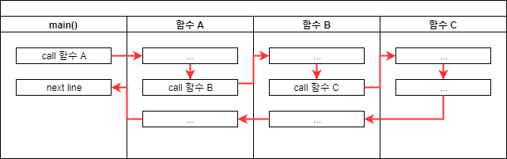
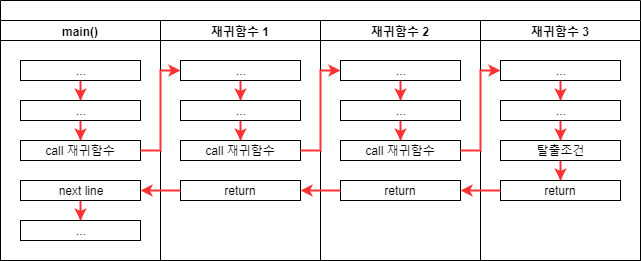
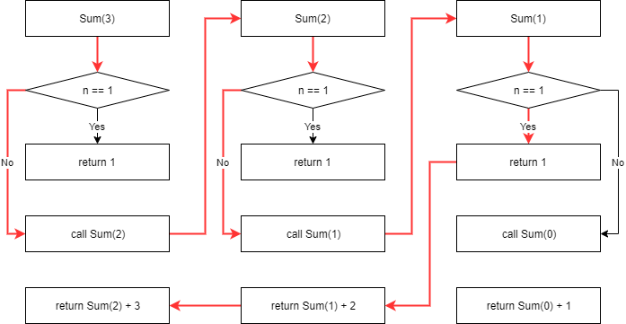
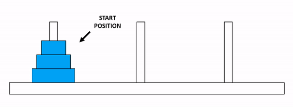
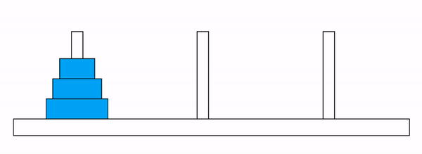

```{r setup, include=FALSE}
library(knitr)
library(kableExtra)

# 출력 폭을 60자로 접는다 (bookdown 판에서 쓰던 linewidth 훅).
# PDF 전용이던 size 훅은 HTML 렌더에서 필요 없으므로 제외했다.
options(linewidth = 60)
hook_output <- knitr::knit_hooks$get("output")
knit_hooks$set(output = function(x, options) {
  if (!is.null(n <- options$linewidth)) {
    x <- knitr:::split_lines(x)
    if (any(nchar(x) > n)) x <- strwrap(x, width = n)
    x <- paste(x, collapse = "\n")
  }
  hook_output(x, options)
})

```


::: {.callout-important}
**학습 목표**

- 일상의 절차를 **알고리즘의 다섯 조건**(명확성·유일성·입력과 출력·유한성·일반성)에 맞추어 기술하고, 조건을 어기는 부분을 찾아낼 수 있다.
- 동일한 결과를 산출하는 두 코드가 요구하는 **수행 시간과 메모리의 차이**를 설명하고, 어느 쪽이 수행 시간이나 메모리를 덜 쓰는지 연산 횟수를 근거로 제시할 수 있다.
- 반복문의 시간 복잡도를 빅오 표기법($\mathcal{O}$)으로 표현하고, 코드로부터 복잡도의 차수를 판별할 수 있다.
- 재귀 함수의 **종료 조건**을 정확히 규정하고, 그 조건이 성립하지 않는 입력을 스스로 구성해 확인할 수 있다.
- 탐색·정렬 알고리즘을 구현하고, 구현의 정확성을 **전수 검사와 경계 사례**로 검증할 수 있다.
- 정렬 알고리즘 네 가지(버블·삽입·병합·퀵)의 비교 횟수를 직접 세어, 같은 알고리즘이라도 **입력의 상태(무작위·정렬됨·역순)에 따라 비교 횟수가 달라짐**을 설명할 수 있다.
- 회귀계수 추정을 **최적화 문제**로 보고 뉴턴-랩슨 알고리즘으로 계수를 구한 뒤 `lm()`·`glm()` 과 대조할 수 있으며, 경사하강법과의 차이를 반복 횟수와 반복 한 번에 드는 계산량·메모리로 설명할 수 있다.
- 사람이 작성한 코드와 AI 가 생성한 코드 모두에서, 예제 입력에서는 정답을 내는 구현의 **잘못된 경계 처리**를 찾아낼 수 있다.

:::


이 장의 목적은 알고리즘을 암기하는 데 있지 않고, **어떤 코드가 왜 더 많은 수행 시간과
메모리를 요구하는지 판단하는 능력**을 기르는 데 있다. AI 가 코드를 생성해 주면 알고리즘을 직접 구현할
일은 줄어들지만, 생성된 코드가 맞는 결과를 내는지, 입력이 커지면 수행 시간과 메모리가 얼마나 늘어나는지는
사람이 판단해야 한다. 이 장에서는 그 판단에 쓰는 도구로 연산 횟수 세기, 빅오 표기법, 전수 검사와 경계 사례를 다룬다.


## 알고리즘과 계산 비용 {#sec-algo-cost}


### 일상의 절차에서 알고리즘으로 {#sec-everyday-algorithm}

알고리즘(algorithm)이라는 말은 낯설게 들리지만, 우리는 매일 알고리즘을 실행한다.
라면을 끓이는 순서, 처음 가는 건물에서 강의실을 찾아가는 방법, 사전에서 단어를 찾는 방법이
모두 **문제를 해결하기 위해 정해 둔 일련의 절차**다. 컴퓨터 과학에서 말하는 알고리즘도 다르지 않다.
다른 점은 그 절차를 **누가 실행해도 같은 결과가 나오도록 약속해 둔다**는 데 있다.
이 소절에서는 두 가지 일상의 예로 그 약속이 무엇인지 살펴본다.


#### 예 1: 전화번호부에서 이름 찾기 {.unnumbered}

스마트폰이 없던 시절에는 집마다 두꺼운 전화번호부가 있었다. 이름이 가나다순으로 인쇄된
1,000쪽짜리 전화번호부에서 '이아무개'의 번호를 찾는다고 하자. 두 가지 방법을 생각할 수 있다.

| | 방법 A: 한 쪽씩 넘기기 | 방법 B: 가운데 펼치기 |
|:--|:--|:--|
| 1단계 | 첫 쪽을 편다. | 남은 부분의 가운데 쪽을 편다. |
| 2단계 | 찾는 이름이 있으면 멈춘다. | 찾는 이름이 있으면 멈춘다. |
| 3단계 | 없으면 다음 쪽으로 넘기고 2단계로 간다. | 펼친 쪽의 이름이 '이'보다 앞이면 뒤쪽 절반만, 뒤면 앞쪽 절반만 남기고 1단계로 간다. |
| 1,000쪽일 때 | 최악의 경우 1,000쪽을 모두 확인한다. | 최대 10번 펼치면 끝난다. |

: {tbl-colwidths="[16,36,48]"}

두 방법은 모두 '이아무개'를 찾아낸다. **결과는 같지만 확인하는 쪽수가 다르다.** 1,000쪽에서 방법 A 는
최대 1,000쪽, 방법 B 는 최대 10쪽을 확인한다. 이 절의 나머지 부분은 이런 차이, 곧 알고리즘이 결과를 내기까지
드는 연산 횟수와 메모리(이 장에서 **비용**이라 부른다)를 재고 비교하는 방법을 다룬다.

방법 B 에는 전제가 하나 있다. 이름이 **가나다순으로 정렬**되어 있어야 한다.
동아리 가입 순서대로 적은 명단이라면 가운데를 펼쳐도 찾는 이름이 앞에 있는지 뒤에 있는지
알 수 없으므로 방법 B 를 쓸 수 없다. 이 전제는 @sec-binary-search 의 이진 탐색에서 그대로 다시 등장한다.


::: {.callout-tip}
**예측해 보자**: 전화번호부가 10,000쪽이라면 방법 B 로는 최대 몇 번 펼쳐야 하는가?
1,000쪽일 때 10번이었다. 실행하기 전에 답을 적어 보자.

:::


한 번 펼칠 때마다 남은 쪽수가 절반으로 줄어드는 과정을 그대로 코드로 옮기면 다음과 같다.


```{r phonebook-halving}
# 방법 B: 남은 쪽의 가운데를 펼쳐 절반을 버리는 일을 한 쪽이 남을 때까지 반복한다
half_count <- function(pages) {
  count <- 0
  while (pages > 1) {
    pages <- ceiling(pages / 2)   # 찾는 이름이 없는 쪽 절반을 버린다
    count <- count + 1
  }
  count
}

sizes <- c(1000, 10000, 1000000)
data.frame(
  쪽수 = format(sizes, big.mark = ",", scientific = FALSE),
  방법A_최악 = format(sizes, big.mark = ",", scientific = FALSE),
  방법B_최대 = sapply(sizes, half_count)
)

```


쪽수가 10배로 늘어도 방법 B 로 펼치는 횟수는 4번밖에 늘지 않는다.
100만 쪽이라도 20번이면 끝난다. 반면 방법 A 가 최악의 경우 확인하는 쪽수는 전체 쪽수와 같아,
쪽수에 정비례해 늘어난다.
이 차이가 @sec-big-o 에서 다루는 $\mathcal{O}(n)$ 과 $\mathcal{O}(\log n)$ 의 차이다.


::: {.callout-note}
실제로 전화번호부를 펼칠 때 우리는 정확히 가운데를 펴지 않는다. 'ㅇ' 은 가나다순에서 뒤쪽에
있으므로 3분의 2 지점쯤을 짐작해 편다. 값의 분포를 이용해 펼칠 위치를 정하는 이 방법에도
이름이 있다. **보간 탐색(interpolation search)**이다. 사람이 짐작으로 고르던 펼칠 위치도
계산하는 식으로 정해 두면, 누가 실행해도 같은 쪽을 펴는 알고리즘이 된다.

:::


#### 예 2: 청소 로봇에게 청소 시키기 {.unnumbered}

사람에게는 "방을 깨끗이 청소해"라는 한마디면 충분하다. 그러나 청소 로봇에게 이 말은 절차가 아니다.
**어디서** 시작하는가? **깨끗이**는 어떤 상태인가? **언제** 멈추는가? 사람은 이런 빈칸을
상식으로 채우지만 로봇은 채우지 못한다. 로봇에게는 빈칸 없이 약속된 절차가 필요하다.

1. 방을 같은 크기의 칸으로 나누고, 왼쪽 위 칸에서 시작한다.
2. 한 줄을 끝까지 이동하며 지나는 칸을 청소한다.
3. 줄 끝에 닿으면 아래로 한 칸 내려가고, 이동 방향을 반대로 바꾼다.
4. 마지막 줄의 끝 칸을 청소하면 멈춘다.

이 절차는 R 로 그대로 옮길 수 있다. 칸마다 몇 번째로 청소되는지를 행렬에 기록해 보자.


::: {.callout-tip}
**예측해 보자**: 4행 6열의 방에서 2행 1열 칸은 몇 번째로 청소되는가? 실행하기 전에 답을 적어 보자.

:::


```{r clean-room}
clean_room <- function(n_row, n_col) {
  visit <- matrix(0L, nrow = n_row, ncol = n_col)   # 칸마다 청소한 순서를 기록
  step <- 0L
  for (i in seq_len(n_row)) {           # 1. 위에서부터 한 줄씩
    cols <- seq_len(n_col)
    if (i %% 2 == 0) cols <- rev(cols)  # 3. 짝수 번째 줄은 반대 방향
    for (j in cols) {                   # 2. 줄 끝까지 한 칸씩 이동
      step <- step + 1L
      visit[i, j] <- step
    }
  }
  visit                                 # 4. 마지막 칸을 지나면 종료
}

clean_room(4, 6)

```


2행 1열은 12번째다. 둘째 줄은 오른쪽 끝(7번째)에서 출발해 왼쪽으로 이동하기 때문이다.

이 절차는 크기가 다른 방, 예컨대 `clean_room(3, 10)` 에도 그대로 적용된다. 그런데 방 한가운데
**가구**가 놓여 있다면 어떻게 될까? 이 함수에는 가구를 표현할 입력이 없다. 로봇은 가구 자리를
청소하려다 부딪히거나 그 자리에서 멈출 것이다. 가구가 놓인 방은 이 절차를 만든 사람이
**떠올리지 못한 입력**이다. 한편 "깨끗해질 때까지 청소하라"는 식으로 종료 조건을 정하면,
먼지 센서가 끝내 0을 가리키지 않는 한 로봇은 멈추지 않는다.


#### 알고리즘의 조건 {.unnumbered}

두 예를 바탕으로 알고리즘을 정의하면 다음과 같다.


::: {.callout-note}
**알고리즘(algorithm)**: 주어진 문제를 해결하기 위해 **약속된 일련의 절차**를 단계적으로
표현한 것. 여기서 '약속'이란 사람이든 로봇이든 컴퓨터든, 누가 실행해도 같은 결과가 나오도록
각 단계를 미리 정해 둔다는 뜻이다.

:::


알고리즘이라 부르려면 다음 다섯 조건을 만족해야 한다. 오른쪽 열은 앞의 청소 로봇 절차에서
각 조건이 무엇에 해당하는지를 보인다.

| 조건 | 뜻 | 청소 로봇에서 |
|:--|:--|:--|
| **명확성** | 각 단계가 모호하지 않게 기술된다. | "깨끗이"가 아니라 "모든 칸을 한 번씩 지난다" |
| **유일성** | 각 단계의 다음 단계가 하나로 결정된다. | 줄 끝에 닿으면 "아래로 한 칸, 방향 반대로" 하나뿐이다 |
| **입력과 출력** | 정의된 입력을 받아 결과를 산출한다. | 방의 가로·세로 칸 수를 받아 칸별 청소 순서를 낸다 |
| **유한성** | 유한한 수의 단계를 거쳐 반드시 종료한다. | 가로 × 세로 번 이동하면 끝난다 |
| **일반성** | 정의된 입력 전체에 대해 동작한다. | 크기가 다른 방에서는 동작하지만, 가구가 놓인 방은 정의된 입력에 없다 |

: {tbl-colwidths="[14,38,48]"}

이 장에서 고치는 구현의 결함은 **유한성**과 **일반성**을 어긴 것이다. `recursive_sum(0)` 은
종료 조건에 닿지 못해 중첩 한계에서 오류로 멈추고(유한성, @sec-base-case-limits), `rbinary_search()` 는 예제에서는 정답을 내지만 일부 원소를
찾지 못한다(일반성, @sec-search-verification). "특정 예제에서 올바르게 동작한다"는 것과 "정의된 입력
전체에서 올바르게 동작한다"는 것은 다른 진술이며, 이 장에서는 그 차이를 반복해서 다룬다. 청소 로봇에게 가구 놓인 방이 그렇듯,
코드에도 그 코드를 만든 사람이 떠올리지 못한 입력이 들어온다.


### 구현에 따른 비용 차이 {#sec-cost-difference}

::: {.callout-important}
**이 장에서 말하는 비용(cost)**: 알고리즘이 요구하는 **수행 시간**과 **메모리**, 두 가지를
합쳐 부르는 말이다. 수행 시간은 시계로 잰 초가 아니라 **연산 횟수**로, 메모리는 **동시에
확보해야 하는 공간의 크기**로 잰다. "비용이 크다"고 할 때는 둘 중 어느 쪽인지 반드시
구분한다. 시간을 줄이기 위해 메모리를 더 쓰는 알고리즘(병합 정렬)이 이 장에 나온다.
:::


아래 두 프로그램은 1부터 `n` 까지의 값을 담은 벡터를 생성한다. **두 결과는 완전히 동일하다.**


::: {.callout-tip}
**예측해 보자**: `n` 이 5만일 때 두 프로그램의 실행 시간은 얼마나 차이 나겠는가?
비슷한 수준인가, 두 배 정도인가, 그보다 큰가? 실행하기 전에 적어 보자.

:::


```{r cost-two-programs}
# 프로그램 1: 벡터를 미리 할당한 뒤 각 위치에 값을 대입한다
prealloc_vec <- function(n) {
  x <- numeric(n)
  for (i in seq_len(n)) {
    x[i] <- i
  }
  x
}

# 프로그램 2: 반복할 때마다 벡터를 이어 붙여 길이를 늘린다
grow_vec <- function(n) {
  x <- NULL
  for (i in seq_len(n)) {
    x <- c(x, i)
  }
  x
}

# 두 결과가 동일한지 먼저 확인
identical(prealloc_vec(1000), as.numeric(grow_vec(1000)))

```


두 함수의 결과가 동일함을 확인했으므로 이제 수행 시간을 잰다.


```{r cost-two-programs-time}
n <- 50000
t1 <- system.time(prealloc_vec(n))[["elapsed"]]
t2 <- system.time(grow_vec(n))[["elapsed"]]

data.frame(
  방식 = c("사전 할당", "이어 붙이기"),
  초 = c(t1, t2)
)

```


예측과 일치하는가? 이 문서를 렌더할 때 사전 할당은 `r t1`초, 이어 붙이기는 `r t2`초가 걸렸다.
두 배가 아니라 수백 배 넘게 차이 난다.
`x <- c(x, i)` 는 반복마다 **길이가 1 만큼 늘어난 새 벡터를 할당하고 기존 원소를 전부 복사**한다.
$i$ 번째 반복에서 기존 원소 $i-1$ 개를 복사하므로 전체 복사량은
$0 + 1 + \cdots + (n-1) = n(n-1)/2$ 에 비례한다. 따라서 `n` 을 10배로 늘리면 이어 붙이기의 복사량은
약 100배가 된다. 반면 사전 할당 방식은 이미 확보된 메모리에 값을 대입하므로 반복마다 대입 한 번으로
연산 횟수가 일정하고, `n` 을 10배로 늘리면 연산 횟수도 10배가 된다.


::: {.callout-caution}
**흔한 오해**: 결과가 같으면 두 코드가 동등하다고 판단하는 것.
두 프로그램의 출력은 완전히 동일하지만 수행 시간의 **증가율**이 다르다($n$ 에 비례 대 $n^2$ 에 비례).
입력이 작을 때는 둘 다 금방 끝나 차이가 눈에 띄지 않다가, $n$ 이 커질수록 $n^2$ 에 비례해 벌어진다.

:::


### 시간 복잡도와 공간 복잡도 {#sec-complexity}


::: {.callout-note}
**시간 복잡도(time complexity)**: 알고리즘이 종료할 때까지 수행하는 연산의 횟수.
사칙연산, 비교연산, 반복, 함수 호출이 계수의 대상이다.

**공간 복잡도(space complexity)**: 알고리즘이 종료할 때까지 필요한 메모리의 크기.
변수의 개수, 자료 구조의 크기, 함수 호출로 누적되는 스택 프레임이 대상이다.

:::

앞 절의 두 프로그램을 이 용어로 기술하면 다음과 같다.

- 프로그램 1: 반복이 $n$ 회이므로 수행 시간은 $n$ 에 비례한다. 벡터를 미리 할당한 뒤
대입만 하므로 추가 메모리는 증가하지 않는다.
- 프로그램 2: 반복마다 복사가 발생하므로 수행 시간은 $n^2$ 에 비례한다. 반복마다 새
벡터를 할당하므로 필요한 메모리도 $n$ 까지 증가한다.

성능은 일반적으로 **최악의 경우(worst case)** 를 기준으로 평가한다. 최선의 경우는
특정 입력에서만 성립하고, 평균의 경우는 입력 분포를 가정해야 계산할 수 있는 반면,
최악의 경우는 임의의 입력에 대해 항상 성립하는 상한을 제공하기 때문이다.


### 빅오 표기법 {#sec-big-o}

입력 크기를 $n$, 연산 횟수를 $f(n)$ 이라 하자. $n$ 이 커질수록 $f(n)$ 에서 저차항이
차지하는 비중은 0 에 가까워지고 **증가율이 가장 큰 항**이 값을 정한다. 예를 들어 $f(n) = 3n^2 + 5n$
에서 $n = 1000$ 이면 $5n = 5{,}000$ 은 $3n^2 = 3{,}000{,}000$ 의 0.2% 도 되지 않는다. 이러한 점근적
증가율을 나타내는 표기가 빅오 표기법이다.


::: {.callout-note}
**정의**: $x \geq k$ 인 모든 $x$ 에 대해 $|f(x)| \leq C|g(x)|$ 를 만족하는
상수 $k$ 와 $C$ 가 존재하면 $f(x) = \mathcal{O}(g(x))$ 라 하고
"$f$ 는 $g$ 의 빅오"라고 읽는다.

즉 $g$ 는 $f$ 의 **점근적 상한**이다. $x \geq k$ 인 모든 입력에서 $|f|$ 는 $C|g|$ 를 넘지 않는다.
$k$ 보다 작은 입력에서는 $f$ 가 $Cg$ 보다 클 수 있다.

:::


```{r fig-big-o-def-fig, fig.align='center', echo=FALSE, fig.show='hold', out.width='90%', fig.cap="빅오의 정의: k 이상인 모든 x 에서 Cg(x) 가 f(x) 보다 크거나 같다 (https://johngrib.github.io/wiki/big-O-notation/ 에서 발췌)"}
options(knitr.graphics.auto_pdf = TRUE)
knitr::include_graphics('figures/big-o-explain.png', dpi = NA)

```


코드를 분석할 때 실제로 사용하는 것은 정의 자체보다 다음 세 규칙이다.


::: {.callout-tip}
**규칙 1 (계수 법칙)**: $C > 0$ 이면 $C f(n) = \mathcal{O}(g(n))$.
$\rightarrow$ 반복 횟수가 $5n$ 이든 $100n$ 이든 모두 $\mathcal{O}(n)$ 이다.

**규칙 2 (합의 법칙)**: 두 부분이 순차적으로 실행되면 증가율이 큰 쪽만 남는다.
$\rightarrow$ $\mathcal{O}(n) + \mathcal{O}(n^2) = \mathcal{O}(n^2)$.
단, 입력 변수가 서로 다르면 하나로 합쳐지지 않는다. $\rightarrow$ $\mathcal{O}(n + m)$.

**규칙 3 (곱의 법칙)**: 반복문이 중첩되면 각 반복 횟수를 곱한다.
$\rightarrow$ $\mathcal{O}(n) \times \mathcal{O}(n) = \mathcal{O}(n^2)$.

:::


이 세 규칙을 코드에 적용해 보자.


::: {.callout-tip}
**예측해 보자**: 아래 네 함수의 시간 복잡도를 각각 적어 보자.
코드를 실행할 필요는 없으며, 반복 횟수만 세면 된다.

:::


```{r big-o-cases, eval=FALSE}
case1 <- function(n) {           # (가)
  s <- 0
  for (i in seq_len(n)) s <- s + i
  s
}

case2 <- function(n) {           # (나)
  s <- 0
  for (i in seq_len(5 * n)) s <- s + i
  s
}

case3 <- function(n, m) {        # (다)
  s <- 0
  for (i in seq_len(n)) s <- s + i
  for (j in seq_len(m)) s <- s + j
  s
}

case4 <- function(n) {           # (라)
  s <- 0
  for (i in seq_len(n)) {
    for (j in seq_len(n)) s <- s + j
  }
  s
}

```


답은 차례로 (가) $\mathcal{O}(n)$, (나) $\mathcal{O}(5n) = \mathcal{O}(n)$,
(다) $\mathcal{O}(n + m)$, (라) $\mathcal{O}(n^2)$ 이다.
(나)에서 계수 5가 소거되는 것이 규칙 1, (다)에서 두 반복이 하나로 합쳐지지 않는 것이
규칙 2의 단서 조항에 해당하며, (라)는 규칙 3의 사례다.

복잡도의 차수가 한 단계 올라갈 때 연산 횟수가 얼마나 벌어지는지 확인해 보자.


```{r big-o-table, echo=FALSE}
n <- c(10, 100, 1000)

# kableExtra 는 raw HTML 을 내보내므로 열 이름의 $..$ 는 pandoc 을 거치지 않아
# 수식이 되지 않는다. MathJax 가 직접 인식하는 \( \) 로 쓴다.
fmt <- function(x) format(x, big.mark = ",", scientific = FALSE)

tab <- data.frame(
  n       = fmt(n),
  o1      = c("1", "1", "1"),
  ologn   = c("3", "7", "10"),
  on      = fmt(n),
  onlogn  = fmt(round(n * log2(n))),
  on2     = fmt(n^2),
  o2n     = c("1,024", "1.3e+30", "1.1e+301")
)
names(tab) <- c("\\(n\\)", "\\(\\mathcal{O}(1)\\)", "\\(\\mathcal{O}(\\log n)\\)",
                "\\(\\mathcal{O}(n)\\)", "\\(\\mathcal{O}(n\\log n)\\)",
                "\\(\\mathcal{O}(n^2)\\)", "\\(\\mathcal{O}(2^n)\\)")

kable(tab, align = rep("r", 7), escape = FALSE, booktabs = TRUE,
      caption = "입력 크기에 따른 연산 횟수 비교") |>
  kable_styling(bootstrap_options = c("condensed", "striped"),
                position = "center", font_size = 12,
                latex_options = c("striped", "HOLD_position"))

```


$n = 1000$ 에서 $\mathcal{O}(n)$ 과 $\mathcal{O}(n^2)$ 의 연산 횟수는 천 배 차이가 난다.
$\mathcal{O}(2^n)$ 은 $n = 100$ 에서 $1.3 \times 10^{30}$, $n = 1000$ 에서는 $1.1 \times 10^{301}$ 이다.
뒤의 값은 관측 가능한 우주의 원자 수로 추정하는 약 $10^{80}$ 보다 크다.

$n = 10^6$ 이고 컴퓨터가 초당 $10^9$ 번 연산한다고 하자. $\mathcal{O}(n \log n)$ 은 약 $2 \times 10^7$ 번으로
0.02초, $\mathcal{O}(n^2)$ 은 $10^{12}$ 번으로 1,000초(약 17분)가 걸린다. 컴퓨터가 100배 빨라져도
$\mathcal{O}(n^2)$ 은 10초로, $\mathcal{O}(n \log n)$ 의 0.02초와 500배 차이가 남는다.
**차수의 차이는 하드웨어 성능 향상으로 메워지지 않으며, 차수가 낮은 알고리즘으로 바꿔야 줄어든다.**


```{r fig-complexity-pattern, fig.width=10, fig.height=6.5, echo=FALSE, fig.cap="입력 크기 n 에 따른 차수별 연산 횟수"}
op <- par(mar = c(4.5, 4.5, 1, 1))
n <- seq(1, 40, by = 0.5)
plot(range(n), c(0, 200), type = "n", xlab = "n (입력 크기)",
     ylab = "연산 횟수", bty = "l", cex.lab = 1.2)
lines(n, rep(1, length(n)), lwd = 2, col = "grey40")
lines(n, log2(n), lwd = 2, col = "#1F6F7A")
lines(n, n, lwd = 2, col = "#2E7D32")
lines(n, n * log2(n), lwd = 2, col = "#B58900")
lines(n, n^2, lwd = 2, col = "#A64B32")
text(40, 1, expression(O(1)), pos = 2, offset = 0.3, col = "grey40", cex = 1.1)
text(40, log2(40), expression(O(log~n)), pos = 3, col = "#1F6F7A", cex = 1.1)
text(40, 40, expression(O(n)), pos = 4, offset = -1.6, col = "#2E7D32", cex = 1.1)
text(33, 33 * log2(33), expression(O(n~log~n)), pos = 2, col = "#B58900", cex = 1.1)
text(14, 190, expression(O(n^2)), pos = 4, col = "#A64B32", cex = 1.1)
par(op)

```


## 재귀 {#sec-recursion}

**재귀 함수(recursive function)** 는 자기 자신을 호출하는 함수다.
분할 정복과 같이 원래 문제를 동일한 구조의 더 작은 문제로 환원할 수 있는 경우,
반복문보다 간결하게 표현된다.

일반적인 함수 호출은 호출 지점으로 복귀하는 구조를 갖는다.


```{r fig-fn-call-fig, echo=FALSE, out.width='85%', fig.align='center', fig.cap="일반적인 함수의 호출과 반환 (http://10bun.tv/beginner/episode-4/ 에서 발췌)"}


```


재귀 호출 역시 호출 지점으로 복귀하지만, 그 지점이 **자기 자신**이라는 점이 다르다.
호출할 때마다 호출 스택(call stack)에 새로운 프레임이 쌓인다. 호출을 멈추는 조건이 없으면
프레임이 계속 쌓이다가, R 이 허용하는 호출 깊이를 넘는 순간 오류로 중단된다.


```{r fig-rec-call-fig, echo=FALSE, out.width='85%', fig.align='center', fig.cap="재귀 함수의 호출과 반환 (http://10bun.tv/beginner/episode-4/ 에서 발췌)"}


```


### 재귀 함수의 구성 {#sec-recursion-structure}

모든 재귀 함수는 두 부분으로 이루어진다.

1. **종료 조건(base case)**: 더 이상 분할하지 않고 결과를 직접 반환하는 경우.
2. **재귀 단계(recursive step)**: 문제의 크기를 줄여 자기 자신을 호출하는 경우.

1부터 `n` 까지의 합을 구하는 함수로 확인해 보자.


```{r recursive-sum}
recursive_sum <- function(n) {
  if (n == 1) return(n)            # 종료 조건
  n + recursive_sum(n - 1)         # 재귀 단계
}

recursive_sum(3)

```


```{r fig-rec-sum-fig, echo=FALSE, out.width='85%', fig.align='center', fig.cap="recursive_sum(3) 의 호출과 반환 (http://10bun.tv/beginner/episode-4/ 에서 발췌)"}


```


- `recursive_sum(3)` 은 `n` 이 1이 아니므로 `recursive_sum(2)` 를 호출한다.
- `recursive_sum(2)` 는 같은 이유로 `recursive_sum(1)` 을 호출한다.
- `recursive_sum(1)` 은 종료 조건을 만족하여 1을 반환한다.
- 복귀하면서 `2 + 1 = 3`, `3 + 3 = 6` 이 계산되어 최종적으로 6이 반환된다.


### 종료 조건의 한계 {#sec-base-case-limits}

위 함수는 `recursive_sum(3)` 에서 정답 6 을 반환했다. 그렇다면 "정의된 입력 전체"에 대해서도 정답을 반환하는가?


::: {.callout-tip}
**예측해 보자**: `recursive_sum(0)` 은 무엇을 반환하겠는가?
0, 1, 오류 중 어느 것인지 실행하기 전에 답을 정해 두자.

:::


```{r recursive-sum-zero}
# 이 호출은 종료 조건에 닿지 못하고 중첩 한계 오류로 멈춘다. 발생하는 오류 메시지를 확인한다.
tryCatch(recursive_sum(0),
         error = function(e) cat("오류:", conditionMessage(e), "\n"))

```


`n` 이 0이면 `n == 1` 은 결코 참이 되지 않는다. 인수가 `0, -1, -2, ...` 로 계속
감소하다가 R 의 중첩 한계에 도달해서야 `evaluation nested too deeply` 오류로 중단된다.
**종료 조건은 "`n` 이 1일 때"가 아니라 "`n` 이 1 이하일 때"로 규정했어야 한다.** 이 결함은 큰 입력이
아니라 정의역(1 이상의 정수)의 경계 바로 바깥인 0 에서 드러났다.

입력 크기에 따른 한계도 확인해 두자.


```{r recursive-sum-deep}
recursive_sum(1000)          # 500500 을 반환한다

tryCatch(recursive_sum(5000),   # 중첩 한계
         error = function(e) cat("오류:", conditionMessage(e), "\n"))

```


재귀 호출은 호출마다 스택 프레임을 누적하므로 **공간 복잡도가 $\mathcal{O}(n)$** 이다.
R 은 중첩 깊이를 `options(expressions)` 로 제한하며 기본값은 5000이다.
동일한 계산을 반복문으로 구현하면 공간 복잡도는 $\mathcal{O}(1)$ 이고 깊이 제한도 없다.

종료 조건을 고친 재귀 구현과, 호출 깊이 문제가 없는 반복문 구현은 다음과 같다.


```{r recursive-sum-fixed}
recursive_sum2 <- function(n) {
  if (n <= 1) return(n)            # 경계 조건을 포함한다
  n + recursive_sum2(n - 1)
}

c(recursive_sum2(0), recursive_sum2(1), recursive_sum2(100))

# 반복문 구현: 공간 복잡도 O(1), 깊이 제한 없음
iterative_sum <- function(n) {
  s <- 0
  for (i in seq_len(n)) s <- s + i
  s
}

c(iterative_sum(0), iterative_sum(100), iterative_sum(100000))

```


::: {.callout-caution}
재귀는 **점화식을 그대로 코드로 옮길 수 있는 대신, 호출 깊이만큼 스택 프레임을 쌓아 메모리를 쓴다.**
호출 깊이가 입력 크기에 비례하는 재귀는 R 의 중첩 한계에 걸린다. 위에서 `recursive_sum(1000)` 은
계산되었지만 `recursive_sum(5000)` 은 오류로 멈췄다. 재귀 구조로 문제를 먼저 이해한 뒤, 호출 깊이가
이 한계에 가까울 만큼 큰 입력을 다뤄야 하면 반복문으로 변환하고 결과를 재귀 구현의 결과와 대조한다.

:::


### 계승 {#sec-recursion-factorial}

계승(factorial)은 아래의 재귀적 정의를 한 줄씩 그대로 코드로 옮길 수 있는 예다.

$$
 n! = \begin{cases}
 n \times (n-1)!, & n \geq 1 \\
 1, & n = 0
 \end{cases}
$$


```{r factorial-manual}
factorial_manual <- function(n) {
  if (n == 0) return(1)
  n * factorial_manual(n - 1)
}

factorial_manual(10)

factorial(10)        # R 내장 함수로 대조

```


직접 구현한 `factorial_manual(10)` 의 결과를 내장 함수 `factorial(10)` 과 대조한 마지막 줄이 곧 검증이다.
두 값은 모두 3628800 이다.
**구현했으면 반드시 정답이 알려진 기준과 대조한다.**

### 하노이 탑 {#sec-recursion-hanoi}

하노이 탑은 재귀 단계에서 자기 자신을 두 번 호출하는 예다.
기둥 세 개(A, B, C)와 크기가 다른 원판 $n$ 개가 있고, 원판은 A 에 크기순으로 쌓여 있다.
모든 원판을 C 로 옮기되 (1) 한 번에 하나씩만 옮기고 (2) 큰 원판을 작은 원판 위에
올릴 수 없다.


```{r fig-hanoi-problem, out.width='100%', fig.show='hold', fig.cap="하노이 탑 문제", echo=FALSE}


```


해법은 원판 $n$ 개를 옮기는 문제를 원판 $n-1$ 개를 옮기는 같은 문제로 바꾸는 데서 출발한다.
$n$ 개를 A 에서 C 로 옮기는 작업은 다음 세 단계로 분해된다.

1. 위쪽 $n-1$ 개를 A 에서 B 로 옮긴다 (크기만 하나 작은 동일한 문제).
2. 가장 큰 원판을 A 에서 C 로 옮긴다.
3. B 에 있던 $n-1$ 개를 B 에서 C 로 옮긴다 (역시 동일한 문제).


```{r fig-hanoi-solution, out.width='100%', fig.show='hold', fig.cap="원판 3개를 옮기는 과정", echo=FALSE}


```


```{r hanoi-code}
move_hanoi <- function(k, from, to, via) {
  if (k == 1) {
    cat(sprintf("원판 1: %s -> %s\n", from, to))
  } else {
    move_hanoi(k - 1, from = from, to = via, via = to)
    cat(sprintf("원판 %d: %s -> %s\n", k, from, to))
    move_hanoi(k - 1, from = via, to = to, via = from)
  }
}

move_hanoi(3, "A", "C", "B")

```


원판이 $n$ 개일 때 필요한 이동 횟수는 $2^n - 1$ 이다. 호출이 매 단계에서 두 개로
분기하기 때문이다. 즉 이 알고리즘의 시간 복잡도는 $\mathcal{O}(2^n)$ 이며, 앞의 표에서
확인했듯 $n = 100$ 이면 $2^n$ 이 $1.3 \times 10^{30}$ 이다. 전설에 등장하는 원판 64개는
$2^{64} - 1$ 회의 이동이 필요하며, 1초에 한 번씩 옮겨도 5천억 년이 넘게 걸린다.


```{r hanoi-count}
count_moves <- function(k) if (k == 1) 1 else 2 * count_moves(k - 1) + 1

data.frame(원판 = 3:6,
           실제_이동 = sapply(3:6, count_moves),
           공식 = 2^(3:6) - 1)

```


## 탐색 알고리즘 {#sec-search}

정렬된 자료에서 특정 값을 찾는 두 가지 방법을 비교한다. 이 절에서는 두 알고리즘의 비교 횟수를
직접 세어, **차수가 $\mathcal{O}(n)$ 과 $\mathcal{O}(\log n)$ 으로 다르면 $n$ 이 커질 때 비교 횟수가
얼마나 벌어지는지** 확인한다.


### 선형 탐색 {#sec-linear-search}

첫 원소부터 순차적으로 비교한다. 가장 단순하며, 자료가 정렬되어 있지 않아도 적용할 수 있다.


```{r linear-search}
linear_search <- function(target, vec) {
  for (i in seq_along(vec)) {
    if (vec[i] == target) return(i)
  }
  NA_integer_
}

set.seed(1)
x <- sort(sample(1:100, 20))
x

linear_search(target = x[13], vec = x)
linear_search(target = 101, vec = x)

```


목표값이 마지막 위치에 있거나 존재하지 않으면 $n$ 회 모두 비교하게 된다.
따라서 최악의 경우 시간 복잡도는 $\mathcal{O}(n)$ 이다.


### 이진 탐색 {#sec-binary-search}

**정렬된** 벡터에서는 선형 탐색보다 비교 횟수를 줄일 수 있다. 중앙에 위치한 값과 목표값을
비교하여, 목표값이 더 작으면 오른쪽 절반을, 더 크면 왼쪽 절반을 탐색 범위에서 제외한다.
비교를 한 번 수행할 때마다 후보의 개수가 절반으로 줄어든다.


```{r fig-binary-search-anim, echo=FALSE, out.width='100%', fig.cap="선형 탐색과 이진 탐색 (https://blog.penjee.com/binary-vs-linear-search-animated-gifs/ 에서 발췌)"}
knitr::include_graphics("https://blog.penjee.com/wp-content/uploads/2015/04/binary-and-linear-search-animations.gif")

```


```{r binary-search}
binary_search <- function(target, ovec) {
  lo <- 1L
  hi <- length(ovec)
  while (lo <= hi) {
    mid <- (lo + hi) %/% 2L
    if (ovec[mid] == target) {
      return(mid)
    } else if (ovec[mid] > target) {
      hi <- mid - 1L          # 오른쪽 절반을 탐색 범위에서 제외
    } else {
      lo <- mid + 1L          # 왼쪽 절반을 탐색 범위에서 제외
    }
  }
  NA_integer_
}

binary_search(target = x[13], ovec = x)
binary_search(target = 101, ovec = x)

```


비교 횟수에 따라 후보의 개수는 $n, n/2, n/2^2, \ldots$ 로 감소한다. $k$ 번째 비교에서
후보가 1개가 되므로 $n/2^k = 1$ 이고, 양변에 밑이 2인 로그를 취하면 $k = \log_2 n$ 을
얻는다. 따라서 이진 탐색의 시간 복잡도는 $\mathcal{O}(\log n)$ 이다.


### 구현의 정확성 검증 {#sec-search-verification}

위 `binary_search()` 는 올바른 구현인가?
예제 두 개를 통과했다는 사실이 보장하는 것은 그 두 예제에 대한 정확성뿐이다.

검증의 출발점은 **전수 검사**다. 벡터의 모든 원소를 차례로 목표값으로 입력하고,
반환된 위치가 실제 위치와 일치하는지 확인한다.


```{r binary-search-exhaustive}
checks <- vapply(seq_along(x), function(i) {
  binary_search(target = x[i], ovec = x) == i
}, logical(1))

all(checks)
sum(!checks)

```


`r length(x)`개 원소 모두 통과했다(`sum(!checks)` 가 0). 이번에는 동일한 알고리즘을 재귀로 작성한 구현을 살펴본다.
아래 구현에는 **결함이 있다.** 어느 부분이 잘못되었는지 찾아보자.


::: {.callout-tip}
**예측해 보자**: 아래 `rbinary_search()` 에 벡터의 모든 원소를 입력하면
몇 개나 정확히 찾아내겠는가? 전부인가, 절반인가, 아니면 하나도 찾지 못하는가?

:::


```{r rbinary-search-buggy}
rbinary_search <- function(target, ovec, minL, maxL) {
  if (maxL <= minL) return(NA_integer_)
  midL <- floor((minL + maxL) / 2)
  if (ovec[midL] > target) {
    rbinary_search(target, ovec, minL = minL, maxL = midL - 1)
  } else if (ovec[midL] < target) {
    rbinary_search(target, ovec, minL = midL + 1, maxL = maxL)
  } else {
    return(midL)
  }
}

# 본문 예제 하나만 실행하면 정상으로 보인다
set.seed(2)
k <- sample(x, 1)
c(목표값 = k, 반환 = rbinary_search(k, x, 1, length(x)), 정답 = which(x == k))

```


예제 하나는 통과한다. 이제 전수 검사를 수행한다.


```{r rbinary-search-exhaustive}
found <- vapply(seq_along(x), function(i) {
  r <- rbinary_search(x[i], x, 1, length(x))
  if (is.na(r)) NA_integer_ else as.integer(r)
}, integer(1))

data.frame(index = seq_along(x), target = x, returned = found)

sum(is.na(found))     # 찾아내지 못한 원소의 개수

```


`r length(x)`개 원소 가운데 `r sum(is.na(found))`개가 `NA` 로 반환되었다. 원인은 첫 줄의
`if (maxL <= minL) return(NA_integer_)` 이다. 탐색 범위가 원소 하나로 좁혀지면
`minL == maxL` 이 되는데, 이 조건은 **남은 원소를 검사하지 않은 채 탐색을 종료한다.**
탐색 범위가 실제로 비는 조건은 `minL > maxL` 이다.


```{r rbinary-search-fixed}
rbinary_search2 <- function(target, ovec, lo = 1L, hi = length(ovec)) {
  if (lo > hi) return(NA_integer_)          # 탐색 범위가 비었을 때만 종료
  mid <- (lo + hi) %/% 2L
  if (ovec[mid] == target) {
    mid
  } else if (ovec[mid] > target) {
    rbinary_search2(target, ovec, lo, mid - 1L)
  } else {
    rbinary_search2(target, ovec, mid + 1L, hi)
  }
}

found2 <- vapply(seq_along(x), function(i) {
  as.integer(rbinary_search2(x[i], x))
}, integer(1))

all(found2 == seq_along(x))
rbinary_search2(101, x)      # 존재하지 않는 값은 NA

```


::: {.callout-important}
**`rbinary_search()` 에서 확인한 것**: 이 함수는 문법 오류가 없고, 실행 시 오류 메시지도
출력하지 않으며, 저자가 선택한 예제에서는 정답을 반환한다. 그럼에도 잘못된 구현이다.

이러한 결함은 오류 메시지로는 드러나지 않고 **검증 절차를 거쳐야** 발견된다.
전수 검사, 경계 사례 검토, 정답이 알려진 기준과의 대조가 그 절차에 해당한다.
같은 절차를 이 장의 @sec-ai-algorithms 에서 AI 가 생성한 코드에 적용하고,
2학기 "AI와 함께 프로그래밍하기" 장에서 다시 사용한다.

:::


### 두 탐색의 비용 비교 {#sec-search-cost}

이제 두 탐색 알고리즘의 비교 횟수를 직접 측정한다. 실행 시간 대신
**연산 횟수를 계수하면** 하드웨어 성능과 무관한 값을 얻을 수 있다.


```{r search-cost-count}
count_linear <- function(target, vec) {
  n <- 0L
  for (i in seq_along(vec)) {
    n <- n + 1L
    if (vec[i] == target) return(n)
  }
  n
}

count_binary <- function(target, ovec) {
  lo <- 1L; hi <- length(ovec); n <- 0L
  while (lo <= hi) {
    n <- n + 1L
    mid <- (lo + hi) %/% 2L
    if (ovec[mid] == target) return(n)
    if (ovec[mid] > target) hi <- mid - 1L else lo <- mid + 1L
  }
  n
}

set.seed(1)
sizes <- c(100, 1000, 10000)
cmp <- t(sapply(sizes, function(n) {
  v <- seq_len(n)
  ks <- sample(v, 100)
  c(선형 = mean(sapply(ks, count_linear, vec = v)),
    이진 = mean(sapply(ks, count_binary, ovec = v)),
    log2n = log2(n))
}))

data.frame(n = sizes, round(cmp, 1))

```


선형 탐색의 평균 비교 횟수는 $n/2$ 에 가깝고, 이진 탐색은 $\log_2 n$ 보다 1회 안팎 적다.
$n$ 이 100에서 10,000으로 100배 증가할 때 선형 탐색의 평균 비교 횟수는
`r round(cmp[3, "선형"] / cmp[1, "선형"])`배가 되지만, 이진 탐색은 `r round(cmp[3, "이진"] / cmp[1, "이진"], 1)`배에
그친다. $n = 10^6$ 이면 선형 탐색은 평균 50만 회, 이진 탐색은 약 20회를 수행한다.


::: {.callout-caution}
정렬 비용까지 더하면 이진 탐색의 비교 횟수가 항상 적지는 않다. 이진 탐색은 **자료가 정렬되어 있어야**
적용할 수 있고, 정렬의 비교 횟수는 $\mathcal{O}(n \log n)$ 이다. 탐색을 한 번만 수행한다면 선형 탐색은
최대 $n$ 회로 끝나므로, 약 $n \log_2 n$ 회를 들여 정렬한 뒤 이진 탐색을 적용하는 것보다 비교가 적다.
탐색을 $k$ 번 반복하면 선형 탐색은 최대 $kn$ 회, 정렬 후 이진 탐색은 약 $n \log_2 n + k \log_2 n$ 회를
비교하므로, $k$ 가 $\log_2 n$ ($n = 1{,}000$ 이면 약 10) 을 넘을 무렵부터 정렬에 든 비교 횟수가 상쇄된다.

:::


## 정렬 알고리즘 {#sec-sorting}

이 장에서는 정렬 알고리즘 네 가지를 **두 쌍**으로 묶어 다룬다.

| 쌍 | 시간 복잡도 | 방식 |
|:--|:--|:--|
| 버블 정렬 · 삽입 정렬 | $\mathcal{O}(n^2)$ | 원소를 하나씩 비교하며 자리를 옮긴다 |
| 병합 정렬 · 퀵 정렬 | 평균 $\mathcal{O}(n \log n)$ | 문제를 나누어 재귀로 푸는 분할 정복 |

: {tbl-colwidths="[30,24,46]"}

쌍과 쌍을 비교하면 **차수의 차이**가 드러난다. 쌍 안의 두 알고리즘을 비교하면 같은 차수라도
**입력의 상태(무작위, 정렬됨, 역순)에 따라** 비교 횟수가 달라진다는 사실이 드러난다. 이 절의 마지막
소절에서 네 알고리즘의 비교 횟수를 직접 세어 두 가지를 모두 확인한다.


::: {.callout-note}
**안정 정렬(stable sort)**: 값이 동일한 원소들의 상대적 순서가 정렬 후에도 유지되는
정렬. 데이터 프레임을 한 열로 정렬한 뒤 다른 열로 다시 정렬할 때, 안정 정렬이어야 두 번째 열의
값이 같은 행들 사이에서 첫 번째 정렬의 순서가 유지된다.

아래 네 알고리즘은 모두 **오름차순** 기준으로 설명하며, 입력은 **`NA` 가 없는 수치형 벡터**라고
전제한다. 참고로 `sort()` 는 기본값(`na.last = NA`)에서 `NA` 를 제거한 뒤 정렬한다.

:::


### 버블 정렬 {#sec-bubble-sort}

정렬 방법 가운데 가장 단순한 것은 **이웃한 두 값만 비교해 순서가 틀리면 바꾸는** 방법이다.
처음부터 끝까지 한 번 훑으며 이 일을 하면 가장 큰 값이 맨 끝에 놓인다. 맨 끝 자리는 정해졌으므로
남은 앞부분에 같은 일을 반복하면 된다.

키 순서로 한 줄을 세우는데, 학생들은 **바로 옆 사람과만** 키를 비교할 수 있다고 하자.
앞사람이 더 크면 둘이 자리를 바꾼다. 줄의 처음부터 끝까지 한 번 훑으면 키가 가장 큰 학생이
맨 뒤로 밀려난다. 버블 정렬(bubble sort)은 이 방법 그대로다.

인접한 두 원소를 비교하여 순서가 어긋나 있으면 교환한다. 한 번 훑을 때마다 자리가 정해지는 값이
하나씩 늘어나므로, 훑는 일을 $n-1$ 회 반복하면 정렬이 끝난다.


```{r fig-bubble-anim, echo=FALSE, out.width='55%', fig.align='center', fig.cap="버블 정렬 (위키미디어 공용)"}
knitr::include_graphics("https://upload.wikimedia.org/wikipedia/commons/0/06/Bubble-sort.gif")

```


```{r bubble-sort}
bubble_sort <- function(x) {
  n <- length(x)
  if (n < 2) return(x)
  for (i in seq_len(n - 1)) {
    for (j in seq_len(n - i)) {
      if (x[j] > x[j + 1]) {
        temp <- x[j]
        x[j] <- x[j + 1]
        x[j + 1] <- temp
      }
    }
  }
  x
}

set.seed(1234)
v <- sample(1:100, 15)
v

bubble_sort(v)

identical(bubble_sort(v), sort(v))     # 내장 함수와 대조한다

```


비교 횟수는 $(n-1) + (n-2) + \cdots + 1 = n(n-1)/2$ 이므로 시간 복잡도는
$\mathcal{O}(n^2)$ 이다. 이미 정렬된 입력에 대해서도 이 구현은 모든 비교를 수행한다.
구현이 단순하고 벡터 내부에서 교환이 이루어져 추가 공간이 $\mathcal{O}(1)$ 이다. 반면 비교 횟수가
$n^2$ 에 비례하므로 $n$ 이 두 배가 되면 비교 횟수는 약 네 배가 된다(@sec-sorting-cost 에서 확인한다).


### 삽입 정렬 {#sec-insertion-sort}

버블 정렬은 앞부분이 이미 정렬되어 있어도 바퀴마다 정해지지 않은 부분의 끝까지 비교한다. 비교를
줄이려면 **이미 정렬된 부분을 이용해야** 한다. 앞부분을 늘 정렬된 상태로 두고 새 값 하나를 그 안의
제자리에 끼워 넣으면, 제자리를 찾는 순간 그 값의 비교를 멈출 수 있다. 입력이 거의 정렬되어 있으면
대부분의 값이 한두 번 비교하고 멈춘다.

카드 게임에서 카드를 한 장씩 받아 손에 쥔다고 하자. 새 카드를 받을 때마다 이미 쥐고 있는
카드 사이에서 **제자리를 찾아 끼워 넣는다.** 손에 쥔 카드는 언제나 정렬된 상태이고,
마지막 카드를 끼워 넣으면 정렬이 끝난다. 삽입 정렬(insertion sort)은 이 방법 그대로다.


```{r fig-insertion-anim, echo=FALSE, out.width='45%', fig.align='center', fig.cap="삽입 정렬 (위키미디어 공용)"}
knitr::include_graphics("https://upload.wikimedia.org/wikipedia/commons/0/0f/Insertion-sort-example-300px.gif")

```


벡터의 앞부분 `x[1:(i-1)]` 이 '손에 쥔 카드'다. `i` 번째 값을 `key` 로 꺼내 두고,
앞부분에서 `key` 보다 큰 값을 한 칸씩 뒤로 밀어 빈자리를 만든 뒤 그 자리에 `key` 를 넣는다.


```{r insertion-sort}
insertion_sort <- function(x) {
  n <- length(x)
  if (n < 2) return(x)
  for (i in 2:n) {
    key <- x[i]                        # 이번에 끼워 넣을 값
    j <- i - 1
    while (j >= 1 && x[j] > key) {     # key 보다 큰 값을 한 칸씩 뒤로 민다
      x[j + 1] <- x[j]
      j <- j - 1
    }
    x[j + 1] <- key                    # 비워 둔 자리에 넣는다
  }
  x
}

insertion_sort(v)

identical(insertion_sort(v), sort(v))

```


`while` 의 조건 `j >= 1 && x[j] > key` 에서 앞쪽 검사가 경계를 지킨다. `key` 가 앞부분의
모든 값보다 작으면 `j` 가 0 까지 내려가는데, 이때 `&&` 는 왼쪽이 `FALSE` 이므로 오른쪽
`x[0] > key` 를 계산하지 않는다. 이를 **단락 평가(short-circuit evaluation)** 라 한다.
앞쪽 검사를 빼면 어떻게 되는지 확인해 보자.


```{r insertion-sort-nocheck, error=TRUE}
# j >= 1 검사를 뺀 구현
insertion_nocheck <- function(x) {
  for (i in 2:length(x)) {
    key <- x[i]
    j <- i - 1
    while (x[j] > key) {
      x[j + 1] <- x[j]
      j <- j - 1
    }
    x[j + 1] <- key
  }
  x
}

insertion_nocheck(c(3, 1, 2))

cards <- c(3, 1, 2)
cards[0]         # 0번 위치는 오류가 아니라 길이 0 인 벡터를 돌려준다
cards[0] > 1     # 비교 결과도 길이 0 이므로 while 이 참·거짓을 판단하지 못한다

```


R 에서 `x[0]` 은 오류가 아니다. 이 때문에 경계를 벗어난 비교가 곧바로 드러나지 않고,
`while` 에 이르러서야 `argument is of length zero` 라는 메시지와 함께 멈춘다. 이 메시지에는 `x[0]` 이나
`j` 가 0 이 되었다는 말이 없으므로, 원인을 찾으려면 `j` 의 값을 따라가 보아야 한다.

비교 횟수는 입력의 상태에 따라 달라진다. 이미 정렬된 입력에서는 `key` 마다 바로 앞의
값과 한 번만 비교하고 멈추므로 모두 $n-1$ 회로 끝난다. 역순으로 정렬된 입력에서는 `key` 가
매번 맨 앞까지 이동해야 하므로 $1 + 2 + \cdots + (n-1) = n(n-1)/2$ 회를 비교한다.
최선의 경우 $\mathcal{O}(n)$, 최악의 경우 $\mathcal{O}(n^2)$ 이다. 버블 정렬처럼 벡터 안에서
자리만 옮기므로 추가 공간은 $\mathcal{O}(1)$ 이다.

같은 $\mathcal{O}(n^2)$ 이지만 이미 정렬된 입력에서 삽입 정렬은 $n-1$ 회, 이 장의 버블 정렬은
$n(n-1)/2$ 회를 비교한다. **거의 정렬된 자료**에서도 삽입 정렬은 `key` 마다 몇 칸만 옮기면 되므로
비교 횟수가 $n$ 에 가깝다. 실제 정렬 함수에도 삽입 정렬을 섞어 쓰는 것이 있다. 파이썬의 기본 정렬
알고리즘인 팀정렬(Timsort)은 원소 수십 개 길이의 짧은 구간을 (이진) 삽입 정렬로 정렬한 뒤 병합한다.
구간이 짧으면 삽입 정렬은 병합 정렬처럼 재귀 호출이나 임시 벡터를 쓰지 않아 추가 작업이 적기 때문이다.
팀정렬이 거의 정렬된 자료를 적은 비교로 처리하는 것은 이와 별개로, 이미 정렬된 구간(run)을 찾아 그대로
병합에 쓰는 단계 덕분이다.


### 병합 정렬 {#sec-merge-sort}

버블 정렬과 삽입 정렬은 값 하나의 자리를 찾을 때마다 다른 값들을 다시 훑으므로, 무작위 입력에서
비교 횟수가 $n^2$ 에 비례한다. 그런데 **이미 정렬된 두 묶음**은 맨 앞 값끼리만 비교하며 한 번 훑으면
하나로 합쳐진다. 아래에서 길이 3 인 두 묶음을 합치는 예는 여섯 자리를 채우는 데 비교가 5번이면 된다.
그렇다면 정렬 문제를 "정렬된 두 묶음 만들기"로 바꿀 수 있다. 두 묶음도 각각 반으로 나누어 같은 방법으로
정렬하고, 나누기를 길이 1 까지 반복한다. 길이 1 인 묶음은 이미 정렬되어 있기 때문이다.

두 반의 시험 답안지를 번호순으로 한 묶음으로 합친다고 하자. 두 묶음이 각각 번호순으로
정리되어 있다면, 두 묶음의 맨 위 장끼리 비교해 번호가 빠른 쪽을 한 장씩 내려놓으면 된다.
한 번 비교할 때마다 한 장이 자리를 찾고, 한쪽 묶음에 남은 장이 없으면 나머지는 비교 없이 내려놓으므로
두 묶음을 합쳐 $n$ 장이면 비교는 $n - 1$ 번을 넘지 않는다.
정리되지 않은 큰 묶음은 절반으로 나누어 각각 정리한 뒤 이렇게 합치면 되고,
절반도 크면 다시 절반으로 나눈다. 병합 정렬(merge sort)은 이 방법 그대로다.

**분할 정복(divide and conquer)** 기법을 사용한다. 벡터를 절반으로 분할하고, 각 부분을
재귀적으로 정렬한 뒤, 정렬된 두 부분을 병합한다.
실제 정렬이 이루어지는 단계는 분할 단계가 아니라 **병합 단계**다.


```{r fig-merge-anim, echo=FALSE, out.width='45%', fig.align='center', fig.cap="병합 정렬 (위키미디어 공용)"}
knitr::include_graphics("https://upload.wikimedia.org/wikipedia/commons/c/cc/Merge-sort-example-300px.gif")

```


#### 정렬된 두 묶음 합치기 {.unnumbered}

병합 함수부터 구현한다. 정렬된 두 벡터의 앞에서부터 작은 값을 차례로 선택하면
결과 역시 정렬된 상태로 채워진다. 이 소절에서는 길이 6 인 벡터 `v6 = c(5, 2, 4, 6, 1, 3)` 을 예로 쓴다.
`v6` 을 병합 정렬로 정렬하면 마지막에 정렬된 두 묶음 `2 4 5` 와 `1 3 6` 을 합친다. 이 합치기를
손으로 풀면 다음 표와 같다.

| 자리 | 왼쪽 맨 앞 | 오른쪽 맨 앞 | 꺼낸 값 | 결과 |
|:-:|:-:|:-:|:--|:--|
| 1 | 2 | 1 | 1, 오른쪽 | 1 |
| 2 | 2 | 3 | 2, 왼쪽 | 1 2 |
| 3 | 4 | 3 | 3, 오른쪽 | 1 2 3 |
| 4 | 4 | 6 | 4, 왼쪽 | 1 2 3 4 |
| 5 | 5 | 6 | 5, 왼쪽 | 1 2 3 4 5 |
| 6 | 남은 값 없음 | 6 | 6, 오른쪽 (비교 없음) | 1 2 3 4 5 6 |

: {tbl-colwidths="[10,18,18,26,28]"}

다섯째 자리까지는 자리마다 두 맨 앞 값을 한 번씩 비교하고, 여섯째 자리는 비교 없이 채운다.
비교는 모두 5번이다. 이 절차를 함수로 옮긴다. 두 묶음의 맨 앞 위치를 `l` 과 `r` 로 둔다.


```{r smerge}
smerge <- function(left, right) {
  temp <- numeric(length(left) + length(right))
  l <- r <- 1L
  for (i in seq_along(temp)) {
    # 오른쪽에 남은 값이 없거나, 왼쪽에 남은 값이 있고 그 값이 더 작거나 같으면 왼쪽에서 꺼낸다
    if (r > length(right) ||
        (l <= length(left) && left[l] <= right[r])) {
      temp[i] <- left[l]
      l <- l + 1L
    } else {
      temp[i] <- right[r]
      r <- r + 1L
    }
  }
  temp
}

smerge(c(2, 4, 5), c(1, 3, 6))     # 손으로 푼 표의 결과와 대조
smerge(c(1, 4, 9), c(2, 3, 10))

```


**남은 값이 없는 쪽을 먼저 검사하는 이유**는 표의 여섯째 자리에 있다. 왼쪽 묶음 `2 4 5` 를 다 꺼냈으므로
왼쪽에는 비교할 값이 없고, 오른쪽에 남은 6 을 그대로 옮기면 된다. 이때 코드의 `l` 은 4 로, 왼쪽의 길이 3 을
넘는다. 조건의 `l <= length(left)` 가 `FALSE` 이므로 `&&` 는 뒤쪽 `left[l] <= right[r]` 을 계산하지 않고,
`else` 로 가서 오른쪽에서 꺼낸다. 오른쪽 묶음에 먼저 남은 값이 없어지는 경우는 조건 맨 앞의 검사, 곧 `r` 이 `right` 의
길이를 넘었는지가 맡는다. 이 검사가 없으면 무엇을 비교하게 되는지, 길이를 넘는 위치의 값부터 확인해 보자.


```{r smerge-out-of-range}
#| error: true
left <- c(2, 4, 5)
left[4]                           # 길이를 넘는 위치는 오류가 아니라 NA 를 돌려준다
left[4] <= 6                      # NA 와 비교한 결과도 NA 다
if (left[4] <= 6) "왼쪽에서 꺼냄"   # if 는 NA 로 참과 거짓을 정하지 못한다

```


@sec-insertion-sort 의 `x[0]` 은 길이 0 인 벡터를 돌려주었고, 길이를 넘는 위치 `left[4]` 는 `NA` 를
돌려준다. 어느 쪽이든 그 자리에서는 오류가 나지 않고, `while` 이나 `if` 에 이르러서야 멈춘다. 그래서
한쪽에 남은 값이 없는지를 **값을 비교하기 전에** 검사한다.

`left[l] <= right[r]` 에서 **`<=`** 를 사용한 것이 안정성을 보장한다.
값이 동일한 경우 왼쪽, 즉 원래 앞에 있던 원소를 먼저 선택하기 때문이다.


#### 재귀로 나누고 합치기 {.unnumbered}

검증한 `smerge()` 가 있으면 병합 정렬 전체는 재귀 함수 하나로 쓸 수 있다. @sec-recursion-structure 의
`recursive_sum(n)` 은 "1 부터 $n - 1$ 까지의 합을 구할 수 있다고 하면, 거기에 $n$ 을 더하면 된다"는
생각이었다. 병합 정렬은 "**절반 길이의 벡터는 정렬할 수 있다고 하면, 정렬된 두 절반을 합치기만 하면
된다**"는 생각이다. 절반을 정렬하는 일은 같은 함수에 맡긴다.


```{r merge-sort}
merge_sort <- function(x) {
  n <- length(x)
  if (n <= 1) return(x)                 # 종료 조건: 길이가 1 이하이면 이미 정렬된 상태다
  mid <- n %/% 2L
  left  <- merge_sort(x[1:mid])         # 앞 절반을 같은 함수로 정렬
  right <- merge_sort(x[(mid + 1):n])   # 뒤 절반을 같은 함수로 정렬
  smerge(left, right)                   # 정렬된 두 절반을 합친다
}

v6 <- c(5, 2, 4, 6, 1, 3)
merge_sort(v6)

merge_sort(v)

identical(merge_sort(v), as.numeric(sort(v)))

```


2절의 재귀와 다른 점도 있다. `recursive_sum()` 과 `factorial_manual()` 은 입력의 크기를 1 씩 줄이며
자기 자신을 한 번 부른다. `merge_sort()` 는 크기를 반으로 줄이며 두 번 부른다. 자기 자신을 두 번 부르는
것은 @sec-recursion-hanoi 의 하노이 탑과 같다. 그래서 호출이 한 줄로 쌓이지 않고 나무 모양으로 퍼지며,
호출이 쌓이는 깊이는 $n$ 이 아니라 약 $\log_2 n$ 이다.


::: {.callout-tip}
**예측해 보자**: `merge_sort(v6)` 을 실행하면 `merge_sort()` 는 처음 호출을 포함해 모두 몇 번
호출되겠는가? `smerge()` 는 몇 번 호출되겠는가? 호출을 위에서 아래로 그려 본 뒤 세어 보자.

:::


```{r fig-merge-call-tree}
#| echo: false
#| fig-width: 9.5
#| fig-height: 5.6
#| fig-cap: '`merge_sort(v6)` 의 호출 나무. 함수를 실제로 실행하며 기록한 호출과 반환을 그렸다. 위쪽 세 줄은 호출이 내려가는 길로, 위치로 반씩 자르기만 한다. 옅은 상자는 길이가 1 이라 종료 조건에서 그대로 돌아오는 호출이다(점선). 아래쪽 세 줄은 돌아오는 길에서 `smerge()` 가 두 묶음을 합친 결과이며, 값의 순서는 이 길에서 정해진다.'
# merge_sort(v6) 를 실행하며 호출(내려가는 길)과 반환(돌아오는 길)을 기록한다
merge_tree <- local({
  calls <- list(); rets <- list()
  walk <- function(x, from, d) {
    leaf <- length(x) <= 1
    to <- from + length(x) - 1L
    calls[[length(calls) + 1]] <<- data.frame(d = d, from = from, to = to,
                                              lab = paste(x, collapse = " "), leaf = leaf)
    if (leaf) {
      out <- x
    } else {
      mid <- length(x) %/% 2L
      out <- smerge(walk(x[1:mid], from, d + 1L),
                    walk(x[(mid + 1):length(x)], from + mid, d + 1L))
    }
    rets[[length(rets) + 1]] <<- data.frame(d = d, from = from, to = to,
                                            lab = paste(out, collapse = " "), leaf = leaf)
    out
  }
  walk(v6, 1L, 0L)
  list(calls = do.call(rbind, calls), rets = do.call(rbind, rets))
})

local({
  ink <- "#241F1A"; teal <- "#1F6F7A"; brick <- "#A64B32"; grey <- "#6E665C"
  xs <- c(1, 2, 3, 4.6, 5.6, 6.6)                                     # 원소 여섯 자리의 가로 위치
  cl <- merge_tree$calls; rt <- merge_tree$rets
  D <- max(cl$d)
  cl$x <- (xs[cl$from] + xs[cl$to]) / 2; cl$y <- 2 * D + 1 - cl$d   # 내려가는 길: 위에서 아래로
  rt$x <- (xs[rt$from] + xs[rt$to]) / 2; rt$y <- rt$d + 1           # 돌아오는 길: 아래에서 위로
  h <- 0.24
  op <- par(mar = c(0.2, 0.2, 0.2, 0.2))
  on.exit(par(op))
  plot.new()
  plot.window(xlim = c(-0.6, 9.6), ylim = c(0.55, 2 * D + 1.45))
  # 선: 호출은 부모에서 자식으로, 반환은 자식에서 부모로
  kids <- function(tab, i) {
    which(tab$d == tab$d[i] + 1 & tab$from >= tab$from[i] & tab$to <= tab$to[i])
  }
  for (i in which(!cl$leaf)) {
    k <- kids(cl, i)
    segments(cl$x[i], cl$y[i] - h, cl$x[k], cl$y[k] + h, col = teal, lwd = 1.6)
  }
  for (i in which(!rt$leaf)) {
    k <- kids(rt, i)
    segments(rt$x[k], rt$y[k] - h, rt$x[i], rt$y[i] + h, col = brick, lwd = 1.6)
  }
  # 가장 깊은 줄까지 내려가지 않고 끝난 길이 1 인 호출은 그대로 돌아온다
  sh <- rt[rt$leaf & rt$d < D, ]
  segments(sh$x, 2 * D + 1 - sh$d - h, sh$x, sh$y + h, col = grey, lty = 2, lwd = 1.3)
  box_at <- function(x, y, lab, border, fill) {
    w <- strwidth(lab, cex = 1.15) / 2 + 0.16
    rect(x - w, y - h, x + w, y + h, border = border, col = fill, lwd = 1.8)
    text(x, y, lab, cex = 1.15, col = ink)
  }
  for (i in seq_len(nrow(cl))) {
    box_at(cl$x[i], cl$y[i], cl$lab[i], teal, if (cl$leaf[i]) "#E4EEEF" else "white")
  }
  for (i in which(!(rt$leaf & rt$d == D))) {
    box_at(rt$x[i], rt$y[i], rt$lab[i], if (rt$leaf[i]) teal else brick,
           if (rt$leaf[i]) "#E4EEEF" else "white")
  }
  text(-0.25, 2 * D + 1 - 0:D, paste("깊이", 0:D), col = grey, cex = 0.95)
  text(-0.25, (D - 1):0 + 1, paste("깊이", (D - 1):0), col = grey, cex = 0.95)
  text(7.35, 2 * D, "내려가는 길\nmerge_sort() 호출\n위치로 반씩 자름\n(값 비교 없음)",
       col = teal, adj = 0, cex = 1)
  text(7.35, D + 1, "옅은 상자: 길이 1,\n종료 조건", col = grey, adj = 0, cex = 1)
  text(7.35, 2, "돌아오는 길\nsmerge() 로 합침\n(값 비교, 순서가 정해짐)",
       col = brick, adj = 0, cex = 1)
})

```


@fig-merge-call-tree 에서 `merge_sort()` 는 `r nrow(merge_tree$calls)` 번 호출된다. 그 가운데 길이가 1 인
`r sum(merge_tree$calls$leaf)` 번은 종료 조건에서 바로 돌아오고, 나머지 `r sum(!merge_tree$calls$leaf)` 번이
`smerge()` 를 한 번씩 부른다. 가장 깊은 호출은 깊이 `r max(merge_tree$calls$d)` 이며, 이는 $\log_2 6 \approx 2.58$ 을
올림한 값이다.

정렬이 일어나는 곳은 그림의 아래쪽 절반이다. 호출이 내려가는 동안(위쪽 절반)은 `x[1:mid]` 와
`x[(mid + 1):n]` 으로 **위치를 기준으로 자르기만** 하고 값을 비교하지 않는다. 길이 1 에 닿아 돌아오는
길에 `smerge()` 가 불리며 그때 값의 순서가 정해진다. 예를 들어 `5 2 4` 를 맡은 호출은 `5` 와 `2 4` 로 자른 뒤,
두 호출이 돌려준 `5` 와 `2 4` 를 합쳐 `2 4 5` 를 돌려준다.

이 함수가 모든 길이에서 맞는 이유는 두 사실로 설명된다. 첫째, 길이 1 인 벡터는 이미 정렬되어 있으므로
종료 조건은 맞는 답을 돌려준다. 둘째, `smerge()` 는 정렬된 두 묶음을 받으면 정렬된 결과를 돌려준다.
길이 2 인 벡터는 길이 1 인 두 벡터로 나뉘고, 첫째 사실에 따라 둘 다 정렬되어 있으므로 둘째 사실에 따라
합친 결과도 정렬되어 있다. 길이 3 인 벡터는 길이 1 과 길이 2 로 나뉘는데, 길이 2 에서 맞는다는 것을 방금
확인했으므로 길이 3 에서도 맞는다. 같은 방법으로 길이 4 (2 와 2), 길이 5 (2 와 3) 로 이어진다. 길이 2 와
3 의 모든 순서를 넣어 확인해 보자.


```{r merge-sort-small}
merge_sort(c(2, 1))                                    # 길이 2: 길이 1 두 개를 합친다

perms3 <- rbind(c(1, 2, 3), c(1, 3, 2), c(2, 1, 3),
                c(2, 3, 1), c(3, 1, 2), c(3, 2, 1))     # 길이 3 의 여섯 가지 순서
t(apply(perms3, 1, merge_sort))                        # 길이 3: 길이 1 과 길이 2 를 합친다

```


@sec-recursion-structure 에서는 재귀 함수를 종료 조건과 재귀 단계 두 부분으로 나누었다. 재귀 단계를 다시
**한 단계 작게**(작은 문제로 자기 자신을 부르는 부분)와 **결과 합치기**(돌아온 결과로 원래 문제의 답을
만드는 부분)로 나누면, 이 장의 재귀 함수 네 개를 같은 틀로 비교할 수 있다.

| 함수 | 종료 조건 | 한 단계 작게 | 결과 합치기 | 한 호출이 자기 자신을 부르는 횟수 | 전체 호출 수 |
|:--|:--|:--|:--|:-:|:--|
| `recursive_sum(n)` | `n == 1` 이면 `n` | `recursive_sum(n - 1)` | `n` 을 더함 | 1 | $n$ |
| `factorial_manual(n)` | `n == 0` 이면 1 | `factorial_manual(n - 1)` | `n` 을 곱함 | 1 | $n + 1$ |
| `move_hanoi(k, ...)` | `k == 1` 이면 원판 1 을 옮김 | 원판 $k - 1$ 개를 옮기는 `move_hanoi(k - 1, ...)` | 위쪽 $k - 1$ 개 이동, 가장 큰 원판 이동, 다시 $k - 1$ 개 이동을 차례로 실행 | 2 | $2^k - 1$ |
| `merge_sort(x)` | 길이가 1 이하이면 `x` | 앞 절반과 뒤 절반에 `merge_sort()` | 두 결과를 `smerge()` 로 합침 | 2 | $2n - 1$ |

: {tbl-colwidths="[17,15,20,26,10,12]"}

자기 자신을 한 번 부르는 합과 계승은 호출이 한 줄로 쌓이므로 전체 호출 수가 곧 깊이다. 두 번 부르는
하노이 탑과 병합 정렬은 호출이 나무로 퍼진다. 하노이 탑은 원판이 하나 늘 때마다 전체 호출 수가 두 배에
1 을 더한 값이 되어, 깊이 $k$ 에서 $2^k - 1$ 번을 부른다. 병합 정렬은 길이가 반씩 줄어 깊이가 약 $\log_2 n$ 이고, 길이 1 인
호출 $n$ 번과 `smerge()` 를 부르는 호출 $n - 1$ 번을 합쳐 $2n - 1$ 번을 부른다(`v6` 에서
$2 \times 6 - 1 = 11$ 번).

분할을 절반씩 반복하므로 재귀 깊이는 $\log_2 n$ 이고, 각 깊이에서 원소 전체를 한 번씩
순회하므로 $n$ 회의 연산이 필요하다. 따라서 시간 복잡도는 $\mathcal{O}(n \log n)$ 이다.
다만 병합 결과를 담을 임시 벡터가 필요하므로 공간 복잡도는 $\mathcal{O}(n)$ 이다.
**버블·삽입 정렬(추가 메모리 $\mathcal{O}(1)$, 비교 $\mathcal{O}(n^2)$)과 비교하면, 메모리를 $\mathcal{O}(n)$
더 쓰고 비교 횟수를 $\mathcal{O}(n \log n)$ 으로 줄인 구조다.**


### 퀵 정렬 {#sec-quick-sort}

병합 정렬은 나눌 때 위치로 자르기만 하고, 값의 비교는 합칠 때 한다. 합칠 때마다 결과를 담을 벡터
`temp` 도 따로 만든다. 순서를 바꾸어 **나눌 때 값으로 나누면**, 곧 어떤 값보다 작은 것과 큰 것으로
나누면, 작은 무리의 값은 모두 큰 무리의 값보다 앞에 온다. 그러면 두 무리를 각각 정렬한 뒤 이어 붙이기만
하면 되고, 합치는 단계에서는 비교할 일이 없다. 벡터 안에서 자리만 바꾸도록 구현하면 결과를 담을 벡터도
따로 필요 없다(이 장의 짧은 구현은 나눌 때 새 벡터를 만들므로, 메모리는 아래에서 따로 따진다). 대신 두 무리의 크기는 나누는 기준이 된 값에 달려 있어서,
병합 정렬처럼 늘 반으로 나뉘지는 않는다. 이 점이 아래에서 볼 최악의 입력으로 이어진다.

체육 시간에 학생들을 키 순서로 세운다고 하자. 선생님이 먼저 한 학생을 **기준**으로 세우고,
그보다 작은 학생은 왼쪽, 큰 학생은 오른쪽으로 보낸다. 기준 학생은 이것으로 제자리에 선 셈이다.
이제 왼쪽 무리와 오른쪽 무리 안에서 각각 같은 일을 반복하고, 무리가 한 명 이하가 되면 멈춘다.
퀵 정렬(quick sort)은 이 방법 그대로다.

병합 정렬과 같은 분할 정복이지만 정렬이 일어나는 단계가 반대다. 병합 정렬은 **합치는 단계**에서,
퀵 정렬은 **나누는 단계**에서 정렬이 일어난다. 기준이 되는 값을 **기준값(pivot)** 이라
한다. 여기서는 벡터의 첫 원소를 기준값으로 삼는다.


```{r quick-sort}
quick_sort <- function(x) {
  if (length(x) <= 1) return(x)      # 종료 조건: 원소가 하나 이하이면 이미 정렬된 상태다
  pivot <- x[1]                      # 첫 원소를 기준값으로 삼는다
  c(quick_sort(x[x < pivot]),        # 기준값보다 작은 무리를 정렬해 왼쪽에
    x[x == pivot],                   # 기준값(과 같은 값)을 가운데에
    quick_sort(x[x > pivot]))        # 기준값보다 큰 무리를 정렬해 오른쪽에
}

quick_sort(v)

identical(quick_sort(v), sort(v))

```


나누는 과정을 출력해 보자. 아래 `quick_trace()` 는 `quick_sort()` 와 같은 일을 하면서
호출마다 `[작은 무리] 기준값 [큰 무리]` 를 한 줄씩 출력한다. 들여쓰기가 재귀의 깊이다.


```{r quick-trace}
quick_trace <- function(x, depth = 0) {
  if (length(x) <= 1) return(x)
  pivot <- x[1]
  small <- x[x < pivot]
  big <- x[x > pivot]
  cat(strrep("  ", depth), "[", paste(small, collapse = " "), "] ", pivot,
      " [", paste(big, collapse = " "), "]\n", sep = "")
  c(quick_trace(small, depth + 1), x[x == pivot], quick_trace(big, depth + 1))
}

res <- quick_trace(c(5, 3, 8, 1, 9, 2, 7))

```


한 번 나눌 때마다 무리가 대략 절반씩 작아져 세 단계 만에 끝났다. 무작위 순서의 입력이라면
재귀 깊이는 대략 $\log_2 n$ 에 비례하고, 각 깊이에서 모든 원소가 기준값과 한 번씩 비교되므로
평균 시간 복잡도는 병합 정렬과 같은 $\mathcal{O}(n \log n)$ 이다.


::: {.callout-tip}
**예측해 보자**: 이미 정렬된 벡터 `1:6` 을 `quick_trace()` 에 넣으면 출력은 몇 줄이고,
들여쓰기는 어떤 모양이 되겠는가? 실행하기 전에 그려 보자.

:::


```{r quick-trace-sorted}
res <- quick_trace(1:6)

```


첫 원소를 기준값으로 삼으면 정렬된 입력에서는 기준값이 늘 **가장 작은 값**이 된다. 작은 무리는
늘 비고, 큰 무리는 원소가 하나씩만 줄어든다. 재귀 깊이는 $n - 1$ 이 되고, 비교 횟수는
$(n-1) + (n-2) + \cdots + 1 = n(n-1)/2$ 로 버블 정렬과 같아진다. **평균은 $\mathcal{O}(n \log n)$
이지만 최악은 $\mathcal{O}(n^2)$ 이며, 그 최악이 이미 정렬된 입력이다.**

재귀 깊이가 $n$ 에 비례하면 @sec-base-case-limits 의 `recursive_sum(5000)` 처럼 R 이 허용하는 호출 깊이를 넘는다.


```{r quick-sort-depth}
set.seed(1)
identical(quick_sort(sample(5000)), 1:5000)   # 무작위 순서 5,000개: 정상

tryCatch(quick_sort(1:5000),                  # 정렬된 5,000개: 재귀 깊이 약 5,000
         error = function(e) cat("오류:", conditionMessage(e), "\n"))

```


같은 5,000개의 값인데 **순서만 다른** 두 입력 가운데 무작위 순서는 정렬을 마치고(`TRUE`),
정렬된 순서는 오류로 멈춘다. 오류 메시지는 `node stack overflow` 로, @sec-base-case-limits 의
`evaluation nested too deeply` 와 다르다. R 은 재귀 호출이 쌓이는 공간에 한계를 여러 개 두고 있어
어느 한계에 먼저 닿느냐에 따라 메시지가 달라지지만, 원인은 같다. 정렬된 5,000개를 정렬하려면 재귀 깊이가
4,999 까지 쌓여야 하므로, 그 깊이에 이르기 전에 한계에 닿는다.
정렬해 둔 자료에 값 몇 개를 덧붙여 다시 정렬하는 것처럼 이미 정렬되었거나 거의 정렬된 자료를 정렬하는
경우에, 첫 원소를 기준값으로 삼는 이 구현은 비교 횟수가 최악($n(n-1)/2$)에 가까워지고 $n$ 이 크면 오류로 멈춘다.

메모리도 따져 보자. 이 구현은 나눌 때마다 `x[x < pivot]` 과 `x[x > pivot]` 으로 **새 벡터를
만들고**, 호출이 끝날 때까지 각 깊이의 벡터가 동시에 메모리에 남는다. 무작위 입력에서는 깊이마다
벡터가 대략 절반씩 작아지므로 추가 공간이 $\mathcal{O}(n)$ 이지만, 정렬된 입력에서는
$n + (n-1) + \cdots$ 가 쌓여 $\mathcal{O}(n^2)$ 까지 늘어난다. 함수 본문이 다섯 줄로 짧은 대신
추가 메모리를 정렬된 입력에서 $\mathcal{O}(n^2)$ 까지 쓰는 구현이다. 교과서의 퀵 정렬은 대개 벡터 안에서
자리만 바꾸는 **제자리(in-place)** 방식으로 구현해 추가 공간을 재귀 호출에 필요한 만큼으로 줄인다.
대신 코드가 길어지고, 자리를 바꿀 구간의 양 끝 위치를 다루는 경계 처리를 따로 해야 한다.


::: {.callout-note}
**기준값을 고르는 규칙이 최악의 입력을 정한다.** 가운데 원소를 기준값으로 삼으면 정렬된
입력은 최선의 경우가 되지만, 그 규칙에 불리한 다른 입력이 여전히 존재한다. 기준값을 무작위로
고르면 특정 입력이 늘 최악이 되는 일은 없어지는 대신, 같은 입력이라도 실행할 때마다 비교
횟수가 달라진다.

:::


### 네 정렬의 비용 비교 {#sec-sorting-cost}


::: {.callout-tip}
**예측해 보자**: 원소 수를 두 배로 늘리면 네 정렬의 비교 횟수는 각각 몇 배가 되겠는가?
또 **이미 정렬된** 입력에서는 네 정렬 가운데 어느 것이 가장 적게, 어느 것이 가장 많이
비교하겠는가? 표를 보기 전에 적어 보자.

:::


실행 시간 대신 **비교 횟수를 측정한다.** 실행 시간은 하드웨어 성능과 측정 시점의 부하에
따라 변동한다. 또 `system.time()` 은 0.001초 단위로 재므로, 측정값이 이 단위의 몇 배에 그치는
짧은 정렬은 $n$ 을 두 배로 늘렸을 때의 배율을 실행 시간으로 읽기 어렵다. 차수의 차이는 비교 횟수 표에서 본다.
반면 비교 횟수는 입력이 동일하면 항상 같은 값을 갖는다.

아래 네 함수는 각 정렬 함수에서 두 값을 비교하는 곳마다 1을 더하도록 고친 것이다. 퀵 정렬은
한 번 나눌 때 기준값과 나머지 원소를 한 번씩 비교한다고 보고 (원소 수 $-\,1$) 회로 센다.


```{r sorting-count}
#| code-fold: true
#| code-summary: "비교 횟수를 세는 함수 네 개 (펼쳐 보기)"
bubble_count <- function(x) {
  n <- length(x)
  cnt <- 0
  for (i in seq_len(n - 1)) {
    for (j in seq_len(n - i)) {
      cnt <- cnt + 1
      if (x[j] > x[j + 1]) {
        temp <- x[j]; x[j] <- x[j + 1]; x[j + 1] <- temp
      }
    }
  }
  cnt
}

insertion_count <- function(x) {
  n <- length(x)
  cnt <- 0
  if (n < 2) return(cnt)
  for (i in 2:n) {
    key <- x[i]
    j <- i - 1
    while (j >= 1) {
      cnt <- cnt + 1                   # x[j] 와 key 를 비교한다
      if (x[j] <= key) break
      x[j + 1] <- x[j]
      j <- j - 1
    }
    x[j + 1] <- key
  }
  cnt
}

# 병합 단계의 비교 횟수는 두 부분을 정렬한 결과에 달려 있으므로
# 정렬 결과와 비교 횟수를 함께 돌려주는 내부 함수를 둔다
merge_count <- function(x) {
  sort_count <- function(x) {
    n <- length(x)
    if (n <= 1) return(list(x = x, cnt = 0))
    mid <- n %/% 2L
    a <- sort_count(x[1:mid])
    b <- sort_count(x[(mid + 1):n])
    left <- a$x
    right <- b$x
    out <- numeric(n)
    l <- r <- 1L
    cnt <- a$cnt + b$cnt
    for (i in seq_len(n)) {
      both <- l <= length(left) && r <= length(right)
      if (both) cnt <- cnt + 1         # 양쪽이 모두 남아 있을 때만 비교한다
      if ((both && left[l] <= right[r]) || r > length(right)) {
        out[i] <- left[l]; l <- l + 1L
      } else {
        out[i] <- right[r]; r <- r + 1L
      }
    }
    list(x = out, cnt = cnt)
  }
  sort_count(x)$cnt
}

quick_count <- function(x) {
  if (length(x) <= 1) return(0)
  pivot <- x[1]
  (length(x) - 1) + quick_count(x[x < pivot]) + quick_count(x[x > pivot])
}

```


먼저 무작위 순서의 입력에서 원소 수를 두 배씩 늘려 가며 센다.


```{r sorting-count-random}
set.seed(1234)
sizes <- c(500, 1000, 2000)
cnt <- t(sapply(sizes, function(n) {
  v <- sample(n)                     # 1 부터 n 까지를 무작위 순서로
  c(버블 = bubble_count(v), 삽입 = insertion_count(v),
    병합 = merge_count(v), 퀵 = quick_count(v))
}))

data.frame(n = sizes, cnt)

# n 이 두 배가 될 때 비교 횟수가 늘어난 배율
ratio <- round(cnt[-1, ] / cnt[-nrow(cnt), ], 2)
rownames(ratio) <- c("1000/500", "2000/1000")
ratio

```


$n$ 이 두 배가 될 때 버블 정렬의 비교 횟수는 **4배**, 삽입 정렬은 **3.9배 남짓**
증가하고, 병합 정렬과 퀵 정렬은 **두 배를 조금 넘는** 수준(2.2\~2.4배)으로 증가한다.
$n$ 이 두 배가 되면 $n^2$ 은 4배, $n\log_2 n$ 은 2배보다 조금 더(1,000 에서 2,000 이면
`r round(2000 * log2(2000) / (1000 * log2(1000)), 2)`배) 커지므로, 표의 배율은 두 차수의 차이와 맞는다.
분석으로 얻은 복잡도가 실제 연산 횟수와 일치하는지 대조해 보자.


```{r sorting-count-theory}
data.frame(n = sizes,
           버블 = cnt[, "버블"], `n(n-1)/2` = sizes * (sizes - 1) / 2,
           삽입 = cnt[, "삽입"], `n^2/4` = sizes^2 / 4,
           병합 = cnt[, "병합"], 퀵 = cnt[, "퀵"],
           `n log2(n)` = round(sizes * log2(sizes)),
           check.names = FALSE)

```


버블 정렬의 비교 횟수는 $n(n-1)/2$ 와 **정확히** 일치한다. 삽입 정렬은 무작위 입력에서 그 절반인
$n^2/4$ 근처를 비교한다. 원소 하나를 끼워 넣을 때 평균적으로 앞부분의 절반쯤을 지나가기
때문이다. 병합 정렬은 $n\log_2 n$ 의
`r sprintf("%.2f", min(cnt[, "병합"] / (sizes * log2(sizes))))`배에서
`r sprintf("%.2f", max(cnt[, "병합"] / (sizes * log2(sizes))))`배, 퀵 정렬은
`r sprintf("%.2f", min(cnt[, "퀵"] / (sizes * log2(sizes))))`배에서
`r sprintf("%.2f", max(cnt[, "퀵"] / (sizes * log2(sizes))))`배로, 앞에 붙는 계수만 다르다.
빅오 표기법은 이 계수를 무시하고 두 정렬을 같은 $\mathcal{O}(n\log n)$ 으로 묶는다(@sec-big-o 의 규칙 1).
**이론적으로 분석한 복잡도가 실제 연산 횟수와 일치하는지 확인하는 것 역시 검증이다.**

다음은 입력의 상태를 바꾸어 센다. 원소 수는 1,000개로 고정하고 무작위 순서, 정렬된 순서,
역순 세 가지를 넣는다.


```{r sorting-count-input}
set.seed(1234)
n <- 1000
inputs <- list(무작위 = sample(n), 정렬됨 = 1:n, 역순 = n:1)

t(sapply(inputs, function(v) {
  c(버블 = bubble_count(v), 삽입 = insertion_count(v),
    병합 = merge_count(v), 퀵 = quick_count(v))
}))

```


정렬된 입력에서 삽입 정렬은 999회로 네 정렬 가운데 가장 적게 비교하고, 퀵 정렬은 499,500회로
버블 정렬과 같아진다. 역순 입력에서는 삽입 정렬도 499,500회로 최악이 된다. 병합 정렬만 입력의 상태와
관계없이 $n \log_2 n$ (약 9,966) 이하를 유지한다. **같은 알고리즘이라도 입력에 따라 비교 횟수가 달라지므로
(삽입 정렬은 999회에서 499,500회까지), 수행 시간을 말할 때는 어떤 입력에서의 값인지(최선·평균·최악)를
함께 밝혀야 한다.**

실행 시간도 함께 측정한다. 측정값은 컴퓨터와 측정 시점의 부하에 따라 달라지므로, 아래 표는 이 문서를
렌더할 때 얻은 값이다.


```{r sorting-benchmark}
set.seed(1234)
timing <- t(sapply(sizes, function(n) {
  v <- sample(n)
  c(버블 = system.time(bubble_sort(v))[["elapsed"]],
    삽입 = system.time(insertion_sort(v))[["elapsed"]],
    병합 = system.time(merge_sort(v))[["elapsed"]],
    퀵 = system.time(quick_sort(v))[["elapsed"]])
}))

data.frame(n = sizes, timing)

```


$n = 2{,}000$ 에서 버블 정렬은 `r timing[3, "버블"]`초, 병합 정렬은 `r timing[3, "병합"]`초,
퀵 정렬은 `r timing[3, "퀵"]`초가 걸렸다. 퀵 정렬은 병합 정렬보다 비교를 더 많이 한다
(같은 $n$ 의 무작위 입력에서 `r format(cnt[3, "퀵"], big.mark = ",")`회 대 `r format(cnt[3, "병합"], big.mark = ",")`회).
비교 횟수만 보면 퀵 정렬이 더 오래 걸릴 것 같지만, 이번 측정에서 퀵 정렬의 시간은 병합 정렬의
`r round(timing[3, "퀵"] / timing[3, "병합"], 2)`배였다. 두 함수는 비교를 처리하는 방식이 다르다.
`x[x < pivot]` 은 원소 수만큼의 비교를 C 로 작성된 R 내부 코드가 한 번에 처리하고, `smerge()` 는 비교
한 번마다 R 의 `for` 반복을 한 바퀴씩 돈다. 차수가 같을 때는 이런 구현의 차이, 곧 빅오가 무시한 계수가
실제 시간을 좌우할 수 있다.

정확성도 함께 확인한다. 결과가 틀린 함수는 수행 시간이 짧게 측정되어도 비교할 근거가 되지 못한다.


```{r sorting-correctness}
set.seed(99)
same <- function(a, b) length(a) == length(b) && all(a == b)

checks <- replicate(200, {
  n <- sample(0:50, 1)                     # 길이 0 인 벡터도 포함한다
  v <- sample(1:20, n, replace = TRUE)     # 중복값을 포함시킨다
  s <- sort(v)
  same(bubble_sort(v), s) && same(insertion_sort(v), s) &&
    same(merge_sort(v), s) && same(quick_sort(v), s)
})

all(checks)

```


네 정렬의 성질을 정리하면 다음과 같다. 최선·최악의 경우는 이 장의 구현 기준이다.

| 정렬 | 방식 | 최선 | 평균 | 최악 | 추가 메모리 |
|:--|:--|:--|:--|:--|:--|
| 버블 | 인접한 두 원소를 교환 | $\mathcal{O}(n^2)$ | $\mathcal{O}(n^2)$ | $\mathcal{O}(n^2)$ | $\mathcal{O}(1)$ |
| 삽입 | 앞부분의 제자리에 끼워 넣기 | $\mathcal{O}(n)$ 정렬된 입력 | $\mathcal{O}(n^2)$ | $\mathcal{O}(n^2)$ 역순 입력 | $\mathcal{O}(1)$ |
| 병합 | 절반으로 나누어 정렬한 뒤 병합 | $\mathcal{O}(n \log n)$ | $\mathcal{O}(n \log n)$ | $\mathcal{O}(n \log n)$ | $\mathcal{O}(n)$ |
| 퀵 | 기준값으로 나눈 뒤 이어 붙이기 | $\mathcal{O}(n \log n)$ | $\mathcal{O}(n \log n)$ | $\mathcal{O}(n^2)$ 정렬된 입력 | $\mathcal{O}(n)$, 최악 $\mathcal{O}(n^2)$ |

: {tbl-colwidths="[8,28,15,13,20,16]"}


::: {.callout-note}
**R 의 `sort()` 는 무엇을 쓰는가**: 기본값 `method = "auto"` 는 길이가 $2^{31}$ 보다 짧은
수치·정수·논리 벡터와 요인에는 **기수 정렬(radix sort)** 을, 그 밖의 경우(문자 벡터 등)에는
셸 정렬(Shellsort)을 쓴다(`?sort`). 기수 정렬은 원소끼리 비교하는 대신 값을 자릿수(바이트)
단위로 나누어 배치하는 방식이며, 도움말에 따르면 $\mathcal{O}(n)$ 으로 동작한다.
`sort(x, method = "quick")` 로 퀵 정렬을 지정할 수도 있다.

실무에서는 정렬을 직접 구현하지 않고 `sort()`, `order()` 를 쓴다. 이 절에서 네 정렬을 직접
구현한 목적은 비교 횟수와 메모리가 코드의 어느 부분에서 늘어나는지 이해하고, 주어진 구현을 검증하는 능력을 기르는 데 있다.

:::


## 뉴턴-랩슨 알고리즘 {#sec-newton-raphson}

앞의 절들이 자료를 처리하는 알고리즘을 다루었다면, 이 절에서는 **수치 계산** 알고리즘을
다룬다. $f(x) = 0$ 을 만족하는 $x$ 를 반복 계산으로 구하는 방법이다.

통계학에서는 이 알고리즘으로 모형의 계수를 추정한다. **추정이 곧 최적화(optimization) 문제**이기 때문이다.
회귀계수의 최소제곱추정은 잔차제곱합을 **최소**로 만드는 값을, 최대가능도추정은 가능도를
**최대**로 만드는 값을 찾는다. 함수가 최소나 최대가 되는 지점에서는 도함수가 0 이므로, 결국
"도함수 $= 0$" 이라는 방정식을 푸는 문제가 된다. 이 절의 앞부분(@sec-nr-principle 부터
@sec-nr-verification 까지)에서 방정식의 해를 구하는 원리를 익히고, 뒷부분(@sec-nr-optimization
부터 @sec-nr-logistic 까지)에서 회귀모형과 로지스틱 회귀모형의 계수를 이 방법으로 구한다.
마지막으로 같은 문제를 푸는 또 다른 방법인 경사하강법을 간단히 소개한다(@sec-gradient-descent).

적용 조건은 두 가지다. 탐색 구간에 해가 존재해야 하고, $f$ 가 미분 가능해야 한다.


::: {#fig-nr-video}
<video src="video/newton-raphson-ex.mp4" controls loop muted
       style="width:100%; max-width:720px;"></video>

뉴턴-랩슨 알고리즘의 진행
:::


### 원리와 점화식 {#sec-nr-principle}

이 절에서 처음 풀 방정식은 $5x^3 - 7x^2 - 40x + 100 = 0$ 이다. 2차 방정식은 근의 공식으로 풀지만,
3차 방정식의 근의 공식은 복잡해 손으로 쓰기 어렵다. @sec-nr-logistic 에서 만날 로지스틱 회귀모형의
방정식은 해를 식으로 쓰는 공식 자체가 없다. 공식 없이 해를 구하는 방법이 필요하다.

곡선이 $x$ 축과 만나는 점은 바로 구하지 못하지만, **직선**이 $x$ 축과 만나는 점은 나눗셈 한 번으로
구한다. 그래서 현재 위치에서 곡선을 그 점의 접선(직선)으로 바꾸어 놓고, 접선이 $x$ 축과 만나는 점을
다음 위치로 삼는다. 해에 가까워질수록 접선이 곡선과 비슷해지므로, 접선의 해와 곡선의 해의 차이, 곧
오차가 줄어든다. 이 일을 반복하는 것이 뉴턴-랩슨 알고리즘이다. @sec-binary-search 의 이진 탐색은 범위를
반씩 줄여 답에 다가갔다. 뉴턴-랩슨은 범위를 줄이는 대신 기울기를 써서 다음 위치를 계산한다.

알고리즘의 진행은 다음 네 단계로 이루어진다.

1. 초기값 $x_0$ 을 설정한다.
2. $x_n$ 에서 접선을 구한다. 접선의 기울기는 $f'(x_n)$ 이다.
3. 접선이 $x$ 축과 만나는 점을 다음 근사값 $x_{n+1}$ 로 정한다.
4. 종료 조건을 만족할 때까지 2\~3을 반복한다.

$(x_n, f(x_n))$ 을 지나는 접선의 식은 $y = f'(x_n)(x - x_n) + f(x_n)$ 이고,
$y = 0$ 인 $x$ 를 풀면 다음 점화식을 얻는다.

$$
 x_{n+1} = x_n - \frac{f(x_n)}{f'(x_n)}
$$

한 번의 반복에서 $x$ 가 움직이는 양 $f(x_n)/f'(x_n)$ 을 **갱신량**이라 한다. 갱신량은 함숫값이 0에서
멀수록 커지고, 기울기의 절댓값이 클수록 작아진다. 종료 조건은 일반적으로 다음 세 가지를 함께 사용한다.

- 최대 반복 횟수를 초과한 경우
- 갱신량의 크기가 정해 둔 값보다 작아진 경우
- $|f(x)|$ 가 허용 오차(`tol`) 이내로 0에 근접한 경우


### 구현 {#sec-nr-implementation}

앞의 종료 조건 가운데 최대 반복 횟수(`max_iters`)와 $|f(x)|$ 의 허용 오차(`tol`) 두 가지를 인수로
받는다. 갱신량의 크기는 이 구현의 종료 조건에 들어 있지 않다. 도함수는 `deriv()` 로 함수 본문에서
직접 유도하며, 해가 존재하는 구간을 `range` 로 주면 근사값이 그 구간 밖으로 나가지 않도록 끝점에서 자른다.


```{r newton-raphson}
newton_raphson <- function(FUN, x0 = 1, max_iters = 5000,
                           tol = 1e-9, range = c(-Inf, Inf)) {
  grads <- deriv(as.expression(body(FUN)), "x", function.arg = TRUE)
  iters <- 1L
  gap <- Inf

  while (iters < max_iters && abs(gap) > tol) {
    slope <- attr(grads(x0), "gradient")
    if (slope == 0) stop("미분계수가 0이므로 다음 근사값을 계산할 수 없다.")
    x_new <- x0 - FUN(x0) / slope
    if (x_new <= range[1]) x_new <- range[1]
    if (x_new >= range[2]) x_new <- range[2]
    gap <- FUN(x_new)
    iters <- iters + 1L
    x0 <- x_new
  }

  list(solution = x_new, iteration = iters, value = FUN(x_new))
}

f <- function(x) 5 * x^3 - 7 * x^2 - 40 * x + 100

sol <- newton_raphson(f, x0 = 1, range = c(-10, 10))
sol

```


### 해의 검증과 초기값 의존성 {#sec-nr-verification}

결과를 검증한다. 3차 다항식이므로 `polyroot()` 로 모든 근을 구해 대조할 수 있다.


```{r newton-raphson-check}
roots <- polyroot(c(100, -40, -7, 5))     # 상수항부터 오름차순 계수
roots

# 허수부가 0인 것만 실근이다
Re(roots)[abs(Im(roots)) < 1e-8]

```


이 함수의 **실근은 하나뿐**이며, 뉴턴-랩슨 알고리즘이 구한 값과 일치한다.
나머지 두 근은 켤레 복소수이므로 실수 축에서는 나타나지 않는다.
@fig-nr-video 의 곡선이 $x$ 축과 한 번만 교차하는 이유가 여기에 있다.

초기값을 달리하면 수렴하는 해는 같으나 수렴에 필요한 반복 횟수가 달라진다.


```{r newton-raphson-x0}
inits <- c(-5, -1, 0, 1, 5)
t(sapply(inits, function(x0) {
  r <- newton_raphson(f, x0 = x0, range = c(-10, 10))
  c(x0 = x0, 해 = r$solution, 반복 = r$iteration)
}))

```


::: {.callout-caution}
뉴턴-랩슨 알고리즘은 **반복 횟수와 도달하는 해가 초기값에 따라 달라진다.** 위 표에서 같은 해
$-3.151719$ 에 도착하기까지 초기값 $-5$ 는 6회, $5$ 는 50회 반복했다. 기울기가 0에 가까운
지점에서 출발하면 $f(x)/f'(x)$ 가 커져 다음 근사값이 해에서 멀리 이동하고, $f'(x) = 0$ 이면 점화식을 계산할 수 없다.
해가 여러 개인 함수에서는 어느 해로 수렴하는지를 초기값이 결정한다.
따라서 결과를 얻은 뒤에는 **그 값이 실제로 해인지($f(x) \approx 0$)**, 그리고
**의도한 해가 맞는지**를 반드시 확인해야 한다.

:::


### 최적화: 극값은 도함수의 근이다 {#sec-nr-optimization}

미분 가능한 함수 $f$ 가 어떤 점에서 극값을 가지면 그 점의 접선은 수평이다. 즉 도함수가 0 이다.
따라서 극값을 찾는 문제는 **도함수 $f'$ 의 근을 찾는 문제**가 되고, 앞의 점화식에서 $f$ 자리에
$f'$ 을, $f'$ 자리에 $f''$ 을 넣으면 된다.

$$
 x_{n+1} = x_n - \frac{f'(x_n)}{f''(x_n)}
$$

이 점화식의 갱신량은 $f'(x_n) \div f''(x_n)$ 이다. 이 소절은 기울기를 왜 2계 도함수로 나누는지를 먼저 보고,
극값을 구한 뒤, 모수가 둘일 때 이 나눗셈이 무엇으로 바뀌는지를 본다.


#### 왜 $f' \div f''$ 인가: 기울기를 0 으로 만드는 갱신량 {.unnumbered}

앞에서 쓴 $f(x) = 5x^3 - 7x^2 - 40x + 100$ 으로 보자. 도함수는 $f'(x) = 15x^2 - 14x - 40$, 2계 도함수는
$f''(x) = 30x - 14$ 다. 손으로 구한 두 식은 R 의 기호 미분 함수 `D()` 로 대조한다.


```{r nr-opt-deriv}
fp  <- function(x) 15 * x^2 - 14 * x - 40     # 손으로 구한 f'(x)
fpp <- function(x) 30 * x - 14                # 손으로 구한 f''(x)

D(body(f), "x")                               # R 이 기호 미분한 f'(x)
D(D(body(f), "x"), "x")                       # 한 번 더 미분한 f''(x)

```


출력된 두 식을 정리하면 손으로 구한 식과 같다.

같은 갱신량에 이르는 설명이 두 가지 있다. 첫째는 기울기에서 출발한다. 달리던 자동차의 속도가 시속 30 km 이고
1초에 시속 10 km 씩 줄고 있다면, 줄어드는 비율이 그대로일 때 $30 \div 10 = 3$ 초 뒤에 멈춘다. 속도를 기울기로,
속도가 줄어드는 비율을 $f''$ 으로, 멈출 때까지 걸리는 시간을 갱신량으로 바꾸면 뉴턴-랩슨의 계산이 된다.
최소점에서는 기울기가 0 이다. 지금 위치 $x$ 의 기울기는 $f'(x)$ 이고, $f''(x)$ 는 $x$ 를 1 옮길 때 기울기가
바뀌는 비율이다. 이 비율이 그대로라고 보면, 기울기 $f'(x)$ 를 0 으로 만들려면 $x$ 를 $f'(x) \div f''(x)$ 만큼
옮기면 된다. 이것이 갱신량이고, 새 위치는 지금 위치에서 갱신량을 뺀 값이다.


::: {.callout-tip}
**예측해 보자**: $x = 3.5$ 에서 갱신량만큼 옮긴 새 위치의 기울기는 0 이겠는가?

:::


```{r nr-opt-why}
x_now <- 3.5
fp(x_now)                       # 지금 위치의 기울기
fpp(x_now)                      # x 를 1 옮길 때 기울기가 바뀌는 비율
upd <- fp(x_now) / fpp(x_now)   # 갱신량
x_next <- x_now - upd           # 갱신량을 뺀 새 위치
c(갱신량 = upd, `새 위치` = x_next)

fp(x_next)                      # 새 위치의 기울기
fpp(x_next)                     # 새 위치에서 기울기가 바뀌는 비율

```


기울기 `r fp(x_now)` 를 비율 `r fpp(x_now)` 로 나눈 갱신량은 약 `r round(upd, 3)` 이고, 새 위치는 약
`r round(x_next, 3)` 이다. 새 위치의 기울기는 약 `r round(fp(x_next), 1)` 으로 줄었지만 0 은 아니다. 비율 $f''$ 도
$x$ 에 따라 바뀌어, 출발점의 `r fpp(x_now)` 이 새 위치에서는 약 `r round(fpp(x_next), 1)` 로 줄었기 때문이다. 비율이
그대로라는 가정이 맞지 않은 만큼 기울기가 남고, 남은 기울기를 다음 반복이 다시 줄인다. 뉴턴-랩슨을 반복하는
이유다.


#### 왜 $f' \div f''$ 인가: 직선 대신 포물선 {.unnumbered}

둘째 설명은 @sec-nr-principle 의 접선에서 출발한다. 근을 찾을 때는 곡선을 접선(직선)으로 바꾸어, 직선이
$x$ 축과 만나는 점을 구했다. 극값을 찾을 때는 직선을 쓸 수 없다. 직선에는 최소점이 없기 때문이다. 최소점이
있는 가장 단순한 곡선은 포물선(2차 함수)이다. 그래서 지금 위치 $x$ 에서 함숫값, 기울기, 휜 정도($f''$)가
$f$ 와 같은 포물선을 그리고, 그 포물선의 꼭짓점으로 간다. 변수를 $t$ 로 쓰면 이 포물선은 다음과 같다.

$$
 q(t) = f(x) + f'(x)(t - x) + \frac{1}{2} f''(x)(t - x)^2
$$

$t = x$ 를 넣으면 $q(x) = f(x)$ 다. $t$ 로 미분하면 $q'(t) = f'(x) + f''(x)(t - x)$ 이므로 $q'(x) = f'(x)$ 이고,
한 번 더 미분하면 $q''(t) = f''(x)$ 다. 세 값이 모두 $f$ 와 같다. 꼭짓점에서는 $q'(t) = 0$ 이므로
$t = x - f'(x) \div f''(x)$ 이고, 첫째 설명과 같은 식이 나온다. $q'(t)$ 의 식은 첫째 설명에서 "비율이
그대로라고 보면" 이라고 한 가정을 식으로 쓴 것이다.


```{r fig-nr-parabola}
#| echo: false
#| fig-width: 8
#| fig-height: 4.6
#| fig-cap: '$x = 3.5$ 에서 $f$ 에 맞닿는 포물선(긴 점선)과 접선(짧은 점선). 접선에는 최소점이 없고, 포물선의 꼭짓점이 뉴턴-랩슨의 새 위치다.'
local({
  ink <- "#241F1A"; brick <- "#A64B32"; grey <- "#6E665C"
  x0 <- 3.5
  q  <- function(t) f(x0) + fp(x0) * (t - x0) + fpp(x0) / 2 * (t - x0)^2   # 맞닿는 포물선
  x1 <- x0 - fp(x0) / fpp(x0)                                              # 포물선의 꼭짓점
  x_min <- (14 + sqrt(14^2 + 4 * 15 * 40)) / 30                           # f 의 극소점
  xs <- seq(1.3, 3.8, length.out = 300)
  op <- par(mar = c(4.2, 4.2, 0.6, 0.6))
  on.exit(par(op))
  plot(xs, f(xs), type = "l", lwd = 2.5, col = ink, xlim = c(1.3, 4.05), ylim = c(0, 105),
       xlab = "x", ylab = "f(x)", bty = "l")
  xt <- seq(2.95, 3.8, length.out = 50)                                    # 접선은 출발점 가까이만
  lines(xt, f(x0) + fp(x0) * (xt - x0), col = grey, lty = 3, lwd = 1.6)
  text(3.56, 103, "접선(직선): 최소점이 없음", col = grey, pos = 2)
  xq <- seq(1.85, 3.75, length.out = 200)
  lines(xq, q(xq), lty = 2, lwd = 2, col = brick)
  text(1.85, 60, "맞닿는 포물선", col = brick, pos = 4)
  segments(x1, q(x1), x1, f(x1), lty = 3, col = brick)
  points(x1, q(x1), pch = 1, col = brick, cex = 1.5, lwd = 2)
  points(c(x0, x1), f(c(x0, x1)), pch = 19, col = c(ink, brick), cex = 1.4)
  points(x_min, f(x_min), pch = 4, col = ink, cex = 1.3, lwd = 2)
  text(x0 + 0.06, f(x0) - 9, sprintf("출발점\nx = %.1f", x0), adj = 0)
  text(x1 + 0.06, 21, sprintf("포물선의 꼭짓점 = 새 위치\nx = %.3f", x1), adj = 0, col = brick)
  text(x_min, f(x_min), sprintf("f 의 극소점\nx = %.3f", x_min), pos = 1, offset = 1)
  arrows(x0, 5, x1, 5, length = 0.1, lwd = 2, col = brick)
  text((x0 + x1) / 2, 5, sprintf("갱신량 f '(x) ÷ f ''(x) = %.2f", x0 - x1), pos = 3, col = brick)
})

```


@fig-nr-parabola 에서 포물선은 출발점 근처에서 $f$ 와 거의 겹치고, 출발점에서 멀어질수록 $f$ 와 벌어진다.
그래서 포물선의 꼭짓점(새 위치)은 $f$ 의 극소점에 한 번에 닿지 못한다.

두 도함수가 맡는 일은 다르다. $f'$ 의 부호는 어느 쪽으로 갈지를 정한다. 새 위치는 지금 위치에서 갱신량을
뺀 값이므로, $f'' > 0$ 인 곳에서 기울기가 양수이면 $x$ 가 줄고 음수이면 $x$ 가 는다. $f''$ 은 얼마나 갈지를
정한다. 많이 휜 곳($f''$ 이 큰 곳)에서는 기울기가 빨리 0 에 이르므로 최소점이 가까워 조금 가고, 완만한
곳에서는 멀리 간다. 기울기만으로는 방향은 정해도 거리는 정하지 못한다. @sec-gradient-descent 의 경사하강법이
거리를 정하는 수(학습률)를 사람에게 맡기는 이유다.


#### 극값 구하기 {.unnumbered}

이제 `newton_raphson()` 에 `f` 대신 `fp` 를 넣는다. 함수를 새로 만들 필요는 없다. `newton_raphson()` 이
안에서 `fp` 를 한 번 더 미분해 $f''$ 을 얻는다.


::: {.callout-tip}
**예측해 보자**: 초기값 $-5, -1, 0, 1, 5$ 에서 출발하면 모두 같은 점에 도착하겠는가?
도착한 점은 모두 $f$ 를 가장 작게 만드는 점이겠는가?

:::


```{r nr-opt-run}
inits <- c(-5, -1, 0, 1, 5)
opt <- t(sapply(inits, function(x0) {
  r <- newton_raphson(fp, x0 = x0)
  c(x0 = x0, 해 = r$solution, 반복 = r$iteration)
}))

# 2계 도함수 f''(해) 의 부호로 극소와 극대를 가린다
d2 <- fpp(opt[, "해"])
data.frame(opt, `f''(해)` = d2, 판정 = ifelse(d2 > 0, "극소", "극대"),
           check.names = FALSE)

```


초기값에 따라 두 점으로 갈라진다. $x \approx 2.165$ 에서는 $f'' > 0$ 이므로 **극소**,
$x \approx -1.232$ 에서는 $f'' < 0$ 이므로 **극대**다. 알고리즘은 $f'(x) = 0$ 인 점을 찾을 뿐,
그 점이 극소인지 극대인지는 가리지 않는다. 극대점을 찾을 때도 같은 점화식을 쓴다. $f'' < 0$ 인 곳에서는
맞닿는 포물선이 아래로 열려 꼭짓점이 꼭대기가 되므로, 같은 갱신량으로 극대점에 다가간다. 로그가능도를
최대로 만드는 @sec-nr-logistic 이 이 경우다. R 의 1차원 최적화 함수 `optimize()` 와도 대조해 둔다.


```{r nr-opt-check}
optimize(f, interval = c(0, 5))                    # 구간 [0, 5] 에서 최솟값
optimize(f, interval = c(-5, 0), maximum = TRUE)   # 구간 [-5, 0] 에서 최댓값

```


::: {.callout-caution}
$f'(x) = 0$ 은 극값의 **후보**일 뿐이다. 결과를 얻은 뒤에는 (1) 2계 도함수의 부호로 극소인지
극대인지 확인하고, (2) 그 극소가 관심 있는 범위 전체에서의 최소인지 확인해야 한다. 이 $f$ 는
$x$ 가 작아질수록 한없이 작아지므로 $x \approx 2.165$ 는 극소이지만 전체의 최소는 아니다.
로그가능도에 봉우리가 여러 개 있으면 초기값에 따라 서로 다른 봉우리에 도착한다.

:::


#### 모수가 둘일 때: 왜 행렬이 필요한가 {.unnumbered}

다음 두 소절의 회귀모형은 절편과 기울기, 모수가 둘이다. 지금까지 쓴 $f'$ 와 $f''$ 은 수 하나였다.
모수가 둘이면 그 자리에 무엇이 오는가? $S(a, b) = a^2 + ab + 2b^2 - 4a - 9b$ 의 최소점을 $(3, 4)$ 에서
출발해 찾으며 보자.

**기울기가 둘이다.** 모수가 둘이면 $b$ 를 고정하고 $a$ 만 움직일 때의 기울기($a$ 방향 기울기)와, $a$ 를
고정하고 $b$ 만 움직일 때의 기울기($b$ 방향 기울기)가 따로 있다. $a$ 방향 기울기는 $b$ 를 상수로 보고 $a$ 로
미분한 $2a + b - 4$, $b$ 방향 기울기는 $a$ 를 상수로 보고 $b$ 로 미분한 $a + 4b - 9$ 다. 최소점에서는 어느
방향으로도 평평하므로 두 기울기를 모두 0 으로 만들어야 한다. $(3, 4)$ 에서 두 기울기는
$2 \times 3 + 4 - 4 = 6$ 과 $3 + 4 \times 4 - 9 = 10$ 이다.

**한 모수를 옮기면 두 기울기가 함께 바뀐다.** $a$ 를 1 늘리면 $a$ 방향 기울기 $2a + b - 4$ 는 2, $b$ 방향
기울기 $a + 4b - 9$ 는 1 는다. $b$ 를 1 늘리면 두 기울기는 각각 1 과 4 는다. 이 네 수를 표로 모은다.

| | $a$ 를 1 늘림 | $b$ 를 1 늘림 |
|---|:-:|:-:|
| $a$ 방향 기울기의 변화 | 2 | 1 |
| $b$ 방향 기울기의 변화 | 1 | 4 |

행은 어느 기울기가 바뀌는지, 열은 어느 모수를 옮기는지를 나타낸다. 이 표가 **헤시안 행렬(Hessian matrix)**
이다. 모수가 하나일 때 $f''$ 이 기울기가 바뀌는 비율이었듯이, 헤시안 행렬은 기울기들이 바뀌는 비율을 모은
표이고 $f''$ 이 하던 일을 한다.

**그래서 연립방정식을 푼다.** 모수가 하나일 때는 기울기를 비율로 나누어 갱신량을 구했다. 모수가 둘이면
$a$ 에서 $d_a$, $b$ 에서 $d_b$ 를 빼서 두 기울기를 동시에 0 으로 만들어야 한다. 표에 따르면 그때 $a$ 방향
기울기는 $2d_a + d_b$ 만큼, $b$ 방향 기울기는 $d_a + 4d_b$ 만큼 줄어든다. 두 기울기 6 과 10 이 모두 0 이
되려면 다음 두 식을 함께 풀어야 한다.

$$
 2 d_a + d_b = 6, \qquad d_a + 4 d_b = 10
$$

해는 $(d_a, d_b) = (2, 2)$ 이고, 새 위치는 $(3, 4) - (2, 2) = (1, 2)$ 다. 두 기울기를 모은 벡터를 $\nabla S$,
표를 $\mathbf{H}$ 로 쓰면 이 연립방정식은 $\mathbf{H}\mathbf{d} = \nabla S$ 이고, R 에서는 `solve(H, g)` 가
이 연립방정식을 푼다.


::: {.callout-tip}
**예측해 보자**: 연립방정식을 풀지 않고 모수마다 따로 $f' \div f''$ 을 하면 어떻게 되는가? $a$ 에서
$6 \div 2 = 3$, $b$ 에서 $10 \div 4 = 2.5$ 를 빼서 $(0, 1.5)$ 로 가면 두 기울기가 모두 0 이 되겠는가?

:::


```{r nr-two-why}
# S(a, b) = a^2 + ab + 2b^2 - 4a - 9b 의 두 기울기와 기울기의 변화율 표. th = c(a, b)
grad_ab <- function(th) c(2 * th[1] + th[2] - 4,     # a 방향 기울기: b 를 상수로 보고 a 로 미분
                          th[1] + 4 * th[2] - 9)     # b 방향 기울기: a 를 상수로 보고 b 로 미분
hess_ab <- function(th) matrix(c(2, 1,
                                 1, 4), nrow = 2, byrow = TRUE)   # 행: 어느 기울기, 열: 어느 모수

th0 <- c(3, 4)
g0 <- grad_ab(th0)
g0                                          # 출발점의 두 기울기

d_sep   <- g0 / diag(hess_ab(th0))          # 모수마다 따로 나눈다: 6 ÷ 2, 10 ÷ 4
d_joint <- solve(hess_ab(th0), g0)          # 2 d_a + d_b = 6, d_a + 4 d_b = 10 을 함께 푼다

cmp <- rbind(c(d_sep,   th0 - d_sep,   grad_ab(th0 - d_sep)),
             c(d_joint, th0 - d_joint, grad_ab(th0 - d_joint)))
dimnames(cmp) <- list(c("모수마다 따로", "연립방정식"),
                      c("d_a", "d_b", "새 a", "새 b", "a 방향 기울기", "b 방향 기울기"))
cmp

```


모수마다 따로 나누면 새 위치 $(`r paste(th0 - d_sep, collapse = ", ")`)$ 의 두 기울기가 $(`r paste(grad_ab(th0 - d_sep), collapse = ", ")`)$ 으로 0 이 아니다.
$a$ 를 3 줄이면 $a$ 방향 기울기뿐 아니라 $b$ 방향 기울기도 3 줄어드는데, 따로 나눈 계산은 이 변화를 셈에
넣지 않았다. 표의 대각선 밖에 있는 1 이 이 변화이고, $S$ 의 교차 항 $ab$ 에서 나온다. 연립방정식으로 구한
$(1, 2)$ 에서는 두 기울기가 모두 0 이다.

모수가 하나일 때 포물선으로 근사했듯이, 모수가 둘이면 2차 곡면으로 근사하고 그 곡면이 휜 정도를 헤시안
행렬이 정한다. $S$ 는 원래 $a$, $b$ 의 2차 함수라 이 근사가 정확하므로 한 번의 반복으로 최소점에 닿는다.


#### 모수가 둘일 때: 기울기 벡터와 헤시안 행렬 {.unnumbered}

앞에서 쓴 두 기울기와 변화율 표에 이름을 붙인다. 다른 모수를 상수로 놓고 한 모수로만 미분하는 것을
**편미분(partial derivative)** 이라 하고, 함수 $S(a, b)$ 를 $a$ 로 편미분한 것을 $\partial S / \partial a$ 로 쓴다.
앞의 $a$ 방향 기울기가 $\partial S / \partial a$ 다.

- **기울기 벡터(gradient)** $\nabla S$: 모수마다 한 번씩 편미분한 값을 모은 벡터다. 모수가 둘이면 길이가
  2 이고, $f'$ 의 자리에 온다.
- **헤시안 행렬** $\mathbf{H}$: 기울기 벡터의 각 성분을 다시 모수마다 편미분한 값을 모은
  행렬이다. 모수가 둘이면 $2 \times 2$ 이고, $f''$ 의 자리에 온다. $f''$ 이 곡선이 휜 정도였듯이, 헤시안 행렬은
  곡면이 방향마다 휜 정도를 나타낸다.

$S(a, b)$ 를 정의대로 편미분하면 다음과 같다.

$$
 \nabla S = \begin{pmatrix} \partial S / \partial a \\ \partial S / \partial b \end{pmatrix}
 = \begin{pmatrix} 2a + b - 4 \\ a + 4b - 9 \end{pmatrix}, \qquad
 \mathbf{H} = \begin{pmatrix}
   \partial^2 S / \partial a^2 & \partial^2 S / \partial a \, \partial b \\
   \partial^2 S / \partial b \, \partial a & \partial^2 S / \partial b^2
 \end{pmatrix}
 = \begin{pmatrix} 2 & 1 \\ 1 & 4 \end{pmatrix}
$$

헤시안 행렬의 첫 행은 $\partial S / \partial a = 2a + b - 4$ 를 다시 $a$ 와 $b$ 로 편미분한 2 와 1 이고,
둘째 행은 $\partial S / \partial b = a + 4b - 9$ 를 편미분한 1 과 4 다. 앞의 변화율 표와 같다. 이 헤시안 행렬에는
$a$, $b$ 가 들어 있지 않다. 곡면이 휜 정도가 어느 위치에서나 같다는 뜻이다.

벡터를 행렬로 나눌 수는 없으므로, 앞에서 본 대로 연립방정식 $\mathbf{H}\mathbf{d} = \nabla S$ 를 풀어 갱신량
$\mathbf{d}$ 를 구하고 현재 위치에서 $\mathbf{d}$ 를 뺀다. @sec-nr-regression, @sec-nr-logistic 의 코드가
`solve()` 를 쓰는 이유다. 앞 청크의 `grad_ab()` 가 기울기 벡터, `hess_ab()` 가 헤시안 행렬이다. 이 둘로
뉴턴-랩슨의 한 번의 반복을 함수로 만든다.


::: {.callout-tip}
**예측해 보자**: $(3, 4)$ 에서 한 번 반복하면 어디에 닿겠는가? 그 뒤 한 번 더 반복하면 위치가
바뀌겠는가?

:::


```{r nr-two-param}
# 뉴턴-랩슨 한 번의 반복: H d = 기울기 벡터 를 풀어 갱신량 d 를 구하고 현재 위치에서 뺀다
nr_step_ab <- function(th) th - solve(hess_ab(th), grad_ab(th))

th1 <- nr_step_ab(c(3, 4))     # (3, 4) 에서 첫 번째 반복
th1

grad_ab(th1)                   # 최소점이면 기울기 벡터가 0 이다
nr_step_ab(th1)                # 한 번 더 반복해도 제자리다

```


$(3, 4)$ 에서 한 번의 반복으로 $(1, 2)$ 에 닿고, 그 점에서 기울기 벡터는 $(0, 0)$ 이다. 앞에서 연립방정식을 손으로
풀어 얻은 점과 같고, 한 번 더 반복해도 움직이지 않는다. $S$ 는 $a$, $b$ 의 2차 함수라 2차 곡면
근사가 $S$ 자신이고 헤시안 행렬이 위치에 따라 바뀌지 않기 때문이다. 같은 일이 @sec-nr-regression 의
회귀모형에서 다시 일어난다. 지금까지의 내용을 점화식으로 정리하면 다음과 같다.


::: {.callout-note}
**모수가 여러 개일 때의 뉴턴-랩슨**

$$
 \boldsymbol{\theta}_{n+1} = \boldsymbol{\theta}_n - \mathbf{H}^{-1} \nabla f(\boldsymbol{\theta}_n)
$$

- $\nabla f$ : **기울기 벡터(gradient)**. 모수마다 편미분한 값을 모은 벡터이며, $f'$ 의 자리다.
- $\mathbf{H}$ : **헤시안 행렬(Hessian matrix)**. 기울기 벡터의 각 성분을 다시 모수마다 편미분한 값을 모은
  행렬이며, $f''$ 의 자리다. 곡면이 방향마다 휜 정도를 나타낸다.
- 나눗셈은 역행렬을 곱하는 것으로 바뀐다. R 에서는 역행렬을 직접 구하지 않고 `solve(H, g)` 로
  연립방정식 $\mathbf{H}\mathbf{d} = \nabla f$ 를 풀어 갱신량 $\mathbf{d}$ 를 얻는다.

:::


### 회귀모형: 정규방정식은 뉴턴-랩슨의 한 번의 반복이다 {#sec-nr-regression}

`mtcars` 의 연비 `mpg`(단위 마일/갤런)가 차량 중량 `wt`(단위 1,000 파운드)에 따라 어떻게 달라지는지를
단순선형회귀모형 $y_i = \beta_0 + \beta_1 x_i + \varepsilon_i$ 로 나타내 보자. $y_i$ 는 연비, $x_i$ 는
차량 중량이다. 최소제곱추정은 잔차제곱합

$$
 S(\boldsymbol\beta) = \sum_{i=1}^{n} (y_i - \beta_0 - \beta_1 x_i)^2
 = (\mathbf{y} - \mathbf{X}\boldsymbol\beta)^\top (\mathbf{y} - \mathbf{X}\boldsymbol\beta)
$$

을 최소로 만드는 $\boldsymbol\beta = (\beta_0, \beta_1)^\top$ 를 찾는다. $\mathbf{X}$ 는 첫 열이
모두 1(절편)이고 둘째 열이 $x_i$ 인 $n \times 2$ 행렬이다. 모수가 $\beta_0$, $\beta_1$ 둘이므로
@sec-nr-optimization 끝에서 본 기울기 벡터와 헤시안 행렬을 쓴다. 유도는 생략하고 정의대로 미분한 결과만
적으면 다음과 같다.

$$
 \nabla S = -2\mathbf{X}^\top(\mathbf{y} - \mathbf{X}\boldsymbol\beta), \qquad
 \mathbf{H} = 2\mathbf{X}^\top\mathbf{X}
$$

헤시안 행렬 $2\mathbf{X}^\top\mathbf{X}$ 에는 $\boldsymbol\beta$ 가 들어 있지 않다. 두 식을 그대로 R 함수로
옮기고, 헤시안 행렬의 숫자를 출력해 보자.


```{r nr-ls-funs}
X <- cbind(1, mtcars$wt)      # 첫 열은 절편에 곱해지는 1, 둘째 열은 차량 중량
y <- mtcars$mpg

grad_S <- function(beta) -2 * t(X) %*% (y - X %*% beta)   # 기울기 벡터
hess_S <- function(beta) 2 * t(X) %*% X                   # 헤시안 행렬: beta 를 쓰지 않는다

hess_S(c(0, 0))

```


`hess_S()` 는 인수 `beta` 를 쓰지 않으므로 어떤 위치를 넣어도 같은 $2 \times 2$ 행렬을 돌려준다.
@sec-nr-optimization 끝의 $S(a, b)$ 와 같은 상황이다.


::: {.callout-tip}
**예측해 보자**: 초기값 $(0, 0)$ 에서 출발하면 뉴턴-랩슨 알고리즘은 몇 번 반복해야 수렴하겠는가?
초기값을 $(100, -50)$ 으로 바꾸면 어떻게 되겠는가?

:::


```{r nr-ls}
# 뉴턴-랩슨 한 번의 반복: beta - H^{-1} g
nr_step_ls <- function(beta) as.vector(beta - solve(hess_S(beta), grad_S(beta)))

b1 <- nr_step_ls(c(0, 0))
b1

nr_step_ls(b1)                # 한 번 더 반복해도 제자리다
nr_step_ls(c(100, -50))       # 출발점을 바꾸어도 한 번의 반복으로 같은 점

```


**한 번의 반복으로** 도착하고, 한 번 더 반복해도 움직이지 않는다. 출발점도 결과를 바꾸지 못한다.
점화식에 기울기 벡터와 헤시안 행렬을 대입해 보면 이유가 드러난다.

$$
 \boldsymbol\beta_1
 = \boldsymbol\beta_0 + (\mathbf{X}^\top\mathbf{X})^{-1}\mathbf{X}^\top(\mathbf{y} - \mathbf{X}\boldsymbol\beta_0)
 = (\mathbf{X}^\top\mathbf{X})^{-1}\mathbf{X}^\top\mathbf{y}
$$

초기값 $\boldsymbol\beta_0$ 가 소거된다. @sec-nr-optimization 에서 본 대로 뉴턴-랩슨은 반복마다
목적함수를 2차 곡면으로 근사한 뒤 그 곡면의 최소점으로 이동한다. 잔차제곱합은 원래 $\boldsymbol\beta$ 의
2차 곡면이므로 근사가 정확하고, 그래서 한 번의 반복으로 끝난다. 결과는 **정규방정식(normal equations)**
$\mathbf{X}^\top\mathbf{X}\boldsymbol\beta = \mathbf{X}^\top\mathbf{y}$ 의 해이며, 회귀분석에서
배우는 최소제곱추정량 공식 그 자체다. `lm()` 과 대조한다.


```{r nr-ls-check}
coef(lm(mpg ~ wt, data = mtcars))

all.equal(b1, unname(coef(lm(mpg ~ wt, data = mtcars))))

```


두 결과를 `==` 가 아니라 `all.equal()` 로 비교했다. 같은 식이라도 계산 순서가 다르면 소수점
아래 열다섯째 자리 부근에서 차이가 날 수 있으므로, 실수는 허용 오차 안에서 같은지를 확인한다.

계수에는 단위를 붙여 읽는다. 차량 중량의 계수 $\hat\beta_1 = `r round(b1[2], 2)`$ 는 차량 중량이 1,000 파운드
늘 때 연비가 약 `r round(-b1[2], 1)` 마일/갤런 줄어든다는 뜻이다.


::: {.callout-note}
`lm()` 은 정규방정식을 그대로 풀지 않고 $\mathbf{X}$ 의 **QR 분해**를 이용한다.
$\mathbf{X}^\top\mathbf{X}$ 를 만들면 조건수(condition number)가 $\mathbf{X}$ 의 조건수의 제곱이 되어,
설명변수끼리 상관이 높을 때 연립방정식을 푸는 과정의 반올림 오차가 커지기 때문이다.
수식으로는 같은 답이라도 **계산하는 방법에 따라 정확도가 달라진다.**

:::


### 로지스틱 회귀모형: 반복이 필요한 경우 {#sec-nr-logistic}

반응변수가 0 또는 1 인 자료가 있다. 합격·불합격, 발병·비발병처럼 결과가 두 가지인 경우다.
`mtcars` 의 `am` 은 변속기가 자동이면 0, 수동이면 1 이다. 차량 중량이 변속기 종류와 관련이 있는지
보려면, $i$ 번째 차가 수동 변속기일 확률 $p_i$ 가 차량 중량 $x_i$ 에 따라 달라지는 정도를 식으로 나타내는
**로지스틱 회귀모형(logistic regression model)** 을 쓴다.

$$
 p_i = P(y_i = 1) = \frac{1}{1 + e^{-(\beta_0 + \beta_1 x_i)}}
$$

계수는 로그가능도

$$
 \ell(\boldsymbol\beta) = \sum_{i=1}^{n} \bigl\{ y_i \log p_i + (1 - y_i) \log (1 - p_i) \bigr\}
$$

를 **최대**로 만드는 값으로 추정한다. 기울기 벡터와 헤시안 행렬은 정의대로 미분한 결과만 적으면
다음과 같다. $\mathbf{X}$ 는 @sec-nr-regression 과 같은 $n \times 2$ 행렬이고, $\mathbf{y}$ 와 $\mathbf{p}$ 는
$y_i$ 와 $p_i$ 를 모은 길이 $n$ 인 벡터다.

$$
 \nabla \ell = \mathbf{X}^\top(\mathbf{y} - \mathbf{p}), \qquad
 \mathbf{H} = -\mathbf{X}^\top\mathbf{W}\mathbf{X}
$$

$\mathbf{W}$ 는 $n \times n$ **대각행렬**이다. 대각선의 $i$ 번째 원소가 $w_i$ 이고 나머지 원소는 모두 0 이다.

$$
 \mathbf{W} = \begin{pmatrix}
   w_1    & 0      & \cdots & 0      \\
   0      & w_2    & \cdots & 0      \\
   \vdots & \vdots & \ddots & \vdots \\
   0      & 0      & \cdots & w_n
 \end{pmatrix}, \qquad
 w_i = p_i(1 - p_i)
$$

`mtcars` 는 32 대이므로 $\mathbf{W}$ 는 $32 \times 32$ 행렬이다. 대각 원소 $w_i = p_i(1 - p_i)$ 는 0 또는 1 인
반응 $y_i$ 의 분산이다. $p_i = 0.5$ 에서 0.25 로 가장 크고, $p_i$ 가 0 이나 1 에 가까우면 0 에 가깝다.
출발점 $\boldsymbol\beta = (0, 0)$ 에서는 $\beta_0 + \beta_1 x_i = 0$ 이라 모든 $p_i$ 가 0.5 이므로,
$\mathbf{W}$ 는 0.25 에 단위행렬을 곱한 행렬이다.

$\mathbf{H} = -\mathbf{X}^\top\mathbf{W}\mathbf{X}$ 는 @sec-nr-regression 의 $2\mathbf{X}^\top\mathbf{X}$ 와 같은
모양에 $\mathbf{W}$ 가 끼어든 것이다. 그런데 회귀모형과 달리 $\mathbf{W}$ 안에 $p_i$, 곧 $\boldsymbol\beta$ 가
들어 있다. 헤시안 행렬이 반복마다 바뀌므로 2차 곡면 근사도 반복마다 다시 해야 하고, 한 번의 반복으로
끝나지 않는다. $\nabla \ell = \mathbf{0}$ 을 $\boldsymbol\beta$ 에 대해 정리한 식(닫힌 형태의 해)도 없다.
그래서 반복 계산이 필요하다.

코드에서는 $32 \times 32$ 행렬 $\mathbf{W}$ 를 만들지 않는다. $\mathbf{W}$ 는 대각선 밖이 0 이므로
$\mathbf{W}\mathbf{X}$ 는 $\mathbf{X}$ 의 $i$ 번째 행에 $w_i$ 를 곱한 것과 같고, R 에서는 `X * w` 로 계산된다.
길이 3 인 벡터 `w` 를 $3 \times 2$ 행렬에 곱하면 R 이 `w` 를 열마다 되풀이해 쓰기 때문이다.
작은 예로 확인한다.


```{r w-matrix-small}
X3 <- cbind(1, c(2, 3, 5))      # 3 x 2 행렬
w3 <- c(0.1, 0.2, 0.3)          # 대각 원소 세 개

diag(w3) %*% X3                 # 대각행렬을 만들어 곱한 결과
X3 * w3                         # i 번째 행에 w3[i] 를 곱한 결과

all.equal(diag(w3) %*% X3, X3 * w3)

```


그래서 아래 코드는 헤시안 행렬을 `-t(X) %*% (X * (p * (1 - p)))` 로 계산한다.


```{r nr-logistic}
# 로그가능도: 반복마다 값이 커지는지 확인하는 데 쓴다
loglik <- function(beta, X, y) {
  p <- as.vector(1 / (1 + exp(-X %*% beta)))
  sum(y * log(p) + (1 - y) * log(1 - p))
}

logistic_nr <- function(X, y, beta = rep(0, ncol(X)),
                        tol = 1e-8, max_iters = 50) {
  history <- NULL
  for (iter in seq_len(max_iters)) {
    p <- as.vector(1 / (1 + exp(-X %*% beta)))   # 현재 계수에서 구한 확률
    g <- t(X) %*% (y - p)                         # 기울기 벡터
    H <- -t(X) %*% (X * (p * (1 - p)))            # 헤시안 행렬 -X'WX: X 의 i 번째 행에 w_i 를 곱함
    step <- as.vector(solve(H, g))
    beta <- beta - step
    b <- setNames(beta, paste0("b", seq_along(beta) - 1))
    history <- rbind(history, c(반복 = iter, b, 로그가능도 = loglik(beta, X, y),
                                갱신량 = max(abs(step))))
    if (max(abs(step)) < tol) break               # 계수가 더 움직이지 않으면 멈춘다
  }
  list(beta = beta, history = history)
}

fit_nr <- logistic_nr(X, mtcars$am)
fit_nr$history

```


로그가능도는 반복마다 커지다가 $-9.588042$ 에서 더 커지지 않는다. 갱신량의 크기는 5번째 반복의
$2.1 \times 10^{-1}$ 에서 $4.3 \times 10^{-3}$, $1.7 \times 10^{-6}$, $2.7 \times 10^{-13}$ 으로 줄어든다.
해 근처에서 뉴턴-랩슨은 오차가 대략 제곱으로 줄어드는 **2차 수렴(quadratic
convergence)** 을 보이며, 갱신량의 0 이 아닌 첫 자리가 소수점 아래 1, 3, 6, 13 번째로 반복마다
두 배쯤씩 뒤로 밀려나는 것이 그 모습이다. `glm()` 과 대조한다.


```{r nr-logistic-glm}
fit_glm <- glm(am ~ wt, family = binomial, data = mtcars)
coef(fit_glm)

all.equal(fit_nr$beta, unname(coef(fit_glm)))

```


`glm()` 의 결과와 일치한다. 중량의 계수가 음수이므로 무거운 차일수록 수동 변속기일 확률이 낮다.

헤시안 행렬이 반복마다 바뀌는지 숫자로 확인해 보자. `logistic_nr()` 안의 헤시안 행렬과 같은 식을 계수의
함수 `hess_l()` 로 만들고, 첫 번째 반복이 쓰는 출발점 $(0, 0)$ 과 두 번째 반복이 쓰는 위치(첫 번째 반복
뒤의 계수)에서 계산한다.


```{r nr-logistic-hess}
# logistic_nr() 안의 헤시안 행렬과 같은 식을 계수 beta 의 함수로 만든다
hess_l <- function(beta) {
  p <- as.vector(1 / (1 + exp(-X %*% beta)))
  -t(X) %*% (X * (p * (1 - p)))
}

hess_l(c(0, 0))                                   # 첫 번째 반복: 출발점 (0, 0)
all.equal(hess_l(c(0, 0)), -0.25 * t(X) %*% X)    # 모든 w_i 가 0.25 이므로 -0.25 X'X
hess_l(fit_nr$history[1, c("b0", "b1")])          # 두 번째 반복: 첫 번째 반복 뒤의 계수

# 수렴한 계수에서 W 의 대각 원소 w_i = p_i(1 - p_i) 의 앞 여섯 개
p_hat <- as.vector(1 / (1 + exp(-X %*% fit_nr$beta)))
round(head(p_hat * (1 - p_hat)), 4)

```


출발점에서는 모든 $w_i$ 가 0.25 이므로 헤시안 행렬이 $-0.25\,\mathbf{X}^\top\mathbf{X}$ 이고, 첫 번째 반복 뒤의
위치에서는 숫자가 달라진다. 수렴한 계수에서는 $p_i$ 가 차량 중량에 따라 달라지므로 $w_i$ 도 중량에 따라 다르고, 모두 0.25 보다 작다.
@sec-nr-regression 의 `hess_S()` 가 어느 위치에서나 같은 행렬을 돌려준 것과 다르다.


::: {.callout-note}
`glm()` 은 이 계산을 **반복 재가중 최소제곱(IRLS, iteratively reweighted least squares)** 이라는
형태로 수행한다. 매 반복에서 $\mathbf{W}$ 의 대각 원소 $w_i = p_i(1-p_i)$ 를 가중값으로 쓰는 가중 최소제곱
문제를 푸는 방식이며,
로지스틱 회귀모형에서는 뉴턴-랩슨과 같은 계산이다. `summary(fit_glm)` 의 마지막 줄
"Number of Fisher Scoring iterations" 가 그 반복 횟수다(이 자료에서 `r fit_glm$iter` 회).
위 구현과 횟수가 다른 것은 종료 조건이 다르기 때문이다. `glm()` 은 계수의 갱신량이 아니라
이탈도(deviance)의 상대 변화가 $10^{-8}$ 보다 작아지면 멈춘다(`?glm.control`).

:::


### 경사하강법 맛보기 {#sec-gradient-descent}

뉴턴-랩슨은 반복할 때마다 헤시안 행렬을 만들고 연립방정식 $\mathbf{H}\mathbf{d} = \nabla f$ 를 풀어 갱신량을
구한다. 모수가 $p$ 개이면 헤시안 행렬은 $p \times p$ 이고 원소는 $p^2$ 개다. @sec-nr-logistic 은 모수가 둘이라
$2 \times 2$ 행렬이면 되었다. 그러나 모수가 1,000 개면 원소는 100만 개, 10억 개면 $10^{18}$ 개다. 원소 하나에
8바이트를 쓰면 $10^{18}$ 개는 8 엑사바이트(800만 테라바이트)라 메모리에 저장할 수 없다. 대규모 언어 모형(LLM)은
수십억 개가 넘는 모수를 가진다. 모형이 복잡하면 2계 도함수를 식으로 구하는 일부터 어렵다.

그렇다면 **헤시안 행렬 없이 기울기 벡터만으로** 최소점에 갈 수 있는가?

짙은 안개가 낀 산에서 골짜기로 내려가야 한다고 하자. 멀리는 보이지 않고 발밑의 경사만 느낄 수
있다. 가장 가파르게 내려가는 쪽으로 한 걸음 옮기고, 그 자리에서 다시 경사를 느껴 내려갈 쪽을 정하는
일을 되풀이하면 골짜기 바닥에 닿는다. 이 비유에서 발밑의 경사가 기울기 벡터이고, 한 걸음의 길이가
갱신량이다.

기울기 벡터는 그 자리에서 함숫값이 가장 빨리 커지는 방향을 가리키므로, 그 **반대 방향**이 함숫값이 가장
빨리 줄어드는 방향이다. 방향은 기울기에서 얻는다. 그러나 그 방향으로 얼마나 움직일지는 기울기만으로
정해지지 않는다. @sec-nr-optimization 에서 보았듯이 뉴턴-랩슨에서는 2계 도함수, 모수가 여럿이면 헤시안
행렬이 이것을 정했다. 헤시안 행렬이 없으면 얼마나 갈지를 알 수 없으므로, 기울기에 곱할 수 $\eta$ 를
사람이 정한다. 이것이 **경사하강법(gradient descent)** 이다.

$$
 \boldsymbol\theta_{n+1} = \boldsymbol\theta_n - \eta \, \nabla f(\boldsymbol\theta_n)
$$

$\eta$ 를 **학습률(learning rate)** 이라 한다. 갱신량은 $\eta \nabla f$ 로, 뉴턴-랩슨의 갱신량
$\mathbf{H}^{-1}\nabla f$ 에서 $\mathbf{H}^{-1}$ 자리에 상수 $\eta$ 가 들어간 형태다. 사람이 정하는 것은 $\eta$
뿐이고, 갱신량은 기울기에 따라 반복마다 달라진다. 기울기가 작아지면 갱신량도 작아지므로 최소점 근처에서는
조금씩만 움직인다.


```{r fig-gd-nr-step}
#| echo: false
#| fig-width: 10
#| fig-height: 4.5
#| fig-cap: '갱신량을 계산하는 방법. 같은 출발점 $x_0 = 3.5$ 에서 뉴턴-랩슨은 기울기와 2계 도함수 값이 같은 포물선의 꼭짓점으로 가고(왼쪽), 경사하강법은 기울기에 학습률 $\eta$ 를 곱한 만큼 간다(오른쪽).'
local({
  brick <- "#A64B32"; teal <- "#1F6F7A"; ink <- "#241F1A"
  f   <- function(x) 5 * x^3 - 7 * x^2 - 40 * x + 100
  fp  <- function(x) 15 * x^2 - 14 * x - 40
  fpp <- function(x) 30 * x - 14
  x0 <- 3.5
  xs <- seq(1.3, 3.8, length.out = 300)
  op <- par(mfrow = c(1, 2), mar = c(4.2, 4.2, 3.2, 1))
  on.exit(par(op))

  # 왼쪽: 뉴턴-랩슨. x0 에서 f 와 기울기, 2계 도함수 값이 같은 포물선의 꼭짓점으로 간다
  plot(xs, f(xs), type = "l", lwd = 2.5, col = ink, ylim = c(10, 105), xlab = "x", ylab = "f(x)",
       bty = "l", main = "뉴턴-랩슨: 포물선으로 근사해 꼭짓점으로", font.main = 1)
  q <- function(x) f(x0) + fp(x0) * (x - x0) + fpp(x0) / 2 * (x - x0)^2
  xq <- seq(1.85, 3.75, length.out = 200)
  lines(xq, q(xq), lty = 2, lwd = 2, col = brick)
  x1 <- x0 - fp(x0) / fpp(x0)
  segments(x1, q(x1), x1, f(x1), lty = 3, col = brick)
  points(x1, q(x1), pch = 1, col = brick, cex = 1.5, lwd = 2)
  points(c(x0, x1), f(c(x0, x1)), pch = 19, col = c(ink, brick), cex = 1.4)
  text(x0, f(x0), "출발점", pos = 4)
  segments(x1, q(x1) + 1.5, 2.25, 62, col = brick)
  text(2.25, 62, "포물선의 꼭짓점 = 다음 위치", pos = 3, col = brick)
  arrows(x0, 16, x1, 16, length = 0.1, lwd = 2, col = brick)
  text(1.3, 100, "갱신량 = f '(x) ÷ f ''(x): 2계 도함수로 계산", pos = 4, col = brick)

  # 오른쪽: 경사하강법. 기울기에 학습률을 곱한 만큼 간다
  plot(xs, f(xs), type = "l", lwd = 2.5, col = ink, ylim = c(10, 105), xlab = "x", ylab = "f(x)",
       bty = "l", main = "경사하강법: 기울기에 학습률 η 를 곱한 만큼", font.main = 1)
  xt <- seq(x0 - 0.3, x0 + 0.15, length.out = 20)
  lines(xt, f(x0) + fp(x0) * (xt - x0), lty = 2, lwd = 2, col = teal)
  x_small <- x0 - 0.005 * fp(x0)
  x_big <- x0 - 0.02 * fp(x0)
  points(c(x0, x_small, x_big), f(c(x0, x_small, x_big)), pch = 19, col = c(ink, teal, teal), cex = 1.4)
  text(x0, f(x0), "출발점", pos = 4)
  text(x_small, f(x_small), "η = 0.005", pos = 4, col = teal)
  text(1.32, 58, "η = 0.02:\n최소점을 넘어감", pos = 4, col = teal)
  arrows(x0, 22, x_small, 22, length = 0.1, lwd = 2, col = teal)
  arrows(x0, 14, x_big, 14, length = 0.1, lwd = 2, col = teal)
  text(1.3, 100, "갱신량 = η × f '(x): η 는 사람이 정함", pos = 4, col = teal)
})

```


@fig-gd-nr-step 은 @sec-nr-optimization 의 $f(x) = 5x^3 - 7x^2 - 40x + 100$ 에서 극소점 $x \approx 2.165$ 를 찾는
첫 번째 반복이다. 출발점은 $x_0 = 3.5$ 다. 왼쪽은 @sec-nr-optimization 에서 본 포물선(@fig-nr-parabola)이다.
뉴턴-랩슨은 출발점에서 함숫값, 기울기($f'$), 2계 도함수($f''$, 곡선이 휜 정도)가 모두 $f$ 와 같은 포물선의
꼭짓점으로 옮겨 가므로, 갱신량 $f'(x) \div f''(x)$ 의 크기를 2계 도함수가 정한다. 경사하강법은 기울기만 쓰므로 갱신량의 크기를 학습률이 정한다. 같은 출발점에서 몇 번 반복해야 극소점에
닿는지 세어 보자.


```{r gd-1d-count}
#| code-fold: true
#| code-summary: "반복 횟수를 세는 코드 (펼쳐 보기)"
# fp(), fpp() 는 극값 소절에서 만든 f'(x), f''(x)
x_min <- uniroot(fp, c(0, 5), tol = 1e-12)$root     # 극소점

# 출발점 3.5 에서 update 를 n 번 되풀이해 지나간 위치들
run_1d <- function(update, n) {
  Reduce(function(z, k) update(z), seq_len(n), 3.5, accumulate = TRUE)[-1]
}
# 극소점과의 차이가 tol 보다 처음 작아진 반복
first_hit <- function(path, tol) which(abs(path - x_min) < tol)[1]

iters <- c(뉴턴랩슨 = first_hit(run_1d(function(z) z - fp(z) / fpp(z), 10), 1e-8),
           `eta = 0.005` = first_hit(run_1d(function(z) z - 0.005 * fp(z), 100), 1e-6),
           `eta = 0.02` = first_hit(run_1d(function(z) z - 0.02 * fp(z), 100), 1e-6))
pos_04 <- round(tail(run_1d(function(z) z - 0.04 * fp(z), 1000), 4), 2)   # 1,000번 뒤 마지막 네 위치
pos_05 <- round(run_1d(function(z) z - 0.05 * fp(z), 4), 3)               # 처음 네 위치

iters; pos_04; pos_05      # 반복 횟수, eta = 0.04 의 위치, eta = 0.05 의 위치

```


뉴턴-랩슨은 4번 반복하면 극소점과의 차이가 $10^{-8}$ 보다 작아진다. 경사하강법은 극소점과의 차이가 $10^{-6}$ 보다
작아질 때까지 $\eta = 0.005$ 에서 47번, $\eta = 0.02$ 에서 5번 반복한다($\eta = 0.02$ 는 첫 번째 반복에서 극소점을
넘어갔다가 되돌아온다). $\eta = 0.04$ 이면 극소점 양쪽의 두 점(1.81 과 2.46)을 끝없이 오가고, $\eta = 0.05$ 이면
첫 번째 반복에서 극대점($x \approx -1.232$) 근처까지 왼쪽으로 넘어간 뒤 한없이 작아지는 쪽으로 발산한다. 이 $f$ 는
전체 최소가 없는 함수라는 @sec-nr-optimization 의 주의가 여기서도 드러난다.

@sec-nr-regression 의 회귀계수를 경사하강법으로 구해 보자. 목적함수는 잔차제곱합을 $n$ 으로 나눈
평균제곱오차로 둔다. 최소점은 같고 기울기의 크기만 작아진다.


::: {.callout-tip}
**예측해 보자**: 뉴턴-랩슨은 이 문제를 한 번의 반복으로 풀었다. 경사하강법은 몇 번 반복해야 하겠는가?
10번 안쪽, 100번 안쪽, 1,000번 이상 가운데 골라 보자.

:::


```{r gd-ls}
# eta 는 사람이 정하는 학습률
gd_ls <- function(X, y, eta, beta = c(0, 0), tol = 1e-6, max_iters = 1e5) {
  n <- nrow(X)
  for (iter in seq_len(max_iters)) {
    g <- as.vector(-2 / n * t(X) %*% (y - X %*% beta))   # 평균제곱오차의 기울기
    if (sqrt(sum(g^2)) < tol) break        # 기울기가 거의 0 이면 도착
    beta <- beta - eta * g                 # 갱신량 eta * g 만큼 기울기 반대 방향으로
    if (max(abs(beta)) > 1e6) {            # 값이 끝없이 커지면 발산
      return(c(학습률 = eta, 반복 = iter, b0 = NA, b1 = NA))
    }
  }
  c(학습률 = eta, 반복 = iter, b0 = beta[1], b1 = beta[2])
}

t(sapply(c(0.01, 0.05, 0.08, 0.09), function(eta) gd_ls(X, y, eta)))

```


학습률 0.01, 0.05, 0.08 에서는 `lm()` 과 같은 값에 도착하지만 각각 10,224번, 2,040번, 1,272번,
곧 **1,000번 넘게** 반복한다. 학습률을 줄이면 반복 횟수가 더 늘고, 0.08 에서 0.09 로 키우면 골짜기를
넘나들며 점점 멀어져 69번째 반복에서 계수의 절댓값이 $10^6$ 을 넘는다(발산). 알맞은 학습률의
범위는 문제마다 다르므로 대개 여러 값을 시험해 정한다.

반복이 왜 이렇게 많이 필요한지는 두 알고리즘이 지나간 길을 그려 보면 보인다(@fig-gd-path). 등고선은 평균제곱오차가
같은 $(\beta_0, \beta_1)$ 를 이은 선이고, × 가 최소점(`lm()` 의 결과)이다. 등고선이 가늘고 길게 기울어 있으므로
최소점 둘레는 **좁고 긴 골짜기**다.


```{r fig-gd-path}
#| echo: false
#| fig-width: 8.5
#| fig-height: 4.8
#| fig-show: animate
#| animation-hook: gifski
#| interval: 0.6
#| fig-cap: '평균제곱오차의 등고선 위에서 본 두 알고리즘의 경로. 뉴턴-랩슨은 한 번의 반복으로 최소점에 가고, 경사하강법($\eta = 0.08$)은 골짜기를 가로질러 지그재그로 1,272번 반복한다. 마지막 장면은 학습률을 $\eta = 0.09$ 로 키웠을 때다.'
local({
  brick <- "#A64B32"; teal <- "#1F6F7A"; ink <- "#241F1A"
  X <- cbind(1, mtcars$wt); y <- mtcars$mpg; n <- nrow(X)
  grad <- function(b) as.vector(-2 / n * t(X) %*% (y - X %*% b))
  b_hat <- as.vector(solve(t(X) %*% X, t(X) %*% y))
  walk <- function(eta, steps) {                      # 경사하강법이 지나간 점들
    path <- matrix(0, steps + 1, 2)
    for (k in seq_len(steps)) path[k + 1, ] <- path[k, ] - eta * grad(path[k, ])
    path
  }
  b0 <- seq(-5, 45, length.out = 150)
  b1 <- seq(-12, 18, length.out = 150)
  mse <- outer(b0, b1, Vectorize(function(a, b) mean((y - a - b * mtcars$wt)^2)))

  draw <- function(path, k, eta, note = "") {
    op <- par(mar = c(4.2, 4.2, 3, 1))
    on.exit(par(op))
    contour(b0, b1, mse, levels = c(9, 10, 12, 16, 25, 40, 70, 120, 200, 350, 600, 1000),
            drawlabels = FALSE, col = "#D5CABB", bty = "l",
            xlab = expression(beta[0] * " (절편)"), ylab = expression(beta[1] * " (기울기)"))
    title(main = sprintf("경사하강법 (η = %s): 반복 %s번%s", eta, format(k, big.mark = ","), note),
          col.main = teal, font.main = 1, adj = 0)
    arrows(0, 0, b_hat[1], b_hat[2], length = 0.12, lwd = 2.5, col = brick)
    text(15, -3.6, "뉴턴-랩슨: 반복 1번", col = brick)
    if (k > 0) {
      lines(path[1:(k + 1), 1], path[1:(k + 1), 2], col = teal, lwd = 1.4)
      points(path[2:(k + 1), 1], path[2:(k + 1), 2], col = teal, pch = 19, cex = 0.55)
      points(path[k + 1, 1], path[k + 1, 2], col = teal, pch = 19, cex = 1.3)
    }
    points(0, 0, pch = 19, col = ink, cex = 1.3)
    text(0, 0, "출발 (0, 0)", pos = 1)
    points(b_hat[1], b_hat[2], pch = 4, col = ink, cex = 1.8, lwd = 2.5)
  }

  path08 <- walk(0.08, 1272)
  for (k in c(0, 1, 2, 3, 4, 5, 6, 8, 10, 15, 20, 30, 50, 100, 200, 400, 700, rep(1272, 4))) {
    draw(path08, k, "0.08")
  }
  path09 <- walk(0.09, 7)
  for (k in c(1:7, 7, 7)) draw(path09, k, "0.09", ", 튀는 폭이 점점 커짐")
})

```


뉴턴-랩슨은 헤시안 행렬, 곧 곡면이 방향마다 휜 정도를 쓰므로 한 번의 반복으로 최소점에 간다. 경사하강법은
반복마다 그 자리에서 가장 가파르게 내려가는 방향으로 가는데, 좁은 골짜기에서 그 방향은 최소점이 아니라
**맞은편 벽**을 향한다. 그래서 첫 번째 반복에서 $\beta_1$ 이 9.5 근처로 튀어 오르고, 이후 골짜기를 가로질러
지그재그로 튀면서 조금씩 최소점 쪽으로 내려간다. 학습률이 알맞으면(0.08) 튀는 폭이 조금씩 줄어 결국
도착하지만, 0.09 로 키우면 튀는 폭이 반복마다 커져 일곱 번째 반복에서 그림 밖으로 벗어난다. 앞의 표에서 본
발산이다.

반복 횟수가 이렇게 많은데도 경사하강법을 쓰는 이유는 **반복 한 번의 비용**, 곧 반복 한 번에 드는 연산 횟수와
메모리에 있다.

| | 뉴턴-랩슨 | 경사하강법 |
|:--|:--|:--|
| 쓰는 도함수 | 1계와 2계 (기울기 벡터, 헤시안 행렬) | 1계 (기울기 벡터)만 |
| 반복 한 번의 비용 | 모수가 $p$ 개이면 $p \times p$ 행렬을 저장하고 연립방정식을 푼다 | 길이 $p$ 인 벡터 하나를 계산한다 |
| 반복 횟수, 이 절의 예 | 적다 (회귀 1회, 로지스틱 회귀 8회) | 많다 (위 회귀에서 1,000회 이상) |
| 정해야 할 값 | 초기값 | 초기값, 학습률 |
| 주로 쓰는 곳 | 모수가 적은 통계모형 (`glm()` 등) | 헤시안 행렬을 저장하기 어려울 만큼 모수가 많은 기계학습·딥러닝 |

: {tbl-colwidths="[18,41,41]"}

LLM 을 비롯한 딥러닝 모형은 경사하강법을 변형한 방법(확률적 경사하강법, Adam 등)으로 학습한다.
**반복 횟수가 적은 뉴턴-랩슨과 반복 한 번의 연산 횟수와 메모리가 적은 경사하강법 가운데 어느 쪽을 쓸지는
모수의 개수가 정한다.** 이 장 첫 절에서 말한 비용, 곧 수행 시간과 메모리를 함께 따지는 판단이다.


::: {.callout-note}
이 소절은 경사하강법이라는 방법이 **있다는 것**과 뉴턴-랩슨과의 차이를 소개하는 데 그친다.
학습률을 자동으로 조정하는 방법, 자료의 일부만으로 기울기를 계산하는 확률적 경사하강법 등은
기계학습을 다루는 과목에서 배운다. R 에서 일반적인 최적화 문제는 `optim()` 으로 풀 수 있으며,
`method` 인수로 헤시안 행렬을 근사해 쓰는 준뉴턴법(`"BFGS"`)이나 기울기만 쓰는 켤레기울기법(`"CG"`)
등을 고를 수 있다.

:::


## AI와 함께: 생성 코드의 검증 {#sec-ai-algorithms}


::: {.callout-important}
**이 절의 목표**: LLM 에 재귀 이진 탐색 함수의 생성을 요청하고, 생성된 코드를
전수 검사와 경계 사례로 검증한다. @sec-search-verification 에서 사람이 작성한 코드에
적용한 절차를 동일하게 AI 생성 코드에 적용한다.

:::


### 작업 요구사항 {#sec-ai-algorithms-spec}

프롬프트는 곧 요구사항이다. 요구사항이 불완전하면 그 부분은 구현자의 임의 판단으로
채워진다. 아래 요구사항은 입력과 출력만 적고, 예외 상황에서 어떻게 동작할지는 **일부러 적지 않았다.**

> 오름차순으로 정렬된 수치형 벡터 `vec` 과 값 `target` 을 받아,
> `target` 이 있으면 그 위치(인덱스)를, 없으면 `NA` 를 반환하는
> 재귀 이진 탐색 함수를 R 로 작성하라.


### AI 가 생성한 코드 {#sec-ai-algorithms-gen}

아래는 위 요구사항으로 실제 생성된 응답이며 **수정 없이 그대로 수록했다.**


```{r ai-generated}
# 생성: Claude Opus 5, 2026-09-11. 수정 없이 그대로 수록.
binary_search_rec <- function(vec, target, lo = 1, hi = length(vec)) {
  if (lo > hi) return(NA_integer_)
  mid <- (lo + hi) %/% 2
  if (vec[mid] == target) {
    return(mid)
  } else if (vec[mid] > target) {
    binary_search_rec(vec, target, lo, mid - 1)
  } else {
    binary_search_rec(vec, target, mid + 1, hi)
  }
}

```


@sec-search-verification 에서 고친 `rbinary_search2()` 와 동일한 구조이며, 종료 조건도 `lo > hi` 로
올바르게 지정되어 있다. 코드를 읽어 맞아 보이는 것과 실행 결과가 맞는 것은 다르므로, 같은 검증 절차를 수행한다.


### 검증 {#sec-ai-algorithms-verify}

**검증 1. 전수 검사** — 벡터의 모든 원소를 목표값으로 입력한다.


```{r ai-verify-exhaustive}
x <- seq(1, 40, by = 3)
found <- vapply(seq_along(x), function(i) {
  as.integer(binary_search_rec(x, x[i]))
}, integer(1))

all(found == seq_along(x))

```


**검증 2. 경계 사례** — 빈 벡터, 길이가 1인 벡터, 존재하지 않는 값.


```{r ai-verify-edge}
c(빈벡터 = binary_search_rec(numeric(0), 5),
  길이1적중 = binary_search_rec(7, 7),
  길이1불발 = binary_search_rec(7, 9),
  없는값 = binary_search_rec(x, 2))

```


**검증 3. 무작위 대조** — 정답이 알려진 `which()` 와 500회 대조한다.


```{r ai-verify-random}
set.seed(20260911)
n_fail <- 0
for (i in 1:500) {
  n <- sample(1:60, 1)
  v <- sort(sample(1:200, n))
  k <- if (runif(1) < 0.7) sample(v, 1) else sample(1:200, 1)
  got <- binary_search_rec(v, k)
  want <- which(v == k)
  ok <- if (length(want) == 0) is.na(got) else (!is.na(got) && got %in% want)
  if (!ok) n_fail <- n_fail + 1
}
n_fail

```


세 가지 검증을 모두 통과했다(무작위 대조 500회 중 실패 `r n_fail`회). **검증에 쓴 입력**, 곧 중복값과
`NA` 가 없는 오름차순 수치형 벡터에서는 이 코드의 오류를 찾지 못했다. 아래 세 가지는 요구사항이 동작을
정하지 않은 경우에 이 코드가 내는 결과다.


### 요구사항이 규정하지 않은 부분 {#sec-ai-algorithms-gaps}

**미규정 1. 중복값이 있으면 어느 위치를 반환하는가?**
요구사항에 규정되어 있지 않으므로 구현이 임의로 결정한다.


```{r ai-gap-duplicates}
d <- c(1, 3, 3, 3, 5, 7)

binary_search_rec(d, 3)    # 이 구현이 반환한 위치
which(d == 3)              # 3이 존재하는 모든 위치
match(3, d)                # R 의 관례: 가장 앞

```


R 의 `match()` 는 가장 앞의 위치(2)를 반환하지만, 이 구현은 중간 위치(3)를 반환한다.
어느 쪽도 그 자체로 오류는 아니나, **호출하는 쪽이 앞의 위치를 기대했다면 오류가 된다.**

**미규정 2. 정렬되지 않은 입력이 들어오면 어떻게 되는가?**
요구사항은 "정렬된 벡터"를 전제했으나, 그 전제가 성립하지 않을 때의 동작은 규정하지 않았다.


```{r ai-gap-unsorted}
u <- c(19, 7, 2, 15, 10)      # 정렬되어 있지 않은 벡터

binary_search_rec(u, 19)      # 19 는 1번 위치에 존재한다
which(u == 19)

```


19 는 1번 위치에 있는데도 오류나 경고 없이 `NA`, 곧 값이 존재하지 않는다고 반환한다.
**오류 없이 잘못된 결과를 반환하면 그 값이 다음 분석에 그대로 쓰인다.** 명시적으로 실패하면 그 자리에서
멈추므로 실행한 사람이 바로 알아챌 수 있다.

**미규정 3. `NA` 가 포함되어 있으면 어떻게 되는가?**


```{r ai-gap-na, error=TRUE}
binary_search_rec(c(1, 3, NA, 7), 7)

```


이 경우에는 `missing value where TRUE/FALSE needed` 오류로 실행이 중단된다. 앞의 두 경우와 달리
실행한 사람이 결함을 그 자리에서 알 수 있다.

요구사항의 전제를 강제하도록 방어 코드를 추가하면 다음과 같다.


```{r ai-gap-fixed}
binary_search_safe <- function(vec, target) {
  stopifnot(is.numeric(vec), length(target) == 1L)
  if (anyNA(vec)) stop("vec 에 NA 가 포함되어 있다.")
  if (is.unsorted(vec)) stop("vec 이 오름차순으로 정렬되어 있지 않다.")
  binary_search_rec(vec, target)
}

binary_search_safe(x, x[5])

```


```{r ai-gap-fixed-error, error=TRUE}
binary_search_safe(u, 19)

```


::: {.callout-caution}
**AI 생성 코드에서 자주 나타나는 오류 유형**

- **경계 조건**: `<` 와 `<=`, `mid` 와 `mid - 1` 을 혼동한다. 이 장의
`rbinary_search()` 가 정확히 이 유형이며, 사람이 작성한 코드에서도 동일하게 나타난다.
- **전제 미검사**: "정렬되어 있다", "`NA` 가 없다"와 같은 전제를 확인하지 않는다.
- **빈 입력**: 길이가 0인 벡터에서 인덱스 1을 참조한다.
- **요구사항의 공백**: 중복값이나 동점 처리와 같이 요구사항이 규정하지 않은 부분을
임의로 결정하고, 그 선택을 명시하지 않는다.

@sec-search-verification 의 `rbinary_search()` 와 이 절의 세 미규정 사례, 모두 네 경우 가운데
`rbinary_search()`, 중복값, 정렬되지 않은 입력 세 경우는 **오류 메시지 없이** 결과를 냈고, `NA` 가 든
입력만 오류로 멈췄다. 따라서 실행해서 오류가 나지 않는
것만으로는 결과가 맞는지 알 수 없으며, 전수 검사, 경계 사례, 정답이 알려진 기준과의 대조가 필요하다.

:::


### 연습 {#sec-ai-algorithms-practice}

1. 위 요구사항에 "중복값이 있으면 **가장 앞** 위치를 반환한다"는 조건을 추가하여 다시
요청하고, 생성된 코드가 그 조건을 충족하는지 `match()` 와 대조해 확인하시오.
2. 두 사람이 코드를 교환한다. 상대의 `binary_search_rec()` 에 결함을 하나 삽입해
돌려주고, 서로 전수 검사로 찾아내시오. 몇 번째 검증에서 발견했는지 기록하시오.


## 연습문제 {#sec-ex-algorithms .unnumbered}

**읽기 문항** (실행하지 말고 답을 먼저 적은 뒤 확인할 것)

1. 다음 각 코드의 시간 복잡도를 빅오로 나타내시오.

   a) 길이가 $n$ 인 벡터를 한 번 순회하여 최댓값을 찾는 코드
   b) 길이가 $n$ 인 벡터의 모든 두 원소 쌍을 비교하는 이중 반복문
   c) 길이가 $n$ 인 벡터의 탐색 범위를 절반씩 줄여 나가는 코드
   d) 길이가 $n$ 인 벡터에 대해 반복문 안에서 `x <- c(x, i)` 로 결과를 누적하는 코드

2. 아래 함수는 `n` 번째 피보나치 수를 구한다. 실행하기 전에 답하시오.

    ```r
    fib <- function(n) {
      if (n <= 2) return(1)
      fib(n - 1) + fib(n - 2)
    }
    ```

   a) `fib(6)` 의 값은 얼마인가?
   b) `fib(0)` 은 무엇을 반환하는가? 그 값이 타당한지 판단하시오.
   c) `fib(30)` 의 수행 시간이 긴 이유를 호출 횟수의 증가율을 근거로 설명하시오.

3. @sec-search-verification 의 `rbinary_search()` 는 `maxL <= minL` 에서 탐색을
종료한다. 길이가 4인 벡터 `c(2, 4, 6, 8)` 에서 `target = 4` 를 탐색할 때 `minL` 과
`maxL` 이 어떻게 변하는지 단계별로 추적하고, 어느 단계에서 정답을 놓치는지 기술하시오.

4. 다음 주장은 참인가 거짓인가. 근거를 대시오.
"이진 탐색은 선형 탐색보다 항상 빠르므로 값을 찾을 일이 있으면 먼저 정렬해야 한다."

5. @sec-everyday-algorithm 의 `clean_room()` 에 대해 실행하지 말고 답하시오.

   a) `clean_room(3, 5)` 에서 3행 5열 칸은 몇 번째로 청소되는가?
   b) 방 가운데에 가구가 놓인 경우를 이 함수로 표현할 수 있는가? 알고리즘의 다섯 조건 가운데
      어느 조건과 관련되는지 설명하시오.

6. 오름차순으로 정렬된 1,000개의 값에서 마지막 두 원소만 자리가 바뀌어 있다. @sec-sorting 의
네 정렬 함수 가운데 비교 횟수가 가장 적은 것과 가장 많은 것을 고르고, 각 알고리즘의 동작으로
그 이유를 설명하시오.

7. @sec-nr-regression 에서는 뉴턴-랩슨 알고리즘이 한 번의 반복으로 수렴했지만 @sec-nr-logistic 에서는
여러 번 반복했다. 두 경우의 헤시안 행렬을 비교하여 그 차이를 설명하시오.

**쓰기 문항**

8. `bubble_sort()` 를 수정하여, 한 번 순회하는 동안 교환이 한 번도 발생하지 않으면
즉시 종료하도록 하시오. 이미 정렬된 입력에 대해 시간 복잡도가 어떻게 달라지는지
설명하고, `system.time()` 으로 확인하시오.

9. `merge_sort()` 가 내림차순으로 정렬하도록 수정하시오. `smerge()` 의 어느 부분을
변경해야 하는지 설명하고, 중복값이 있는 벡터에서 안정성이 유지되는지 확인하시오.

10. `quick_sort()` 가 첫 원소 대신 가운데 원소 `x[(length(x) + 1) %/% 2]` 를 기준값으로 삼도록
수정하시오. `quick_count()` 도 같은 방식으로 고친 뒤, 정렬된 입력 `1:1000` 과 무작위 입력
`sample(1000)` 에서 원래 구현과 비교 횟수를 비교하시오. 기준값 규칙을 바꾸어도 비교 횟수가
$n(n-1)/2$ 가 되는 입력이 여전히 존재하는 이유를 설명하시오.

11. `newton_raphson()` 에 수렴 실패를 알리는 기능을 추가하시오. 최대 반복 횟수에
도달했음에도 $|f(x)| > $ `tol` 인 경우 경고를 출력하고 `converged = FALSE` 를 함께
반환하도록 한다. 실근이 존재하지 않는 $f(x) = x^2 + 1$ 로 동작을 확인하시오.

12. `logistic_nr()` 로 설명변수가 두 개인 모형 `am ~ wt + hp` 의 계수를 구하고 `glm()` 의 결과와
`all.equal()` 로 대조하시오. `X` 를 어떻게 만들었는지, `logistic_nr()` 에서 고쳐야 할 곳이
있었는지 함께 설명하시오.

13. 길이가 $n$ 인 정렬된 벡터에서 `target` **이상인 첫 번째 위치**를 반환하는 함수를
이진 탐색으로 작성하시오(해당 위치가 없으면 `length(vec) + 1` 을 반환한다).
전수 검사와 경계 사례(빈 벡터, 모든 값이 `target` 보다 작은 경우)로 검증하고,
검증 코드도 함께 제출하시오.

14. 일상의 절차 하나(라면 끓이기, 도서관에서 책 찾기, 처음 가는 강의실 찾아가기 등)를 골라
다섯 조건을 모두 만족하도록 단계별로 기술하시오. 처음 쓴 절차에서 "적당히", "다 익으면"처럼
모호한 표현을 찾아 어떻게 고쳤는지도 함께 적으시오. 이 작업은 @sec-ai-algorithms 에서 AI 에게
요구사항을 적는 일과 같다.
