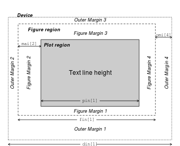
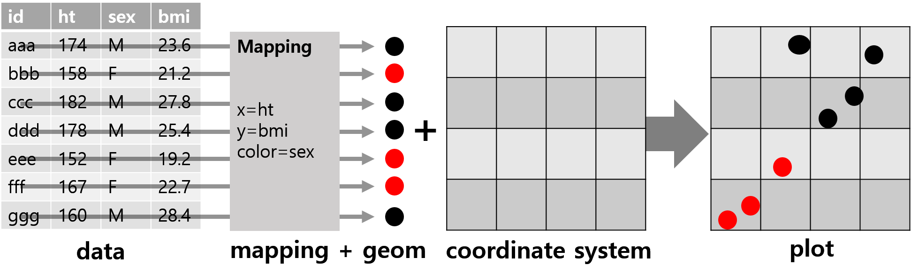

```{r setup, include=FALSE}
library(knitr)
library(readr)
library(dplyr)
library(tidyr)
library(ggplot2)
library(patchwork)
options(readr.show_col_types = FALSE)

# 슬라이드는 폭이 좁다. 출력 폭을 46자로 접는다.
options(linewidth = 46, width = 46)
hook_output <- knitr::knit_hooks$get("output")
knit_hooks$set(output = function(x, options) {
  if (!is.null(n <- options$linewidth)) {
    x <- knitr:::split_lines(x)
    if (any(nchar(x) > n)) x <- strwrap(x, width = n)
    x <- paste(x, collapse = "\n")
  }
  hook_output(x, options)
})
# 기본 그래픽의 여백을 슬라이드 그림 크기에 맞게 줄이는 청크 훅 (청크에 base_mar: true)
knit_hooks$set(base_mar = function(before, options, envir) {
  if (before) par(mar = c(4, 4.2, 2.2, 1), mgp = c(2.5, 0.8, 0))
})

# 그림 크기: 인치 x 96 이 슬라이드 좌표의 px. 2배 해상도로 만들어 투영해도 선명하게 한다.
opts_chunk$set(dev = "png", dpi = 96, fig.retina = 2, dev.args = list(pointsize = 14))
theme_set(theme_grey(base_size = 15))

# 4.1 ToothGrowth 의 보충제와 용량별 평균: 긴 표 tg 와 행렬 tg_mat
tg <- ToothGrowth |>
  summarise(mean_len = mean(len), .by = c(supp, dose))
tg_wide <- pivot_wider(tg, names_from = supp, values_from = mean_len)
tg_mat <- as.matrix(tg_wide[c("OJ", "VC")])
rownames(tg_mat) <- tg_wide$dose

# 4.4 이후의 Gapminder 표: 강의노트 4.4 의 gm-prepare 와 같은 결합
gm_pop     <- read_csv("dataset/ch12/gapminder-population.csv")
gm_gdp     <- read_csv("dataset/ch12/gapminder-gdp.csv")
gm_lex     <- read_csv("dataset/ch12/gapminder-life-expectancy.csv")
gm_regions <- read_csv("dataset/ch12/gapminder-regions.csv")
region_continent <- tribble(
  ~region, ~continent,
  "Eastern Africa", "아프리카", "Middle Africa", "아프리카", "Northern Africa", "아프리카",
  "Southern Africa", "아프리카", "Western Africa", "아프리카",
  "Caribbean America", "아메리카", "Central America", "아메리카",
  "Northern America", "아메리카", "South America", "아메리카",
  "Central Asia", "아시아", "Eastern Asia", "아시아", "South-Eastern Asia", "아시아",
  "Southern Asia", "아시아", "Western Asia", "아시아",
  "Eastern Europe", "유럽", "Northern Europe", "유럽", "Southern Europe", "유럽",
  "Western Europe", "유럽",
  "Melanesia Oceania", "오세아니아", "Micronesia Oceania", "오세아니아",
  "Oceania", "오세아니아", "Polynesia Oceania", "오세아니아"
) |>
  mutate(continent = factor(continent,
                            levels = c("아프리카", "아메리카", "아시아", "유럽", "오세아니아")))
gm <- gm_pop |>
  left_join(select(gm_gdp, -name), by = c("geo", "year"), relationship = "one-to-one") |>
  left_join(select(gm_lex, -name), by = c("geo", "year"), relationship = "one-to-one") |>
  mutate(iso = replace_values(toupper(geo), "HOS" ~ "VAT"),
         gdp_per_capita = gdp_total / population) |>
  inner_join(select(gm_regions, iso, region), by = "iso",
             relationship = "many-to-one", unmatched = c("error", "drop")) |>
  mutate(region = replace_values(region, "Northen America" ~ "Northern America")) |>
  inner_join(region_continent, by = "region",
             relationship = "many-to-one", unmatched = "error")
stopifnot(nrow(gm) == 4137, n_distinct(gm$geo) == 197, n_distinct(gm$continent) == 5)

# 7.2 이후: 세 지표가 모두 있는 2015년 나라 189개
gm_2015 <- gm |>
  filter(year == 2015, !is.na(gdp_per_capita), !is.na(life_expectancy),
         !is.na(population), gdp_per_capita > 0, population > 0)
ref_bubble_data <- arrange(gm_2015, desc(population))
stopifnot(nrow(gm_2015) == 189)

# 장면을 PNG 로 저장하고 r-stack 의 fragment 로 내보낸다 (8장 5.7 과 같은 방식)
emit_frames <- function(plots, prefix, width = 7, height = 4.6) {
  cat("::: {.r-stack}\n")
  for (i in seq_along(plots)) {
    file <- knitr::fig_path(sprintf("%s-%02d.png", prefix, i))
    dir.create(dirname(file), recursive = TRUE, showWarnings = FALSE)
    ggsave(file, plots[[i]], width = width, height = height, dpi = 192, bg = "white")
    attrs <- if (i == 1) "" else sprintf(' .fragment fragment-index="%d"', i - 1)
    cat(sprintf('{width="100%%"%s}\n\n', file, attrs))
  }
  cat(":::\n")
}
```


## 이 수업에서 다루는 것

::: {.keypoint}
그림 코드는 틀려도 **오류 없이 실행**: 그림이 **무엇을 계산해 그렸는지** 꺼내서 대조
:::

| | 절 | 내용 | 자료 |
|:--|:--|:--|:--|
| 1 | 그림으로 자료 보기 | 요약 통계량이 같은 네 자료, 두 그림 체계 | anscombe, cars |
| 2 | 기본 그래픽: 고수준 함수 | plot(), hist(), barplot(), boxplot(), 모자이크 그림 | mtcars, UCB 입학 |
| 3 | 덧그리기와 그래픽 상태 | 저수준 함수, 영역과 칸 나누기, par() 되돌리기 | mtcars |
| 4 | ggplot2 의 문법 | 매핑과 설정, group 과 선의 순서 | ToothGrowth, Gapminder |
| 5 | geom 과 stat | 그림이 계산한 값, layer_data() | mpg, diamonds |
| 6 | 위치 조정 | 쌓기, 나란히, 겹치기, 흩뜨리기 | diamonds, iris |
| 7 | 척도, 좌표, 글자 | ylim() 과 coord_cartesian(), 로그 축, 점 크기 | mpg, Gapminder |
| 8 | 나누어 그리기, 배치, 테마, 저장 | facet, patchwork, theme(), ggsave() | economics_long |
| 9 | 그림 검증하기 | 확인 절차, 글자와 코드 대조, 통합 사례 | Gapminder |
| 10 | AI와 함께 | 거품 그림 코드의 검증 | Gapminder |

: {tbl-colwidths="[5,27,47,21]"}

::: {.notes}
전체 지도입니다.

1절부터 3절까지는 R 에 들어 있는 기본 그래픽이고, 4절부터 8절까지는 ggplot2 패키지입니다. 9절에서 두 체계에서 쓴 확인 방법을 하나의 절차로 모으고, 10절에서 AI 가 생성한 그림 코드를 그 절차로 검증합니다.

함수의 인수를 모두 외우는 시간이 아닙니다. 인수 목록은 ggplot2 함수 목록 문서와 부록에서 찾으면 됩니다. 오늘은 그림이 자료의 값을 그대로 그렸는지, 무언가를 계산해서 그렸는지 구분하고, 계산한 값을 꺼내서 대조하는 방법을 익힙니다.

자료는 R 과 ggplot2 에 들어 있는 자료, 그리고 12장에서 쓴 Gapminder 파일 네 개를 그대로 씁니다.
:::


# [1]{.secno} 그림으로 자료 보기 {.section-title}

::: {.columns}
::: {.column width="54%"}
자료를 몇 개의 수로 줄일 때 **빠지는 것** 확인하기

R 의 **두 그림 체계**와 그림이 그려지는 곳
:::
::: {.column width="46%"}
[이 절에서]{.label}

- 요약 통계량이 같은 네 자료
- 그림을 그리는 두 체계와 그래픽 장치
:::
:::

::: {.keypoint .teal}
**이 절이 답하는 질문**: 요약 통계량이 같으면 **그림도 같은가**?
:::

::: {.notes}
1절입니다. 자료를 평균, 표준편차, 상관계수 같은 몇 개의 수로 줄이면 비교하기 쉽습니다. 그런데 줄이는 과정에서 무엇이 빠지는지는 그림을 그려야 보입니다.

이어서 R 에서 그림을 그리는 두 체계, 기본 그래픽과 ggplot2 가 그림을 어떻게 다르게 만드는지 봅니다.
:::


## 예측해 보자 {.predict}

Anscombe 의 네 쌍: 요약 통계량과 기울기가 소수 둘째 자리까지 같음. 네 쌍의 **산점도**도 비슷할까?

```{r anscombe-stats}
#| output-location: column
sapply(c(쌍1 = 1, 쌍2 = 2, 쌍3 = 3, 쌍4 = 4), \(i) {
  x <- anscombe[[paste0("x", i)]]
  y <- anscombe[[paste0("y", i)]]
  c(x평균 = mean(x), y평균 = mean(y),
    x표준편차 = sd(x), y표준편차 = sd(y),
    상관 = cor(x, y), 기울기 = coef(lm(y ~ x))[[2]])
}) |> round(2)
```

::: {.options}
::: {}
**A** 네 그림 모두 비슷
:::
::: {}
**B** 흩어진 정도만 조금씩 다름
:::
::: {}
**C** 점이 놓인 모양이 서로 다름
:::
:::

::: {.why}
상관계수와 회귀직선은 x 와 y 가 **직선 관계**라고 보고 계산한 값
:::

::: {.notes}
Anscombe 라는 통계학자가 1973년 논문에서 만든 자료입니다. 11행이고 x 와 y 의 쌍이 네 개 들어 있습니다.

쌍마다 평균, 표준편차, 상관계수, 회귀직선의 기울기를 구했습니다. 오른쪽 출력을 보면 소수 둘째 자리까지 네 쌍이 모두 같습니다. 회귀직선의 절편도 3.00 으로 같습니다.

질문입니다. 이 수치들이 같으니 네 쌍의 산점도도 비슷할까요? 실행하기 전에 A, B, C 가운데 하나를 적어 보세요. 아래 줄을 참고하세요. 상관계수와 회귀직선은 x 와 y 가 직선 관계라고 보고 계산한 값입니다.
:::


## [1.1]{.secno} 요약 통계량이 같은 네 자료

::: {.columns}
::: {.column width="56%"}
::: {}
```{r anscombe-plot, echo=FALSE}
#| fig-width: 6.6
#| fig-height: 5.1
op <- par(mfrow = c(2, 2), mar = c(4, 4, 1, 1))
ff <- y ~ x
for (i in 1:4) {
  ff[[2]] <- as.name(paste0("y", i))
  ff[[3]] <- as.name(paste0("x", i))
  modi <- lm(ff, data = anscombe)
  xl <- substitute(expression(x[i]), list(i = i))
  yl <- substitute(expression(y[i]), list(i = i))
  plot(ff, data = anscombe, col = "red", pch = 21, cex = 2, bg = "orange",
       xlim = c(3, 19), ylim = c(3, 13),
       xlab = eval(xl), ylab = eval(yl))
  abline(modi, col = "blue")
}
par(op)
```
:::
:::
::: {.column width="44%"}
[정답은 C: 네 그림이 서로 다름]{.label .label-slide}

- 쌍 1: 직선 주위에 흩어짐, 회귀직선이 자료를 요약
- 쌍 2: 점이 **곡선** 위에 있음
- 쌍 3: 점 (13, 12.74) 하나를 빼면 기울기 0.500 → **0.345**
- 쌍 4: x = 8 에 10개, x = 19 에 1개: 떨어진 **한 점**이 기울기를 정함

::: {.keypoint}
상관계수와 회귀직선은 **직선이라는 가정** 아래의 값: 가정이 맞는지는 **그림**으로 확인
:::
:::
:::

::: {.notes}
답은 C 입니다. 네 그림은 서로 다릅니다. 파란 선은 쌍마다 적합한 회귀직선이고, 네 직선은 같습니다.

쌍 1 은 점이 직선 주위에 흩어져 있습니다. 회귀직선이 자료를 요약하는 경우입니다. 쌍 2 는 점이 곡선 위에 있습니다. x 와 y 의 관계가 직선이 아닙니다.

쌍 3 은 점 하나를 빼면 나머지 10개가 거의 한 직선 위에 있습니다. (13, 12.74) 한 점을 빼고 다시 적합하면 기울기가 0.500 에서 0.345 로 줄고 상관계수는 1 에 가깝습니다. 쌍 4 는 x 가 8 인 점이 10개, 19 인 점이 1개입니다. x 가 8 인 점만으로는 기울기를 정할 수 없으니, 떨어진 한 점이 회귀직선을 정합니다.

상관계수와 회귀직선은 직선이라는 가정 아래에서 계산한 값입니다. 그 가정이 맞는지는 수치만으로 알 수 없고 그림을 그려야 보입니다.

그림 코드는 강의노트에 있습니다. 이 코드의 이전 판에는 두 축 이름 중 하나가 의도와 다르게 찍히는 오류가 있었습니다. 장 끝 연습문제에서 찾아봅니다.
:::


## [1.2]{.secno} 그림을 그리는 두 체계

::: {.columns}
::: {.column width="46%"}
[예측: p 에는 무엇이 담길까]{.label .label-note}

```{r two-systems}
#| fig-show: hide
#| collapse: true
p <- plot(cars)
p
g <- ggplot(cars, aes(speed, dist)) +
  geom_point()
class(g)[1:2]
```

- 기본 그래픽: 장치에 그리고 끝, 반환값은 **NULL**: 그림은 **부수효과**(5장)
- ggplot2: 그림이 **객체**, 객체를 출력할 때 장치에 그림
:::
::: {.column width="54%"}
::: {}
| | 기본 그래픽 | ggplot2 |
|:--|:--|:--|
| 그리는 방식 | 부를 때마다 장치에 차례로 덧그림 | 자료, 매핑, 레이어를 + 로 더한 객체 |
| 설정 | par(): 장치에 남음 (3절) | 객체 안의 테마 (8절) |
| 계산한 값 확인 | hist(x, plot = FALSE) 같은 반환값 | layer_data() (5절) |

: {tbl-colwidths="[24,38,38]"}
:::

[그래픽 장치: 그림이 그려지는 곳]{.label}

- 화면 장치: Positron, RStudio 의 Plots 창
- 파일 장치: png(), pdf() 로 열고 **dev.off()** 로 닫아야 파일 완성, ggplot2 는 ggsave() (8절)
:::
:::

::: {.notes}
`cars` 는 자동차 50대의 속도와 제동 거리를 잰 자료입니다. 왼쪽 위 코드에서 `p <- plot(cars)` 를 실행하면 산점도가 그려집니다. 그러면 p 에는 무엇이 담길까요? 출력은 NULL 입니다. plot() 은 장치에 그림을 그리는 일을 하고, 값으로는 아무것도 돌려주지 않습니다. 함수가 값을 돌려주는 것 말고 바깥에 남기는 결과를 부수효과라고 5장에서 불렀습니다. 그림을 다시 보거나 고치려면 코드를 다시 실행해야 합니다.

ggplot2 는 그림을 객체로 만듭니다. g 의 클래스가 ggplot 입니다. 객체를 만드는 것만으로는 그려지지 않고, 객체를 출력할 때 장치에 그립니다.

오른쪽 표가 두 체계의 차이입니다. 설정이 어디에 남는지가 3절의 주제이고, 계산한 값을 꺼내는 방법이 5절의 주제입니다.

그림이 그려지는 곳을 그래픽 장치라고 합니다. 화면 장치는 Positron 이나 RStudio 의 Plots 창이고, 파일 장치는 png() 나 pdf() 로 파일을 연 뒤 그리고, dev.off() 로 닫아야 파일이 완성됩니다.
:::


# [2]{.secno} 기본 그래픽: 고수준 함수 {.section-title}

::: {.columns}
::: {.column width="54%"}
부를 때마다 **새 그림**을 시작하고 축과 눈금까지 그리는 함수

막대 높이와 수염 끝은 **함수가 계산한 값**
:::
::: {.column width="46%"}
[이 절에서]{.label}

- plot() 은 받은 객체에 따라 다르게 그린다
- 히스토그램과 막대그림
- 상자그림의 수염
- 범주형 자료의 모자이크 그림
:::
:::

::: {.keypoint .teal}
**이 절이 답하는 질문**: 막대 높이와 수염 끝은 자료의 **어느 값**인가?
:::

::: {.notes}
2절입니다. 고수준 함수는 부를 때마다 새 그림을 시작하고 축, 눈금, 축 이름까지 한 번에 그립니다. plot(), hist(), barplot(), boxplot(), mosaicplot() 이 여기에 속합니다.

이 함수들이 그린 막대 높이와 수염 끝은 자료에 적힌 값이 아니라 함수가 계산한 값인 경우가 많습니다. 그 값을 꺼내서 확인하는 방법을 봅니다.
:::


## [2.1]{.secno} plot() 은 받은 객체에 따라 다르게 그린다

::: {.columns}
::: {.column width="48%"}
```{r plot-classes}
#| collapse: true
mod <- lm(mpg ~ disp, data = mtcars)
tab <- margin.table(Titanic, c(2, 4))  # 성별 x 생존
c(class(mtcars[, 1:4]), class(mod), class(tab))
```
:::
::: {.column width="52%"}
- plot() 은 **총칭 함수**(generic function): 클래스를 보고 plot.data.frame(), plot.lm(), plot.table() 을 부름
- 클래스별 방법 목록: methods(plot)
:::
:::

::: {}
```{r plot-three, echo=FALSE}
#| layout-ncol: 3
#| fig-width: 4
#| fig-height: 3.3
#| dev.args: !expr list(pointsize = 12)
plot(mtcars[, 1:4])
op <- par(mfrow = c(2, 2), mar = c(3, 3, 2, 1), mgp = c(1.8, 0.6, 0))
plot(mod)
par(op)
plot(tab, main = "", color = c("gray70", "steelblue"))
```
:::

::: {.columns}
::: {.column width="33%"}
데이터 프레임: **산점도 행렬**
:::
::: {.column width="33%"}
회귀모형: **진단 그림** 네 장
:::
::: {.column width="33%"}
교차표: **모자이크 그림** (2.4)
:::
:::

::: {.notes}
plot() 에는 벡터뿐 아니라 데이터 프레임, 회귀모형, 교차표도 넣을 수 있습니다. 위 코드로 세 객체를 준비하고 클래스를 확인했습니다. 세 객체를 각각 plot() 에 넣으면 어떤 그림이 나올까요? 모두 산점도일까요?

아래 세 그림입니다. 원자료의 산점도는 첫째뿐입니다. 데이터 프레임은 열의 모든 쌍을 그린 산점도 행렬입니다. i 행 j 열 칸은 j 번째 변수를 x 축, i 번째 변수를 y 축에 둔 산점도입니다. 회귀모형은 모형을 진단하는 그림 네 장, 잔차 대 적합값, 잔차의 정규 Q-Q 그림, 척도-위치, 잔차 대 지렛값입니다. 교차표는 모자이크 그림이고 읽는 법은 2.4 에서 봅니다. 강의노트는 타이타닉호 탑승자 2,201명을 등급, 성별, 나이, 생존으로 나눈 4차원 교차표 Titanic 을 그대로 그렸고, 슬라이드에서는 글자가 겹치지 않도록 성별과 생존으로 합친 표를 그렸습니다.

같은 이름의 함수가 이렇게 다르게 동작하는 것은 plot() 이 총칭 함수이기 때문입니다. 받은 객체의 클래스를 보고 plot.data.frame, plot.lm, plot.table 처럼 클래스 이름이 붙은 방법을 골라 부릅니다. 어떤 클래스의 방법이 있는지는 methods(plot) 으로 봅니다.

강의노트에는 점을 잇는 방법 type 여덟 가지, 점 모양 pch 와 선 모양 lty 의 번호표, 색 번호를 정하는 팔레트도 있습니다. ggplot2 의 점 모양과 선 모양도 같은 번호를 씁니다.
:::


## 예측해 보자 {.predict}

x <- c(1, 2, 2, 1, 3, 3, 1, 5) 일 때 hist(x) 와 barplot(x) 의 막대는 각각 **몇 개**이고 **높이**는?

```{r hist-predict}
#| collapse: true
#| fig-show: hide
x <- c(1, 2, 2, 1, 3, 3, 1, 5)
table(x)       # 값별 개수
hist(x)        # 구간 경계는 R 이 정함: 1, 2, 3, 4, 5
barplot(x)
```

::: {.options}
::: {}
**A** 둘 다 4개: 값 1, 2, 3, 5 의 개수 3, 2, 2, 1
:::
::: {}
**B** hist() 4개(높이 5, 2, 0, 1), barplot() 8개
:::
::: {}
**C** hist() 4개(높이 3, 2, 2, 1), barplot() 4개
:::
:::

::: {.why}
hist() 의 첫 구간 [1, 2] 는 **양 끝을 모두** 포함
:::

::: {.notes}
히스토그램과 막대그림은 둘 다 막대를 그립니다. 막대의 높이는 각각 어디서 올까요?

값 여덟 개짜리 벡터 x 입니다. hist() 는 구간 경계를 R 이 정하는데, 이 자료에서는 1, 2, 3, 4, 5 입니다. 구간은 오른쪽 끝을 포함하고, 첫 구간만 왼쪽 끝도 포함합니다.

hist(x) 와 barplot(x) 의 막대는 각각 몇 개이고 높이는 얼마일까요? A, B, C 가운데 골라 적어 보세요.
:::


## [2.2]{.secno} 히스토그램은 세고, 막대그림은 값을 그림

::: {.columns}
::: {.column width="54%"}
::: {}
```{r hist-barplot-fig, echo=FALSE}
#| fig-width: 6.6
#| fig-height: 3.1
x <- c(1, 2, 2, 1, 3, 3, 1, 5)
op <- par(mfrow = c(1, 2), mar = c(4, 4, 2.5, 1), mgp = c(2.5, 0.8, 0))
hist(x, main = "hist(x)", ylab = "빈도")
barplot(x, main = "barplot(x)", ylab = "값")
par(op)
```
:::

```{r hist-counts}
#| collapse: true
h <- hist(x, plot = FALSE)   # 그리지 않고 값만
h$breaks
h$counts
```
:::
::: {.column width="46%"}
[정답은 B]{.label .label-slide}

- hist(x): 높이 **5, 2, 0, 1**: 첫 구간 [1, 2] 에 1 세 개와 2 두 개
- barplot(x): 값 8개가 그대로 막대 8개
- 값별 빈도의 막대그림: barplot(table(x))

[breaks 에 준 수 하나는 제안]{.label .label-note}

- 기온 153일: breaks = 4 이면 막대 **5개**, 15 이면 **21개**
- 경계를 정하려면 seq(55, 100, by = 5)

::: {.keypoint}
막대 높이는 hist() 가 **구간마다 센 값**: 반환값으로 꺼내 대조
:::
:::
:::

::: {.notes}
답은 B 입니다. hist(x) 는 막대 네 개, 높이 5, 2, 0, 1 입니다. 첫 구간 [1, 2] 에 1 세 개와 2 두 개가 함께 들어갔고, 3 두 개는 (2, 3] 구간, 5 는 (4, 5] 구간에 들어갔습니다. (3, 4] 구간은 비어 높이가 0 입니다. barplot(x) 는 계산 없이 값 여덟 개를 그대로 막대 여덟 개의 높이로 그렸습니다. 값마다 몇 번 나왔는지를 그리려면 barplot(table(x)) 처럼 먼저 세어서 넘깁니다.

왼쪽 아래 코드가 이 장에서 계속 쓸 방법입니다. hist() 에 plot = FALSE 를 주면 그리지 않고 계산한 구간 경계와 개수만 돌려줍니다. 그림이 계산한 값을 이렇게 꺼내서 대조합니다. ggplot2 에서는 layer_data() 로 꺼내고 5절에서 봅니다.

오른쪽 아래. 강의노트에서는 airquality 의 일 최고 기온 153일치로 breaks 인수를 시험합니다. breaks = 4 를 주면 막대가 다섯 개, 15 를 주면 스물한 개입니다. breaks 에 수 하나를 주면 그 수는 구간 수의 제안이고, R 이 1, 2, 5 에 10의 거듭제곱을 곱한 간격으로 보기 좋은 경계를 고릅니다. 구간을 정확히 정하려면 경계를 벡터로 줍니다.
:::


## 예측해 보자 {.predict}

위 수염 끝은 항상 max(x) 일까? x 에 값 **5** 하나를 더한 x2 의 상자그림에서 위 수염 끝과 5 는?

```{r whisker-predict}
#| collapse: true
#| fig-show: hide
set.seed(20200522)
x <- rnorm(100)
c(최댓값 = max(x),
  수염밖의점 = length(boxplot.stats(x)$out))
x2 <- c(x, 5)
boxplot(list(x = x, x2 = x2), horizontal = TRUE)
```

::: {.options}
::: {}
**A** 위 수염 끝이 5 까지 늘어남
:::
::: {}
**B** 위 수염 끝은 2.206 그대로, 5 는 따로 찍힌 점
:::
::: {}
**C** 상자와 수염이 모두 오른쪽으로 길어짐
:::
:::

::: {.why}
수염은 상자 끝에서 **상자 길이의 1.5배 안**에 있는 관측값 가운데 가장 먼 값까지
:::

::: {.notes}
상자그림입니다. 반 학생 서른 명의 키를 상자그림으로 그리면 유난히 키가 큰 학생 한 명은 수염 끝에 이어지지 않고 점으로 따로 찍힙니다. 수염을 어디까지 그릴지 정하는 규칙이 있기 때문입니다.

표준정규분포에서 100개를 뽑았습니다. 최댓값은 2.206 이고, 이 자료의 상자그림에는 수염 밖의 점이 없습니다. 여기에 값 5 하나를 더한 x2 를 만들었습니다.

질문입니다. 위 수염 끝은 항상 최댓값일까요? x2 의 상자그림에서 위 수염 끝은 어디이고 5 는 어떻게 그려질까요? 아래 줄이 수염의 규칙입니다.
:::


## [2.3]{.secno} 수염 끝은 한계 안의 가장 먼 관측값

::: {.columns}
::: {.column width="52%"}
::: {}
```{r boxplot-anatomy, echo=FALSE}
#| fig-width: 6.2
#| fig-height: 3.2
op <- par(mar = c(5.5, 5, 1.5, 1))
part <- c("아래 수염 끝", "아래 힌지", "중앙값", "위 힌지", "위 수염 끝")
bx <- boxplot(x, horizontal = TRUE, axes = FALSE)
axis(side = 1, at = bx$stats, labels = FALSE)
text(x = bx$stats, y = 0.45, labels = part, xpd = TRUE, srt = 25, adj = 1.1)
abline(v = bx$stats, lty = 2, col = "gray")
arrows(x0 = bx$stats[2], y0 = 1.3, x1 = bx$stats[4], y1 = 1.3, code = 3, length = 0.1)
text(x = mean(bx$stats[c(2, 4)]), y = 1.3, labels = "상자 길이(IQR)", pos = 3)
par(op)
```
:::

- 상자: 아래 힌지, 중앙값, 위 힌지 (fivenum() 의 2, 3, 4번째 값)
- 수염 밖의 관측값은 **점**: 이상점 후보
- 이전 판의 "최솟값, 최댓값" 라벨: 점이 **없을 때만** 맞음
:::
::: {.column width="48%"}
::: {}
```{r boxplot-x2, echo=FALSE}
#| fig-width: 5.6
#| fig-height: 2.2
op <- par(mar = c(3, 3, 0.5, 1), mgp = c(2, 0.7, 0))
boxplot(list(x = x, x2 = x2), horizontal = TRUE, las = 1)
par(op)
```
:::

```{r whisker-answer}
#| collapse: true
b2 <- boxplot.stats(x2)
round(b2$stats, 3)   # 위 수염 끝은 다섯째
b2$out               # 수염 밖의 점
```

- 위 힌지 0.560 + 1.5 × 1.280 = **2.48**: 그 안에서 가장 먼 값 2.206

::: {.keypoint}
정답은 **B**: 수염 끝은 최댓값이 아니라 **한계 안의 가장 먼 관측값**
:::
:::
:::

::: {.notes}
답은 B 입니다. x2 의 위 수염 끝은 그대로 2.206 이고, 5 는 수염 밖의 점으로 따로 찍혔습니다.

왼쪽이 상자그림의 구성입니다. 상자는 아래 힌지, 중앙값, 위 힌지를 잇습니다. 힌지는 자료를 중앙값 기준으로 반씩 나눴을 때 각 절반의 중앙값으로, fivenum() 의 둘째와 넷째 값이고 1사분위수, 3사분위수와 거의 같습니다. 위 힌지에서 아래 힌지를 뺀 상자 길이가 사분위범위, IQR 에 해당합니다.

오른쪽 아래 계산. 위 힌지 0.560 에 상자 길이 1.280 의 1.5배를 더한 2.48 까지가 위 수염 끝이 놓일 수 있는 한계입니다. 그 안에서 상자로부터 가장 먼 관측값이 2.206 이고, 5 는 한계 밖이라 점이 됩니다.

이전 판 강의노트는 상자그림을 최솟값, 1사분위수, 중앙값, 3사분위수, 최댓값의 다섯 통계량으로 그린다고 적었습니다. 수염 끝이 최솟값과 최댓값이 되는 것은 수염 밖에 점이 없을 때뿐입니다. 상자그림을 읽을 때는 점이 있는지부터 봅니다.

그리고 힌지는 quantile() 의 기본 계산과 넷째 자리에서 다릅니다. ggplot2 의 상자그림은 quantile() 로 그리므로 자료에 따라 두 체계의 상자그림이 다르게 그려집니다. 5절에서 그런 자료를 봅니다.
:::


## [2.4]{.secno} 범주형 자료의 모자이크 그림

::: {.columns}
::: {.column width="56%"}
::: {}
```{r ucb-dept-mosaic, echo=FALSE}
#| fig-width: 6.8
#| fig-height: 4.9
#| dev.args: !expr list(pointsize = 17)
op <- par(mfrow = c(2, 3), oma = c(0, 0, 0, 0), mar = c(2.5, 2.5, 2, 0.5))
for (d in dimnames(UCBAdmissions)$Dept) {
  mosaicplot(t(UCBAdmissions[, , d]), color = c("steelblue", "gray70"),
             main = paste("학과", d), xlab = "성별", ylab = "합격 여부")
}
par(op)
```
:::
:::
::: {.column width="44%"}
[UC Berkeley 1973년 대학원 지원자 4,526명]{.label .label-note}

- 가로 폭: 성별 **지원자 수**, 세로 높이: 성별 안의 **합격 비율**
- 학과를 합친 합격률: 남자 **44.5%**, 여자 **30.4%**

```{r ucb-rate}
round(prop.table(UCBAdmissions, c(2, 3))[
  "Admitted", , ], 2)
```

- **네 학과**(A, B, D, F)에서 여자가 높음: 합격률이 낮은 C~F 학과에 여자 지원자의 93%

::: {.keypoint}
합치면 비교의 방향이 뒤집힘: **심슨의 역설**
:::
:::
:::

::: {.notes}
모자이크 그림은 교차표의 칸마다 직사각형을 그리고 넓이를 칸의 빈도에 비례시킵니다. 첫째 변수로 가로를 나누고 나뉜 조각마다 둘째 변수로 세로를 나눕니다. 그래서 가로 폭은 첫째 변수의 비율, 세로 높이는 첫째 변수 안에서 둘째 변수의 비율입니다.

캘리포니아대학교 버클리의 1973년 대학원 지원 자료입니다. 지원자가 많은 6개 학과의 지원자 4,526명을 합격 여부, 성별, 학과로 나눈 3차원 교차표입니다. 학과를 합치면 합격률은 남자 44.5%, 여자 30.4% 로 남자가 14%p 높습니다.

먼저 예측해 보세요. 학과별로 나누어도 여섯 학과 모두 남자 합격률이 높을까요?

왼쪽 그림과 오른쪽 표가 답입니다. 여섯 학과 중 네 학과, A, B, D, F 에서 여자 합격률이 높습니다. A 학과는 여자 82%, 남자 62% 입니다. 남자가 높은 C, E 학과도 차이는 2.8%p, 3.8%p 입니다.

그런데 합치면 왜 남자가 높을까요? 합격률이 63~64% 인 A, B 학과에는 지원자 대부분이 남자입니다. A 학과 그림에서 여자 쪽 폭이 좁은 것이 지원자 108명입니다. 합격률이 6.4~35.1% 인 C 부터 F 학과에는 여자 지원자의 93%, 남자 지원자의 49% 가 지원했습니다. 여자가 합격률이 낮은 학과에 많이 지원했기 때문에, 학과 안에서는 높거나 비슷한 여자 합격률이 합치면 낮게 나옵니다. 이렇게 집단을 합칠 때 비교의 방향이 뒤집히는 현상을 심슨의 역설이라고 합니다.

이 그림은 par(mfrow = c(2, 3)) 으로 장치를 6칸으로 나눠 그렸고 끝에서 되돌렸습니다. 이전 판 강의노트의 같은 그림은 되돌리지 않았습니다. 그 결과는 3절에서 봅니다.
:::


# [3]{.secno} 덧그리기와 그래픽 상태 {.section-title}

::: {.columns}
::: {.column width="54%"}
고수준 함수가 정한 **좌표 위에** 점, 선, 글자를 더하기

par() 로 바꾼 설정은 **장치에 남음**
:::
::: {.column width="46%"}
[이 절에서]{.label}

- 그림 위에 덧그리기
- 그림 영역과 칸 나누기
- 그래픽 상태
:::
:::

::: {.keypoint .teal}
**이 절이 답하는 질문**: 같은 코드가 왜 한 번은 **그려지고** 한 번은 **오류**인가?
:::

::: {.notes}
3절입니다. 기본 그래픽은 그림을 장치에 차례로 덧그립니다. 고수준 함수가 축과 좌표를 정하면 points(), lines(), abline(), text() 같은 저수준 함수가 그 좌표 위에 점, 선, 글자를 더합니다.

그리고 여백이나 칸 나누기 같은 설정은 장치에 걸려 있어서 다음 그림에도 남습니다. 이 절의 질문은 같은 코드가 왜 한 번은 그려지고 한 번은 오류가 나는가입니다.
:::


## 예측해 보자 {.predict}

회귀직선, 연비 평균의 가로선, 마력 평균의 세로선: 세 직선은 **한 점**에서 만날까?

```r
m <- lm(mpg ~ hp, data = mtcars)            # 단순 선형회귀: 연비를 마력으로
plot(mpg ~ hp, data = mtcars, type = "n")   # 축과 좌표만 정한 빈 판
points(mtcars$hp, mtcars$mpg, pch = 16)
abline(m, col = "red")                      # 회귀직선
abline(h = mean(mtcars$mpg), lty = 2)       # 연비 평균
abline(v = mean(mtcars$hp), lty = 2)        # 마력 평균
```

::: {.options}
::: {}
**A** 만나지 않음: 교점이 세 개
:::
::: {}
**B** 이 자료에서는 우연히 한 점에서 만남
:::
::: {}
**C** 어느 자료든 한 점에서 만남
:::
:::

::: {.why}
최소제곱 회귀직선의 **절편**을 구하는 식을 떠올리기
:::

::: {.notes}
mtcars 의 마력과 연비로 산점도를 그립니다. type = "n" 은 축과 좌표만 정하고 점도 선도 그리지 않는 빈 판입니다. 그 위에 points() 로 점을 얹고, abline() 으로 회귀직선과 두 평균선을 그립니다.

질문입니다. 회귀직선, 연비 평균의 가로선, 마력 평균의 세로선, 세 직선은 한 점에서 만날까요? 만난다면 이 자료에서만 그런 걸까요, 어느 자료에서나 그럴까요? 최소제곱 회귀직선의 절편을 구하는 식을 떠올려 보세요.
:::


## [3.1]{.secno} 그림 위에 덧그리기

::: {.columns}
::: {.column width="56%"}
::: {}
```{r abline-example, echo=FALSE}
#| fig-width: 6.8
#| fig-height: 5.0
m <- lm(mpg ~ hp, data = mtcars)
yhat <- fitted(m)
op <- par(mar = c(4, 4, 2, 1), mgp = c(2.5, 0.8, 0))
plot(mpg ~ hp, data = mtcars, type = "n", bty = "n",
     xlim = c(50, 350), ylim = c(5, 40),
     main = "회귀직선, 잔차, 평균선", xlab = "마력(hp)", ylab = "연비(마일/갤런)")
for (i in seq_len(nrow(mtcars))) {
  lines(c(mtcars$hp[i], mtcars$hp[i]), c(mtcars$mpg[i], yhat[i]),
        col = "green3", lwd = 0.8)
}
points(mtcars$hp, mtcars$mpg, pch = 16)
abline(m, lwd = 3, col = "red")
abline(h = mean(mtcars$mpg), lty = 2, col = "darkgray")
abline(v = mean(mtcars$hp), lty = 2, col = "darkgray")
text(mean(mtcars$hp), 40,
     bquote(bar(x) == .(sprintf("%.1f", mean(mtcars$hp)))), pos = 4)
text(350, mean(mtcars$mpg),
     bquote(bar(y) == .(sprintf("%.1f", mean(mtcars$mpg)))), adj = c(1, -0.5))
par(op)
```
:::
:::
::: {.column width="44%"}
```{r abline-check}
#| collapse: true
c(마력평균 = mean(mtcars$hp),
  연비평균 = mean(mtcars$mpg),
  예측값 = unname(predict(m,
    data.frame(hp = mean(mtcars$hp)))))
```

[정답은 C]{.label .label-slide}

- 절편 $b_0 = \bar{y} - b_1 \bar{x}$: 회귀직선은 항상 $(\bar{x}, \bar{y})$ 를 지남
- 빈 판, lines() 잔차, points(), abline() 순서: **나중에 그린 것이 위**
- 평균 글자는 mean() 결과를 sprintf() 로: 이전 판은 연비 평균에도 x̄
- 범례 legend(), 넓이 칠하기 polygon(): 강의노트
:::
:::

::: {.notes}
답은 C 입니다. 그림에서 세 직선은 한 점에서 만납니다. 오른쪽 위 계산으로 확인하면 마력 평균 146.7 에서 회귀직선의 예측값이 20.09 로 연비 평균과 같습니다. 최소제곱 회귀직선의 절편은 y 평균에서 기울기 곱하기 x 평균을 뺀 값이므로, 직선은 어느 자료에서나 두 평균의 점을 지납니다.

그리는 순서도 보세요. 빈 판을 만들고, lines() 로 잔차를 초록 세로선으로 먼저 그린 뒤, points() 로 점을 그 위에 얹었습니다. 나중에 그린 것이 위에 놓입니다.

평균선 옆의 글자는 mean() 의 결과를 sprintf() 로 넣었습니다. 손으로 숫자를 적지 않았으니 자료가 바뀌어도 글자가 따라 바뀝니다. 이전 판 강의노트는 연비 평균에도 x 바 라고 적었습니다. 세로축 변수의 평균이니 y 바 입니다.

범례를 다는 legend() 와 곡선 아래 넓이를 칠하는 polygon() 예제는 강의노트에 있습니다. 범례는 점과 따로 그리므로 범례의 이름, 모양, 색이 점에 준 것과 같은 순서인지 맞추는 일은 코드를 쓰는 사람에게 남습니다.
:::


## [3.2]{.secno} 그림 영역과 여백

::: {.columns}
::: {.column width="56%"}
::: {}
```{r graphics-regions, echo=FALSE}
#| fig-width: 6.6
#| fig-height: 4.9
op <- par(oma = c(2, 2, 2, 2))
set.seed(10)
hist(rnorm(100), col = "#4A92FF", main = "", xlab = "", ylab = "")
for (r in c("plot", "figure", "outer")) box(which = r, col = "red")
text(-2, 15, "plot 영역")
mtext("figure 영역", side = 3, adj = 0, at = -3, line = 2)
for (i in 1:4) {
  mtext(paste("그림 여백", i), side = i, line = c(3, 3, 0.5, 0.5)[i], col = "red")
}
for (i in 1:4) mtext(paste("바깥 여백", i), side = i, outer = TRUE, col = "blue")
par(op)
```
:::
:::
::: {.column width="44%"}
{height="270px"}

[mai 그림 여백, pin plot 영역, fin figure 영역, din 장치 (인치)]{.label .label-note}

- 네 값의 순서: c(아래, 왼쪽, 위, 오른쪽), 여백 번호 1~4 도 같은 순서
- 그림 여백 mar(줄 단위), 바깥 여백 oma
- 새 장치의 par("mar"): 5.1, 4.1, 4.1, 2.1
:::
:::

::: {.notes}
한 장치에 그림 여러 개를 그리려면 칸마다 축과 제목이 놓일 자리가 필요합니다. 장치가 어떤 영역으로 나뉘는지 봅시다.

왼쪽 그림의 빨간 선이 안쪽부터 plot 영역, figure 영역, 장치의 경계입니다. 장치의 가장자리에 바깥 여백이 있고, 그 안에 그림 하나가 차지하는 figure 영역이 있습니다. figure 영역 안에서 자료를 그리는 곳이 plot 영역이고, 둘 사이가 그림 여백입니다. 축 이름과 제목은 그림 여백에 놓입니다.

오른쪽 그림은 영역의 크기를 정하는 매개변수입니다. 출처는 AIMS-R-users 의 Murray Logan 자료이고 지금은 접속되지 않습니다. mai 는 그림 여백을 인치로, pin 은 plot 영역, fin 은 figure 영역, din 은 장치의 크기를 인치로 나타냅니다.

여백의 네 값은 아래, 왼쪽, 위, 오른쪽 순서입니다. 그림 여백은 mar 로 글자 줄 수 단위로 정하고, 바깥 여백은 oma 로 정합니다. 새 장치의 그림 여백은 아래 5.1 줄, 왼쪽 4.1 줄, 위 4.1 줄, 오른쪽 2.1 줄입니다.
:::


## 예측해 보자 {.predict}

이전 판 강의노트의 코드: 위쪽 제목은 "mfrow = c(2, 3)". 그림은 **몇 행 몇 열**일까?

```r
par(oma = c(0, 0, 3, 0), mfrow = c(3, 2))
for (i in 1:6) {
  set.seed(12345)
  plot(rnorm(20), rnorm(20), main = paste("Plot", i))
  box("figure")
}
mtext(side = 3, line = 1, cex = 0.8, col = "blue",
      "Multiple plots with mfrow = c(2, 3)", outer = TRUE)
```

::: {.options}
::: {}
**A** 2행 3열
:::
::: {}
**B** 3행 2열
:::
::: {}
**C** 6행 1열
:::
:::

::: {.why}
제목은 사람이 적은 **문자열**, 칸 나누기는 **인수**가 정함
:::

::: {.notes}
한 장치를 여러 칸으로 나누는 매개변수는 mfrow 와 mfcol 입니다. 이 코드는 이전 판 강의노트에 실려 있던 코드입니다. 슬라이드에서는 주석을 빼고 줄을 모았고, 영문 제목의 철자 하나만 고쳤습니다. 원문은 강의노트에 있습니다.

그림의 위쪽 제목에는 mfrow = c(2, 3) 이라고 적힙니다. 그림은 몇 행 몇 열일까요? 제목을 믿지 말고 코드를 읽고 답해 보세요.
:::


## [3.2]{.secno} 칸 나누기: mfrow 와 mfcol

::: {.columns}
::: {.column width="29%"}
::: {}
```{r mfrow-old-code, echo=FALSE}
#| fig-width: 3.4
#| fig-height: 5.6
par(oma = c(0, 0, 3, 0), # 윗쪽 여백 크기 조정
    mfrow = c(3, 2))
for (i in 1:6) {
  set.seed(12345)
  plot(rnorm(20), rnorm(20),
       main = paste("Plot", i))
  box("figure")
}
# 윗쪽 여백(side=3)에 텍스트 출력
mtext(side = 3, line = 1, cex = 0.8, col = "blue",
    "Multiple plots with mfrow = c(2, 3)",
    outer = TRUE) # outer 여백 사용 여부
```
:::
:::
::: {.column width="29%"}
::: {}
```{r mfcol-example, echo=FALSE}
#| fig-width: 3.4
#| fig-height: 5.6
op <- par(oma = c(0, 0, 3, 0), mfcol = c(3, 2))
for (i in 1:6) {
  set.seed(12345)
  plot(rnorm(20), rnorm(20), main = paste("그림", i), xlab = "", ylab = "")
  box("figure")
}
mtext("mfcol = c(3, 2)", side = 3, line = 1, outer = TRUE, col = "blue", cex = 0.8)
par(op)
```
:::
:::
::: {.column width="42%"}
[정답은 B: 3행 2열]{.label .label-slide}

- mfrow = c(**행 수**, 열 수): 코드는 c(3, 2), **제목이 틀림**
- 제목은 손으로 적은 문자열: 코드와 어긋나도 **오류 없음** (9.2)
- mfrow: 1행부터 채움, 1, 2 번이 첫 행
- mfcol: 1열부터 채움, 1, 2, 3 번이 첫 열

::: {.keypoint}
이 코드의 문제 하나 더: 바꾼 oma 와 mfrow 를 **되돌리지 않음** (3.3)
:::
:::
:::

::: {.notes}
답은 B 입니다. 그림은 3행 2열입니다. 코드는 mfrow = c(3, 2) 를 줬고, mfrow 는 행 수, 열 수 순서입니다. 제목의 c(2, 3) 이 틀렸습니다.

제목은 사람이 손으로 적은 문자열이라 코드와 어긋나도 오류가 나지 않습니다. 그림 속 글자와 코드를 대조하는 방법은 9절에서 다룹니다.

가운데는 mfcol 로 같은 칸 나누기를 한 그림입니다. 여섯 칸은 같은 시드로 만든 같은 점이고 제목만 다릅니다. mfrow 는 1행을 먼저 채워 1, 2 번 그림이 첫 행에 놓이고, mfcol 은 1열을 먼저 채워 1, 2, 3 번 그림이 첫 열에 놓입니다.

이 이전 판 코드에는 문제가 하나 더 있습니다. par() 로 바꾼 oma 와 mfrow 를 되돌리지 않았습니다. 그러면 어떻게 되는지 다음 슬라이드에서 봅니다.
:::


## [3.3]{.secno} 그래픽 상태: 장치에 남는 설정 {.dense}

::: {.columns}
::: {.column width="52%"}
[예측: 6칸으로 나눈 장치에서 이어서 pin = c(5, 2) 를 주면?]{.label .label-note}

```{r state-error}
#| fig-show: hide
#| collapse: true
#| fig-width: 7
#| fig-height: 4.5
#| dev.args: !expr list(pointsize = 12)
op <- par(mfrow = c(2, 3))
for (i in 1:6) plot(rnorm(20))
par("pin")       # 한 칸의 plot 영역(인치)
tryCatch({
  par(pin = c(5, 2))
  plot(1:10)
}, error = function(e) conditionMessage(e))
par(op)
```

- 같은 두 줄을 **새 장치**에서 실행하면 그려짐
- 차이는 코드가 아니라 장치에 남은 **상태**
- 이전 판: 모자이크 그림 청크가 되돌리지 않아, 콘솔에서 몇 청크 뒤 이 오류
:::
::: {.column width="48%"}
[화이트보드를 칸으로 나누고 선을 지우지 않으면 다음 사람도 그 칸에 씀]{.label}

```r
op <- par(mfrow = c(1, 2))  # 바꾸기 전 값이 op 에
hist(x); plot(x, y)
par(op)                     # 되돌리기

plot_two <- function(x, y) {
  op <- par(mfrow = c(1, 2))
  on.exit(par(op))          # 오류로 끝나도 실행
  hist(x); plot(x, y)
}
```

- par() 는 값을 바꿀 때 **바꾸기 전 값**을 돌려줌
- 렌더할 때는 청크마다 새 장치라 오류가 보이지 않음
- ggplot2: 설정이 그림 객체의 테마에, 장치에 상태를 남기지 않음
:::
:::

::: {.notes}
화이트보드를 네 칸으로 나눠 쓰고 나눈 선을 지우지 않으면 다음 사람도 네 칸으로 나뉜 판에 씁니다. 기본 그래픽의 장치도 이렇게 동작합니다. par() 로 바꾼 값은 되돌리거나 장치를 닫을 때까지 그 장치에서 그리는 모든 그림에 적용됩니다. 함수 호출이 끝난 뒤에도 남아 다음 동작에 영향을 주는 값을 상태라고 합니다.

왼쪽 코드를 보세요. 장치를 6칸으로 나눠 그림 여섯 개를 그렸습니다. 이 상태에서 pin, 즉 plot 영역의 크기를 폭 5인치, 높이 2인치로 정하고 그림을 그리면 어떻게 될까요? 장치는 폭 7인치, 높이 4.5인치입니다.

plot region too large, 그림 영역이 너무 크다는 오류가 났습니다. 6칸으로 나뉜 장치에서 한 칸의 plot 영역은 폭 1.5인치, 높이 1인치 정도입니다. 폭 5인치가 들어가지 않습니다. 같은 두 줄을 새 장치에서 실행하면 그려집니다. 차이는 코드가 아니라 장치에 남은 상태에 있습니다.

이전 판 강의노트에서 이 일이 실제로 있었습니다. 학과별 모자이크 그림 청크가 par() 를 되돌리지 않았고, 콘솔에서 순서대로 실행하면 몇 청크 뒤의 pin 청크에서 이 오류가 났습니다. 강의노트를 렌더할 때는 청크마다 장치를 새로 열어서 오류가 보이지 않았습니다.

고치는 방법은 오른쪽입니다. par() 는 값을 바꿀 때 바꾸기 전 값을 돌려주므로 op 에 담아 두었다가 par(op) 로 되돌립니다. 함수 안에서는 on.exit() 에 되돌리는 코드를 걸어 둡니다. 함수가 오류로 중간에 끝나도 실행됩니다. ggplot2 는 설정을 그림 객체 안의 테마에 담기 때문에 장치에 상태를 남기지 않습니다.
:::


# [4]{.secno} ggplot2 의 문법 {.section-title}

::: {.columns}
::: {.column width="54%"}
그림 하나를 자료, 매핑, geom 같은 **부품의 조합**으로 적기

그리기 전에 **열과 그림 속성의 대응**을 명세
:::
::: {.column width="46%"}
[이 절에서]{.label}

- 같은 그림을 두 체계로
- 매핑: 열을 그림의 속성에 대응시키기
- 매핑과 설정: aes() 안과 밖
- 선으로 잇기: group 과 순서
:::
:::

::: {.keypoint .teal}
**이 절이 답하는 질문**: 그림의 각 속성은 자료의 **어느 열**에서 왔는가?
:::

::: {.notes}
4절입니다. ggplot2 는 Leland Wilkinson 의 그래픽 문법을 R 에 옮긴 패키지입니다. 그림 하나를 자료, 매핑, 기하 객체 같은 부품의 조합으로 적습니다.

이 절에서는 기본 그래픽과 같은 그림을 그려 두 체계의 차이를 보고, 자료의 열을 그림의 속성에 대응시키는 매핑을 익힙니다. 이 절의 질문은 그림의 각 속성이 자료의 어느 열에서 왔는가입니다.
:::


## [4.1]{.secno} 같은 그림을 두 체계로

::: {.columns}
::: {.column width="50%"}
[기본 그래픽: OJ 선을 그리고 VC 선을 덧그림]{.label .label-note}

```{r tg-base}
#| fig-width: 5.4
#| fig-height: 2.9
#| fig-show: hold
#| collapse: true
#| base_mar: true
plot(tg_mat[, "OJ"], type = "l")
lines(tg_mat[, "VC"], lty = 2)
par("usr")[3:4]    # y 축 범위
```
:::
::: {.column width="50%"}
[ggplot2: 같은 긴 표 tg 에서 매핑만 정함]{.label .label-slide}

```{r tg-gg}
#| fig-width: 5.4
#| fig-height: 2.9
ggplot(tg, aes(dose, mean_len, colour = supp)) +
  geom_line(linewidth = 1) + geom_point() +
  labs(x = "용량(mg/일)", y = "길이의 평균")
```
:::
:::

::: {.keypoint}
첫 plot() 이 y 축 범위를 OJ 값으로 정하고 lines() 는 범위를 바꾸지 않음: VC 0.5 mg 평균 7.98 이 **잘림**, x 축은 용량이 아니라 **1, 2, 3**
:::

::: {.notes}
ToothGrowth 는 기니피그 60마리에게 비타민 C 를 보충제 두 가지, 오렌지 주스 OJ 와 아스코르브산 VC, 용량 세 가지로 주고 치아 세포의 길이를 잰 자료입니다. 조합마다 길이의 평균을 구해 ggplot2 용 긴 표 tg 와 기본 그래픽용 행렬 tg_mat 을 만들어 두었습니다. 행렬은 12장의 pivot_wider() 로 만들었습니다.

먼저 예측해 보세요. 왼쪽 코드처럼 OJ 의 선을 그리고 lines() 로 VC 의 선을 덧그리면, VC 의 점선은 그림 안에 다 보일까요? x 축에는 무엇이 적힐까요?

왼쪽 그림입니다. VC 의 선은 왼쪽 일부가 잘렸습니다. 첫 plot() 이 OJ 의 값에 여유를 조금 더해 y 축 범위를 12.72 부터 26.57 로 정했고, lines() 는 범위를 바꾸지 않습니다. VC 의 0.5 mg 평균 7.98 이 범위 밖입니다. x 축은 용량이 아니라 행 번호 1, 2, 3 입니다.

오른쪽은 ggplot2 입니다. 같은 긴 표에서 x 는 용량, y 는 평균, 색은 보충제로 대응시켰습니다. y 축은 두 보충제의 값을 모두 담고, x 축은 용량의 실제 간격으로 놓입니다. 기본 그래픽은 그림마다 자료의 모양과 함수를 바꿨고, ggplot2 는 표 하나에 매핑과 geom 만 정했습니다.
:::


## [4.2]{.secno} 매핑: 열을 그림의 속성에 대응시키기

[성적표의 학생 한 명이 점 하나: 키는 가로 위치, 체질량지수는 세로 위치, 성별은 점의 색]{.label .label-note}

::: {}
{width="84%"}
:::

::: {.columns}
::: {.column width="33%"}
- 자료(data): 그릴 표
- **매핑** aes(): 열을 속성에
- geom: 점, 선, 막대
:::
::: {.column width="33%"}
- stat: 그리기 전 계산 (5절)
- position: 겹친 모양의 자리 (6절)
- scale: 값을 위치, 색, 크기로 (7절)
:::
::: {.column width="33%"}
- coord: 위치를 평면에 (7절)
- facet: 집단마다 작은 그림 (8절)
- theme: 글꼴, 바탕, 격자 (8절)
:::
:::

::: {.notes}
성적표에 학생마다 키, 체질량지수, 성별이 적혀 있습니다. 종이 위에 학생 한 명을 점 하나로 찍되, 키는 가로 위치, 체질량지수는 세로 위치, 성별은 점의 색으로 정합니다. 이렇게 자료의 열을 그림의 속성 하나에 대응시키는 일을 매핑이라고 합니다.

그림의 왼쪽이 학생 일곱 명의 표, data 입니다. 가운데 상자가 매핑과 geom 입니다. x 는 ht, y 는 bmi, color 는 sex 로 대응시켜 점 일곱 개를 만들었습니다. 이 점을 좌표계, coordinate system 위에 놓으면 오른쪽 그림, plot 이 됩니다. 남자는 검은 점, 여자는 빨간 점입니다.

ggplot2 는 가로와 세로 위치, 색, 크기, 모양 같은 그림의 속성을 aesthetic 이라고 부르고, aes() 안에 속성 = 열 로 적습니다.

아래가 ggplot2 그림의 부품입니다. 자료, 매핑, geom 은 이 절에서, 그리기 전에 하는 계산인 stat 은 5절, 겹치는 모양을 놓는 자리인 position 은 6절, 값을 위치와 색과 크기로 바꾸는 척도와 좌표계는 7절, 패널 나누기와 테마는 8절에서 다룹니다.
:::


## [4.2]{.secno} 레이어를 하나씩 더하기

```{r layer-plots, include=FALSE}
lp0 <- ggplot(gm_2015, aes(gdp_per_capita, life_expectancy))
lp1 <- lp0 + geom_point()
lp2 <- lp1 + scale_x_log10(labels = scales::label_comma())
lp3 <- lp2 + labs(x = "1인당 GDP(PPP, 2011년 불변 국제달러, 로그 눈금)",
                  y = "기대수명(년)")
```

::: {.columns}
::: {.column width="58%"}
```{r layer-frames, echo=FALSE, results='asis'}
emit_frames(list(lp0, lp1, lp2, lp3), "layers", width = 7, height = 4.9)
```
:::
::: {.column width="42%"}
[2015년 Gapminder, 세 지표가 모두 있는 189개 나라]{.label .label-slide}

```r
ggplot(gm_2015, aes(gdp_per_capita,
                    life_expectancy))
```

축과 눈금만 있는 **빈 판**: 매핑은 축 범위만 정함

::: {.fragment fragment-index="1"}
```r
  + geom_point()
```
geom 을 더해야 점 189개
:::

::: {.fragment fragment-index="2"}
```r
  + scale_x_log10()
```
x 축을 로그 눈금으로 (7.2)
:::

::: {.fragment fragment-index="3"}
```r
  + labs(x = "1인당 GDP(...)",
         y = "기대수명(년)")
```
축 이름에 지표와 **단위**
:::
:::
:::

::: {.notes}
레이어를 하나씩 더해 봅니다. 자료는 4.4 에서 준비하는 Gapminder 표의 2015년, 인구와 GDP 와 기대수명이 모두 있는 189개 나라입니다.

먼저 예측해 보세요. ggplot() 에 자료와 매핑만 주고 출력하면 무엇이 그려질까요?

축과 눈금만 있는 빈 판입니다. 매핑으로 x 와 y 의 범위는 정해졌지만 점을 그릴 geom 이 없습니다.

(클릭) geom_point() 를 더하자 점 189개가 그려졌습니다. 나라 대부분이 왼쪽에 몰려 있습니다.

(클릭) x 축을 로그 눈금으로 바꿨습니다. 7.2 에서 다시 봅니다.

(클릭) labs() 로 축 이름에 지표 이름과 단위를 적었습니다.

매핑을 ggplot() 에 두면 뒤에 더하는 모든 레이어가 물려받고, geom 안에 두면 그 레이어에만 적용됩니다. 강의노트에는 점 레이어에만 매핑을 주어 둘째 레이어인 회귀선이 x 와 y 를 몰라 오류가 나는 예가 있습니다.
:::


## 예측해 보자 {.predict}

셋째 줄의 점은 **무슨 색**이고, 범례에는 무엇이 적힐까?

```r
ggplot(mpg, aes(class)) + geom_bar(fill = "navy")          # 모든 막대가 남색
ggplot(mpg, aes(class)) + geom_bar(aes(fill = fl))         # 연료별 색과 범례
ggplot(mtcars, aes(wt, mpg)) + geom_point(aes(colour = "blue"))
```

::: {}
```{r aes-setting-mapping-fig, echo=FALSE}
#| fig-width: 12
#| fig-height: 2.3
bar_theme <- theme(axis.text.x = element_text(size = 10))
(ggplot(mpg, aes(class)) + geom_bar(fill = "navy") +
   labs(title = "첫째 줄: 설정", x = NULL, y = "차량 수") + bar_theme) |
  (ggplot(mpg, aes(class)) + geom_bar(aes(fill = fl)) +
     labs(title = "둘째 줄: 매핑", x = NULL, y = NULL, fill = "연료") + bar_theme)
```
:::

::: {.options}
::: {}
**A** 파란 점, 범례 없음
:::
::: {}
**B** 붉은 점, 범례 항목 'blue'
:::
::: {}
**C** 오류: "blue" 는 열 이름이 아님
:::
:::

::: {.why}
aes() 안에 적은 것은 **척도**를 거쳐 색이 됨
:::

::: {.notes}
aes() 안에 열 이름을 쓰면 매핑이고, geom 의 인수로 값을 직접 주면 설정입니다. 첫 줄은 설정이라 모든 막대가 남색이고 범례가 없습니다. 둘째 줄은 매핑이라 연료 다섯 가지가 색 다섯 가지에 대응되고 범례가 생깁니다.

셋째 줄을 보세요. aes() 안에 "blue" 라고 적었습니다. 점은 무슨 색이고 범례에는 무엇이 적힐까요?
:::


## [4.3]{.secno} 매핑과 설정: aes() 안과 밖

::: {.columns}
::: {.column width="44%"}
::: {}
```{r aes-blue-fig, echo=FALSE}
#| fig-width: 5.0
#| fig-height: 2.9
p <- ggplot(mtcars, aes(wt, mpg)) + geom_point(aes(colour = "blue"), size = 2.5)
p
```
:::

```{r aes-blue}
#| collapse: true
unique(layer_data(p)$colour)
```
:::
::: {.column width="56%"}
[정답은 B]{.label .label-slide}

- "blue" 는 색이 아니라 값이 "blue" 하나뿐인 **변수**: 색 척도의 첫째 색 #F8766D
- 파란 점은 **설정**: geom_point(colour = "blue")

::: {}
| | 매핑 | 설정 |
|:--|:--|:--|
| 쓰는 곳 | aes() 안, 열 이름 | geom 인수, 값 |
| 값 | 행마다 다름, 척도를 거침 | 모든 행에 같은 값 |
| 범례 | 만듦 | 만들지 않음 |

: {tbl-colwidths="[20,40,40]"}
:::

[선 굵기는 linewidth: ggplot2 3.4.0 부터]{.label .label-note}

- 이전 판 geom_line(size = 1): 그림은 그려지고 경고만, "Using `size` aesthetic for lines was deprecated in ggplot2 3.4.0."
:::
:::

::: {.notes}
답은 B 입니다. 점은 파란색이 아니라 붉은색이고, 범례 제목은 colour, 항목은 blue 입니다. 왼쪽 아래 출력이 점에 실제로 쓴 색입니다. layer_data() 는 5절에서 자세히 봅니다.

aes() 안의 "blue" 는 색이 아니라 모든 행의 값이 "blue" 인 변수로 다뤄집니다. 값이 하나뿐인 범주형 변수가 색 척도의 첫째 색에 대응되었습니다. 파란 점을 원하면 aes() 밖에서 설정으로 colour = "blue" 라고 씁니다.

표가 매핑과 설정의 차이입니다. 매핑은 행마다 다른 값을 척도에 따라 색이나 크기로 바꾸고 범례를 만듭니다. 설정은 모든 행에 같은 값을 쓰고 범례를 만들지 않습니다.

아래. ggplot2 3.4.0 부터 점과 글자의 크기는 size, 선의 굵기는 linewidth 로 나뉘었습니다. 이전 판 강의노트는 선에 size = 1 을 썼습니다. 지금 실행하면 그림은 그려지고 폐기 예정이라는 경고만 나옵니다. 경고를 읽지 않으면 지나칩니다. 이 경고는 R 세션에서 한 번만 나오므로 처음 실행한 출력을 확인하세요.
:::


## 예측해 보자 {.predict}

아시아 50개 나라의 2000~2020년 기대수명을 아래 코드로 그리면 **어떤 모양**일까?

```{r asia-predict}
#| collapse: true
#| fig-show: hide
asia <- filter(gm, continent == "아시아")   # 50개 나라 x 21년 = 1,050행
asia |> arrange(year) |> select(name, year, life_expectancy) |>
  head(3) |> as.data.frame()
ggplot(asia, aes(year, life_expectancy)) + geom_line()
```

::: {.options}
::: {}
**A** 나라마다 선 하나, 모두 50개
:::
::: {}
**B** 같은 해의 값 50개를 위아래로 오가는 **선 하나**
:::
::: {}
**C** 연도별 평균을 이은 선 하나
:::
:::

::: {.why}
색이나 group 으로 집단을 나누지 않은 geom_line() 은 선을 **몇 개** 그릴까?
:::

::: {.notes}
이 장의 4절부터 10절까지 쓸 Gapminder 표 gm 을 12장 통합 사례에서 확인한 결합 그대로 만들었습니다. 197개 나라의 2000년부터 2020년까지, 4,137행입니다. 지역 22개를 대륙 5개로 묶는 대응표도 붙였습니다.

아시아 50개 나라만 골라 연도를 x, 기대수명을 y 로 놓고 geom_line() 을 더했습니다. 어떤 모양일까요? 색이나 group 으로 집단을 나누지 않았다는 데 주목하세요.
:::


## [4.4]{.secno} 선으로 잇기: group 과 순서

::: {.columns}
::: {.column width="58%"}
::: {}
```{r asia-lines, echo=FALSE}
#| fig-width: 6.9
#| fig-height: 3.4
asia <- filter(gm, continent == "아시아")
(ggplot(asia, aes(year, life_expectancy)) + geom_line() +
   labs(x = "연도", y = "기대수명(년)", title = "group 없음")) |
  (ggplot(asia, aes(year, life_expectancy)) +
     geom_line(aes(group = name), alpha = 0.3) +
     geom_smooth(aes(group = 1), se = FALSE) +
     labs(x = "연도", y = NULL, title = "group = name"))
```
:::

```r
ggplot(asia, aes(year, life_expectancy)) +
  geom_line(aes(group = name), alpha = 0.3) +
  geom_smooth(aes(group = 1), se = FALSE)
```
:::
::: {.column width="42%"}
[정답은 B]{.label .label-slide}

- 1,050행을 연도 순서로 **선 하나**
- aes(group = name): 나라마다 선 하나
- 파란 곡선 group = 1: 50개 나라를 **같은 무게**로 합침, 인구 가중 평균이 아님 (9.4)

[geom_line() 과 geom_path()]{.label .label-note}

- geom_line(): **x 순서**로 잇기
- geom_path(): **행 순서**로 잇기
- 1인당 GDP 와 기대수명을 연도 순으로 이으려면 geom_path(): 일본 2002, 2008, 2009년처럼 GDP 가 줄어든 해에서 두 그림이 갈림
:::
:::

::: {.notes}
답은 B 입니다. 왼쪽 그림이 톱니 모양입니다. geom_line() 이 50개 나라 곱하기 21년, 1,050행을 연도 순서로 정렬해 선 하나로 이었고, 같은 해의 값 50개를 위아래로 오갔습니다.

나라마다 선을 나누려면 group 에 나라 이름을 줍니다. 오른쪽 그림입니다. 색이나 선 모양에 범주형 변수를 대응시키면 그 변수가 집단이 되지만, 색을 쓰지 않을 때는 group 을 직접 줍니다.

오른쪽의 파란 곡선은 group = 1 로 나라 50개를 한 집단으로 묶어 적합한 평활선입니다. 관측이 1,000개를 넘어 gam 이라는 방법을 썼습니다. 이 곡선은 인구와 관계없이 나라 50개를 같은 무게로 합친 것입니다. 이전 판 강의노트는 이것을 아시아 국가의 평균 추세선이라고 불렀지만 인구 가중 평균이 아닙니다. 12장 통합 사례의 단순 평균 대 가중 평균과 같은 구조이고, 9절에서 다시 다룹니다.

오른쪽 아래. 선을 잇는 순서도 geom 이 정합니다. geom_line() 은 x 순서로, geom_path() 는 행 순서로 잇습니다. 강의노트에서는 한국, 중국, 일본, 인도, 대만, 싱가포르의 1인당 GDP 와 기대수명을 연도 순으로 잇습니다. 일본 2002, 2008, 2009년, 싱가포르 2001, 2008, 2009, 2019년, 대만 2001, 2009년에 1인당 GDP 가 전년보다 줄어서, geom_line() 은 그 해를 x 축의 다른 자리에 끼워 넣고 시간 순서가 사라집니다.
:::


# [5]{.secno} geom 과 stat: 그림이 계산한 값 {.section-title}

::: {.columns}
::: {.column width="54%"}
레이어는 geom(그리는 모양)과 stat(**그리기 전 계산**)의 짝

layer_data() 로 계산한 표를 꺼내 **직접 계산한 값과 대조**
:::
::: {.column width="46%"}
[이 절에서]{.label}

- 개수를 세는 막대와 값을 그리는 막대
- 히스토그램과 밀도 곡선
- 상자그림, 바이올린, 관측값 점
- 평활선: geom_smooth() 의 기본 방법
- 평균과 오차 막대
:::
:::

::: {.keypoint .teal}
**이 절이 답하는 질문**: 막대 높이는 **누가 계산했는가**?
:::

::: {.notes}
5절입니다. 막대 높이가 자료에 적힌 값인지 센 값인지는 그림만 보아서는 알 수 없습니다. ggplot2 의 레이어는 geom, 그리는 모양과 stat, 그리기 전에 하는 계산의 짝입니다. geom_point() 는 값을 그대로 쓰고, geom_bar() 는 개수를, geom_histogram() 은 구간마다 개수를, geom_boxplot() 은 사분위수를 계산합니다.

이 절에서는 layer_data() 로 계산한 표를 꺼내 직접 계산한 값과 대조합니다.
:::


## [5.1]{.secno} 개수를 세는 막대와 값을 그리는 막대

::: {.columns}
::: {.column width="50%"}
[예측: y 를 주지 않은 geom_bar() 의 막대 높이는?]{.label .label-note}

```{r bar-count}
#| collapse: true
p <- ggplot(mpg, aes(x = class)) + geom_bar()
layer_data(p)$count    # stat_count() 가 센 값
as.vector(table(mpg$class))
```

- 출석부 한 줄이 학생 한 명이면 반별 인원 막대는 **먼저 세어야** 함
- layer_data(p, i): i 번째 레이어가 그리려고 **계산한 표**
- geom_col(): 값을 그대로 (stat_identity()), geom_bar(stat = "identity") 와 같음
:::
::: {.column width="50%"}
::: {}
```{r region-median, echo=FALSE}
#| fig-width: 6.0
#| fig-height: 3.9
region_median <- gm |>
  filter(year == 2015) |>
  summarise(median = median(gdp_per_capita, na.rm = TRUE), .by = region)
ggplot(region_median, aes(x = median, y = reorder(region, median))) + geom_col() +
  scale_x_continuous(labels = scales::label_comma()) +
  labs(x = "2015년 1인당 GDP 중앙값(PPP)", y = NULL) +
  theme(axis.text.y = element_text(size = 10))
```
:::

```r
ggplot(region_median, aes(x = median,
       y = reorder(region, median))) + geom_col()
```
- 가로 막대: 범주를 y 에, 정렬은 reorder()
:::
:::

::: {.notes}
출석부 한 줄이 학생 한 명일 때 반별 인원 막대를 그리려면 먼저 반마다 세어야 합니다. 막대 높이는 출석부에 적힌 값이 아니라 센 값입니다. mpg 도 한 행이 자동차 한 대입니다.

왼쪽 코드에는 y 를 주지 않았습니다. 막대 높이는 무엇일까요? 차급마다 센 차량 수입니다. layer_data() 로 꺼낸 count 열이 table() 의 결과 5, 47, 41, 11, 33, 35, 62 와 같습니다. geom_bar() 에는 개수를 세는 stat_count() 가 붙어 있습니다.

layer_data(p, i) 는 그림 p 의 i 번째 레이어가 그리려고 계산한 표를 돌려줍니다. 이 장에서 가장 많이 쓸 함수입니다.

자료에 이미 높이가 있으면 geom_col() 을 씁니다. 값을 그대로 쓰는 stat_identity() 가 붙어 있습니다. 오른쪽은 2015년 지역 22곳의 1인당 GDP 중앙값을 요약해 값으로 그린 가로 막대입니다. 가로 막대는 범주를 y 에 대응시키면 되고, 이전 판처럼 coord_flip() 으로 축을 뒤집지 않아도 됩니다. reorder() 가 중앙값이 작은 지역부터 수준을 매겨서 동아프리카가 맨 아래, 북아메리카가 맨 위에 놓였습니다.
:::


## [5.2]{.secno} 히스토그램과 밀도 곡선

::: {}
```{r hist-diamonds, echo=FALSE}
#| fig-width: 12
#| fig-height: 2.7
p_default <- ggplot(diamonds, aes(carat)) + geom_histogram() +
  labs(title = "기본값: 구간 30개", x = "캐럿", y = "개수")
p_fine <- ggplot(diamonds, aes(carat)) + geom_histogram(binwidth = 0.01) +
  labs(title = "binwidth = 0.01", x = "캐럿", y = "개수")
p_default | p_fine
```
:::

::: {.columns}
::: {.column width="44%"}
```{r hist-fine-count}
#| collapse: true
layer_data(p_fine) |>
  filter(round(x, 2) %in%
           c(0.99, 1, 1.49, 1.5)) |>
  select(x, count)
```
:::
::: {.column width="56%"}
- 기본값의 메시지 "stat_bin() using bins = 30. Pick better value binwidth.": 오류도 경고도 아님
- 0.3, 0.5, 0.7, 1, 1.5, 2 캐럿에 **뾰족한 막대**: 무게가 이 값들에 몰림
- 밀도: aes(y = after_stat(density)), 막대 넓이의 합 1
- 이전 판의 ..density.. 표기: 폐기 예정 경고
:::
:::

::: {.notes}
diamonds 는 다이아몬드 53,940개의 무게, 캐럿과 가격 등을 담은 자료입니다. geom_histogram() 은 stat_bin() 으로 구간마다 셉니다.

먼저 예측해 보세요. 캐럿의 히스토그램을 기본값으로 그린 것과 구간 폭을 0.01 캐럿으로 줄여 그린 것을 비교합니다. 0.3, 0.5, 0.7, 1, 1.5, 2 캐럿 근처에 무엇이 보일까요?

기본값으로 그리면 stat_bin() 이 구간 30개를 썼으니 binwidth 로 더 나은 값을 고르라는 메시지가 나옵니다. 오류도 경고도 아니라서 지나치기 쉽습니다. 폭을 0.01 로 줄이자 그 값들에 뾰족한 막대가 섰습니다. 왼쪽 아래 출력처럼 0.99 캐럿은 23개, 1 캐럿은 1,558개입니다. 무게가 이 값들에 몰려 있다는 것이 30구간에서는 보이지 않았습니다.

y 축을 개수 대신 밀도로 바꾸려면 stat 이 계산한 열을 after_stat() 으로 가리킵니다. stat_bin() 은 count 말고도 막대 넓이의 합이 1 이 되도록 나눈 density 를 계산해 둡니다. 이전 판 강의노트는 점 두 개로 감싼 ..density.. 라고 썼는데, ggplot2 3.4.0 부터 폐기 예정이라는 경고가 나옵니다. 강의노트에는 밀도 곡선의 adjust 인수로 곡선이 얼마나 매끄러워지는지 비교한 그림도 있습니다.
:::


## 예측해 보자 {.predict}

mpg 의 suv 62대 가운데 시내 연비 19 인 차 한 대: 두 체계의 상자그림에서 **같은 곳**(수염 끝 또는 점)에 그려질까?

```r
suv <- filter(mpg, class == "suv")
boxplot(suv$cty)                             # 기본 그래픽: 상자는 fivenum() 의 힌지
ggplot(suv, aes(y = cty)) + geom_boxplot()   # ggplot2: 상자는 quantile()
sort(suv$cty, decreasing = TRUE)[1:4]        # 20 20 19 18
```

::: {.options}
::: {}
**A** 둘 다 수염 끝
:::
::: {}
**B** 둘 다 따로 찍힌 점
:::
::: {}
**C** 기본 그래픽은 수염 끝, ggplot2 는 점
:::
:::

::: {.why}
상자 경계가 다르면 **수염 한계**(상자 끝 + 1.5 × 상자 길이)도 다름
:::

::: {.notes}
2.3 에서 기본 그래픽의 상자그림은 힌지로 상자를 그린다고 했습니다. ggplot2 는 quantile() 의 기본 방법으로 상자를 그립니다.

mpg 의 suv 62대 가운데 시내 연비가 19 인 차가 한 대 있습니다. 위로는 20 인 차가 두 대 있고요. 기본 그래픽 boxplot() 과 ggplot2 geom_boxplot() 으로 상자그림을 그리면 이 차는 두 그림에서 같은 곳에 그려질까요? 수염 끝일까요, 따로 찍힌 점일까요?
:::


## [5.3]{.secno} 상자그림: 두 체계의 수염 한계

::: {.columns}
::: {.column width="44%"}
::: {}
```{r box-two-systems, echo=FALSE}
#| layout-ncol: 2
#| fig-width: 2.7
#| fig-height: 3.6
suv <- filter(mpg, class == "suv")
op <- par(mar = c(1, 4, 2.2, 0.5), mgp = c(2.5, 0.8, 0))
boxplot(suv$cty, main = "boxplot()", ylab = "시내 연비(마일/갤런)")
par(op)
ggplot(suv, aes(x = "", y = cty)) + geom_boxplot() +
  labs(title = "geom_boxplot()", x = NULL, y = NULL) +
  theme(plot.title = element_text(size = 13))
```
:::
:::
::: {.column width="56%"}
```{r box-two-values}
#| collapse: true
boxplot.stats(suv$cty)$stats
ld <- layer_data(ggplot(suv, aes(y = cty)) + geom_boxplot())
unlist(ld[c("ymin", "lower", "middle", "upper", "ymax")])
ld$outliers[[1]]
```

::: {}
| | 위 경계 | 수염 한계 | 연비 19 |
|:--|:--|:--|:--|
| boxplot() | 힌지 15 | 15 + 1.5 × 3 = 19.5 | 수염 끝 |
| geom_boxplot() | 3사분위수 14.75 | 14.75 + 1.5 × 2.75 = 18.875 | **점** |

: {tbl-colwidths="[26,24,34,16]"}
:::

::: {.keypoint}
정답은 **C**: 상자그림의 점을 근거로 말할 때는 **어느 함수**로 그렸는지 함께
:::
:::
:::

::: {.notes}
답은 C 입니다. 19 는 기본 그래픽에서는 위 수염의 끝이고, ggplot2 에서는 수염 밖의 점입니다.

오른쪽 위 출력을 보세요. 기본 그래픽은 위 힌지가 15 입니다. 아래 힌지 12 와의 차이 3 에 1.5 를 곱해 더하면 수염 한계가 19.5 라서 19 는 한계 안, 수염 끝입니다. ggplot2 는 3사분위수가 14.75 입니다. 1사분위수 12 와의 차이 2.75 에 1.5 를 곱해 더하면 18.875 라서 19 는 한계 밖, 점이 되고 위 수염 끝은 18 입니다. layer_data() 의 outliers 열에 20, 19, 20 이 들어 있습니다.

같은 자료, 같은 이름의 그림인데 점의 개수가 다릅니다. 상자그림의 점을 이상점이라고 말할 때는 어느 함수로 그렸는지 함께 적으세요.
:::


## [5.3–5.4]{.secno} 바이올린은 밀도를, 평활선은 모형을 그림

::: {.columns}
::: {.column width="50%"}
[봉우리 둘, 정규, 균일: 이전 판의 모의 자료]{.label .label-note}

::: {}
```{r box-violin, echo=FALSE}
#| fig-width: 6.0
#| fig-height: 3.0
set.seed(20200522)
sim <- bind_rows(
  tibble(dist = "봉우리 둘", value = c(rnorm(200, 2, 1), rnorm(300, -2, 1))),
  tibble(dist = "정규", value = rnorm(200, 4, 1)),
  tibble(dist = "균일", value = runif(200, -2, 2))
)
(ggplot(sim, aes(dist, value)) + geom_boxplot() + labs(x = NULL, y = "값")) |
  (ggplot(sim, aes(dist, value)) + geom_violin() + labs(x = NULL, y = NULL))
```
:::

- 상자그림: 다섯 값만 그려 **봉우리 수**를 못 보임
- 바이올린: 밀도 곡선을 좌우 대칭으로, 봉우리 둘이 보임
:::
::: {.column width="50%"}
[method 를 주지 않은 geom_smooth()]{.label .label-note}

::: {}
```{r smooth-two, echo=FALSE}
#| fig-width: 6.0
#| fig-height: 3.0
(ggplot(mpg, aes(displ, hwy)) + geom_point(alpha = 0.3) + geom_smooth() +
   labs(title = "mpg 234행", x = "배기량(리터)", y = "고속도로 연비")) |
  (ggplot(diamonds, aes(carat, price)) + geom_smooth() +
     labs(title = "diamonds 53,940행", x = "캐럿", y = "가격(달러)"))
```
:::

- 메시지 "method = 'loess'" 와 "method = 'gam'": 가장 큰 집단의 관측이 **1,000개** 이상이면 gam
- 회색 띠: 평균 곡선의 95% 신뢰대, 관측값의 범위가 아님
:::
:::

::: {.notes}
왼쪽은 이전 판 강의노트의 모의 자료입니다. 봉우리가 둘인 자료, 정규분포 자료, 균일분포 자료입니다. 예측해 보세요. 세 자료의 상자그림은 서로 구별될까요?

상자그림에서 봉우리가 둘인 자료는 상자가 길 뿐 다른 두 자료와 같은 모양입니다. 상자그림은 다섯 값만 그리므로 봉우리의 수를 보이지 못합니다. 바이올린 그림은 밀도 곡선을 좌우 대칭으로 그려서 두 봉우리가 보입니다. 관측값이 많지 않으면 상자 위에 점을 함께 찍습니다. 그때는 이상점이 두 번 그려지지 않도록 outlier.shape = NA 를 주고, 점은 가로로만 흩뜨리고 시드를 고정합니다. 강의노트에 그 코드가 있습니다.

오른쪽은 평활선입니다. geom_smooth() 는 x 와 y 의 관계를 곡선으로 요약하는데, method 를 주지 않으면 스스로 고릅니다. 같은 geom_smooth() 를 mpg 와 diamonds 에 쓰면 같은 방법으로 적합할까요? 메시지가 답을 알려 줍니다. mpg 는 loess, 국소 회귀이고, diamonds 는 gam, 일반화가법모형입니다. 도움말에 따르면 가장 큰 집단의 관측이 1,000개 미만이면 loess, 이상이면 gam 이 기본값입니다.

회색 띠는 적합한 평균 곡선의 95% 신뢰대입니다. 개별 관측값이 들어갈 범위가 아닙니다.
:::


## 예측해 보자 {.predict}

컷 5가지와 색 7가지 조합의 캐럿 평균과 95% 신뢰구간: 오차 막대에만 position_dodge(0.8) 을 주면 **점**은 어디에?

```r
p_err <- ggplot(carat_summ, aes(x = cut, y = mean, colour = color))
p_err +
  geom_errorbar(aes(ymin = lcl, ymax = ucl), width = 0.1,
                position = position_dodge(0.8)) +   # 오차 막대에만
  geom_line(aes(group = color)) +
  geom_point(size = 2)
```

::: {.options}
::: {}
**A** 자기 오차 막대 위
:::
::: {}
**B** 컷의 가운데에 모임
:::
::: {}
**C** 오차 막대를 따라 같이 비킴
:::
:::

::: {.why}
위치 조정은 **레이어마다** 따로 정함
:::

::: {.notes}
오차 막대는 평균 같은 대표값에 범위를 붙입니다. diamonds 의 컷 다섯 가지와 색 일곱 가지 조합마다 캐럿의 평균과 t 분포로 구한 95% 신뢰구간을 계산해 carat_summ 에 담았습니다.

색 일곱 개의 오차 막대가 겹치지 않도록 오차 막대에 position_dodge(0.8) 을 줬습니다. 선과 점에는 주지 않았습니다. 그러면 점은 어디에 놓일까요?
:::


## [5.5]{.secno} 평균과 오차 막대

```{r errorbar-dodge-prep, include=FALSE}
carat_summ <- diamonds |>
  summarise(N = n(), mean = mean(carat), sd = sd(carat), .by = c(cut, color)) |>
  mutate(lcl = mean - qt(0.975, N - 1) * sd / sqrt(N),
         ucl = mean + qt(0.975, N - 1) * sd / sqrt(N))
p_err <- ggplot(carat_summ, aes(x = cut, y = mean, colour = color)) +
  labs(x = "컷", y = "캐럿 평균(95% 신뢰구간)", colour = "색")
p_bad <- p_err +
  geom_errorbar(aes(ymin = lcl, ymax = ucl), width = 0.1, position = position_dodge(0.8)) +
  geom_line(aes(group = color)) +
  geom_point(size = 2)
dodge <- position_dodge(0.8)
p_good <- p_err +
  geom_errorbar(aes(ymin = lcl, ymax = ucl), width = 0.1, position = dodge) +
  geom_line(aes(group = color), position = dodge) +
  geom_point(size = 2, position = dodge)
```

::: {}
```{r errorbar-fig, echo=FALSE}
#| fig-width: 12
#| fig-height: 3.2
(p_bad + labs(title = "오차 막대에만 dodge")) +
  (p_good + labs(title = "세 레이어에 같은 dodge", y = NULL)) +
  plot_layout(guides = "collect")
```
:::

::: {.columns}
::: {.column width="50%"}
```{r errorbar-positions}
#| collapse: true
# 오차 막대, 선, 점의 x 위치 수
sapply(1:3, \(i)
  n_distinct(layer_data(p_bad, i)$x))
```

- 정답은 **B**: 겹치는 레이어에는 **같은** position_dodge(0.8)
:::
::: {.column width="50%"}
- geom_errorbar() 에 정해진 범위는 **없음**: 넘겨준 ymin, ymax 를 그대로
- 표준오차인지 신뢰구간인지는 **축 이름**에
- 신뢰구간 여러 개의 의미: 9장 '신뢰구간의 의미'
:::
:::

::: {.notes}
답은 B 입니다. 왼쪽 그림에서 오차 막대는 컷마다 색 일곱 개만큼 옆으로 비켜 35개 위치에 놓였는데, 선과 점은 컷의 가운데 5개 위치에 모였습니다. 아래 출력이 세 레이어의 x 위치 수, 35, 5, 5 입니다. 점이 자기 오차 막대 위에 있지 않아서 어느 구간이 어느 평균의 것인지 읽을 수 없습니다. 오른쪽 그림처럼 겹치는 레이어에는 모두 같은 위치 조정을 줍니다.

오차 막대에 대해 하나 더. geom_errorbar() 에는 정해진 범위가 없습니다. 넘겨준 ymin 과 ymax 를 그대로 그립니다. 이전 판 강의노트에는 오차 막대의 기본 범위가 95% 신뢰구간이라는 서술이 있었는데 사실이 아닙니다. 그래서 범위가 표준오차인지 신뢰구간인지는 그린 사람이 축 이름이나 캡션에 적어야 합니다. 이 그림은 축 이름에 95% 신뢰구간이라고 적었습니다.

강의노트에는 warpbreaks 의 평균 더하기 빼기 표준오차 막대그림이 있고, 양모 A, 장력 L 의 평균 44.56 과 표준오차 6.03 이 layer_data() 의 ymin 38.52, ymax 50.59 로 그려졌는지 대조합니다.
:::


# [6]{.secno} 위치 조정: 쌓기, 나란히, 겹치기 {.section-title}

::: {.columns}
::: {.column width="54%"}
통계량을 계산한 **뒤** 그림 요소를 놓을 자리를 정하는 단계

같은 막대라도 놓는 자리에 따라 **꼭대기의 뜻**이 바뀜
:::
::: {.column width="46%"}
[이 절에서]{.label}

- 쌓기와 나란히
- 히스토그램의 기본 위치
- 겹친 점: 투명도와 흩뜨리기
:::
:::

::: {.keypoint .teal}
**이 절이 답하는 질문**: 막대 꼭대기는 **무엇의 값**인가?
:::

::: {.notes}
6절입니다. 같은 자료라도 막대를 쌓거나 옆으로 옮기면 꼭대기가 나타내는 값이 달라집니다. 위치 조정은 통계량을 계산한 뒤 그림 요소를 놓을 자리를 정합니다.

반별 출석 인원을 남녀로 나눠 한 막대에 쌓으면 꼭대기는 반 전체 인원입니다. 남녀 막대를 같은 자리에 반투명하게 겹치면 꼭대기는 둘 중 큰 쪽입니다. 이 절의 질문은 막대 꼭대기가 무엇의 값인가입니다.
:::


## [6.1]{.secno} 쌓기와 나란히

::: {}
```{r position-bars, echo=FALSE}
#| fig-width: 12
#| fig-height: 3.2
p_stack <- ggplot(diamonds, aes(color, fill = cut)) +
  geom_bar() + labs(title = "position 생략(stack)", x = "색", y = "개수", fill = "컷")
p_dodge <- ggplot(diamonds, aes(color, fill = cut)) +
  geom_bar(position = "dodge2") + labs(title = 'position = "dodge2"', x = "색", y = NULL, fill = "컷")
p_fill <- ggplot(diamonds, aes(color, fill = cut)) +
  geom_bar(position = "fill") + labs(title = 'position = "fill"', x = "색", y = "비율", fill = "컷")
(p_stack | p_dodge | p_fill) + plot_layout(guides = "collect")
```
:::

::: {.columns}
::: {.column width="52%"}
::: {}
| 위치 | 조각의 높이 | 막대 꼭대기 |
|:--|:--|:--|
| stack (기본) | 색과 컷 조합의 개수 | 그 색의 **전체 개수** |
| dodge2 | 색과 컷 조합의 개수 | 그 조합의 개수 |
| fill | 그 색 안에서 컷의 비율 | **1** |

: {tbl-colwidths="[24,40,36]"}
:::
:::
::: {.column width="48%"}
```{r stack-tops}
#| collapse: true
tops <- layer_data(p_stack) |>
  summarise(top = max(ymax), .by = x)
all(tops$top == table(diamonds$color))
```

- fill: 색마다 개수가 다르다는 정보가 **사라짐**
:::
:::

::: {.notes}
diamonds 의 색별 막대를 컷으로 나누어 칠했습니다. 먼저 예측해 보세요. position 을 생략하면 막대 꼭대기는 어떤 개수일까요? dodge2 와 fill 이면요?

기본은 쌓기, stack 입니다. 막대 꼭대기는 그 색의 다이아몬드 전체 개수입니다. 오른쪽 아래 코드처럼 layer_data() 에서 x 별로 가장 높은 ymax 를 구해 table() 의 색별 개수와 대조하면 모두 같습니다.

dodge2 는 컷을 나란히 세워서 막대 하나가 한 조합의 개수입니다. fill 은 같은 x 위치의 합계로 나누어 꼭대기가 모두 1 입니다. 색 안에서 컷의 비율은 보이지만, 색마다 개수가 다르다는 정보는 비율 막대만으로는 알 수 없습니다.

2절에서 기본 그래픽 barplot() 으로 warpbreaks 의 쌓은 막대와 나란한 막대를 그린 것과 같은 선택입니다.
:::


## 예측해 보자 {.predict}

붓꽃 세 종의 꽃잎 길이 히스토그램: 막대는 **겹칠까, 쌓일까**? y 를 밀도로 바꾸면 막대 넓이의 합은?

```{r iris-predict}
#| collapse: true
#| fig-show: hide
sapply(split(iris$Petal.Length, iris$Species), range)   # 종별 범위(cm)
ggplot(iris, aes(Petal.Length, fill = Species)) +
  geom_histogram(bins = 20, alpha = 0.2) +
  labs(title = "Overlaying multiple histograms")    # 이전 판의 제목
# 밀도: geom_histogram(aes(y = after_stat(density)), bins = 20, alpha = 0.2)
```

::: {.options}
::: {}
**A** 겹침, 넓이 합 1
:::
::: {}
**B** 쌓임, 넓이 합 3
:::
::: {}
**C** 겹침, 넓이 합 3
:::
:::

::: {.why}
alpha 는 투명도일 뿐, **놓는 자리**는 position 이 정함
:::

::: {.notes}
이전 판 강의노트에 있던 그림입니다. 붓꽃 세 종의 꽃잎 길이 히스토그램을 종별 색으로, 투명도 0.2 로 그렸고 제목은 Overlaying multiple histograms, 여러 히스토그램 겹치기입니다.

질문은 두 가지입니다. 막대는 겹칠까요, 쌓일까요? 그리고 y 를 밀도로 바꾸면 막대 넓이의 합은 얼마일까요? 투명하게 칠하면 뒤의 막대가 보이지만, 투명도는 막대를 놓는 위치를 바꾸지 않습니다.
:::


## [6.2]{.secno} 히스토그램의 기본 위치

```{r iris-prep, include=FALSE}
p_iris_density <- ggplot(iris, aes(Petal.Length, fill = Species)) +
  geom_histogram(aes(y = after_stat(density)), bins = 20, alpha = 0.2, colour = "white") +
  labs(x = "꽃잎 길이(cm)", y = "밀도", fill = "종")
raised <- layer_data(p_iris_density) |> filter(ymin > 0, count > 0)
f_stack <- p_iris_density +
  geom_rect(data = raised, aes(xmin = xmin, xmax = xmax, ymin = ymin, ymax = ymax),
            inherit.aes = FALSE, fill = NA, colour = "red", linewidth = 1) +
  labs(title = "기본: 쌓기 (빨간 테두리: 바닥이 0 위인 막대)")
p_iris_overlay <- ggplot(iris, aes(Petal.Length, fill = Species)) +
  geom_histogram(aes(y = after_stat(density)), bins = 20,
                 position = "identity", alpha = 0.3, colour = "white") +
  geom_density(aes(colour = Species), fill = NA, show.legend = FALSE) +
  labs(title = 'position = "identity" 와 밀도 곡선',
       x = "꽃잎 길이(cm)", y = "밀도", fill = "종")
```

::: {.columns}
::: {.column width="58%"}
```{r iris-frames, echo=FALSE, results='asis'}
emit_frames(list(f_stack, p_iris_overlay), "iris", width = 7, height = 4.6)
```
:::
::: {.column width="42%"}
[정답은 B]{.label .label-slide}

```{r iris-check}
#| collapse: true
d <- layer_data(p_iris_density)
c(올라간막대 = sum(d$ymin > 0 & d$count > 0),
  넓이합 = sum((d$ymax - d$ymin) *
                 (d$xmax - d$xmin)))
```

- 세 종이 거의 겹치지 않아 쌓인 막대는 **3개뿐**: 그림만으로는 놓치기 쉬움
- 넓이 합 3: 종마다 1 씩 **쌓인** 값

::: {.fragment fragment-index="1"}
- position = "identity": 모든 막대가 바닥 0 에서, 밀도 곡선과 **같은 기준**
- 또는 facet_wrap(~ Species, ncol = 1): 종마다 패널
:::
:::
:::

::: {.notes}
답은 B 입니다. position 을 생략한 히스토그램은 쌓입니다.

왼쪽 그림의 빨간 테두리가 바닥이 0 보다 높은 막대, 즉 다른 종의 막대 위에 쌓인 막대입니다. 4.3cm 에서 5.2cm 사이, versicolor 와 virginica 가 겹치는 곳에 세 개 있습니다. 오른쪽 위 출력이 그 수와 넓이의 합입니다. 종마다 밀도의 넓이가 1 이라 세 종을 쌓은 넓이의 합이 3 입니다. 전체 자료를 한 집단으로 계산한 확률밀도가 아닙니다.

세 종의 꽃잎 길이가 겹치는 구간이 적어서 쌓인 막대가 세 개뿐이고, 그림만 보면 쌓였다는 것을 놓치기 쉽습니다. 이전 판의 제목은 겹치기였지만 그림은 쌓기였습니다.

(클릭) 고치는 방법은 두 가지입니다. position = "identity" 를 주면 모든 막대를 바닥 0 에서 그리므로 겹쳐 그린 밀도 곡선과 같은 기준에서 읽을 수 있습니다. 이 그림에서 바닥이 0 위인 막대는 0개입니다. 또는 facet_wrap() 으로 종마다 패널을 나눠 막대가 서로 가리지 않게 합니다.
:::


## [6.3]{.secno} 겹친 점: 투명도와 흩뜨리기

::: {.columns}
::: {.column width="55%"}
::: {}
```{r jitter-figs, echo=FALSE}
#| fig-width: 6.6
#| fig-height: 2.9
p_cyl <- ggplot(mpg, aes(cyl, cty)) + labs(x = "실린더 수", y = "시내 연비")
p_jitter <- p_cyl + geom_point(position = position_jitter(width = 0.3, height = 0, seed = 1))
(p_cyl + geom_point() + labs(title = "그대로")) |
  (p_jitter + labs(title = "가로로 흩뜨림", y = NULL))
```
:::

::: {}
```{r alpha-figs, echo=FALSE}
#| fig-width: 6.6
#| fig-height: 2.5
set.seed(20200605)
normal_points <- data.frame(x = rnorm(5000), y = rnorm(5000))
p_normal <- ggplot(normal_points, aes(x, y))
(p_normal + geom_point() + labs(title = "점 5,000개")) |
  (p_normal + geom_point(alpha = 0.1) + labs(title = "alpha = 0.1", y = NULL))
```
:::
:::
::: {.column width="45%"}
[예측: 234대의 점이 몇 개로 보일까]{.label .label-note}

```{r jitter-check}
#| collapse: true
c(행 = nrow(mpg),
  서로다른좌표 = nrow(distinct(mpg, cyl, cty)))
d <- layer_data(p_jitter)
c(x바뀜 = any(d$x != mpg$cyl),
  y그대로 = all(d$y == mpg$cty))
```

- 같은 자리의 점이 겹쳐 **33개**만 보임
- position_jitter(width = 0.3, height = 0, seed = 1): 가로로만, 시드 고정
- 흩뜨린 x 는 **표시 좌표**: 실린더 수를 소수로 쟀다는 뜻이 아님
- 점이 많으면 alpha 를 낮춰 겹친 곳을 짙게
:::
:::

::: {.notes}
mpg 의 실린더 수와 시내 연비로 산점도를 그립니다. 예측해 보세요. 234대의 점을 모두 구별할 수 있을까요?

왼쪽 위 첫 그림입니다. 오른쪽 출력처럼 234행이지만 서로 다른 좌표는 33개뿐입니다. 같은 자리의 점이 겹쳐서 33개로 보입니다.

둘째 그림은 position_jitter() 로 점을 가로로만 조금씩 흩뜨렸습니다. height = 0 은 세로로 흩뜨리지 않아 연비 값을 바꾸지 않고, seed 는 렌더할 때마다 같은 배치를 만듭니다. 출력의 둘째 줄이 그것을 확인합니다. x 는 바뀌었고 y 는 그대로입니다. 강의노트에서 옮긴 거리를 출력하면 실린더 수에서 0.3 안쪽, -0.29 부터 0.30 까지이고, 자료의 실린더 수는 4, 5, 6, 8 그대로입니다. 흩뜨린 x 는 그림에 표시하는 좌표일 뿐, 실린더 수를 소수로 쟀다는 뜻이 아닙니다.

왼쪽 아래는 점이 5,000개일 때입니다. 투명도 alpha 를 0.1 로 낮추면 점이 겹친 곳이 더 짙게 보여 밀집 정도를 읽을 수 있습니다.
:::


# [7]{.secno} 척도, 좌표, 글자 {.section-title}

::: {.columns}
::: {.column width="54%"}
척도는 자료의 값을 **위치, 크기, 색**으로 바꾸는 규칙

좌표계는 계산한 그림의 **보이는 범위**를 정함
:::
::: {.column width="46%"}
[이 절에서]{.label}

- 척도 한계와 좌표 확대
- 로그 척도
- 크기와 색 인코딩
- 제목, 축 이름, 주석 글자
:::
:::

::: {.keypoint .teal}
**이 절이 답하는 질문**: 축을 좁히면 **통계량이 바뀌는가**?
:::

::: {.notes}
7절입니다. 척도는 자료의 값을 위치, 크기, 색으로 대응시키는 규칙이고, 좌표계는 계산한 그림에서 어느 범위를 어떻게 보여 줄지 정합니다. 두 설정은 통계량 계산에 미치는 영향이 다릅니다.

이 절의 질문은 축을 좁히면 통계량이 바뀌는가입니다. 점 크기가 인구에 비례하는지, 그림의 글자가 몇 번 그려졌는지도 계산으로 확인합니다.
:::


## 예측해 보자 {.predict}

차급별 고속도로 연비 상자그림: ylim(15, 30) 을 더한 그림과 coord_cartesian(ylim = c(15, 30)) 을 더한 그림의 **중앙값**은 같을까?

```r
p_hwy <- ggplot(mpg, aes(class, hwy)) + geom_boxplot()
p_hwy + ylim(15, 30)                          # 척도 한계
p_hwy + coord_cartesian(ylim = c(15, 30))     # 좌표 확대
```

::: {.options}
::: {}
**A** 세 그림의 중앙값이 모두 같음
:::
::: {}
**B** ylim() 그림에서 일부 차급의 중앙값이 바뀜
:::
::: {}
**C** coord_cartesian() 그림에서 일부 차급의 중앙값이 바뀜
:::
:::

::: {.why}
단체 사진의 가운데를 **확대**해 보기와 가장자리를 **잘라 내고** 남은 사람으로 평균 키 다시 내기
:::

::: {.notes}
단체 사진의 가운데를 확대해 보는 것과, 사진 가장자리를 잘라 낸 뒤 남은 사람만으로 평균 키를 다시 내는 것은 다릅니다.

mpg 의 차급별 고속도로 연비 상자그림입니다. 고속도로 연비는 12 부터 44 까지 있습니다. y 축을 15 부터 30 으로 좁히는 방법이 두 가지 있습니다. ylim() 은 척도의 한계를, coord_cartesian() 은 좌표의 보이는 범위를 정합니다. 두 그림의 중앙값은 원본과 같을까요?
:::


## [7.1]{.secno} 척도 한계와 좌표 확대

```{r limits-prep, include=FALSE}
p_hwy <- ggplot(mpg, aes(class, hwy)) + geom_boxplot() +
  labs(x = "차급", y = "고속도로 연비(마일/갤런)") +
  theme(axis.text.x = element_text(size = 11))
p_hwy_limit <- p_hwy + ylim(15, 30)
p_hwy_zoom <- p_hwy + coord_cartesian(ylim = c(15, 30))
```

::: {.columns}
::: {.column width="58%"}
```{r limits-frames, echo=FALSE, results='asis'}
emit_frames(list(p_hwy + labs(title = "원본"),
                 p_hwy_limit + labs(title = "+ ylim(15, 30)"),
                 p_hwy_zoom + labs(title = "+ coord_cartesian(ylim = c(15, 30))")),
            "limits", width = 7, height = 4.8)
```
:::
::: {.column width="42%"}
[중앙값: layer_data()$middle]{.label .label-slide}

원본: midsize **27**, suv **17.5**

::: {.fragment fragment-index="1"}
ylim(15, 30): 범위 밖 **29행을 버린 뒤** 다시 계산, midsize **26**, suv **18**

경고 "Removed 29 rows containing non-finite outside the scale range (stat_boxplot())"
:::

::: {.fragment fragment-index="2"}
coord_cartesian(): 계산은 그대로 두고 **보이는 범위만**, midsize 27, suv 17.5

::: {.keypoint .teal}
정답은 **B**: 확대가 목적이면 coord_cartesian()
:::
:::
:::
:::

::: {.notes}
답은 B 입니다. 원본에서 midsize 의 중앙값은 27, suv 는 17.5 입니다.

(클릭) ylim(15, 30) 을 더한 그림입니다. 척도 한계는 범위 밖의 행을 통계 계산 전에 제외합니다. 15 보다 작거나 30 보다 큰 29행을 버리고 상자를 다시 계산해서 midsize 는 26, suv 는 18 로 바뀌었습니다. 경고 Removed 29 rows 가 제외된 행 수를 알려 줍니다. 경고를 숨기면 통계량이 바뀐 것을 모른 채 지나갑니다.

(클릭) coord_cartesian() 은 계산을 그대로 두고 보이는 범위만 줄입니다. 중앙값은 원본과 같습니다. 화면의 y 범위는 14.25 부터 30.75 로, 기본 여백 5% 가 붙었습니다. 자료의 범위 12 부터 44 와는 다른 값입니다.

점 그림에서는 같은 ylim() 이 점을 지우기만 합니다. 강의노트의 배기량과 고속도로 연비 산점도에 ylim(20, 30) 을 주면 100행이 빠지는데, layer_data() 에는 y 가 NA 인 100행으로 남습니다. 그래서 그려진 점의 수는 layer_data() 의 행 수가 아니라 x 와 y 가 모두 있는 행으로 셉니다.
:::


## [7.2]{.secno} 로그 척도

```{r log-prep, include=FALSE}
p_gdp <- ggplot(gm_2015, aes(gdp_per_capita, life_expectancy)) +
  geom_point() + labs(x = "1인당 GDP(PPP, 2011년 불변 국제달러)", y = "기대수명(년)")
p_gdp_log <- p_gdp + scale_x_log10(labels = scales::label_comma()) +
  labs(x = "1인당 GDP(PPP, 로그 눈금)")
```

::: {.columns}
::: {.column width="56%"}
::: {}
```{r log-fig, echo=FALSE}
#| fig-width: 6.8
#| fig-height: 4.6
(p_gdp + scale_x_continuous(labels = scales::label_comma()) + labs(title = "보통 축")) /
  (p_gdp_log + labs(title = "로그 축"))
```
:::
:::
::: {.column width="44%"}
[예측: 623 달러부터 115,940 달러까지, 보통 축에서 나라 대부분은?]{.label .label-note}

- 보통 축: 최댓값의 절반을 넘는 나라 **8개**, 나머지는 **왼쪽에 몰림**
- 로그 축: 1,000 에서 10,000, 10,000 에서 100,000 의 거리가 같음: 같은 거리가 같은 **배수**(여기서는 10배)

```{r log-korea}
#| collapse: true
k <- which(gm_2015$geo == "kor")   # 한국의 행
c(GDP = gm_2015$gdp_per_capita[k],
  log10값 = log10(gm_2015$gdp_per_capita[k]),
  그려진x = layer_data(p_gdp_log)$x[k])
```

- layer_data() 의 x 는 **로그를 취한 값**, 축 이름에 "로그 눈금"
:::
:::

::: {.notes}
2015년 1인당 GDP 는 623 달러부터 115,940 달러까지입니다. 예측해 보세요. 보통 축에 그리면 나라 대부분은 어디에 모일까요? 그리고 로그 눈금으로 바꾸면 같은 거리만큼 움직이는 것이 같은 금액의 증가를 뜻할까요?

위 그림이 보통 축입니다. 최댓값의 절반을 넘는 나라는 8개뿐이고, 나머지 나라 대부분이 가로축의 왼쪽 일부에 몰렸습니다. 아래는 밑이 10 인 로그 축입니다. 둘째 질문의 답은 아니다입니다. 1,000 에서 10,000 으로 갈 때와 10,000 에서 100,000 으로 갈 때의 거리가 같습니다. 같은 거리는 같은 금액이 아니라 같은 배수, 여기서는 10배의 증가를 뜻합니다.

오른쪽 출력. 한국의 2015년 1인당 GDP 는 34,178 달러입니다. layer_data() 에서 한국의 x 를 꺼내면 34,178 이 아니라 4.534, 즉 log10 을 취한 값입니다. 로그 척도는 값을 바꾼 뒤에 그립니다. 그러니 축 이름에 로그 눈금이라고 적어야 읽는 사람이 압니다.

이전 판 강의노트는 x 와 y 를 반대로, 기대수명을 x 에 두었습니다. 이 장에서는 x 에 1인당 GDP, y 에 기대수명을 놓습니다.
:::


## 예측해 보자 {.predict}

2015년 인구 최대 중국(1,406,847,868명)과 최소 마셜제도(57,444명)는 **24,491배**. aes(size = population) 으로 그리면 두 점의 **면적**은 몇 배?

```r
ggplot(gm_2015, aes(gdp_per_capita, life_expectancy,
                    size = population, colour = continent)) +
  geom_point(alpha = 0.6) +
  scale_x_log10()
```

::: {.options}
::: {}
**A** 24,491배
:::
::: {}
**B** 약 156배
:::
::: {}
**C** 36배
:::
:::

::: {.why}
크기 척도 scale_size() 는 값의 범위를 **어떤 크기의 범위**에 대응시키는가? 면적은 크기의 제곱
:::

::: {.notes}
로그 축 그림에 점 크기는 인구, 색은 대륙으로 대응시킵니다. 이런 그림을 거품 그림이라고 합니다.

2015년에 인구가 가장 많은 중국은 14억 684만 명, 가장 적은 마셜제도는 5만 7,444명으로 24,491배 차이입니다. aes(size = population) 으로 그리면 두 점의 면적은 몇 배일까요? 크기 척도가 값의 범위를 어떤 크기의 범위에 대응시키는지 생각해 보세요.
:::


## [7.3]{.secno} 크기와 색 인코딩

```{r bubble-prep, include=FALSE}
p_size_default <- ggplot(ref_bubble_data,
                         aes(gdp_per_capita, life_expectancy,
                             size = population, colour = continent)) +
  geom_point(alpha = 0.6) +
  scale_x_log10(labels = scales::label_comma()) +
  labs(x = "1인당 GDP(PPP, 로그 눈금)", y = "기대수명(년)", colour = "대륙", size = "인구(명)")
p_bubble <- p_size_default +
  scale_size_area(max_size = 15,
                  labels = scales::label_number(scale_cut = scales::cut_short_scale())) +
  scale_colour_viridis_d() + labs(title = "2015년 나라별 GDP와 기대수명")
```

::: {.columns}
::: {.column width="56%"}
::: {}
```{r bubble-fig, echo=FALSE}
#| fig-width: 6.8
#| fig-height: 5.1
small_legend <- theme(legend.text = element_text(size = 10), legend.title = element_text(size = 11),
                      legend.key.size = unit(0.4, "cm"))
(p_size_default + labs(title = "기본 scale_size()") + small_legend) /
  (p_bubble + labs(title = "scale_size_area()") + small_legend)
```
:::
:::
::: {.column width="44%"}
```{r size-ratio}
#| collapse: true
size_ratio <- function(p) {
  s <- layer_data(p)$size
  (max(s) / min(s))^2      # 면적비
}
c(인구비 = max(ref_bubble_data$population) /
    min(ref_bubble_data$population),
  기본척도면적비 = size_ratio(p_size_default),
  면적척도면적비 = size_ratio(p_bubble))
```

[정답은 C]{.label .label-slide}

- scale_size(): 값의 범위를 크기 1~6 에, (6 / 1)² = **36**
- scale_size_area(): 0 을 면적 0 에, **면적이 인구에 비례**
- 큰 점을 먼저: arrange(desc(population))
- 크기에 log(population): 범례도 **로그 단위**
:::
:::

::: {.notes}
답은 C, 36배입니다. 오른쪽 위 계산입니다. layer_data() 의 size 열에서 가장 큰 점과 가장 작은 점의 크기 비를 제곱해 면적비를 구하고, 두 나라의 인구비와 나란히 놓았습니다. 점 테두리 두께 stroke 는 크기 척도가 정하지 않는 별도 속성이라 이 비교에 들어가지 않습니다.

기본 크기 척도 scale_size() 는 자료의 최솟값과 최댓값을 크기 1 부터 6 에 대응시킵니다. 면적은 크기의 제곱이니 6 나누기 1 의 제곱, 36배입니다. 인구비 24,491배와 다릅니다. 위 그림에서 중국과 인도의 점이 인구에 비해 작게 보입니다.

scale_size_area() 는 0 을 면적 0 에 대응시켜 면적이 값에 비례하게 합니다. 면적비가 인구비와 같은 24,491배입니다. 아래 그림입니다. 큰 점이 작은 점을 덮으므로 인구가 많은 나라부터 그리도록 행을 정렬했습니다.

강의노트에는 이전 판처럼 크기에 log(population) 을 대응시킨 그림도 있습니다. 범례 제목이 log(population, base = 10) 이 되고 범례 값도 로그 단위가 됩니다. 원래 인구에 면적을 비례시키는 것과 다릅니다.

색도 봅시다. 대륙은 이산 변수라 scale_colour_viridis_d() 처럼 색각 이상에도 구별되는 이산 팔레트를 썼습니다. 기대수명처럼 연속적인 수를 색에 대응시키면 연속 척도를 씁니다. 색이 아무 변수도 나타내지 않으면 aes() 밖에서 한 색으로 설정합니다. 범례를 끌 때는 guides(size = "none") 입니다.

이 거품 그림의 자료 ref_bubble_data, 189개 나라는 10절에서 AI 가 생성한 코드와 대조하는 기준 자료로 씁니다.
:::


## [7.4]{.secno} 제목, 축 이름, 주석 글자

```{r labels-prep, include=FALSE}
p_cars_text <- ggplot(mtcars, aes(wt, mpg)) + geom_point() +
  labs(x = "무게(1,000파운드)", y = "연비(마일/갤런)")
p_repeat <- p_cars_text + geom_text(aes(x = 4, y = 30, label = "평균선"))
p_once <- p_cars_text + annotate("text", x = 4, y = 30, label = "평균선")
```

::: {.columns}
::: {.column width="54%"}
::: {}
```{r labels-fig, echo=FALSE}
#| fig-width: 6.4
#| fig-height: 3.0
(p_repeat + labs(title = "geom_text()")) | (p_once + labs(title = "annotate()", y = NULL))
```
:::

```{r labels-count}
#| collapse: true
c(geom_text = nrow(layer_data(p_repeat, 2)),
  annotate = nrow(layer_data(p_once, 2)))
```
:::
::: {.column width="46%"}
[예측: 평균선 글자는 몇 번 그려질까]{.label .label-note}

```r
p + geom_text(aes(x = 4, y = 30, label = "평균선"))
```

- 자료의 **행마다** 하나씩: 32번 겹쳐 그림
- 경고 "All aesthetics have length 1, but the data has 32 rows. Please consider using annotate()"
- 자료와 무관한 주석은 annotate(): 1번
- labs(title, subtitle, x, y, colour, size, caption): 축 이름에 지표와 **단위**
- get_labs(p): 그림에 실제로 붙은 글자를 꺼냄 (9.2)
:::
:::

::: {.notes}
mtcars 산점도에 geom_text() 로 평균선이라는 글자를 하나 넣으려고 합니다. 예측해 보세요. 이 글자는 몇 번 그려질까요?

32번입니다. 아래 출력처럼 글자 레이어의 행이 32개입니다. geom_text() 는 자료의 행마다 글자를 하나씩 그립니다. 같은 좌표에 같은 글자를 넘겨도 한 번으로 합치지 않습니다. 왼쪽 그림의 글자가 더 굵어 보이는 것이 32번 겹쳐 그린 결과입니다. ggplot2 4.0 은 이럴 때 annotate() 를 쓰라는 경고를 냅니다. 이전 판 강의노트의 COVID 그림도 같은 방식으로 주석 글자를 92번 겹쳐 그렸습니다.

자료와 무관한 주석은 annotate() 로 넣습니다. 한 번 그립니다.

제목, 부제, 축 이름, 범례 제목, 캡션은 labs() 로 붙이고, 축 이름에는 지표 이름과 단위를 적습니다. get_labs() 는 그림에 실제로 붙은 글자를 꺼냅니다. 9절에서 글자와 코드를 대조할 때 씁니다.
:::


## [7.4]{.secno} 자동차 이름: 겹친 글자와 이름 상자 {.dense}

```{r car-labels-prep, include=FALSE}
p_named_cars <- ggplot(mutate(mtcars, car = rownames(mtcars)),
                       aes(wt, mpg, label = car)) + geom_point() +
  labs(title = "자동차별 무게와 연비", subtitle = "mtcars 자료",
       x = "무게(1,000파운드)", y = "연비(마일/갤런)", caption = "출처: R datasets")
p_label_box <- p_named_cars +
  geom_label(data = \(d) filter(d, mpg == max(mpg), .by = cyl), size = 3)
```

::: {.columns}
::: {.column width="58%"}
```{r car-label-frames, echo=FALSE, results='asis'}
emit_frames(list(p_named_cars + geom_text() + labs(subtitle = "geom_text()"),
                 p_named_cars + geom_text(check_overlap = TRUE) +
                   labs(subtitle = "geom_text(check_overlap = TRUE)"),
                 p_label_box + labs(subtitle = "geom_label(): 실린더 수별 연비 최댓값")),
            "car-labels", width = 7, height = 5.2)
```
:::
::: {.column width="42%"}
[예측: 32대의 이름이 모두 읽힐까]{.label .label-note}

```r
p_named_cars + geom_text()
```

- 행마다 이름 하나: 무게가 비슷한 차의 이름이 **겹침**

::: {.fragment fragment-index="1"}
- check_overlap = TRUE: 겹치는 글자를 **생략**, 모든 이름이 표시된다는 보장 없음
:::

::: {.fragment fragment-index="2"}
```{r car-label-box-check}
#| collapse: true
nrow(layer_data(p_label_box, 2))
"check_overlap" %in% names(formals(geom_label))
```

- geom_label(): 글자 뒤 상자, 상자가 점을 가림
- check_overlap 인수 **없음**: data = 에 함수를 주어 붙일 행을 직접 고름
:::
:::
:::

::: {.notes}
자동차 이름처럼 자료의 행마다 붙는 글자는 geom_text() 로 그립니다. 예측해 보세요. mtcars 32대의 이름을 점 옆에 모두 붙이면 다 읽을 수 있을까요?

첫 그림입니다. 무게와 연비가 비슷한 차들의 이름이 겹쳐서 읽을 수 없는 곳이 있습니다.

(클릭) check_overlap = TRUE 를 주면 먼저 그린 글자와 겹치는 글자를 그리지 않습니다. 겹침은 사라졌지만 일부 이름이 빠졌습니다. 모든 자동차 이름이 표시된다는 보장은 없습니다.

(클릭) geom_label() 은 글자 뒤에 상자를 그려서 점이나 격자선 위에서도 글자가 읽힙니다. 상자가 점을 가리므로 이전 판처럼 모든 행에 붙이지 않고, data 인수에 함수를 주어 실린더 수별로 연비가 가장 높은 차 3대에만 붙였습니다. 레이어 표의 행 수가 3 입니다. 그리고 geom_label() 에는 check_overlap 인수가 없습니다. 출력의 FALSE 가 그것을 확인합니다. 겹침을 줄이려면 이렇게 글자를 붙일 행을 직접 고릅니다.
:::


# [8]{.secno} 나누어 그리기, 배치, 테마, 저장 {.section-title}

::: {.columns}
::: {.column width="54%"}
같은 그림을 집단별 **패널**로 나누기

그림을 붙이고, 비자료 요소를 바꾸고, **파일로 저장**한 뒤 다시 읽기
:::
::: {.column width="46%"}
[이 절에서]{.label}

- 작은 다중 그림: facet
- 여러 그림 붙이기: patchwork
- 테마
- 그림 저장
:::
:::

::: {.keypoint .teal}
**이 절이 답하는 질문**: 패널 사이의 높이를 **비교해도 되는가**?
:::

::: {.notes}
8절입니다. 같은 종류의 그림을 집단별 패널로 나누어 비교하는 작은 다중 그림, small multiples 를 먼저 봅니다. 그리고 여러 그림을 붙이는 patchwork, 자료와 무관한 요소를 바꾸는 테마, 그림을 파일로 저장하고 다시 읽어 확인하는 방법을 봅니다.
:::


## 예측해 보자 {.predict}

경제 지표 다섯 개를 scales = "free_y" 로 나눔. 두 패널의 선 높이로 "실업자 수가 개인저축률보다 크다"고 말해도 될까?

```r
ggplot(economics_long, aes(date, value)) + geom_line() +
  facet_wrap(~ variable, scales = "free_y")
# variable: pce, pop, psavert, uempmed, unemploy
```

::: {.options}
::: {}
**A** 된다: 같은 그림 안의 선
:::
::: {}
**B** 안 된다: 패널마다 y 척도와 단위가 다름
:::
::: {}
**C** 된다: free_y 가 지표를 같은 척도로 맞춤
:::
:::

::: {.why}
패널마다 y 축의 **눈금**과 **단위**를 먼저 보기
:::

::: {.notes}
economics_long 은 미국의 월별 경제 지표 다섯 개, 개인소비지출, 인구, 개인저축률, 실업기간 중앙값, 실업자 수를 긴 표로 담은 자료입니다. 지표마다 패널을 나누고 scales = "free_y" 를 줬습니다.

두 패널에서 선의 높이를 비교해 실업자 수가 개인저축률보다 크다고 말해도 될까요? y 축의 단위부터 생각해 보세요.
:::


## [8.1]{.secno} 작은 다중 그림: facet

::: {.columns}
::: {.column width="50%"}
::: {}
```{r economics-facets, echo=FALSE}
#| fig-width: 6.0
#| fig-height: 3.9
economics_labels <- c(pce = "개인소비지출(십억 달러)", pop = "인구(천 명)",
                      psavert = "개인저축률(%)", uempmed = "실업기간 중앙값(주)",
                      unemploy = "실업자 수(천 명)")
ggplot(economics_long, aes(date, value)) + geom_line() +
  facet_wrap(~ variable, scales = "free_y", ncol = 2,
             labeller = as_labeller(economics_labels)) +
  labs(x = NULL, y = "지표별 값") +
  theme(strip.text = element_text(size = 11), axis.text = element_text(size = 9))
```
:::

- 정답은 **B**: 비교할 수 있는 것은 패널 **안**의 모양
- labeller = as_labeller(이름 붙인 벡터): 순서가 바뀌어도 같은 이름에 같은 표기
:::
::: {.column width="50%"}
::: {}
```{r mpg-facets, echo=FALSE}
#| fig-width: 6.0
#| fig-height: 3.9
ggplot(mpg, aes(displ, hwy)) +
  geom_point(data = select(mpg, displ, hwy), colour = "grey85", size = 0.8) +
  geom_point(size = 0.8) + facet_grid(cyl ~ class) +
  labs(x = "배기량(리터)", y = "고속도로 연비") +
  theme(strip.text = element_text(size = 9), axis.text = element_text(size = 8))
```
:::

- 회색 점: 패널 변수가 **없는** 자료를 data = 로 다시 줌, 모든 패널에 반복
- 빈 패널: 그 조합에 관측이 **없음**
:::
:::

::: {.notes}
답은 B 입니다. 왼쪽 그림의 패널마다 단위와 척도가 다릅니다. 실업자 수는 천 명 단위이고 개인저축률은 퍼센트입니다. 선의 높이로 지표끼리 크기를 비교할 수 없습니다. 비교할 수 있는 것은 패널 안에서 시간에 따른 변화의 모양입니다.

패널 이름은 이름을 붙인 벡터와 labeller = as_labeller() 로 붙였습니다. 이전 판처럼 factor 의 levels 와 labels 를 위치로 맞춰 붙이면, 자료의 순서가 바뀔 때 다른 지표에 다른 이름이 붙어도 오류가 나지 않습니다. 이름으로 대응시키면 같은 이름에 같은 표기가 붙습니다. 그리고 이전 판은 인수 이름을 scales 대신 scale 이라고 썼는데도 동작했습니다. 그 이유는 연습문제에서 다룹니다.

오른쪽은 실린더 수와 차급의 조합마다 패널을 나눈 그림입니다. 회색 점은 패널 변수 cyl 과 class 를 뺀 자료를 data 인수로 다시 준 레이어라서 모든 패널에 반복됩니다. 검은 점이 그 조합에 속한 관측입니다. 빈 패널은 그 조합에 관측이 없다는 뜻입니다.
:::


## [8.2–8.3]{.secno} 여러 그림 붙이기와 테마

::: {.columns}
::: {.column width="44%"}
[patchwork: 장치에 상태를 남기지 않는 배치]{.label .label-note}

- p1 | p2 는 나란히, p1 / p2 는 위아래
- (p1 | p2) / p3: 괄호로 행마다 다른 배치
- plot_layout(guides = "collect"): 범례 합치기
- plot_annotation(tag_levels = "A"): 패널에 A, B, C

[테마: 자료와 무관한 요소]{.label .label-slide}

```r
p + theme(legend.position = "top")
p + theme(panel.grid = element_blank())
p + theme_grey(ink = "white", paper = "black")
```

- 글자, 바탕, 격자선만 바뀜: 점의 좌표와 개수는 **그대로**
- ink, paper: ggplot2 4.0 부터
:::
::: {.column width="56%"}
::: {}
```{r theme-gallery, echo=FALSE}
#| fig-width: 6.8
#| fig-height: 4.9
p_th <- ggplot(mpg, aes(cyl, cty)) + geom_point() + labs(x = NULL, y = NULL)
theme_list <- list(grey = theme_grey(11), bw = theme_bw(11),
                   minimal = theme_minimal(11), classic = theme_classic(11),
                   light = theme_light(11), dark = theme_dark(11))
wrap_plots(lapply(names(theme_list), function(nm) {
  p_th + theme_list[[nm]] + labs(title = paste0("theme_", nm, "()"))
}), ncol = 3)
```
:::
:::
:::

::: {.notes}
patchwork 는 ggplot2 그림을 연산자로 붙입니다. 세로 막대는 나란히, 빗금은 위아래로 놓고, 괄호로 묶어 행마다 다른 배치를 정합니다. plot_layout(guides = "collect") 는 같은 범례를 하나로 합치고, plot_annotation(tag_levels = "A") 는 패널에 A, B, C 를 붙입니다. 오늘 슬라이드의 나란한 그림들도 이 방법으로 붙였습니다. 3절의 par(mfrow) 와 달리 이 배치는 그림 객체의 일부라서 장치에 상태를 남기지 않습니다.

오른쪽은 완성 테마 여섯 가지를 같은 그림에 적용한 것입니다. 테마는 글자, 바탕, 격자선 같은 자료와 무관한 요소를 바꿉니다. 점의 좌표와 개수는 그대로입니다. 먼저 예측해 보셨나요? 테마를 바꾸면 점의 좌표나 개수도 바뀔까요? 바뀌지 않습니다.

왼쪽 아래 코드. theme() 의 legend.position 은 범례 위치를, element_blank() 는 지정한 요소를 지웁니다. ggplot2 4.0 의 ink 와 paper 인수는 기본 글자와 선의 색, 바탕색을 한 번에 정합니다.
:::


## [8.4]{.secno} 그림 저장

::: {.columns}
::: {.column width="54%"}
[예측: 가로 6, 세로 4 인치, dpi = 150 이면 몇 픽셀?]{.label .label-note}

```{r save-plot}
#| collapse: true
f <- tempfile(fileext = ".png")
ggsave(f, plot = p_bubble, width = 6, height = 4,
       dpi = 150)
c(있음 = file.exists(f), 바이트 = file.size(f))
dim(png::readPNG(f))   # 세로, 가로, 색 채널
unlink(f)
```

::: {.keypoint}
쓰고 **다시 읽어** 확인: 11장의 순서
:::
:::
::: {.column width="46%"}
- ggsave() 크기의 기본 단위는 **인치**: 6 × 150 = 900, 4 × 150 = 600
- 크기를 주지 않으면 현재 장치 크기와 메시지 "Saving 7 x 4.5 in image"

[기본 그래픽: png() 의 크기 단위는 픽셀]{.label .label-note}

```{r save-base}
#| collapse: true
f_base <- tempfile(fileext = ".png")
png(f_base, width = 900, height = 600)
plot(cars, xlab = "속도(마일/시)",
     ylab = "제동 거리(피트)")
invisible(dev.off())    # 닫아야 파일 완성
dim(png::readPNG(f_base))
unlink(f_base)
```

- 저장소 안이 아니라 tempfile() 에: 렌더할 때마다 추적 파일이 바뀌지 않게
:::
:::

::: {.notes}
그림을 파일로 저장합니다. 예측해 보세요. 가로 6, 세로 4, dpi 150 으로 PNG 를 저장하면 픽셀 크기는 얼마일까요?

ggsave() 의 크기 단위 기본값은 인치입니다. 6 곱하기 150 은 900, 4 곱하기 150 은 600 이니 가로 900, 세로 600 픽셀입니다. 첫 출력은 파일이 생겼는지와 바이트 수입니다. 논리값과 수를 한 벡터에 넣어서 TRUE 가 1 로 찍힙니다. 저장한 파일을 png 패키지로 다시 읽어 확인하면 600, 900, 3 입니다. 배열의 첫 두 차원은 세로, 가로 순서이고 셋째는 색 채널입니다.

크기를 주지 않으면 현재 장치의 크기를 쓰고 그 크기를 메시지로 알려 줍니다. 기본 그래픽은 png() 로 파일을 열고 그린 뒤 dev.off() 로 닫아야 저장이 끝납니다. png() 의 크기 단위 기본값은 픽셀입니다.

예제에서는 tempfile() 로 임시 파일에 저장했습니다. 이전 판 강의노트는 저장소에 있는 그림 파일에 저장해서 렌더할 때마다 git 이 추적하는 파일이 바뀌었습니다.

파일을 쓴 뒤 다시 읽어 확인하는 순서는 11장 데이터 입출력과 같습니다.
:::


# [9]{.secno} 그림 검증하기 {.section-title}

::: {.columns}
::: {.column width="54%"}
12장의 대조를 그림에: 입력 자료와 **레이어가 그린 값**을 대조

AI 가 쓴 코드에도 사람이 쓴 코드에도 **같은 절차**
:::
::: {.column width="46%"}
[이 절에서]{.label}

- 그림이 그린 것을 확인하는 절차
- 그림 속 글자와 코드 대조
- 확인을 코드로 남기기
- 통합 사례: 대륙별 기대수명 추이
:::
:::

::: {.keypoint .teal}
**이 절이 답하는 질문**: 이 그림이 그린 것은 **무엇인가**?
:::

::: {.notes}
9절입니다. 그림에 넣은 표가 맞아도 위치 조정, 척도, 글자가 잘못되면 다른 뜻으로 읽힙니다. 12장에서 변환 전후의 행 수와 합계를 대조했듯이, 이 절에서는 입력 자료와 레이어가 그린 값을 대조합니다.

지금까지 절마다 쓴 확인 방법을 하나의 절차로 모으고, 이전 판 강의노트의 그림 두 개에 적용한 뒤, 확인을 함수로 남기고, Gapminder 통합 사례에 씁니다.
:::


## [9.1]{.secno} 그림이 그린 것을 확인하는 절차

| 확인할 것 | 확인 방법 | 본 곳 |
|:--|:--|:--|
| 그려진 행 수 | x 와 y 가 모두 있는 레이어 행 수를 기대 행 수와 | 5, 7.1 |
| 빠진 행의 이유 | 결측 수, 척도 범위, Removed 경고 | 7.1 |
| 계산한 통계량 | count, density, middle, ymin, ymax 를 따로 계산한 값과 | 5 |
| 위치 조정 | 막대 바닥이 0 인지, 쌓았다면 꼭대기가 합계인지 | 6 |
| 척도와 좌표 | 범위 밖 값을 버렸는지, 화면만 확대했는지 | 7.1 |
| 크기와 색 | 면적비, 로그 눈금 표기, 색이 나타내는 변수 | 7.2, 7.3 |
| 글자와 코드 | 제목, 축, 범례의 수치와 단위를 인수와 | 3.2, 9.2 |
| 필터와 설명 | 그림에 들어간 집단 수와 본문의 기준 | 9.4 |
| 저장과 재현 | 다시 읽은 파일 크기, jitter 시드 | 6.3, 8.4 |
| 그래픽 상태 | par() 설정을 되돌렸는지 | 3.3 |

: {tbl-colwidths="[20,62,18]"}

::: {.keypoint}
AI 가 만든 코드에도 이전 판처럼 사람이 쓴 코드에도 **같은 표**: 출처로 정확성을 판단하지 않음
:::

::: {.notes}
그림을 받았을 때 제목부터 믿어도 될까요? 이 표가 오늘 절마다 한 확인을 모은 것입니다. 그림을 받으면 이 표에서 그 그림에 해당하는 항목을 고르고 결과와 대조합니다.

그려진 행 수는 layer_data() 에서 x 와 y 가 모두 있는 행으로 세고, 빠진 행이 있으면 결측인지 척도 범위 밖인지 확인합니다. 막대, 히스토그램, 상자그림처럼 계산한 값을 그린 그림은 그 값을 따로 계산해 대조합니다. 막대는 바닥이 0 인지, 꼭대기가 무엇인지 봅니다. 축을 좁혔다면 자료를 버렸는지 화면만 확대했는지, 크기는 면적에 비례하는지, 로그 축은 표기했는지 봅니다. 그림 속 글자의 숫자와 단위는 코드의 인수와 대조합니다.

AI 가 써 준 그림 코드에도, 이전 판 강의노트처럼 사람이 쓴 그림에도 같은 표를 씁니다. 누가 썼는지로 정확성을 판단하지 않습니다.
:::


## 예측해 보자 {.predict .dense}

이전 판 강의노트의 정규분포 그림: 둘째 곡선의 정점 높이 0.282, 그림 글자는 "μ = 0, σ = 2". 이 **표기**는 맞는가?

```r
# 정규분포 평균=0, 분산=2
y <- mapply(dnorm, list(x, x, x), c(0, 0, 0), c(1, sqrt(2), sqrt(3)))
lines(x, y[,2], lty = 2, lwd = 2, col = "blue")
text(2.1, max(y[,2]),
     expression(paste(mu == 0, "," ~~ sigma == 2)), # 수식 표현
     adj = 0)
```

::: {.options}
::: {}
**A** 맞음: σ = 2 이면 정점 0.282
:::
::: {}
**B** 틀림: 코드의 표준편차는 √2
:::
::: {}
**C** 틀림: 코드의 평균이 0 이 아님
:::
:::

::: {.why}
정규분포의 정점 높이는 $1 / (\sigma\sqrt{2\pi})$
:::

::: {.notes}
이전 판 강의노트에 있던 기본 그래픽 그림입니다. 정규분포 곡선 세 개를 그리고 곡선마다 평균과 표준편차를 글자로 적었습니다. 슬라이드에는 둘째 곡선에 해당하는 줄만 옮겼습니다.

dnorm() 의 셋째 인수가 표준편차입니다. 둘째 곡선의 정점 높이는 0.282 이고 그림에는 시그마 = 2 라고 적혀 있습니다. 이 표기는 맞을까요? 정점 높이 공식으로 계산해 보세요.
:::


## [9.2]{.secno} 그림 속 글자와 코드 대조 {.dense}

::: {.columns}
::: {.column width="50%"}
::: {}
```{r old-normal-labels, echo=FALSE}
#| fig-width: 6.0
#| fig-height: 3.0
op_normal <- par(no.readonly = TRUE)
# 정규분포 평균=0, 분산=1
# 정규분포 평균=0, 분산=2
# 정규분포 평균=0, 분산=3
par(mar = c(3, 0, 3, 0))
x <- seq(-5, 5, 0.01)
y <- mapply(dnorm,
            list(x, x, x),
            c(0, 0, 0),
            c(1, sqrt(2), sqrt(3)))

plot(x, y[,1],
     type = "n",
     bty = "n",
     yaxt = "n",
     ann = FALSE,
     xlim = c(-5, 5))
lines(c(0, 0), c(0, max(y[,1])), lty = 2, col = "lightgray")
lines(x, y[,1], lty = 1, lwd = 2,
      col = "black")
lines(c(0.3, 2), rep(max(y[,1]), 2), lty = 1, col = "gray")
text(2.1, max(y[,1]),
     expression(paste(mu == 0, "," ~~ sigma == 1)), # 수식 표현
     adj = 0)

lines(x, y[,2], lty = 2, lwd = 2, col = "blue")
lines(c(0.3, 2), rep(max(y[, 2]), 2), lty = 1, col = "gray")
text(2.1, max(y[,2]),
     expression(paste(mu == 0, "," ~~ sigma == 2)), # 수식 표현
     adj = 0)

lines(x, y[,3], lty = 3, lwd = 2, col = "green")
lines(c(0.3, 2), rep(max(y[,3]), 2), lty = 1, col = "gray")
text(2.1, max(y[,3]),
     expression(paste(mu == 0, "," ~~ sigma == 3)), # 수식 표현
     adj = 0)
mtext("Normal distribution", side = 3, adj = 0.2, cex = 2)

par(op_normal)
```
:::

```{r normal-peaks-check}
#| collapse: true
dnorm(0, sd = c(1, sqrt(2), sqrt(3)))   # 코드
dnorm(0, sd = c(1, 2, 3))               # 글자
```

- 정답은 **B**: 주석의 분산과 계산은 맞고 **글자만** 틀림
:::
::: {.column width="50%"}
- 고침: 표기를 sigma^2 == 2 로, 또는 표준편차를 2 로: 그리려던 분포가 정함

[이전 판의 히스토그램: 제목과 인수]{.label .label-note}

```{r histogram-title-check}
#| collapse: true
p_wrong_title <- ggplot(diamonds, aes(carat)) +
  geom_histogram(binwidth = 0.01) +
  labs(title = "binwidth = 0.05")
get_labs(p_wrong_title)$title
p_wrong_title$layers[[1]]$stat_params$binwidth
```

- 제목은 인수를 확인하지 않음: 같은 객체로 인수와 제목을 만들기

```r
bw <- 0.01
geom_histogram(binwidth = bw) +
  labs(title = sprintf("구간 너비 = %s", bw))
```
:::
:::

::: {.notes}
답은 B 입니다. 왼쪽이 이전 판 코드로 그린 그림 그대로입니다. 아래 출력에서 코드의 표준편차 1, 루트 2, 루트 3 으로 계산한 정점 높이는 0.399, 0.282, 0.230 입니다. 글자대로 표준편차가 2, 3 이면 정점은 0.199, 0.133 이어야 합니다.

코드의 주석은 분산 = 2, 3 이라고 적었습니다. 계산은 주석과 맞고 그림의 글자만 틀렸습니다. 고치는 방법은 두 가지입니다. 표기를 시그마 제곱 = 2 처럼 분산으로 바꾸거나, 표준편차 인수를 2 로 바꿉니다. 어느 쪽을 고칠지는 그리려던 분포가 정합니다.

오른쪽은 이전 판의 다른 예입니다. 히스토그램 구간 너비는 0.01 인데 제목은 binwidth = 0.05 였습니다. get_labs() 로 제목을, 레이어의 stat_params 로 실제 인수를 꺼내면 두 값이 다릅니다. 제목은 통계 함수의 인수를 확인하지 않습니다. 같은 객체 bw 로 인수와 제목을 함께 만들면 한쪽 숫자만 고치는 실수를 막을 수 있습니다. 3.2 의 mfrow 제목도 같은 종류의 오류였습니다.
:::


## [9.3]{.secno} 확인을 코드로 남기기 {.dense}

::: {.columns}
::: {.column width="55%"}
```{r define-check-plot-rows}
check_plot_rows <- function(p, expected, layer = 1) {
  d <- layer_data(p, layer)
  lab <- get_labs(p)   # labs() 와 이름이 겹치지 않게
  has_label <- function(x) !is.null(x) &&
    length(x) == 1 && nzchar(as.character(x))
  stopifnot(
    "x와 y 열이 있어야 한다" = all(c("x", "y") %in% names(d)),
    "그려진 행 수가 기대와 같아야 한다" =
      sum(complete.cases(d[c("x", "y")])) == expected,
    "x축 제목이 있어야 한다" = has_label(lab$x),
    "y축 제목이 있어야 한다" = has_label(lab$y))
  invisible(TRUE)
}
```

- layer_data() 는 결측과 척도 밖 행을 **남김**: x 와 y 가 모두 있는 행으로 셈
:::
::: {.column width="45%"}
[틀린 기대값에서 멈추는지부터]{.label .label-slide}

```{r check-plot-rows-test}
#| collapse: true
p_ozone <- ggplot(airquality,
                  aes(Temp, Ozone)) + geom_point() +
  labs(x = "일 최고 기온(화씨)", y = "오존 농도(ppb)")
tryCatch(check_plot_rows(p_ozone, nrow(airquality)),
         error = \(e) conditionMessage(e))
expected_ozone <- sum(complete.cases(
  airquality[c("Temp", "Ozone")]))
c(입력행 = nrow(airquality), 완전한행 = expected_ozone)
(check_plot_rows(p_ozone, expected_ozone))
```

- 153행 가운데 오존 결측 37행: 그려진 점은 **116개**
- 한계: 상자그림처럼 여러 행을 도형 하나로 요약하는 레이어에는 맞지 않음
:::
:::

::: {.notes}
지금까지 손으로 한 대조 가운데 두 가지를 함수로 남깁니다. 12장에서 check_sido_rate() 를 만든 것과 같은 방식입니다. 이름을 붙인 stopifnot() 으로 조건마다 실패했을 때의 메시지를 정했습니다.

조건은 레이어의 x 와 y 가 모두 있는 행 수가 기대한 행 수와 같은지, 그리고 축 제목이 비어 있지 않은지입니다. layer_data() 는 결측이거나 척도 밖인 행을 그리는 단계에서 빼지 계산한 표에서는 빼지 않습니다. 그래서 행 수가 아니라 x 와 y 가 모두 있는 행을 셉니다.

오른쪽은 함수를 시험하는 순서입니다. 예측해 보세요. airquality 의 모든 행을 넣으면 모든 행이 점으로 나타날까요? airquality 는 153일치이고 오존이 37일 결측입니다. 먼저 입력 행 수 153 을 기대값으로 주면 멈추는지 확인합니다. 그려진 행 수가 기대와 같아야 한다는 메시지로 멈췄습니다. 기온과 오존이 모두 있는 116 을 기대값으로 주면 통과합니다. 검증 함수도 틀린 입력에서 멈추는 것을 확인한 뒤에 씁니다.

이 함수는 9.4 와 10절에서 다시 씁니다. 한계도 있습니다. 상자그림처럼 여러 행을 요약해 도형 하나로 만드는 레이어에는 맞지 않고, 행 수가 맞아도 좌표, 단위, 집단 구분까지 맞다고 할 수는 없습니다.
:::


## [9.4]{.secno} 통합 사례: 대륙별 기대수명 추이

```{r trend-prep, include=FALSE}
gm_trend <- gm |>
  filter(!is.na(life_expectancy), !is.na(population), population > 0)
asia_trend <- filter(gm_trend, continent == "아시아")
p_asia_mean <- ggplot(asia_trend, aes(year, life_expectancy)) +
  stat_summary(fun = mean, geom = "line")
asia_mean <- asia_trend |>
  summarise(simple = mean(life_expectancy), .by = year) |> arrange(year)
continent_summary <- gm_trend |>
  summarise(countries = n_distinct(geo), simple = mean(life_expectancy),
            weighted = weighted.mean(life_expectancy, population),
            .by = c(continent, year))
trend_counts <- gm_trend |> summarise(n = n_distinct(geo), .by = year)
missing_after_2017 <- gm |>
  filter(year %in% c(2017, 2018), is.na(life_expectancy)) |>
  select(geo, name, year)
dropped_2018 <- anti_join(filter(missing_after_2017, year == 2018),
                          filter(missing_after_2017, year == 2017), by = "geo")
p_trend <- ggplot(gm_trend, aes(year, life_expectancy)) +
  geom_line(aes(group = geo), colour = "grey80", linewidth = 0.3) +
  geom_line(data = continent_summary,
            aes(y = simple, linetype = "나라별 단순 평균"), linewidth = 0.7) +
  geom_line(data = continent_summary,
            aes(y = weighted, linetype = "인구 가중 평균"), linewidth = 1) +
  facet_wrap(~ continent) +
  scale_x_continuous(breaks = c(2005, 2010, 2015)) +   # 패널 경계에서 눈금 글자가 겹치지 않게
  scale_linetype_manual(values = c("나라별 단순 평균" = "dashed",
                                  "인구 가중 평균" = "solid")) +
  labs(x = "연도", y = "기대수명(년)", linetype = "요약 방법",
       title = "대륙별 나라 기대수명과 두 평균",
       subtitle = sprintf("연도별 %d~%d개 나라; 2018년부터 %d개 나라 자료 없음",
                          min(trend_counts$n), max(trend_counts$n),
                          nrow(dropped_2018)))
```

::: {.columns}
::: {.column width="56%"}
::: {}
```{r trend-fig, echo=FALSE}
#| fig-width: 6.8
#| fig-height: 5.1
p_trend + theme(legend.position = "bottom", strip.text = element_text(size = 12),
                axis.text = element_text(size = 10), plot.subtitle = element_text(size = 12))
```
:::
:::
::: {.column width="44%"}
```{r trend-check}
#| collapse: true
all.equal(layer_data(p_asia_mean)$y,
          asia_mean$simple)
(check_plot_rows(p_trend,
  nrow(continent_summary), layer = 3))
```

- stat_summary(fun = mean): 나라별 **단순 평균**

::: {}
| 2020년 | 단순 | 인구 가중 |
|:--|--:|--:|
| 아시아 | 75.5 | 73.9 |
| 아메리카 | 76.1 | 77.5 |
| 유럽 | 79.4 | 78.9 |
| 아프리카 | 66.4 | 66.9 |
| 오세아니아 | 70.3 | **76.8** |
:::

- 2018년부터 3개 나라 없음: 오세아니아 단순 평균 69.3 → 70.0 가운데 약 0.5년은 **마셜제도가 빠진 효과**
:::
:::

::: {.notes}
요구사항을 먼저 문장으로 적습니다. 2000년부터 2020년까지 기대수명을 대륙별 패널에 그린다. 나라별 선은 회색으로 깔고, 대륙 값은 나라별 기대수명의 인구 가중 평균으로 굵은 선을 그린다. 사용한 나라 수와 자료가 빠진 기간을 부제에 적는다. 이 평균은 나라별 기대수명을 인구로 가중한 값이고, 생명표로 따로 구한 대륙 전체의 기대수명과 같은 지표라고 가정하지 않습니다.

빠른 방법은 stat_summary(fun = mean) 입니다. 이 선이 요구한 평균일까요? 오른쪽 위 첫 출력에서 아시아의 요약선을 summarise() 의 단순 평균과 대조하면 TRUE, 같습니다. 나라마다 인구와 관계없이 같은 무게를 받은 단순 평균입니다. 요구사항과 다릅니다. 그래서 weighted.mean() 으로 대륙과 연도별 표를 따로 만들어 실선으로 그리고, 단순 평균은 점선으로 함께 그렸습니다. 둘째 출력은 9.3 의 함수로 가중 평균 레이어의 그려진 행 수가 요약표 continent_summary 의 행 수, 5개 대륙 곱하기 21년, 105행과 같은지 확인했습니다.

예측해 보세요. 오세아니아에서 두 평균은 어느 쪽이 높을까요? 표의 2020년, 단순 평균 70.3년, 가중 평균 76.8년입니다. 인구 대부분이 오스트레일리아와 뉴질랜드에 있고, 인구가 적은 섬나라들은 기대수명이 낮습니다. 아시아는 반대로 가중 평균이 낮습니다.

마지막으로 나라 수입니다. 안도라, 도미니카, 마셜제도는 2018년부터 기대수명 자료가 없어서 오세아니아는 11개에서 10개 나라가 됩니다. 오세아니아 단순 평균이 2017년 69.3 에서 2018년 70.0 으로 올랐는데, 2017년 값에서 마셜제도만 빼도 69.8 이 됩니다. 상승의 약 0.5년은 기대수명이 64.5년인 마셜제도가 빠진 효과입니다. 가중 평균은 같은 제외로 76.42년에서 76.44년, 0.02년 바뀌어 거의 변하지 않습니다. 마셜제도의 인구가 작기 때문입니다. 2018년 선의 상승을 기대수명 개선으로만 읽으면 안 됩니다. 그래서 빠진 나라 수를 부제에 적었고, 이 수도 손으로 적지 않고 2018년에 새로 빠진 나라 표 dropped_2018 의 행 수로 넣었습니다.

stat_summary(fun = mean) 은 받은 함수로 계산할 뿐, 단순 평균과 인구 가중 평균 가운데 어느 것이 분석 목적에 맞는지 정하지 않습니다. 선이 어떤 평균인지는 layer_data() 를 따로 만든 요약표와 대조해 확인하고, 범례나 부제에 적습니다.
:::


# [10]{.secno} AI와 함께: 거품 그림 코드의 검증 {.section-title}

::: {.columns}
::: {.column width="54%"}
AI 가 생성한 거품 그림 코드를 **9.1 의 절차**로 검증

7.3 에서 만든 **기준 자료**(189개 나라)와 나라별 대조
:::
::: {.column width="46%"}
[이 절에서]{.label}

- 작업 요구사항
- AI 가 생성한 코드
- 검증
- AI 가 보지 못한 부분과 연습
:::
:::

::: {.keypoint .teal}
**이 절이 답하는 질문**: 오류 없이 그려진 그림은 **명세대로** 그려졌는가?
:::

::: {.notes}
마지막 10절입니다. 7.3 에서 직접 만든 거품 그림을 이번에는 AI 에게 요청합니다. 받은 코드를 9.1 의 절차로 검증하고, 7.3 의 기준 자료 189개 나라와 나라별로 대조합니다.

이 절의 질문은 오류 없이 그려진 그림이 명세대로 그려졌는가입니다.
:::


```{r ai-run, include=FALSE}
# 강의노트 10.2 의 실행 청크와 같은 코드: 경로 네 곳, local 범위, 그림과 검증 객체 보관만 바꿈
ai_result <- local({
library(tidyverse)
library(scales)

pop    <- read_csv("dataset/ch12/gapminder-population.csv")
gdp    <- read_csv("dataset/ch12/gapminder-gdp.csv")
life   <- read_csv("dataset/ch12/gapminder-life-expectancy.csv")
region <- read_csv("dataset/ch12/gapminder-regions.csv")

region <- region %>%
  mutate(
    continent = case_when(
      str_detect(region, "Oceania|Australia|Melanesia|Micronesia|Polynesia") ~ "오세아니아",
      str_detect(region, "Africa")                                           ~ "아프리카",
      str_detect(region, "America|Caribbean")                                ~ "아메리카",
      str_detect(region, "Europe")                                           ~ "유럽",
      str_detect(region, "Asia")                                             ~ "아시아",
      TRUE                                                                   ~ NA_character_
    ),
    geo = str_to_lower(iso)   # 다른 파일의 geo(소문자)와 맞추기
  ) %>%
  select(geo, continent)

region %>% count(continent)

df <- pop %>%
  filter(year == 2015) %>%
  select(geo, name, population) %>%
  left_join(gdp  %>% filter(year == 2015) %>% select(geo, gdp_total),       by = "geo") %>%
  left_join(life %>% filter(year == 2015) %>% select(geo, life_expectancy), by = "geo") %>%
  left_join(region, by = "geo") %>%
  mutate(
    gdp_per_capita = gdp_total / population,   # 1인당 GDP
    continent = factor(continent,
                       levels = c("아프리카", "아메리카", "아시아", "유럽", "오세아니아"))
  )

df %>% filter(if_any(c(gdp_per_capita, life_expectancy, continent), is.na))

df <- df %>% drop_na(gdp_per_capita, life_expectancy, continent)

p <- ggplot(df, aes(x = gdp_per_capita, y = life_expectancy,
               size = population, fill = continent)) +
  geom_point(shape = 21, color = "white", alpha = 0.8) +
  scale_x_log10(labels = label_dollar(accuracy = 1),
                breaks = c(1000, 2000, 4000, 8000, 16000, 32000, 64000)) +
  scale_size_area(max_size = 20,                    # 면적이 인구에 비례
                  breaks = c(1e7, 1e8, 5e8, 1e9),
                  labels = label_number(scale_cut = cut_short_scale()),
                  name = "인구") +
  scale_fill_brewer(palette = "Set1", name = "대륙") +
  guides(fill = guide_legend(override.aes = list(size = 5))) +
  labs(
    title    = "1인당 GDP와 기대수명 (2015년)",
    subtitle = "점 하나는 나라 하나, 점의 면적은 인구에 비례",
    x = "1인당 GDP (PPP, 2011년 불변 국제달러, 로그 축)",
    y = "기대수명 (세)",
    caption = "자료: Gapminder"
  ) +
  theme_minimal(base_size = 13)
  list(data = df, plot = p, regions = region, pop = pop)
})
```


## [10.1]{.secno} 작업 요구사항

::: {.columns}
::: {.column width="52%"}
[학생이 붙여 넣은 것: 네 파일마다 앞 5줄, 역할과 단위]{.label .label-note}

> 2015년 자료로 거품 그림을 그리고 싶어. 나라 하나가 점 하나이고, x축은 1인당 GDP(로그 축), y축은 기대수명이야. 점 크기는 인구에 비례하게 하고, 색은 대륙으로 구분해 줘. 대륙은 아프리카, 아메리카, 아시아, 유럽, 오세아니아 다섯 개야. 코드 짜 줘.

- 잘 쓴 점: "인구에 비례", "대륙 다섯 개" 처럼 **결과로 확인할 수 있는 조건**

::: {.keypoint}
AI 가 본 것: 파일마다 **2000년 아프가니스탄** 4행, 지역 표는 4개 나라

안 보인 것: 2015년 행, 지역 이름 22개 전체, 결측이 있는 나라
:::
:::
::: {.column width="48%"}
[붙여 넣은 지역 표의 앞 5줄]{.label .label-slide}

```text
"iso","country","region"
"AFG","Afghanistan","Southern Asia"
"ALB","Albania","Southern Europe"
"DZA","Algeria","Northern Africa"
"ASM","American Samoa","Polynesia Oceania"
```

- 다른 세 파일의 나라 코드는 소문자 "afg": 대소문자 차이는 **보임**

::: {.callout-warning}
과제에서 개인정보나 공개되지 않은 연구 자료는 **원문을 보내지 않기**: 열 이름과 가상 예시로 요청하고 실제 파일은 로컬에서 확인
:::
:::
:::

::: {.notes}
학생 상황입니다. 12장의 Gapminder 파일 네 개, 인구, GDP, 기대수명, 지역으로 2015년 나라별 거품 그림을 만들려고 AI 에게 코드를 요청했습니다. 파일마다 앞 5줄, 머리글과 4행을 복사해 붙이고, 파일의 역할과 단위를 적었습니다. 프롬프트 전문은 강의노트에 있습니다.

왼쪽 인용이 요청 문장입니다. 이 요청은 잘 쓴 편입니다. 점 크기는 인구에 비례, 대륙은 다섯 개처럼 실행 결과로 확인할 수 있는 조건을 적었습니다. 이 두 조건이 뒤의 검증 항목과 바로 대응합니다.

AI 가 볼 수 있는 범위도 확인합니다. 파일마다 2000년 아프가니스탄 네 행이고, 지역 표는 아프가니스탄, 알바니아, 알제리, 아메리칸사모아 네 나라입니다. 2015년 행, 22개 지역 이름 전체, 기대수명이 없는 나라는 보이지 않습니다. 오른쪽처럼 지역 표의 나라 코드는 대문자, 다른 세 파일은 소문자라는 차이는 보입니다.

아래 경고. 이 예제는 공개 자료입니다. 여러분의 과제에서 개인정보나 공개되지 않은 연구 자료를 쓸 때는 원문을 AI 에 보내지 마세요. 열 이름과 가상 예시로 요청을 쓰고 실제 파일은 로컬에서 확인합니다.
:::


## [10.2]{.secno} AI 가 생성한 코드 {.dense}

::: {.columns}
::: {.column width="50%"}
```{r ai-code-1}
#| eval: false
#| code-overflow: wrap
# 생성: Claude Sonnet 5.5, 2026-10-16 (발췌, 정렬용 공백 줄임)
region <- region %>%
  mutate(
    continent = case_when(
      str_detect(region, "Oceania|Australia|Melanesia|Micronesia|Polynesia") ~ "오세아니아",
      str_detect(region, "Africa") ~ "아프리카",
      str_detect(region, "America|Caribbean") ~ "아메리카",
      str_detect(region, "Europe") ~ "유럽",
      str_detect(region, "Asia") ~ "아시아",
      TRUE ~ NA_character_
    ),
    geo = str_to_lower(iso)   # 다른 파일의 geo(소문자)와 맞추기
  ) %>%
  select(geo, continent)
```

::: {.keypoint}
**응답이 짚은 것**: 세부 지역을 대륙으로 **직접 묶어야** 함, 코드의 **대소문자** 차이, 이름이 아니라 **코드로** 결합, scale_size_area() 로 면적 비례
:::
:::
::: {.column width="50%"}
```{r ai-code-2}
#| eval: false
#| code-overflow: wrap
df <- pop %>%
  filter(year == 2015) %>%
  select(geo, name, population) %>%
  left_join(gdp %>% filter(year == 2015) %>% select(geo, gdp_total), by = "geo") %>%
  left_join(life %>% filter(year == 2015) %>% select(geo, life_expectancy), by = "geo") %>%
  left_join(region, by = "geo") %>%
  mutate(
    gdp_per_capita = gdp_total / population,  # 1인당 GDP
# (대륙 factor 줄 생략)
  )
df <- df %>% drop_na(gdp_per_capita, life_expectancy, continent)
ggplot(df, aes(x = gdp_per_capita, y = life_expectancy,
               size = population, fill = continent)) +
  geom_point(shape = 21, color = "white", alpha = 0.8) +
# (scale_x_log10() 줄 생략)
  scale_size_area(max_size = 20,   # 면적이 인구에 비례
```
:::
:::

::: {.notes}
AI 가 생성한 코드입니다. Claude Sonnet 5.5 에게 2026년 10월 16일에 한 번 요청한 응답이고, 프롬프트와 응답 전문은 강의노트 저장소의 ai-transcripts 폴더에 있습니다. 슬라이드에는 두 부분만 옮겼습니다. 왼쪽은 대륙을 정하는 부분이고, 줄을 맞추려고 넣은 공백만 줄였습니다. 오른쪽은 표를 합치고 그리는 부분이고, 생략한 줄은 주석으로 표시했습니다. 실행할 때는 파일 경로 네 곳에 dataset/ch12 만 붙였습니다.

코드를 읽어 봅시다. 왼쪽에서 지역 이름에 Oceania, Africa, America 같은 낱말이 들어 있는지 정규식으로 보고 대륙을 정합니다. 지역 표의 대문자 코드를 소문자로 바꿔 다른 파일과 맞췄습니다. 오른쪽에서 인구 표를 기준으로 2015년 GDP, 기대수명, 대륙을 붙이고, 1인당 GDP 를 계산하고, 결측이 있는 행을 지운 뒤 거품 그림을 그립니다. 크기 척도는 scale_size_area() 입니다.

응답은 코드 앞뒤 설명에서 네 가지를 짚었습니다. 지역이 대륙이 아니라 세부 지역이라 직접 묶어야 한다는 점, 나라 코드의 대소문자가 다르다는 점, 나라 이름은 파일마다 다르게 적혀 있을 수 있으니 코드로 합쳐야 한다는 점, 기본 크기 척도는 면적이 인구에 비례하지 않는다는 점을 짚었습니다.

실행하면 오류 없이 그림이 나옵니다. 이제 검증합니다.
:::


## 예측해 보자 {.predict}

AI 코드는 오류 없이 그림을 그림. 7.3 의 기준 자료처럼 2015년 **189개 나라**가 모두, 대륙별 54, 34, 50, 40, 11 개로 그려졌을까?

```r
# AI 코드의 대륙 규칙과 결합 열 (10.2 에서 발췌)
str_detect(region, "Oceania|Australia|Melanesia|Micronesia|Polynesia") ~ "오세아니아",
str_detect(region, "America|Caribbean") ~ "아메리카",
geo = str_to_lower(iso)   # 다른 파일의 geo(소문자)와 맞추기

check_plot_rows(ai_result$plot, nrow(ref_bubble_data))   # 기준 189행
count(ai_result$data, continent)
```

::: {.options}
::: {}
**A** 그렇다: 189개, 대륙별 수도 같음
:::
::: {}
**B** 아니다: 정규식에 걸리지 않은 지역의 나라가 빠짐
:::
::: {}
**C** 아니다: 코드가 다른 나라가 빠져 188개
:::
:::

::: {.why}
AI 가 본 것은 파일마다 **앞 4행**: 2015년 행도, 지역 이름 22개 전체도 못 봄
:::

::: {.notes}
검증 첫 질문입니다. AI 가 생성한 코드의 그림에 7.3 의 기준 자료처럼 2015년 189개 나라가 모두 그려졌을까요? 대륙별 나라 수는 아프리카 54, 아메리카 34, 아시아 50, 유럽 40, 오세아니아 11 과 같을까요?

AI 는 파일마다 앞 4행만 봤습니다. 22개 지역 이름 가운데 Polynesia Oceania 하나만 보고 정규식을 만들었습니다. 9.3 에서 만든 check_plot_rows() 와 count() 로 확인합니다. 결과를 예측해 보세요.
:::


## [10.3]{.secno} 검증: 기준 자료와 나라별 대조 {.dense}

::: {.columns}
::: {.column width="48%"}
```{r ai-verify}
#| collapse: true
(check_plot_rows(ai_result$plot,
                 nrow(ref_bubble_data)))
count(ai_result$data, continent) |> pull(n)
nrow(anti_join(ref_bubble_data,
               ai_result$data, by = "geo"))
ai_layer <- layer_data(ai_result$plot)
c(면적비 = (max(ai_layer$size) /
           min(ai_layer$size))^2,
  인구비 = max(ai_result$data$population) /
    min(ai_result$data$population))
```
:::
::: {.column width="52%"}
::: {}
| 검증 항목 | 결과 |
|:--|:--|
| 연도와 점의 수 | 2015년, **189개**: 기준과 같음 |
| 대륙 대응 | 22개 지역이 모두 다섯 대륙에, 54, 34, 50, 40, 11 |
| 나라별 값 | 인구, 1인당 GDP, 기대수명, 대륙이 나라 코드별로 모두 일치 |
| x 값 | 한국 34,178 달러, layer_data() 의 x 는 4.534 (로그) |
| 크기 비례 | 면적비 = 인구비 24,491 |
| 빠진 나라 | 8개: 기대수명 없음, 교황청은 hos 와 VAT 로 결합도 안 됨 |
| 크기 범례 | 열쇠의 원이 **보이지 않음**: 그림을 보고 찾음 (다음 슬라이드) |

: {tbl-colwidths="[28,72]"}
:::

::: {.keypoint}
정답은 **A**: 나라와 수치는 기준과 같음, 빠진 나라와 이유는 **제출물에 적기**
:::
:::
:::

::: {.notes}
답은 A 입니다. 그려진 나라와 나라별 수치는 기준 자료와 모두 같습니다.

왼쪽 출력입니다. check_plot_rows() 가 TRUE, 그려진 점이 189개이고 축 제목도 있습니다. 대륙별 나라 수가 54, 34, 50, 40, 11 로 기준과 같고, 기준 자료에는 있는데 AI 결과에 없는 나라는 0개입니다. 면적비와 인구비가 같은 24,491배입니다.

오른쪽 표가 강의노트 10.3 의 검증 결과를 모은 것입니다. 행의 순서에 기대지 않고 나라 코드별로 기준 자료와 대조해 인구, 1인당 GDP, 기대수명, 대륙이 모두 같은지 stopifnot() 으로 확인했습니다. 한국의 x 는 로그를 취한 4.534 입니다. 지역 22개 전체를 대조하면 이 파일에서는 정규식의 대륙 대응이 모두 맞습니다.

빠진 나라는 8개입니다. 리히텐슈타인, 모나코처럼 2015년 기대수명이 없는 나라들입니다. 교황청은 지역 표의 코드가 VAT 라서 소문자로 바꾼 hos 와 결합되지 않았지만, 그림에 필요한 GDP 와 기대수명도 없으므로 점의 수에는 영향이 없습니다.

검증은 틀린 것을 찾는 일만이 아닙니다. 맞았다는 것도 확인의 결과입니다. 다만 어느 나라가 왜 빠졌는지는 그림만으로 알 수 없으니 제출물에 적습니다.

표의 마지막 행은 자료를 대조하는 코드로는 잡히지 않은 결함입니다. 다음 슬라이드에서 봅니다.
:::


## [10.3]{.secno} 크기 범례: 그림을 직접 보기 {.dense}

::: {.columns}
::: {.column width="58%"}
```{r ai-legend-frames, echo=FALSE, results='asis'}
emit_frames(list(ai_result$plot,
                 ai_result$plot +
                   guides(size = guide_legend(override.aes = list(fill = "grey50")))),
            "ai-legend", width = 7, height = 5.2)
```
:::
::: {.column width="42%"}
[예측: 크기 범례의 원 네 개가 보이는가]{.label .label-note}

```{r ai-legend-check}
#| collapse: true
get_guide_data(ai_result$plot, "size")[
  c(".label", "size")]
unlist(ai_result$plot$layers[[1]]$aes_params[
  c("shape", "colour")])
```

- 열쇠 네 개는 있음: shape = 21 의 테두리가 **흰색**, 채움이 없어 흰 바탕에 묻힘

::: {.fragment fragment-index="1"}
```r
ai_result$plot +
  guides(size = guide_legend(
    override.aes = list(fill = "grey50")))
```

- 범례 열쇠에만 회색 채움: 그림의 점은 그대로
:::
:::
:::

::: {.notes}
자료 대조를 모두 통과한 그림입니다. 이제 그림을 직접 봅니다. 예측해 보세요. 오른쪽 아래 크기 범례에 원 네 개가 보이나요?

글자 10M, 100M, 500M, 1B 만 있고 원이 보이지 않습니다. get_guide_data() 로 크기 범례를 꺼내면 크기가 다른 열쇠 네 개가 있습니다. 열쇠는 그려졌는데 보이지 않는 것입니다.

이유는 점 레이어의 고정값에 있습니다. shape = 21 은 테두리와 채움을 따로 그리는 점이고, 테두리는 흰색으로 고정했습니다. 채움 색은 fill = continent 로 매핑해서 대륙 범례에만 들어갑니다. 크기 범례의 열쇠에는 geom_point() 의 기본 채움, 즉 채움 없음이 쓰여 흰 테두리만 남고, theme_minimal() 의 흰 바탕에 묻혔습니다.

앞의 검증에서 get_labs() 는 범례 제목 인구만 꺼냈으므로 이 결함을 잡지 못했습니다. 범례는 그림을 직접 보고 확인합니다.

(클릭) 고치는 방법입니다. guides() 의 override.aes 로 범례 열쇠에만 회색 채움을 주면 원이 보입니다. 그림의 점은 바뀌지 않습니다. 응답은 흰 테두리가 겹친 점을 구분하게 한다고 설명했지만 범례는 다루지 않았습니다.
:::


## [10.4]{.secno} AI 가 보지 못한 부분과 연습

::: {.columns}
::: {.column width="58%"}
::: {}
| 확인 항목 | 실제 응답과 실행 결과 | 사람이 확인할 부분 |
|:--|:--|:--|
| 코드 대소문자 | 소문자로 맞추어 결합 | 예외 코드와 결합하지 못한 나라 |
| 지역 전체 | 이 자료의 지역은 모두 다섯 대륙에 | 새 지역명이 들어오면 다시 대조 |
| 결측과 제외 | 결측을 출력한 뒤 drop_na() 로 제외 | 제외한 나라와 이유를 제출물에 |
| 크기 범례 | 흰 테두리를 고정해 원이 **안 보임** | 범례를 그림에서 직접, override.aes |
| 지역명 조회 안내 | 이미 지운 region 열을 조회해 **오류** | 원본 지역 표를 따로 보관 |
| 점 그리는 순서 | 큰 점부터 정렬은 **설명에만** | 작은 점이 가려지는지 그림에서 |

: {tbl-colwidths="[22,40,38]"}
:::

[응답이 안내한 지역명 확인 명령을 실행하면]{.label .label-note}

```{r ai-distinct-error}
#| collapse: true
tryCatch(distinct(ai_result$regions, region),
         error = \(e) cat(conditionMessage(e)))
```
:::
::: {.column width="42%"}
[연습 (강의노트 10.5)]{.label .label-slide}

::: {}
1. 지역 이름 22개 전체를 붙여 다시 요청: 대륙 대응과 검증 결과가 달라지는지 기록
2. "인구에 비례"를 빼고 요청: 크기 척도와 면적비 확인
3. 짝과 함께: 검증 조건 하나에 걸리는 그림 코드를 만들어 교환, 결함과 확인 결과 제출
:::

::: {.keypoint}
이 결과는 **이 파일과 이 응답**에 대한 확인: 다른 응답에도 같은 절차
:::
:::
:::

::: {.notes}
이 응답이 놓친 부분입니다. 실제 응답에서 확인된 것만 적었습니다.

응답은 지역 이름을 보고 싶으면 region %>% distinct(region) 으로 보라고 권했습니다. 그런데 코드는 select(geo, continent) 에서 원래 region 열을 이미 지웠기 때문에 그 명령은 region 열이 없다는 오류를 냅니다. 확인하려면 원본 지역 표를 따로 보관해야 합니다. 그리고 큰 점부터 그리라는 제안은 설명에만 있고 생성 코드에는 없습니다. 실제 그림에서 작은 점이 큰 점에 가려지는지 확인하고, 필요하면 인구 내림차순으로 정렬한 뒤 다시 그립니다.

크기 범례는 앞 슬라이드에서 본 대로 흰 테두리를 고정해 원이 보이지 않았습니다. 범례는 그림에서 직접 확인합니다.

나머지 항목은 응답이 처리했지만 사람이 이어서 확인할 부분입니다. 소문자로 맞추는 방법은 교황청처럼 코드가 다른 예외를 잡지 못합니다. 이 자료의 22개 지역은 정규식으로 모두 맞게 대응되었지만, 새 지역 이름이 들어오면 다시 대조해야 합니다. 결측이 있는 나라는 지웠으니 어느 나라를 왜 뺐는지 제출물에 적습니다.

오른쪽은 강의노트의 연습 세 문항입니다. 첫째, 지역 이름 전체를 붙여 다시 요청하고 결과가 달라지는지 봅니다. 둘째, 인구에 비례라는 조건을 빼고 요청해서 크기 척도와 면적비가 어떻게 되는지 확인합니다. 명세 한 줄이 결과를 바꾸는지 보는 연습입니다. 셋째, 짝과 함께 검증 조건에 걸리는 그림 코드를 일부러 만들어 바꿔 보고 상대의 결함을 찾습니다.

이 결과는 이 파일과 이 응답에 대한 확인입니다. 다른 응답은 다른 정규식이나 결합 조건을 쓸 수 있으니 같은 절차로 다시 확인합니다.
:::


## 정리

::: {.columns}
::: {.column width="50%"}
[기본 그래픽]{.label .label-note}

- 요약 통계량이 같아도 **그림은 다름**: 직선이라는 가정은 그림으로
- 막대 높이와 수염 끝은 **함수가 계산한 값**: hist(plot = FALSE), boxplot.stats() 로 꺼내 대조
- par() 는 장치에 **남음**: op <- par(...), par(op), 함수 안에서는 on.exit()
- 그림 속 글자는 손으로 적은 문자열: **인수와 대조**

[ggplot2 의 문법]{.label .label-slide}

- 그리기 전에 **열과 속성의 대응**을 명세: 매핑은 aes() 안, 설정은 밖
- group 이 없으면 **선 하나**
:::
::: {.column width="50%"}
[계산한 값과 척도]{.label .label-slide}

- layer_data(): count, middle, ymin, ymax 를 **직접 계산과 대조**
- 쌓기의 꼭대기는 **합계**, 겹치는 레이어에는 **같은** 위치 조정
- ylim() 은 자료를 **버리고** 다시 계산, 확대는 coord_cartesian()
- 크기는 scale_size_area() 로 **면적 비례**, 로그 축은 축 이름에
- 요약선이 **단순 평균**인지 **가중 평균**인지 범례에

[AI와 함께]{.label .label-slide}

- 오류 없이 그려진 그림도 9.1 의 절차로: 자료 대조는 **통과**, 크기 범례는 **그림을 보고** 찾음
:::
:::

::: {.keypoint .teal}
다음 시간: 그림으로 확인한 자료로 **기초 통계 분석** (14장)
:::

::: {.notes}
정리하겠습니다.

왼쪽. 요약 통계량이 같아도 그림은 다를 수 있습니다. 상관계수와 회귀직선의 직선이라는 가정은 그림으로 확인합니다. 히스토그램의 막대 높이와 상자그림의 수염 끝은 함수가 계산한 값이니 hist() 의 plot = FALSE 나 boxplot.stats() 로 꺼내 대조합니다. par() 로 바꾼 설정은 장치에 남으니 op 에 담아 두었다가 되돌리고, 함수 안에서는 on.exit() 을 씁니다. 그림 속 제목과 글자는 손으로 적은 문자열이라 코드의 인수와 대조합니다.

ggplot2 에서는 그리기 전에 어느 열을 어느 속성에 대응시킬지 명세합니다. 열은 aes() 안에, 고정한 값은 aes() 밖에 둡니다. 선 그림은 group 이 없으면 선 하나로 이어집니다.

오른쪽. layer_data() 로 stat 이 계산한 값을 꺼내 직접 계산한 값과 대조합니다. 쌓은 막대의 꼭대기는 합계이고, 겹치는 레이어에는 같은 위치 조정을 줍니다. ylim() 은 범위 밖 자료를 버리고 통계량을 다시 계산하니, 확대가 목적이면 coord_cartesian() 을 씁니다. 점 크기는 scale_size_area() 로 면적을 비례시키고, 로그 축은 축 이름에 적습니다. 요약선이 단순 평균인지 가중 평균인지 범례에 적습니다.

AI 가 준 그림 코드도 같은 절차로 확인합니다. 오늘 응답은 나라와 수치의 대조를 모두 통과했고, 통과한 것도 확인의 결과입니다. 크기 범례의 원이 보이지 않는 결함은 코드 대조가 아니라 그림을 직접 보고 찾았습니다.

다음 시간에는 그림으로 확인한 자료로 기초 통계 분석을 합니다. 질문 받겠습니다.
:::
