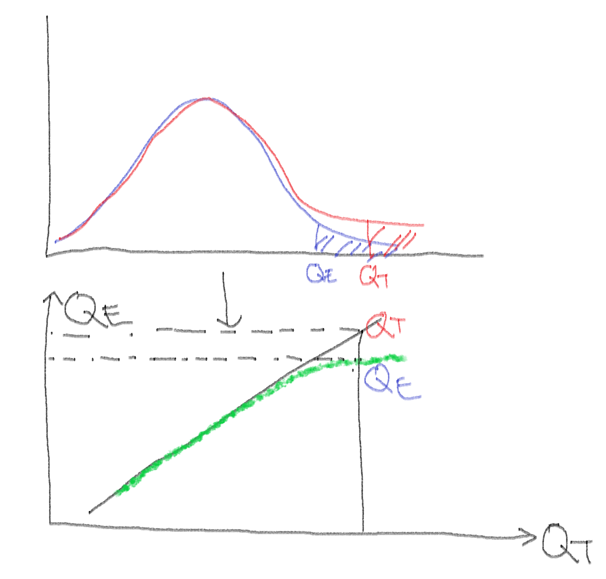
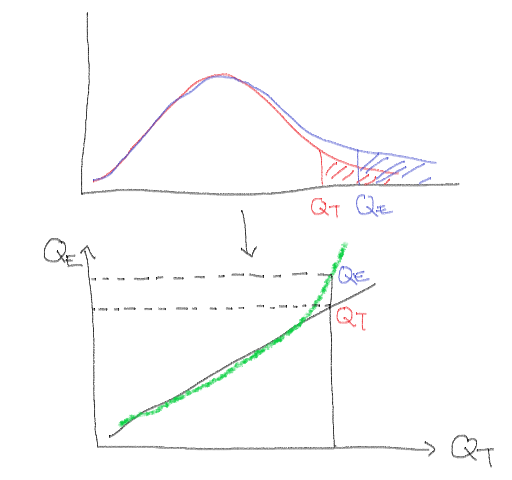

```{r setup, include=FALSE}
library(knitr)

# readr 은 파일을 읽을 때마다 열 유형 요약을 메시지로 출력한다. 이 장에서는 끈다.
options(readr.show_col_types = FALSE)

# 출력 폭을 60자로 접는다 (bookdown 판에서 쓰던 linewidth 훅).
options(width = 60, linewidth = 60)
hook_output <- knitr::knit_hooks$get("output")
knit_hooks$set(output = function(x, options) {
  if (!is.null(n <- options$linewidth)) {
    x <- knitr:::split_lines(x)
    if (any(nchar(x) > n)) x <- strwrap(x, width = n)
    x <- paste(x, collapse = "\n")
  }
  hook_output(x, options)
})
```

::: {.callout-important}
**학습 목표**

- 자료에서 **같은 대상이 두 번 이상 측정되었는지**와 반응 변수·설명 변수의 유형을 확인하고, 그에 맞는 검정을
  고를 수 있다.
- Q-Q plot 으로 자료나 잔차의 분포가 정규분포와 어떻게 다른지 읽고, 정규성 검정의 p값을 **표본 크기와 함께**
  해석할 수 있다.
- t 검정과 분산분석을 직접 계산, 내장 함수, `lm()` 세 경로로 계산해 결과가 일치하는지 대조할 수 있다.
- 집단 쌍마다 검정을 되풀이할 때 1종 오류가 얼마나 커지는지 시뮬레이션으로 확인하고, 사후검정 결과를 해석할
  수 있다.
- 검정 결과를 broom 으로 표에 정리하고, 표의 수치마다 무엇을 뜻하는지 한두 문장으로 쓸 수 있다.
- AI 가 고른 검정이 자료 구조에 맞는지, 생성된 코드가 짝을 올바르게 맞추는지 확인할 수 있다.

:::

9장에서는 95% 신뢰구간이 모평균을 95% 포함하는지, 유의수준 5% 검정이 귀무가설이 참일 때 5% 기각하는지를 반복
실험으로 확인했다. 이 장에서는 자료 하나가 주어졌을 때 **어떤 검정을 쓸지 고르고**,
**계산이 맞는지 다른 경로와 대조하고**, **출력의 수치가 무엇을 뜻하는지** 문장으로 쓴다.

t 검정이나 분산분석 코드는 AI 에게 요청하면 바로 얻을 수 있다. 그러나 같은 사람을 두 번 잰 자료라는 사실을 보지 않으면 자료에
맞지 않는 검정을 고르게 되고, 코드는 오류 없이 끝난다. 이전 판 강의노트에도 그런 분석이
있었다(@sec-sleep-paired). 그래서 이 장은 검정 이름보다 자료 구조를 먼저 본다. 검정을 고른 근거를 적고 계산을
대조하는 절차는 AI 가 제안한 분석을 검증할 때도 그대로 쓴다(@sec-ai-basic-stat).

::: {.callout-note}
**예제 자료**: R 에 들어 있는 자료와 이전 판 강의노트의 자료를 쓰고, 8절에서만 이 장의 연습 파일을 쓴다.

| 자료 | 내용 | 쓰는 절 |
|:--|:--|:--|
| `iris`, `mtcars`, `sleep`, `anscombe` | R 에 들어 있는 자료 | 2, 3, 6 |
| `dataset/DBP.txt` | 혈압강하제 임상시험 40명(시험약 A 20명, 위약 B 20명). 이완기 혈압을 투약 전과 투약 뒤 매달 네 번, 모두 다섯 번 잼 | 1, 3 |
| `data/dysmenorrhea.rds` | 월경통 환자 23명과 대조군 24명(19~29세)의 맥파와 신체 측정 (임상연구 자료의 일부) | 3, 7 |
| `coagulation` | faraway 패키지. 동물 24마리를 네 가지 먹이에 배정하고 잰 혈액 응고 시간 | 1, 4, 5 |
| `dataset/titanic3.csv` | 타이타닉호 승객 1,309명 (12장에서 쓴 파일) | 1, 6 |
| 차 맛보기 표 | `?fisher.test` 의 예제 (Fisher, 1935) | 6 |
| `dataset/ch14/sleep-drug.csv` | 두 수면제 연습 파일 | 8 |

: {tbl-colwidths="[30,52,18]"}

`dataset/ch14/sleep-drug.csv` 를 다시 만드는 스크립트는 같은 폴더의 `make-ch14-data.R` 이다. 파일에 들어 있는
함정은 8절에서 드러나므로 스크립트는 이 장을 끝낸 뒤에 열어 보기를 권한다.

:::

::: {.callout-caution}
**R 4.4.0 이상이 필요하다.** @sec-sleep-paired 에서 다루는 `t.test()` 의 formula 와 `paired = TRUE` 를 함께 쓰는
코드는 R 4.4.0 부터 오류를 낸다. 이 강의노트는 R 4.6.1 로 실행했다. `getRversion()` 으로 버전을 확인한다.

이 장에서 새로 쓰는 패키지는 `install.packages(c("broom", "faraway", "car"))` 로 설치한다.

`data/dysmenorrhea.rds` 는 학생 배포용 `dataset.zip` 에 들어 있지 않다.
[이전 판 강의노트의 저장소](https://github.com/zorba78/stat-package-lecture/blob/master/data/dysmenorrhea.rds) 에
있는 파일을 프로젝트 폴더의 `data/` 에 내려받는다.

```r
dir.create("data", showWarnings = FALSE)   # data 폴더가 없으면 만든다
download.file(
  "https://raw.githubusercontent.com/zorba78/stat-package-lecture/master/data/dysmenorrhea.rds",
  "data/dysmenorrhea.rds", mode = "wb"
)
```

:::

이 장에서 쓰는 패키지를 불러온다.

```{r packages}
library(readr)    # 파일 읽기 (11장)
library(dplyr)    # 행 고르기, 요약 (12장)
library(tidyr)    # 모양 바꾸기 (12장)
library(ggplot2)  # 그림
library(broom)    # 검정 결과를 데이터 프레임으로 (7절)
```

faraway 와 car 는 `library()` 로 붙이지 않고 `faraway::coagulation`, `car::leveneTest()` 처럼 `::` 로 쓴다.
car 를 붙이면 car 의 `recode()` 가 dplyr 의 `recode()` 를 가린다.

## 검정을 고르기 전에 {#sec-test-choice}

검정 이름을 떠올리기 전에 자료가 어떻게 생겼는지부터 본다. 같은 대상을 두 번 쟀는지, 반응 변수와 설명 변수가
연속형인지 범주형인지에 따라 쓸 검정이 정해진다. 이 절의 마지막 표(자료 구조별 검정)로 장 전체에서 검정을 고른다.

### 같은 사람을 두 번 쟀는가 {#sec-paired-or-independent}

가상의 두 표가 있다. 앞의 표는 학생 10명이 수학 학원에 다니기 전과 다닌 뒤에 본 시험 점수이고, 뒤의 표는 두 반
학생 각 10명의 시험 점수다. 두 표 모두 `구분` 과 `점수` 두 열에 20행이다.

```{r make-two-tables}
#| code-fold: true
#| code-summary: "두 표를 만든 코드 (예측한 뒤에 열어 보자)"
set.seed(1407)

# 학원 표: 학생마다 실력이 다르고(평균 70, 표준편차 10), 전후 시험에 같은 실력이 들어간다.
ability <- round(rnorm(10, mean = 70, sd = 10))
academy <- tibble(
  번호 = rep(1:10, times = 2),
  구분 = rep(c("전", "후"), each = 10),
  점수 = round(c(ability + rnorm(10, 0, 3), ability + 5 + rnorm(10, 0, 3)))
)

# 두 반 표: 서로 다른 학생 20명
two_class <- tibble(
  번호 = 1:20,
  구분 = rep(c("1반", "2반"), each = 10),
  점수 = round(c(rnorm(10, 70, 10), rnorm(10, 75, 10)))
)
```

::: {layout-ncol=2}

```{r show-academy}
academy |> select(구분, 점수)
```

```{r show-two-class}
two_class |> select(구분, 점수)
```

:::

::: {.callout-tip}
**예측해 보자**: 두 표 가운데 어느 표의 두 집단에 짝이 있는가? 표의 어느 부분을 보면 알 수 있는가?

:::

`구분` 과 `점수` 두 열만으로는 알 수 없다. 두 표는 모양이 같다. 짝이 있는지는 **누구를 쟀는지** 적은 열이 있어야
드러난다. 실제 자료에는 대개 그런 열(학생 번호, 환자 번호)이 있다. 앞에서는 두 표의 `번호` 열을 빼고 보였다. 그
열을 세어 보자.

```{r count-id}
c(행 = nrow(academy), 학생 = n_distinct(academy$번호))
c(행 = nrow(two_class), 학생 = n_distinct(two_class$번호))

academy |> count(번호) |> head(3)
```

학원 표는 20행에 학생이 10명이고 한 학생이 두 번씩 나온다. 두 반 표는 20행에 학생이 20명이다. 학원 표는 **같은
학생을 두 번 잰** 자료다.

같은 학생을 두 번 재면 무엇이 달라지는가? 수학을 잘하던 학생은 학원에 다니기 전에도 다닌 뒤에도 점수가 높다.
학생마다 다른 이 수준을 **개인차**라 한다. 넓은 표로 펴서 전후 점수와 그 차이를 학생마다 나란히 놓아 보자.

```{r academy-wide}
academy_wide <- academy |>
  pivot_wider(names_from = 구분, values_from = 점수) |>
  mutate(차이 = 후 - 전)

academy_wide

academy_wide |> summarise(across(c(전, 후, 차이), sd))
cor(academy_wide$전, academy_wide$후)
```

전 점수와 후 점수의 표준편차는 각각 `r round(sd(academy_wide$전), 1)` 점, `r round(sd(academy_wide$후), 1)` 점이지만
차이의 표준편차는 `r round(sd(academy_wide$차이), 1)` 점이다. 전 점수가 높은 학생이 후 점수도 높아서(상관계수
`r round(cor(academy_wide$전, academy_wide$후), 2)`), 학생마다
차이를 구하면 학생마다의 수준이 빠진다. 차이에 남는 것은 학원에 다닌 뒤의 변화와 시험마다 생기는 측정 오차다. 두 반
표에서는 1반의 어느 학생과 2반의 어느 학생을 짝 지을 근거가 없으므로 이런 차이를 구할 수 없다.

이제 두 용어를 정한다.

- **대응 표본**(paired samples): 같은 대상(또는 미리 짝 지은 대상)을 두 조건에서 잰 두 표본. 대상마다 차이를
  구해, 차이 하나로 이루어진 표본으로 분석한다.
- **독립 표본**(independent samples): 서로 다른 대상을 잰 두 표본. 한 표본의 값이 다른 표본의 어느 값과도 짝을
  이루지 않는다.

대응 표본의 검정은 @sec-paired-t 에서 다룬다. 이전 판 노트가 대응 표본을 독립 표본으로 분석한 사례는
@sec-sleep-paired 에서 본다.

::: {.callout-important}
자료를 받으면 누구를 쟀는지 적은 열(키)이 두 번 이상 나오는지 `count()` 나 `n_distinct()` 로 센다. 열 이름이나
앞 몇 줄만 보고 판단하지 않는다. 12장 [한 행은 무엇인가](12-data-handling.html#sec-row-unit) 에서 한 확인과 같다.

:::

### 기초통계 용어 다시 보기 {#sec-stat-terms}

검정을 고르고 결과를 해석할 때 쓰는 용어를, 9장에서 시뮬레이션으로 확인한 곳과 함께 한 표로 모은다.

::: {.callout-tip}
**예측해 보자**: 어떤 검정에서 p값이 0.03 이 나왔다. 귀무가설이 참일 확률이 3% 라는 뜻인가?

:::

| 용어 | 이 장에서 쓰는 뜻 | 시뮬레이션으로 확인한 곳 |
|:--|:--|:--|
| 모집단(population)과 표본(sample) | 알고 싶은 대상 전체와, 그 가운데 실제로 잰 일부. 표본을 다시 뽑으면 표본평균 같은 통계량이 달라진다 | [9장 '중심극한정리'](09-simulation.html#sec-clt) |
| 귀무가설(null hypothesis, $H_0$)과 대립가설(alternative hypothesis, $H_1$) | 귀무가설은 '두 모평균이 같다'처럼 검정이 출발점으로 삼는 가설, 대립가설은 그와 반대되는 가설 | [9장 '1종 오류와 p-값의 분포'](09-simulation.html#sec-type1-error) |
| 검정통계량(test statistic) | 자료에서 계산해, 자료가 귀무가설과 얼마나 맞지 않는지 재는 값. t, F, $\chi^2$ | [9장 '가정이 깨지면'](09-simulation.html#sec-assumption) |
| 유의수준(significance level) $\alpha$ | 귀무가설이 참일 때 기각할 확률의 상한으로 미리 정해 두는 값. 이 장은 0.05 | [9장 '1종 오류와 p-값의 분포'](09-simulation.html#sec-type1-error) |
| p값(p-value) | 귀무가설이 참이라고 가정할 때, 관측한 것만큼 또는 그보다 더 극단적인 검정통계량이 나올 확률 | [9장 '1종 오류와 p-값의 분포'](09-simulation.html#sec-type1-error) |
| 1종 오류(type I error) | 귀무가설이 참인데 기각하는 잘못. 그 확률을 $\alpha$ 이하로 맞춘다 | [9장 '1종 오류와 p-값의 분포'](09-simulation.html#sec-type1-error) |
| 2종 오류(type II error)와 검정력(power) | 2종 오류는 대립가설이 참인데 기각하지 못하는 잘못. 검정력은 실제 차이가 있을 때 기각할 확률(1 − 2종 오류의 확률) | [9장 '검정력'](09-simulation.html#sec-power) |
| 신뢰구간(confidence interval) | 같은 방법으로 표본을 거듭 뽑아 구간을 만들면 그 가운데 신뢰수준(이 장은 95%)만큼이 참값을 덮도록 만든 구간 | [9장 '신뢰구간의 의미'](09-simulation.html#sec-ci-meaning) |
| 자유도(degrees of freedom) | t, F, $\chi^2$ 분포의 모양을 정하는 수. 표본 n 개의 표본분산은 평균을 하나 추정하고 남은 n − 1 | 이 장 @sec-paired-t, @sec-anova-f-test |
| 효과 크기(effect size) | 차이나 관계의 크기를 원래 단위나 표준편차 단위로 나타낸 값. 실제 차이가 있을 때 표본이 커지면 p값은 작아지지만 효과 크기의 추정값은 커지지 않는다 | [9장 '검정력'](09-simulation.html#sec-power) |

: {tbl-colwidths="[24,52,24]"}

::: {.callout-important}
p값은 귀무가설이 참일 확률이 아니며, 1종 오류를 범할 확률도 아니다.

:::

예측의 답은 '아니다'이다. p값은 귀무가설이 참이라고 **가정하고** 계산한 확률이므로, 그 가정이 참일 확률을 말해
주지 않는다. 9장에서 귀무가설이 참인 자료를 10,000번 만들어 검정했을 때 p값은 0 과 1 사이에 고르게 흩어졌고,
p < 0.05 가 약 5% 나왔다. 귀무가설이 참이어도 p = 0.03 은 나올 수 있다.

반대 방향의 오해도 있다. 귀무가설을 기각하지 못했다는 것은 '차이가 없다'는 증거가 아니다. 표본이 작아 검정력이
낮으면 실제 차이가 있어도 기각하지 못할 확률(1 − 검정력)이 크다. 이 사실은 @sec-normality-power 의 정규성 검정에서 수치로 다시 본다.

### 자료 구조로 검정 고르기 {#sec-choose-test}

분석할 자료를 얻는 방법은 두 가지다.

- **관찰**(observation): 반응 변수와 설명 변수를 모두 관찰해서 얻는다. 예: 표본조사, 코호트 연구, 단면연구.
- **실험**(experiment): 연구자가 설명 변수의 값을 정하고 반응을 관찰한다. 연구자가 정하는 설명 변수를
  **요인**(factor), 요인이 가질 수 있는 값을 **수준**(level)이라 한다. 대상을 수준에 **무작위로 배정**(random
  assignment)하면 수준 사이의 차이를 요인의 효과로 볼 근거가 생긴다. 예: 무작위 임상시험.

이 장의 예제 가운데 혈압강하제 임상시험과 `coagulation` 은 실험, 타이타닉호 승객 자료는 관찰로 얻은 자료다.

::: {.callout-tip}
**예측해 보자**: 다음 세 질문에는 어떤 검정을 쓰겠는가? 반응 변수와 설명 변수가 연속형인지 범주형인지, 같은
대상을 두 번 쟀는지를 먼저 적어 보자.

- 질문 가: 혈압강하제 임상시험에서 시험약 군과 위약군의 4개월 뒤 혈압 변화를 비교한다.
- 질문 나: 타이타닉호 승객의 객실 등급에 따라 생존 여부가 다른지 본다.
- 질문 다: 네 가지 먹이에 따라 혈액 응고 시간이 다른지 본다.

:::

세 자료를 읽어 한 행이 무엇인지, 집단이 몇 개인지 확인한다.

```{r three-questions}
dbp <- read_tsv("dataset/DBP.txt")
titanic <- read_csv("dataset/titanic3.csv")
coagulation <- faraway::coagulation

# 질문 가: 한 행은 환자 한 명인가? 군마다 몇 명인가?
c(행 = nrow(dbp), 환자 = n_distinct(dbp$Subject))
dbp |> count(TRT)

# 질문 나: 객실 등급(1, 2, 3)과 생존 여부(0, 1)
titanic |> count(pclass, survived)

# 질문 다: 먹이마다 동물 수
coagulation |> count(diet)
```

`dbp` 는 한 행이 환자 한 명이고 시험약 군(A)과 위약군(B)에 20명씩 있다. 환자를 두 군에 무작위로 배정했고 B 가
위약군이라는 것은 이전 판 노트 7장 '시뮬레이션'(`07-simulation.Rmd` 1093줄)의 서술을 따른다. 혈압은 투약 전(`DBP1`)과 투약 뒤 매달
(`DBP2`~`DBP5`) 쟀다. `titanic` 의 객실 등급과 생존 여부는 둘 다 범주형이다. `coagulation` 은 동물 24마리가 네
먹이에 4, 6, 6, 8마리씩 나뉘어 있다. 이 확인을 다음 표와 대조한다.

| 반응 변수 | 설명 변수 | 관측의 짝 | 검정 | R 함수 | 이 장 |
|:--|:--|:--|:--|:--|:--|
| 연속 | 없음(기준값과 비교) | 해당 없음 | 일표본 t 검정 | `t.test(x, mu = )` | @sec-paired-t |
| 연속 | 두 시점 또는 두 처리, 같은 대상 | 대응 | 대응 표본 t 검정 | `t.test(x, y, paired = TRUE)` | @sec-paired-t, @sec-sleep-paired |
| 연속 | 범주 2개, 다른 대상 | 독립 | 독립 이표본 t 검정 | `t.test(y ~ g)` (기본은 Welch) | @sec-indep-t |
| 연속 | 범주 3개 이상, 다른 대상 | 독립 | 일원배치 분산분석 → 사후검정 | `aov()`, `anova(lm())`, `TukeyHSD()` | @sec-oneway-anova, @sec-anova-case |
| 범주 | 범주 | 독립 | 카이제곱 독립성 검정, Fisher 정확검정 | `chisq.test()`, `fisher.test()` | @sec-chisq-test, @sec-fisher-exact |
| 연속 | 연속 | 해당 없음 | 상관계수 검정 | `cor.test()` | @sec-cor-test |

: {tbl-colwidths="[10,20,10,22,24,14]"}

- 정규성 가정이 의심될 때 쓰는 순위 기반 검정으로 Wilcoxon 검정(`wilcox.test()`)과 Kruskal–Wallis 검정
  (`kruskal.test()`)이 있다. 이 장에서는 t 검정의 결론을 다시 확인하는 데에만 쓴다.
- 요인이 둘인 이원배치 분산분석과 같은 대상을 세 번 이상 잰 반복측정 분산분석은 이 장의 범위 밖이다. 반응이
  0 과 1 인 자료의 회귀는 8장 [로지스틱 회귀](08-algorithms.html#sec-nr-logistic)에서 다루었다.
- 혈압강하제 임상시험처럼 투약 전 값(`DBP1`)이 있는 무작위 시험에서는 투약 전 값을 공변량으로 넣는
  공분산분석(analysis of covariance, ANCOVA)으로 두 군을 비교하는 방법도 있다. 이 장의 범위 밖이며, 이 장은
  변화량의 t 검정으로 비교한다.

예측의 답을 표로 확인한다.

- 질문 가: 반응은 연속형(4개월 뒤 혈압의 변화 `DBP5 - DBP1`), 설명 변수는 범주 2개(군)이고 두 군은 서로 다른
  환자다. 그러므로 **변화량**에 대한 독립 이표본 t 검정이다. 군 하나 안에서 전후 혈압을 비교하는 대응 표본 t
  검정은 이 질문의 답이 아니다. 왜 그런지는 @sec-placebo 에서 위약군의 혈압으로 확인한다.
- 질문 나: 반응(생존 여부)과 설명 변수(객실 등급)가 모두 범주형이다. 카이제곱 독립성 검정이다(@sec-chisq-test).
- 질문 다: 반응은 연속형, 설명 변수는 범주 4개, 동물마다 먹이 하나다. 일원배치 분산분석이고, 어느 먹이끼리 다른지는
  사후검정으로 본다(@sec-oneway-anova, @sec-anova-case).

## 분포 확인: 분위수와 Q-Q plot {#sec-quantile-qq}

t 검정과 분산분석은 자료(정확히는 오차)가 정규분포를 따른다고 가정한다. 이 절에서는 자료의 분포가 정규분포와
어디서 다른지 그림으로 확인하는 Q-Q plot 을 직접 만들고 읽는다. Q-Q plot 은 분위수끼리 비교하는 그림이므로
분위수부터 정한다. 이 절의 읽는 법은 @sec-anova-case 에서 분산분석의 잔차를 확인할 때 다시 쓴다.

### 분위수 {#sec-sample-quantile}

학생 100명을 키 순서로 한 줄로 세웠다고 하자. 25번째 학생과 26번째 학생 사이의 키를 경계로 삼으면 그보다 작은
학생이 25명, 큰 학생이 75명이다. 이 키가 하위 25% 의 경계다. 50번째와 51번째 학생 사이의 키는 한가운데, 곧
중앙값이다.

확률 $p$ 의 **분위수**(quantile)는 이런 경계값이다. 확률분포에서는 누적분포함수 $F(x) = P(X \le x)$ 의 역함수
$Q(p) = F^{-1}(p)$ 로 정의한다. 표준정규분포의 0.975 분위수가 `qnorm(0.975)` = 1.96 이다. 자주 쓰는 분위수에는
이름이 있다.

- 2-분위수: 자료를 반으로 나누는 값 하나. 중앙값(median)이다.
- 4-분위수(quartile): 25%, 50%, 75% 의 세 값($Q_1$, 중앙값, $Q_3$). $Q_3 - Q_1$ 을 사분위수 범위(interquartile
  range, IQR)라 한다.
- 100-분위수(percentile): 1%, 2%, ..., 99% 의 99개 값. 백분위수라 한다.

표본 $n$ 개로 분위수를 구할 때는 자료를 크기 순으로 늘어놓은 **순서통계량**(order statistics)
$x_{(1)} \le x_{(2)} \le \cdots \le x_{(n)}$ 을 쓴다. 표본 분위수는 순서통계량의 가중평균이다. 그런데 확률 $p$ 가
두 순서통계량 사이에 떨어지는 경우가 많아, 그 사이를 어떻게 정하느냐에 따라 값이 달라진다.

::: {.callout-tip}
**예측해 보자**: 1 부터 10 까지 열 개의 수에서 0.25 분위수 `quantile(1:10, 0.25)` 는 3 인가 3.25 인가?

:::

```{r quantile-types}
quantile(1:10, 0.25)             # 기본값 type = 7
quantile(1:10, 0.25, type = 5)

# 아홉 가지 방법을 모두 계산한다
q9 <- sapply(1:9, \(type) quantile(1:10, 0.25, type = type, names = FALSE))
names(q9) <- paste0("type", 1:9)
q9
```

R 의 `quantile()` 은 표본 분위수를 계산하는 방법 9가지를 `type` 인수로 고른다. **기본값은 type 7** 이고 결과는
`r quantile(1:10, 0.25)` 이다. type 5 는 `r quantile(1:10, 0.25, type = 5)` 이다. 같은 자료의 0.25 분위수가 방법에
따라 2 에서 3.25 사이로 달라졌다.

- 방법 1~3 은 표본 분위수 함수가 **계단 함수**다. 결과가 늘 자료값 가운데 하나다(type 1, 2, 3 의 결과 3, 3, 2).
- 방법 4~9 는 이웃한 두 순서통계량 사이를 **선형 보간**한다. 보간할 위치를 정하는 식이 방법마다 다르다.

type 5 는 $k$ 번째 순서통계량의 위치를 누적 확률 $p_k = (k - 0.5)/n$ 으로 보고, 그 사이를 보간한다.

$$
Q(p) = (1 - \gamma)\, x_{(j)} + \gamma\, x_{(j+1)}, \qquad j = \lfloor np + 0.5 \rfloor, \quad \gamma = np + 0.5 - j
$$

`1:10` 에서 $p = 0.25$ 이면 $np + 0.5 = 3$ 이라 $j = 3$, $\gamma = 0$ 이고 $Q(0.25) = x_{(3)} = 3$ 이다. type 7 은
$x_{(1)}$ 을 확률 0, $x_{(n)}$ 을 확률 1 에 두고 보간한다. $h = (n - 1)p + 1 = 3.25$ 번째 값이므로 $x_{(3)}$ 과
$x_{(4)}$ 사이의 0.25 지점, 곧 3.25 다.

::: {.callout-caution}
다른 프로그램이나 교재, 손 계산의 분위수와 R 의 결과가 다르면 먼저 계산 방법(`type`)이 같은지 확인한다. 표본이
크면 방법 사이의 차이는 작아진다.

:::

### 분위수 함수 직접 만들기 {#sec-my-quantile}

이전 판 노트는 type 5 의 식을 함수로 직접 만들고 `quantile(type = 5)` 와 대조했다. **이전 판 노트의 코드**를 그대로
싣는다(이전 판 `12-basic-stat-analysis.Rmd` 116~138줄).

```{r old-my-quantile}
# 분위수 계산 함수
my_quantile <- function(x, probs) {
  idx <- NULL
  o <- order(x); n <- length(x)
  xord <- x[o]
  k <- 1:n
  gamma <- n * probs + 0.5 - floor(n * probs + 0.5)
  pk <- (k - 0.5)/n
  for (pj in probs) {
    idx <- c(idx, which.max(pk[pk <= pj]))
  }
  res <- (1 - gamma) * xord[idx] + gamma * xord[idx + 1]
  names(res) <- sprintf("%.1f %%", round(probs * 100))
  return(res)
}


set.seed(10)
x <- rnorm(373)
my_quantile(x, probs = c(0.05, 0.95))
# 확인
quantile(x, probs = c(0.05, 0.95), type = 5)
```

5% 와 95% 에서 두 결과가 같다. 이전 판 노트는 이것으로 함수를 확인했다.

::: {.callout-tip}
**예측해 보자**: `my_quantile(x, probs = c(0.001, 0.5, 0.999))` 의 결과도 `quantile(x, probs = c(0.001, 0.5, 0.999), type = 5)`
와 같겠는가?

:::

```{r old-my-quantile-edge}
#| warning: true
my_quantile(x, probs = c(0.001, 0.5, 0.999))
quantile(x, probs = c(0.001, 0.5, 0.999), type = 5)
```

경고 두 줄과 함께 세 값이 모두 틀렸다. 0.1% 자리와 99.9% 자리에 중앙값에 가까운 값이 나왔고, 중앙값 자리는
`NA` 다. 이름표도 0.1% 를 `0.0 %`, 99.9% 를 `100.0 %` 로 적었다. 어디서 틀렸는지 반복문 안의 식을 확률 하나씩
실행해 보자. `pk` 는 순서통계량의 위치 $p_k = (k - 0.5)/n$ 이다.

```{r old-my-quantile-debug}
n <- length(x)
pk <- (1:n - 0.5) / n
pk[1]                          # 가장 작은 위치 0.5/n

which.max(pk[pk <= 0.001])     # 0.001 보다 작거나 같은 위치가 없다
which.max(pk[pk <= 0.5])
which.max(pk[pk <= 0.999])     # 마지막 순서통계량
```

확률 0.001 은 가장 작은 위치 $p_1 = 0.5/373 =$ `r round(0.5 / 373, 5)` 보다 작다. 조건을 만족하는 원소가 없으면
`which.max()` 는 길이가 0 인 `integer(0)` 을 돌려주고, `c(idx, integer(0))` 은 아무것도 붙이지 않는다. 그래서
`idx` 는 길이 3 이 아니라 2 인 `c(187, 373)` 이 되었다. 길이 3 인 `gamma` 와 곱하면서 짧은 `idx` 가 재활용되었고,
경고는 이 재활용을 알린 것이다. 첫째와 셋째 자리는 187번째와 188번째 값 사이(중앙값 근처)로 계산되었고, 둘째
자리는 373번째 값과 존재하지 않는 374번째 값(`NA`)으로 계산되었다. 확률이 $(n - 0.5)/n$ 이상이면 `idx + 1` 이
$n + 1$ 이 되어 범위를 벗어나는 결함도 있다.

고친 함수는 반복문 없이 확률마다 $j = \lfloor np + 0.5 \rfloor$ 를 직접 계산한다. $j < 1$ 이면 첫째 값,
$j \ge n$ 이면 마지막 값을 쓴다. 확률 하나가 결과 하나를 만들므로 길이가 어긋날 수 없다.

```{r my-quantile-fixed}
my_quantile2 <- function(x, probs) {
  xord <- sort(x)
  n <- length(xord)
  j <- floor(n * probs + 0.5)          # 아래쪽 순서통계량의 번호
  gamma <- n * probs + 0.5 - j         # 위쪽 값으로 옮겨 가는 비율
  lo <- xord[pmin(pmax(j, 1), n)]      # j < 1 이면 첫째 값
  hi <- xord[pmin(pmax(j + 1, 1), n)]  # j + 1 > n 이면 마지막 값
  res <- (1 - gamma) * lo + gamma * hi
  names(res) <- paste0(100 * probs, "%")
  res
}

my_quantile2(x, probs = c(0.001, 0.5, 0.999))
```

세 값이 `quantile(type = 5)` 와 같다. 그러나 이번에도 세 점에서 맞았을 뿐이다. 0 과 1 을 포함해 0.0005 간격으로
확률 2,001개의 격자를 만들어 두 함수를 모두 내장 함수와 대조한다.

```{r my-quantile-grid}
#| warning: true
p <- seq(0, 1, by = 0.0005)              # 양 끝 0 과 1 을 포함한 격자
q5 <- quantile(x, p, type = 5, names = FALSE)

old <- my_quantile(x, p)
old_wrong <- sum(abs(old - q5) > 1e-8, na.rm = TRUE)
c(격자 = length(p), 이전판_다름 = old_wrong, 이전판_NA = sum(is.na(old)),
  p1보다_작은_확률 = sum(p < 0.5 / length(x)))

all.equal(unname(my_quantile2(x, p)), q5)

# 표본이 1~10개일 때도 같은지
set.seed(1422)
sapply(c(1, 2, 5, 10), \(m) {
  z <- rnorm(m)
  isTRUE(all.equal(unname(my_quantile2(z, p)), quantile(z, p, type = 5, names = FALSE)))
})
```

이전 판 함수는 격자 `r format(length(p), big.mark = ",")`개 가운데 `r format(old_wrong, big.mark = ",")`개에서
내장 함수와 다르고 `r sum(is.na(old))`개에서 `NA` 를 냈다. 앞의 확률 `r sum(p < 0.5 / length(x))`개(0, 0.0005,
0.001)에서 `idx` 가 그만큼 짧아져, 그 뒤 확률마다 `r sum(p < 0.5 / length(x))`칸 뒤 확률의 번호가 짝 지어졌다.
고친 함수는 같은 격자에서, 그리고 표본 크기 1, 2, 5, 10 에서도 내장 함수와 같다. 직접 만든 함수는 경계(0, 1, 양
끝 근처)를 넣은 격자에서 내장 함수와 대조한다. 6장에서 다루는 경계 사례 확인과 같은 동작이다.

### Q-Q plot 직접 그리기 {#sec-qq-manual}

우리 반 학생 $n$ 명을 키 순서로 세운 줄이 있다. 그 옆에 '키가 정규분포를 따른다면 이 순번의 학생 키는 얼마여야
하는가'로 만든 줄을 세운다. 같은 순번끼리 짝을 지어 (정규분포로 만든 줄의 키, 우리 반의 키)를 점으로 찍는다.
두 줄의 분포가 같은 모양이면 점들은 한 직선 위에 놓인다. 이 그림이 **Q-Q plot**(quantile-quantile plot)이다.

::: {.callout-tip}
**예측해 보자**: 직접 그린 Q-Q plot 의 x 축과 y 축에 놓이는 값은 각각 무엇인가? 자료가 정규분포를 따르면 점은
어디에 놓이는가?

:::

이전 판 노트의 예제처럼 평균 65, 표준편차 20 인 정규분포에서 몸무게 500개를 만들고 단계마다 표로 확인한다.

```{r qq-manual-table}
set.seed(1234)
weight <- rnorm(500, mean = 65, sd = 20)

n <- length(weight)
qq_manual <- tibble(
  k = 1:n,                          # 순번
  pk = (k - 0.5) / n,               # k 번째 값의 누적 확률
  이론 = qnorm(pk),                  # 표준정규분포의 pk 분위수
  표본 = sort(drop(scale(weight)))   # 표준화한 자료를 크기 순으로
)

head(qq_manual, 3)
tail(qq_manual, 3)
```

x 축에는 **이론 분위수**(theoretical quantile), 곧 표준정규분포에서 $k$ 번째 순번에 해당하는 값 `qnorm(pk)` 를
놓는다. y 축에는 **표본 분위수**(sample quantile), 곧 자료를 크기 순으로 늘어놓은 $k$ 번째 값을 놓는다. 자료를
표준화했으므로 정규분포를 따르면 점은 직선 $y = x$ 근처에 놓인다. 이 표로 그린 그림과 R 의 `qqnorm()`,
`qqline()` 으로 그린 그림을 나란히 놓는다(이전 판 176~205줄).

```{r fig-qq-manual}
#| fig-cap: "직접 계산한 Q-Q plot(왼쪽)과 qqnorm(), qqline() 으로 그린 Q-Q plot(오른쪽). 자료는 정규분포에서 뽑은 몸무게 500개를 표준화한 값"
#| fig-width: 9
#| fig-height: 4.5
par(mfrow = c(1, 2))

plot(qq_manual$이론, qq_manual$표본,
     xlim = c(-3.5, 3.5), ylim = c(-3.5, 3.5),
     pch = 21, bg = "darkgray",
     xlab = "이론 분위수", ylab = "표본 분위수",
     main = "직접 계산")
abline(a = 0, b = 1)

z_weight <- drop(scale(weight))
qqnorm(z_weight, xlim = c(-3.5, 3.5), ylim = c(-3.5, 3.5),
       pch = 21, bg = "darkgray", main = "qqnorm()",
       xlab = "이론 분위수", ylab = "표본 분위수")
qqline(z_weight)
```

두 그림의 점이 같은 자리에 놓이고, 점들은 직선을 따라간다. 그림만 보지 않고 좌표를 대조해 보자. `qqnorm()` 은
그림 대신 좌표를 돌려줄 수도 있다(`plot.it = FALSE`).

```{r qq-manual-check}
qq_r <- qqnorm(z_weight, plot.it = FALSE)

all.equal(sort(qq_r$x), qq_manual$이론)
all.equal(sort(qq_r$y), qq_manual$표본)
```

직접 계산한 좌표와 `qqnorm()` 의 좌표가 같다. `qqnorm()` 은 확률을 `ppoints(n)` 으로 정하는데, $n$ 이 10 보다
크면 $(k - 0.5)/n$ 이고 10 이하면 $(k - 3/8)/(n + 1/4)$ 이다. `qqline()` 은 $y = x$ 가 아니라 이론 분위수와 표본
분위수의 1사분위수 점과 3사분위수 점을 잇는 직선이다. 그래서 표준화하지 않은 자료에서도 쓸 수 있다. 표준화하지
않으면 점들은 절편이 평균, 기울기가 표준편차인 직선 근처에 놓인다.

양 끝 근처의 점은 직선에서 떨어져 있다. `head(qq_manual, 3)` 과 `tail(qq_manual, 3)` 의 출력에서 2번째 점은 이론
분위수 `r sprintf("%.2f", qq_manual$이론[2])` 에 표본 분위수 `r sprintf("%.2f", qq_manual$표본[2])` 으로
`r sprintf("%.2f", abs(qq_manual$표본[2] - qq_manual$이론[2]))`, 499번째 점은 `r sprintf("%.2f", qq_manual$이론[499])` 에
`r sprintf("%.2f", qq_manual$표본[499])` 로 `r sprintf("%.2f", abs(qq_manual$표본[499] - qq_manual$이론[499]))` 차이
난다. 정규분포에서 뽑은 자료에서도 양 끝은 값이 드물어 표본마다 달라지는 정도가 크다(@sec-normality-check).

점이 직선에서 벗어나는 방향은 무엇을 뜻하는가? 표본 분위수를 $Q_E$(empirical), 정규분포의 분위수를
$Q_T$(theoretical)라 하자. 이전 판 노트의 손그림 두 장(@fig-qq-tail-thin, @fig-qq-tail-thick)이 오른쪽 꼬리에서
두 값의 관계를 보여 준다.

- $Q_E < Q_T$: 같은 순번에서 표본의 값이 이론값보다 작다. 점이 직선 **아래**에 놓인다. 오른쪽 꼬리에서 이렇게
  되면 표본의 오른쪽 꼬리가 정규분포보다 **얇다**.
- $Q_E > Q_T$: 같은 순번에서 표본의 값이 이론값보다 크다. 점이 직선 **위**에 놓인다. 오른쪽 꼬리에서 이렇게
  되면 표본의 오른쪽 꼬리가 정규분포보다 **두껍다**.

::: {layout-ncol=2}

```{r fig-qq-tail-thin}
#| echo: false
#| fig-cap: "$Q_E < Q_T$ 인 경우. 위: 파란 곡선은 표본의 분포, 빨간 곡선은 정규분포다. 오른쪽 끝에 같은 확률(빗금)을 남기는 위치가 표본($Q_E$)이 정규분포($Q_T$)보다 왼쪽이다. 아래: Q-Q plot 의 점(녹색)이 오른쪽 끝에서 직선 아래로 휜다"
#| fig-alt: "손으로 그린 두 그림. 위는 파란 표본 분포 곡선과 빨간 정규분포 곡선으로, 오른쪽 꼬리에서 파란 곡선이 더 빨리 0 에 가까워져 표본 분위수 Q_E 가 이론 분위수 Q_T 보다 왼쪽에 있다. 아래는 가로축 Q_T, 세로축 Q_E 인 Q-Q plot 으로, 녹색 점들이 직선을 따라가다가 오른쪽 끝에서 직선 아래로 휜다."

```

```{r fig-qq-tail-thick}
#| echo: false
#| fig-cap: "$Q_E > Q_T$ 인 경우. 위: 파란 곡선(표본)의 오른쪽 꼬리가 빨간 곡선(정규분포)보다 두꺼워 $Q_E$ 가 $Q_T$ 보다 오른쪽이다. 아래: Q-Q plot 의 점(녹색)이 오른쪽 끝에서 직선 위로 휜다"
#| fig-alt: "손으로 그린 두 그림. 위는 파란 표본 분포 곡선과 빨간 정규분포 곡선으로, 오른쪽 꼬리에서 파란 곡선이 더 높게 남아 표본 분위수 Q_E 가 이론 분위수 Q_T 보다 오른쪽에 있다. 아래는 가로축 Q_T, 세로축 Q_E 인 Q-Q plot 으로, 녹색 점들이 직선을 따라가다가 오른쪽 끝에서 직선 위로 휜다."

```

:::

두 그림은 오른쪽 꼬리만 그렸다. **왼쪽 꼬리에서는 해석이 반대**다. 왼쪽 끝의 점이 직선 아래에 있으면 표본의 작은
값이 이론값보다 더 작다는 뜻이므로 왼쪽 꼬리가 **두껍다**. 왼쪽 끝의 점이 직선 위에 있으면 왼쪽 꼬리가 **얇다**.

### Q-Q plot 의 네 가지 모양 {#sec-qq-shapes}

꼬리의 두께와 치우침이 Q-Q plot 에서 어떤 모양으로 나타나는지 네 분포로 확인한다. 이전 판 노트의 네 예제(균등분포
U(−2, 2), 자유도 8 인 t 분포, 비율이 3 인 지수분포, 베타분포 Beta(4, 1)에서 각각 10,000개)를 한 그림에 모으고
분포의 이름을 가렸다.

```{r fig-qq-four}
#| fig-cap: "네 분포에서 10,000개씩 뽑아 표준화한 자료의 정규 Q-Q plot. 어느 그림이 어느 분포인지는 가렸다"
#| fig-width: 8
#| fig-height: 7
#| code-fold: true
#| code-summary: "그림을 만든 코드 (예측한 뒤에 열어 보자)"
set.seed(100); x_unif <- runif(10000, min = -2, max = 2)
set.seed(100); x_beta <- rbeta(10000, shape1 = 4, shape2 = 1)
set.seed(100); x_t8   <- rt(10000, df = 8)
set.seed(100); x_exp  <- rexp(10000, rate = 3)

four <- list("보기 가" = x_unif, "보기 나" = x_beta, "보기 다" = x_t8, "보기 라" = x_exp)

par(mfrow = c(2, 2), mar = c(4, 4, 2.5, 1))
for (nm in names(four)) {
  z <- drop(scale(four[[nm]]))
  qqnorm(z, main = nm, pch = 16, cex = 0.5, col = "darkgray",
         xlab = "이론 분위수", ylab = "표본 분위수")
  qqline(z)
}
```

::: {.callout-tip}
**예측해 보자**: 보기 가~라 가운데 꼬리가 정규분포보다 두꺼운 것은 어느 것인가? 오른쪽으로 치우친(오른쪽 꼬리가
긴) 것은 어느 것인가? 앞 소절의 규칙(오른쪽 끝과 왼쪽 끝에서 점이 직선 위인가 아래인가)으로 판단해 보자.

:::

같은 자료의 밀도(파란 곡선)를 표준정규분포의 밀도(검은 곡선)와 겹쳐 그리고 분포의 이름을 밝힌다.

```{r fig-density-four}
#| fig-cap: "그림의 네 자료(표준화)의 밀도(파란 곡선)와 표준정규분포의 밀도(검은 곡선)"
#| fig-width: 8
#| fig-height: 7
titles <- c("보기 가: 균등분포 U(-2, 2)", "보기 나: 베타분포 Beta(4, 1)",
            "보기 다: t 분포, 자유도 8", "보기 라: 지수분포, 비율 3")
zz <- seq(-6, 6, by = 0.01)

par(mfrow = c(2, 2), mar = c(4, 4, 2.5, 1))
for (i in 1:4) {
  z <- drop(scale(four[[i]]))
  plot(density(z), col = "blue", lwd = 1.5, main = titles[i],
       xlim = c(-4, 4), ylim = c(0, 0.75), xlab = "표준화한 값", ylab = "밀도")
  lines(zz, dnorm(zz), lwd = 1.5)
}
```

답은 꼬리가 두꺼운 것이 보기 다(t 분포), 오른쪽으로 치우친 것이 보기 라(지수분포)다. 네 모양을 앞 소절의 규칙으로
읽으면 다음과 같다.

- 양 끝이 직선 안쪽으로 눕는 S자(왼쪽 끝은 직선 위, 오른쪽 끝은 직선 아래): 양쪽 꼬리가 모두 **얇다**. 보기 가,
  균등분포.
- 양 끝이 직선 바깥으로 벌어지는 S자(왼쪽 끝은 직선 아래, 오른쪽 끝은 직선 위): 양쪽 꼬리가 모두 **두껍다**.
  보기 다, t 분포.
- 아래로 볼록한 곡선(가운데는 직선 아래, 양 끝은 직선 위): 왼쪽 꼬리는 얇고 오른쪽 꼬리는 두껍다. **오른쪽으로
  치우침**. 보기 라, 지수분포.
- 위로 볼록한 곡선(가운데는 직선 위, 양 끝은 직선 아래): 왼쪽 꼬리는 두껍고 오른쪽 꼬리는 얇다. **왼쪽으로
  치우침**. 보기 나, Beta(4, 1).

t 분포는 가운데 부분이 정규분포와 거의 같고 양 끝의 점들만 직선에서 벗어난다. 몇 개나 되는지 세어 보자.

```{r t8-tail-count}
z_t8 <- drop(scale(x_t8))
c(t분포_3넘음 = sum(abs(z_t8) > 3),             # 표준화한 값의 절댓값이 3 을 넘는 점
  정규분포_기대 = round(10000 * 2 * pnorm(-3)))  # 정규분포라면 기대되는 개수
```

표준화한 값의 절댓값이 3 을 넘는 점이 t 분포 표본에는 `r sum(abs(z_t8) > 3)`개 있고, 정규분포에서 10,000개를
뽑았다면 약 `r round(10000 * 2 * pnorm(-3))`개가 기대된다. 꼬리가 두껍다는 것은 이런 극단값이 더 자주 나온다는 뜻이다.

`qqnorm()` 은 정규분포와만 비교한다. 다른 분포와 비교하려면 이론 분위수를 직접 만들어 `qqplot(이론 분위수, 자료)`
로 그린다. 자유도 3 인 카이제곱분포에서 뽑은 500개를 정규분포와 카이제곱분포에 각각 비교해 보자(이전 판
358~368줄).

```{r fig-qq-chisq}
#| fig-cap: "카이제곱분포(자유도 3)에서 뽑은 500개. 정규분포와 비교하면 아래로 볼록하게 휘고(왼쪽), 카이제곱분포(자유도 3)와 비교하면 직선을 따른다(오른쪽)"
#| fig-width: 9
#| fig-height: 4.5
set.seed(100)
y_chisq <- rchisq(500, df = 3)
q_chisq <- qchisq(ppoints(500), df = 3)   # 카이제곱분포의 이론 분위수 500개

par(mfrow = c(1, 2))
qqnorm(y_chisq, main = "정규분포와 비교", xlab = "이론 분위수", ylab = "표본 분위수")
qqline(y_chisq)

qqplot(q_chisq, y_chisq, main = "카이제곱분포(자유도 3)와 비교",
       xlab = "이론 분위수", ylab = "표본 분위수")
qqline(y_chisq, distribution = function(p) qchisq(p, df = 3))
```

같은 자료라도 무엇과 비교하느냐에 따라 모양이 다르다. Q-Q plot 의 직선은 '비교 대상 분포와 모양이 같다'는
뜻이다.

### 작은 표본의 Q-Q plot 과 lineup {#sec-normality-check}

지금까지 본 표본은 500개, 10,000개였다. 이 장의 예제에서 집단 하나의 표본은 4~24개다(`coagulation` 4~8마리,
`sleep` 10명, 혈압강하제 임상시험 20명, 월경통 자료 23명과 24명). 표본이 작으면
Q-Q plot 은 표본마다 얼마나 달라지는가?

```{r fig-lineup}
#| fig-cap: "표본 20개짜리 Q-Q plot 아홉 개. 여덟 개는 정규분포, 하나는 지수분포에서 뽑았다"
#| fig-width: 8
#| fig-height: 8
#| code-fold: true
#| code-summary: "그림을 만든 코드 (예측한 뒤에 열어 보자)"
set.seed(1425)
pos <- sample(9, 1)                     # 지수분포 표본을 놓을 자리
lineup <- lapply(1:9, \(i) if (i == pos) rexp(20) else rnorm(20))

z_all <- unlist(lapply(lineup, \(v) drop(scale(v))))
par(mfrow = c(3, 3), mar = c(2.5, 2.5, 2, 1), mgp = c(1.5, 0.5, 0))
for (i in 1:9) {
  z <- drop(scale(lineup[[i]]))
  qqnorm(z, main = i, xlab = "", ylab = "", pch = 16, col = "gray40",
         xlim = c(-2.5, 2.5), ylim = range(z_all))
  qqline(z)
}
```

::: {.callout-tip}
**예측해 보자**: 위의 아홉 그림 가운데 여덟 개는 정규분포에서 뽑은 표본 20개이고, 하나만 지수분포에서 뽑았다.
어느 그림이 지수분포인가? 고른 이유를 적어 보자.

:::

```{r lineup-answer}
pos                                                  # 지수분포 표본의 자리
round(sapply(lineup, \(v) shapiro.test(v)$p.value), 3) # 그림마다 Shapiro-Wilk 검정의 p값
```

지수분포 표본은 `r pos`번이다. 오른쪽 끝 세 점이 직선 위에 있다. 마지막 점의 표준화한 값은
`r round(max(scale(lineup[[pos]])), 1)` 이고 나머지 점들은 1 이하다. 이 그림의 직선이 다른 그림보다 완만한 것도 그 큰 값 하나가 표준편차를 키워 표준화한 값들이 가운데로
모였기 때문이다. 그런데 정규분포에서 뽑은 표본에도 직선에서 벗어난 그림이 있다. 6번은 오른쪽 끝 두 점이 직선
위로 떠 있고, 7번은 왼쪽 끝 한 점이 직선 아래로 떨어져 있다. 표본 20개짜리 Q-Q plot 은 정규분포에서 뽑아도
이만큼 직선에서 벗어난다. 그래서 작은 표본의 Q-Q plot 은 6번, 7번 정도로 직선에서 벗어났다고 바로
'정규분포가 아니다'로 읽지 않는다. 이렇게 정규분포에서 뽑은 그림 여럿 사이에 확인할 그림을 섞어 놓고 골라낼 수
있는지 보는 방법을 **lineup** 이라 한다. 골라낼 수 없다면 그 정도의 벗어남은 표본 변동으로 설명된다.
@sec-anova-case 에서 분산분석의 잔차를 이 방법으로 확인한다.

### 정규성 검정의 검정력 {#sec-normality-power}

자료가 정규분포를 따르는지 검정하는 방법도 있다. Shapiro–Wilk 검정(`shapiro.test()`), Kolmogorov–Smirnov 검정
(`ks.test()`), Anderson–Darling 검정(nortest 패키지의 `ad.test()`) 등이 있고, 귀무가설은 '자료가 정규분포를
따른다'이다. 앞 소절의 출력에서 지수분포 표본의 p값은 0.05 보다 작고 나머지 여덟 개는 0.05 보다 크다. 이번에는
검정이 지수분포를 잡아냈다. 그러나 한 번의 결과다. 이 검정이 정규성 위반을 얼마나 자주 잡아내는지, 곧 검정력을
시뮬레이션으로 재어 보자([9장 '검정력'](09-simulation.html#sec-power)).

::: {.callout-tip}
**예측해 보자**: 지수분포에서 뽑은 표본 4개를 Shapiro–Wilk 검정이 기각하는 비율은 얼마쯤인가? 정규분포와 거의
같은 자유도 30 인 t 분포에서 5,000개를 뽑으면 이 검정은 얼마나 자주 기각하겠는가?
:::

```{r shapiro-power}
set.seed(1425)
R <- 4000                                    # 경우마다 반복 횟수

# 표본 n 개를 rgen 으로 R 번 뽑아 Shapiro-Wilk 검정이 기각(p < 0.05)한 비율
sw_reject <- function(rgen, n, R) {
  mean(replicate(R, shapiro.test(rgen(n))$p.value < 0.05))
}

sw_cases <- tibble(
  분포 = c(rep("지수분포", 4), rep("t 분포(자유도 30)", 2), "정규분포"),
  n = c(4, 6, 20, 100, 20, 5000, 5000)
)
gens <- list(지수분포 = rexp,
             "t 분포(자유도 30)" = \(m) rt(m, df = 30),
             정규분포 = rnorm)

sw_cases$기각률 <- mapply(\(d, n) sw_reject(gens[[d]], n, R), sw_cases$분포, sw_cases$n)
sw_cases$표준오차 <- sqrt(sw_cases$기각률 * (1 - sw_cases$기각률) / R)
sw_cases
```

```{r shapiro-power-values}
#| include: false
swr <- function(d, m) round(sw_cases$기각률[sw_cases$분포 == d & sw_cases$n == m], 3)
```

표준오차는 기각률의 몬테카를로 오차다([9장 '몬테카를로 방법의 원리와 오차'](09-simulation.html#sec-monte-carlo)).
지수분포는 정규분포와 모양이 다른데도 표본이 4개이면 `r swr("지수분포", 4)`, 6개이면
`r swr("지수분포", 6)` 의 비율로만 기각한다. 표본 4개이면 열 번 가운데 약
`r round(10 * (1 - swr("지수분포", 4)))`번, 6개이면 약 `r round(10 * (1 - swr("지수분포", 6)))`번은 정규성을
기각하지 못한다. 표본이 20개이면 `r swr("지수분포", 20)`, 100개이면 `r swr("지수분포", 100)` 이다. 반대로 자유도
30 인 t 분포는 표본 20개에서 기각률이 `r swr("t 분포(자유도 30)", 20)` 로, 정규분포에서 뽑았을 때의 0.05 와
0.01 도 차이 나지 않는다. 그런데 표본이 5,000개이면 `r swr("t 분포(자유도 30)", 5000)` 의 비율로 기각한다. 같은 5,000개라도 정규분포에서 뽑으면 기각률은
`r swr("정규분포", 5000)` 이고 유의수준 0.05 를 넘지 않는다. t 분포의 기각률은 검정이 t 분포와 정규분포의 작은 차이를
잡아낸 결과다. 앞의 lineup 에서 지수분포를 잡아낸 것은 표본 20개에서 기각률이 `r swr("지수분포", 20)` 인 경우의
한 번이었다.

::: {.callout-important}
**정규성은 그림과 표본 크기로 판단한다.** 표본이 작을 때 정규성 검정의 '기각하지 못했다'는 '정규분포임을
확인했다'는 뜻이 아니다. 표본이 클 때의 '기각했다'는 분석에 문제가 될 만큼 다르다는 뜻이 아니다. 검정의 p값만으로
정하지 않고 Q-Q plot 과 표본 크기를 함께 본다. 정규분포가 아닌 자료에서 t 검정의 1종 오류와 신뢰구간이 어떻게
되는지는 [9장 '가정이 깨지면'](09-simulation.html#sec-assumption) 에서 확인했다.

:::

### 실제 자료의 Q-Q plot: iris {#sec-iris-qq}

실제 자료에 적용해 보자. `iris` 의 세 종(Species)마다 네 측정값(꽃받침과 꽃잎의 길이와 너비, 단위 cm)의 Q-Q plot
을 그린다. 종과 측정값마다 50개씩이다. 이전 판 노트는 ggpubr 패키지의 `ggqqplot()` 을 썼다(388~407줄). 여기서는
ggplot2 의 `stat_qq()` 와 `stat_qq_line()` 으로 그린다. 측정값마다 단위와 크기가 달라 종과 측정값마다 표준화한다.

```{r fig-iris-qq}
#| fig-cap: "iris 의 종(행) × 측정값(열)마다 50개씩, 표준화한 값의 정규 Q-Q plot"
#| fig-width: 9
#| fig-height: 7
iris |>
  pivot_longer(-Species, names_to = "측정", values_to = "값") |>
  mutate(z = (값 - mean(값)) / sd(값), .by = c(Species, 측정)) |>
  ggplot(aes(sample = z, colour = Species)) +
  stat_qq(size = 1) +
  stat_qq_line() +
  facet_grid(Species ~ 측정) +
  labs(x = "이론 분위수", y = "표본 분위수(표준화)") +
  theme(legend.position = "none")
```

열두 칸 모두에 점이 가로로 늘어선 계단이 있다. 길이와 너비를 0.1 cm 단위로 기록해 같은 값이 여러 번 나오기 때문이다.
계단이 가장 긴 setosa 의 꽃잎 너비(`Petal.Width`)를 세어 보자.

```{r iris-setosa-width}
iris |> filter(Species == "setosa") |> count(Petal.Width)
```

50개가 0.1~0.6 cm 의 여섯 값뿐이고 그 가운데 0.2 cm 가 29개다. 계단은 기록 단위 때문에 생기므로, 분포의 모양은
계단의 양 끝이 직선에서 어느 쪽으로 벗어나는지로 읽는다. 이 칸은 오른쪽 끝 두 점(0.5 cm, 0.6 cm)이 직선 위로
떨어져 있어 오른쪽 꼬리가 길다. 나머지 칸에서는 계단의 가운데 부분이 직선을 따르고, 직선에서 벗어난 점은 양 끝에
있다. setosa 의 꽃받침 너비(`Sepal.Width`)는 왼쪽 끝 한 점만 직선 아래로 떨어져 있다. 정규분포에서 뽑은 표본도 끝
한두 점은 이 정도로 벗어나므로(@sec-normality-check 의 lineup), 그 한 점만으로 정규분포가 아니라고 단정하지 않는다.

## 두 집단 비교: t 검정 {#sec-two-group-tests}

두 집단의 평균을 비교할 때는 먼저 두 집단이 같은 대상인지(대응) 다른 대상인지(독립)를
정한다(@sec-paired-or-independent). 이 절은 두 경우의 t 검정을 직접 계산, `t.test()`, `lm()` 으로 구해 대조한다. 이전 판
노트의 코드 세 개(`2 * pt()`, `sleep` 분석, `indep_t_test()`)에 결함이 하나씩 있다. 그 결함을 찾는 일이 이 절의
확인 연습이다.

### 대응 표본: 차이를 한 표본으로 {#sec-paired-t}

같은 대상을 처리 전($x_i$)과 후($y_i$)에 재면 $x_i$ 와 $y_i$ 는 독립이 아니다. 대상마다 차이 $d_i = y_i - x_i$ 를
구하고, 차이 $n$ 개를 평균이 $\mu_D$ 인 한 표본으로 본다. $\rho$ 가 전후 값의 상관계수일 때

$$
\mu_D = \mu_Y - \mu_X, \qquad \sigma_D^2 = \sigma_X^2 + \sigma_Y^2 - 2\rho\,\sigma_X\sigma_Y
$$

이다. 상관이 클수록 $\sigma_D$ 가 작아진다. @sec-paired-or-independent 에서 개인차가 빠진 이유가 이 식이다.
$H_0: \mu_D = 0$ 대 $H_1: \mu_D \ne 0$ 의 검정통계량은 차이의 표본평균 $\bar d$ 와 표본표준편차 $\hat\sigma_D$ 로
$t = \bar d / (\hat\sigma_D/\sqrt{n})$ 이고, $H_0$ 가 참이면 자유도 $n - 1$ 인 t 분포를 따른다. 차이에 대한 일표본
t 검정이다.

혈압강하제 임상시험의 시험약 군(A) 20명에서 투약 전(`DBP1`)과 1개월 뒤(`DBP2`)의 이완기 혈압을 비교한다.
**이전 판 노트의 코드**(이전 판 538~563줄)를 자료 경로만 `data/` 에서 `dataset/` 으로 바꾸어 싣는다. 이전 판
그대로 `%>%` 를 쓴다.

```{r old-dbp-paired}
DBP <- read_delim("dataset/DBP.txt", delim = "\t")
DBP <- DBP %>%
  mutate(D1 = DBP2 - DBP1)
treatment <- DBP %>%
  filter(TRT == "A")
D1 <- treatment$D1
mD1 <- mean(D1)
sD1 <- sd(D1)
### check
# mb <- mean(treatment$DBP1); ma <- mean(treatment$DBP2)
# sD1_check <- with(treatment,
#                   sqrt(var(DBP1) + var(DBP2) -
#                          2*cor(DBP1, DBP2)*sd(DBP1)*sd(DBP2)))
# mD1; ma - mb
# sD1; sD1_check

tstat <- mD1/(sD1/sqrt(length(D1)))
p.val <- 2*(pt(tstat, df = length(D1) - 1))

## t.test() check
tstat; t.test(D1)$statistic
p.val; t.test(D1)$p.value
```

직접 계산과 `t.test()` 가 같다. 주석으로 남아 있던 `### check` 부분은 $\sigma_D$ 의 식을 수치로 대조하는 코드다.
주석을 풀어 실행한다.

```{r sd-formula-check}
with(treatment, c(
  sd_직접 = sd(D1),
  sd_식 = sqrt(var(DBP1) + var(DBP2) - 2 * cor(DBP1, DBP2) * sd(DBP1) * sd(DBP2)),
  상관 = cor(DBP1, DBP2)))
```

식과 직접 계산이 같다. 상관이 0 이었다면 차이의 표준편차는 $\sqrt{\sigma_X^2 + \sigma_Y^2}$ 로 계산해
`r sprintf("%.2f", with(treatment, sqrt(var(DBP1) + var(DBP2))))` 이다. 전후 혈압의 상관(`r sprintf("%.2f", cor(treatment$DBP1, treatment$DBP2))`)
때문에 실제 차이의 표준편차는 `r sprintf("%.2f", sd(D1))` 로 작다.

::: {.callout-tip}
**예측해 보자**: 이전 판 코드는 p값을 `2 * pt(tstat, df)` 로 계산했다. 차이를 `DBP1 - DBP2`(혈압이 내려간 만큼)로
바꾸면 t 는 양수 7.49 가 된다. 이때 이 식의 p 는 얼마인가?
:::

```{r old-pt-sign}
D1_rev <- treatment$DBP1 - treatment$DBP2        # 부호를 바꾼 차이
t_rev <- mean(D1_rev) / (sd(D1_rev) / sqrt(length(D1_rev)))
c(t = t_rev,
  이전판_p = 2 * pt(t_rev, df = length(D1_rev) - 1),
  고친_p = 2 * pt(-abs(t_rev), df = length(D1_rev) - 1))
```

이전 판 식은 2 에 가까운 값을 낸다. 확률이 1 을 넘었다. `pt(t, df)` 는 $P(T \le t)$ 라서 t 가 음수일 때만 왼쪽
꼬리의 확률이 된다. 이전 판 자료는 혈압이 내려가 t 가 음수였으므로 결함이 드러나지 않았다. 양측 p값은
$2P(T \le -|t|)$ 이므로 `2 * pt(-abs(t), df)` 로 쓴다. `2 * (1 - pt(abs(t), df))` 도 수학적으로 같지만 p 가 약
$10^{-16}$ 보다 작으면 `1 -` 의 뺄셈에서 자릿수를 잃어 0 이 된다.

세 번째 경로로 `t.test()` 에 두 벡터와 `paired = TRUE` 를 준다.

```{r dbp-paired-ttest}
t.test(treatment$DBP2, treatment$DBP1, paired = TRUE)
```

시험약 군 20명의 1개월 뒤 이완기 혈압은 평균 3.05 mmHg 낮아졌다(95% 신뢰구간 2.20~3.90 mmHg 감소, t = −7.49,
자유도 19, p < 0.001).

### 위약군과 비교하기 {#sec-placebo}

이 결과로 시험약이 혈압을 낮춘다고 할 수 있을까? 이 임상시험에는 위약(B)을 먹은 환자 20명도 있다. 이전 판 노트는
`filter(TRT == "A")` 로 위약군을 걸러 내고 분석했다.

::: {.callout-tip}
**예측해 보자**: 위약군의 혈압은 1개월 뒤, 4개월 뒤 어떻게 되었을까? 시험약 군의 혈압이 유의하게 떨어진 것만으로
약효가 있다고 할 수 있는가?
:::

@sec-choose-test 에서 읽은 `dbp` 로 두 군 모두 계산한다.

```{r dbp-placebo}
dbp_change <- dbp |>
  mutate(d1 = DBP2 - DBP1, d4 = DBP5 - DBP1)   # 1개월 뒤, 4개월 뒤 변화

dbp_change |>
  reframe(시점 = c("1개월", "4개월"),
          평균변화 = c(mean(d1), mean(d4)),
          t = c(t.test(d1)$statistic, t.test(d4)$statistic),
          p = c(t.test(d1)$p.value, t.test(d4)$p.value),
          .by = TRT)
```

위약군도 1개월 뒤 평균 1.55 mmHg(p = 0.0012), 4개월 뒤 4.8 mmHg(p = 3.5×10⁻⁸) 낮아졌다. 위약 효과나 평균으로의
회귀처럼 약 성분과 무관한 변화가 있을 수 있다. 대응 표본 t 검정이 답하는 질문은 '**이 군 안에서** 혈압이 변했는가'이다. 연구 질문은
'시험약이 위약보다 혈압을 더 낮추는가'이고, 두 군의 변화량을 비교해야 답할 수 있다(@sec-choose-test 의 질문 가).

```{r dbp-group-compare}
t.test(d4 ~ TRT, data = dbp_change)
```

4개월 뒤 변화량은 시험약 군 −15.2 mmHg, 위약군 −4.8 mmHg 이고, 시험약 군이 10.4 mmHg 더 낮아졌다(95% 신뢰구간
8.66~12.14 mmHg, t = −12.15, p = 2.1×10⁻¹⁴). 위약군보다 더 낮아진 이 10.4 mmHg 가 약효의 근거다. 이 검정은 독립 이표본 t 검정이며 계산은
@sec-indep-t 에서 다룬다.

### sleep: 짝은 키로 맞춘다 {#sec-sleep-paired}

R 의 `sleep` 은 수면제 두 종류(`group` 1, 2)를 먹었을 때 평소보다 늘어난 수면 시간(`extra`, 시간)을 기록한
자료다. **이전 판 노트의 코드**(이전 판 1401~1412줄)는 이 자료로 검정 결과를 데이터 프레임으로 꺼내는 법을 보였다.

```{r old-sleep-indep}
# sleep 데이터: 독립이표본 t 검정 결과
# require(tidyverse)
# require(tidymodels)
t1 <- t.test(extra ~ group, data = sleep, var.equal = TRUE)
summ_t1 <- with(t1, data.frame(mean_diff = -diff(estimate),
                               lcl = conf.int[1],
                               ucl = conf.int[2],
                               statistic = statistic,
                               degf = parameter,
                               p.value = p.value))
summ_t1
```

::: {.callout-tip}
**예측해 보자**: 이 코드는 오류 없이 돌고, 두 약의 차이가 유의하지 않다(p = 0.079)는 결과를 표로 꺼냈다. 분석은
맞는가? `table(sleep$ID, sleep$group)` 의 결과를 먼저 예측하고 답해 보자.
:::

```{r sleep-table}
table(sleep$ID, sleep$group)
```

모든 칸이 1 이다. 환자 10명이 두 약을 모두 먹었다. 대응 표본이다. 쌍체 분석은 환자마다 한 행이 되도록 넓은 표를
만든 뒤 두 가지 방법으로 할 수 있다.

```{r sleep-paired}
sleep_wide <- sleep |>
  pivot_wider(names_from = group, values_from = extra, names_prefix = "drug")
head(sleep_wide, 3)

# 방법 1: 두 벡터에 paired = TRUE
t_pair <- t.test(sleep_wide$drug2, sleep_wide$drug1, paired = TRUE)
t_pair

# 방법 2: Pair() 로 짝을 묶은 formula
t.test(Pair(drug2, drug1) ~ 1, data = sleep_wide)$p.value
```

긴 표의 formula 에 `paired = TRUE` 를 주면 R 4.4.0 부터는 오류다.

```{r sleep-formula-paired}
#| error: true
t.test(extra ~ group, data = sleep, paired = TRUE)
```

formula 방법에서는 `paired` 를 쓸 수 없으므로, 짝은 `Pair()` 나 넓은 표로 명시한다. 두 분석을 나란히 놓는다.

```{r sleep-compare}
tibble(분석 = c("독립, 등분산 (이전 판)", "쌍체"), t = c(t1$statistic, t_pair$statistic),
       자유도 = c(t1$parameter, t_pair$parameter), p = c(t1$p.value, t_pair$p.value))
```

독립 분석은 p = `r signif(t1$p.value, 2)` 로 유의수준 0.05 에서 기각하지 못하고, 쌍체 분석은
p = `r signif(t_pair$p.value, 2)` 로 기각한다. **결론이 바뀐다.** t 의 부호가 다른 것은 독립 분석은 약1 − 약2,
쌍체 분석은 약2 − 약1 로 뺐기 때문이다.

결론이 바뀐 이유는 넓힌 표 `sleep_wide` 에 있다. 약1 에서 수면이 많이 는 환자가 약2 에서도 많이 늘었다(두 약의 상관계수
`r sprintf("%.2f", cor(sleep_wide$drug1, sleep_wide$drug2))`). 10명 가운데 `r sum(sleep_wide$drug2 > sleep_wide$drug1)`명은
약2 에서 더 늘었고 1명은 같았다. 독립 분석은 환자 사이의 차이를 오차로 남겨 두 약의 차이를 가리고, 쌍체 분석은
환자마다 차이를 구해 그 부분을 뺀다(@sec-paired-t 의 $\sigma_D$ 식). 이 자료 하나의 일인지 확인하려고, 환자마다
수준이 표준편차 2 만큼 다르고 약 B 가 평균 1시간 더 늘리는 환자 10명의 자료를 4,000번 만든다.

```{r sleep-power-sim}
set.seed(1433)
power_sim <- replicate(4000, {
  person <- rnorm(10, 0, 2)              # 환자마다 다른 수준(개인차)
  drug_a <- person + rnorm(10)
  drug_b <- person + 1 + rnorm(10)       # 약 B 는 평균 1시간 더
  c(독립 = t.test(drug_b, drug_a, var.equal = TRUE)$p.value < 0.05,
    쌍체 = t.test(drug_b, drug_a, paired = TRUE)$p.value < 0.05)
})
power_hat <- rowMeans(power_sim)
rbind(검정력 = power_hat, 표준오차 = sqrt(power_hat * (1 - power_hat) / 4000))
```

같은 자료를 독립으로 분석하면 실제 차이를 `r round(power_hat[["독립"]], 3)` 의 비율로만 알아채고, 쌍체로 분석하면
`r round(power_hat[["쌍체"]], 3)` 의 비율로 알아챈다. 개인차가 있어 같은 환자의 두 측정값이 양의 상관을 갖는 짝
자료를 독립으로 분석하면 검정력을 잃는다.

쌍체 분석의 정규성 가정은 두 약 각각이 아니라 환자별 차이에 대한 것이다. `sleep` 에서는 환자
`r with(sleep_wide, as.character(ID[which.max(drug2 - drug1)]))` 의 차이(`r with(sleep_wide, max(drug2 - drug1))`시간)가
나머지 아홉 명(`r with(sleep_wide, paste(range(sort(drug2 - drug1)[-10]), collapse = "~"))`시간)보다 커서, 차이 10개의
Shapiro–Wilk 검정 p = `r with(sleep_wide, sprintf("%.3f", shapiro.test(drug2 - drug1)$p.value))` 으로 정규성을 기각한다.
이럴 때는 순위 기반 검정(@sec-choose-test 표 아래의 Wilcoxon 검정)으로도 결론이 같은지 확인한다.

마지막으로, 짝은 **위치가 아니라 키로** 맞춘다. 행 순서를 섞은 뒤 약별로 나눈 두 벡터에 `paired = TRUE` 를 주면
$i$ 번째 값끼리 짝이 지어진다.

```{r sleep-shuffle}
set.seed(1433)
sleep_shuffled <- sleep[sample(nrow(sleep)), ]   # 행 순서만 섞는다
# 위치로 짝: 두 벡터의 i 번째끼리
with(sleep_shuffled,
     t.test(extra[group == "2"], extra[group == "1"], paired = TRUE)$p.value)
# 키로 짝: pivot_wider() 가 ID 로 맞춘다
sleep_shuffled |>
  pivot_wider(names_from = group, values_from = extra, names_prefix = "drug") |>
  with(t.test(drug2, drug1, paired = TRUE)$p.value)
```

위치로 짝을 지으면 다른 환자끼리 짝이 지어져 p값이 달라지고, 오류도 경고도 없다. 넓힌 표는 `ID` 로 짝을 맞추므로
행 순서와 무관하게 같은 결과를 낸다. 12장에서 두 표를 키로 합친 것과 같다.

::: {.callout-important}
**계산의 검증과 설계의 검증은 다르다.** 이전 판 코드의 결과는 수기 계산과 대조해도 `t.test()` 와 일치한다. 계산은
맞다. 틀린 것은 자료 구조에 맞지 않는 검정을 고른 설계다. 내장 함수와 결과가 같은지(계산의 검증)와 자료에 맞는
검정을 골랐는지(설계의 검증)는 따로 확인한다. 설계는 키를 `count()` 로 세고 @sec-choose-test 의 표와 대조해 확인한다.
:::

### 독립 이표본: 합동분산 t 검정과 이전 판 함수 {#sec-indep-t}

서로 다른 대상으로 이루어진 두 집단 $i = 1, 2$ 의 관측 $y_{ij}$ ($j = 1, \ldots, n_i$)가
$y_{ij} \sim N(\mu_i, \sigma^2)$ 를 따른다고 보자. 가정은 **정규성**(각 집단의 관측이 정규분포를 따른다),
**독립성**(관측끼리 서로 독립이다), **등분산**(두 집단의 분산이 같다, $\sigma_1^2 = \sigma_2^2 = \sigma^2$) 셋이다.
$H_0: \mu_1 = \mu_2$ 의 검정통계량은 표본평균 $\bar y_i$, 표본분산 $s_i^2$ 와 합동분산(pooled variance) $s_p^2$ 로
다음과 같다. $H_0$ 가 참이면 자유도 $n_1 + n_2 - 2$ 인 t 분포를 따른다.

$$
t = \frac{\bar y_1 - \bar y_2}{s_p\sqrt{1/n_1 + 1/n_2}}, \qquad
s_p^2 = \frac{(n_1 - 1)s_1^2 + (n_2 - 1)s_2^2}{n_1 + n_2 - 2}
$$

예제는 월경통 환자 23명과 대조군 24명(19~29세)의 맥파 자료다. `pdi` 는 손목 요골동맥 맥의 깊이(mm)이고, `pidyn` 이
집단이다.

```{r read-dysmenorrhea}
dysmenorrhea <- read_rds("data/dysmenorrhea.rds")
glimpse(dysmenorrhea)
```

`age` 부터 `pdi` 까지는 변수 설명(label)이 붙은 `labelled` 열이다. 이 점은 @sec-tidy-results 에서 다시 다룬다.
**이전 판 노트의 코드**(이전 판 643~672줄)는 합동분산 t 검정을 함수로 직접 만들었다.

```{r old-indep-t-test}
# 독립 이표본 t-검정 함수 만들어 보기
indep_t_test <- function(y = y, group = group,
                         conf.level = 0.95,
                         na.rm = TRUE) {
  if (!is.numeric(y)) stop("y는 수치형 벡터만 가능합니다")
  if (length(unique(group)) != 2) stop("수준의 수가 2가 아닙니다")
  if (!is.factor(group)) group <- factor(group)

  nvec <- tapply(y, group, FUN = function(x) sum(!is.na(x)))
  mvec <- tapply(y, group, mean, na.rm = TRUE) # 집단별 평균
  vvec <- tapply(y, group, var, na.rm = TRUE) # 집단별 분산

  degf <- sum(nvec) - 2 # 자유도
  mean_diff <- mvec[1] - mvec[2] # 평균 차이
  pool_var <- sum((nvec - 1) * vvec)/(sum(nvec) - 2) # 합동분산
  std_err <- sqrt(sum(pool_var * (1/nvec)))
  t_stat <- mean_diff/std_err
  pvalue <- 2*(1 - pt(abs(t_stat), df = sum(nvec) - 2)) # 양측검정
  ucl <- mean_diff + qt(1 - (1 - conf.level)/2, df = degf) * std_err
  lcl <- mean_diff - qt(1 - (1 - conf.level)/2, df = degf) * std_err

  out <- list(
    statistic = t_stat,
    parameter = degf,
    p.value = pvalue,
    conf.int = c(ucl, lcl),
    estimate = mean_diff,
    stderr = std_err
  )
  return(out)
}
```

::: {.callout-tip}
**예측해 보자**: 이 함수의 결과를 `t.test(var.equal = TRUE)` 와 원소마다 `all.equal()` 로 비교하면 어느 원소가
다른가? 같은 자료를 `lm()` 으로 적합하면 기울기는 평균 차이와 부호가 같은가?
:::

```{r indep-compare}
res_old <- indep_t_test(y = dysmenorrhea$pdi, group = dysmenorrhea$pidyn)
res_tt <- t.test(pdi ~ pidyn, data = dysmenorrhea, var.equal = TRUE)

# t.test() 의 결과를 이전 판 함수와 같은 이름, 같은 뜻으로 맞춘다
ref <- list(statistic = res_tt$statistic, parameter = res_tt$parameter,
            p.value = res_tt$p.value, conf.int = res_tt$conf.int,
            estimate = -diff(res_tt$estimate),     # 첫 수준 - 둘째 수준
            stderr = res_tt$stderr)
same_as_ttest <- function(res) {
  mapply(\(a, b) isTRUE(all.equal(as.vector(a), as.vector(b))), res, ref)
}
same_as_ttest(res_old)
res_old$conf.int
res_tt$conf.int
```

`conf.int` 만 다르다. 이전 판 함수는 `c(ucl, lcl)` 로 **상한을 먼저** 돌려준다. 하한과 상한의 두 값은 모두
들어 있어 출력을 눈으로 훑으면 순서가 바뀐 것을 놓치기 쉽고, `all.equal()` 은 순서까지 비교해 `FALSE` 를 낸다. 그 밖에 기본 인수 `y = y, group = group` 은 자기 자신을 가리켜 기본값 구실을 하지 못하고(인수 없이
부르면 `promise already under evaluation` 오류), `na.rm` 인수는 받기만 하고 쓰지 않는다. 고친 함수는 다음과 같다.

```{r indep-t-fixed}
indep_t_test2 <- function(y, group, conf.level = 0.95) {
  ok <- !is.na(y) & !is.na(group)                   # 결측이 있는 관측은 뺀다
  y <- as.vector(y[ok])
  group <- droplevels(factor(group[ok]))
  if (nlevels(group) != 2) stop("집단이 두 개여야 한다")
  nvec <- tapply(y, group, length)
  mvec <- tapply(y, group, mean)
  vvec <- tapply(y, group, var)
  degf <- sum(nvec) - 2
  std_err <- sqrt(sum((nvec - 1) * vvec) / degf * sum(1 / nvec))
  mean_diff <- unname(mvec[1] - mvec[2])            # 첫 수준 - 둘째 수준
  t_stat <- mean_diff / std_err
  half <- qt(1 - (1 - conf.level) / 2, df = degf) * std_err
  list(statistic = t_stat, parameter = degf,
       p.value = 2 * pt(-abs(t_stat), df = degf),
       conf.int = c(mean_diff - half, mean_diff + half),
       estimate = mean_diff, stderr = std_err)
}

same_as_ttest(indep_t_test2(dysmenorrhea$pdi, dysmenorrhea$pidyn))
```

여섯 원소가 모두 같다.

### 회귀모형으로 계산하고 결과 쓰기 {#sec-indep-lm}

세 번째 경로는 `lm()` 이다. 독립 이표본 t 검정은 집단을 0/1 로 나타낸 회귀모형
$y_i = \beta_0 + \beta_1 x_i + \epsilon_i$, $x_i \in \{0, 1\}$, $\epsilon_i \sim N(0, \sigma^2)$ 과 같다(이전 판
421~431줄). $\beta_0$ 은 $x = 0$ 인 집단의 평균, $\beta_1$ 은 두 집단의 평균 차이다.

```{r indep-lm}
fit_pdi <- lm(pdi ~ pidyn, data = dysmenorrhea)
coef(summary(fit_pdi))
unique(model.matrix(~ pidyn, data = dysmenorrhea))   # 집단마다 설계행렬의 한 행
```

기울기 `r round(coef(fit_pdi)[2], 3)` 과 그 t 값은 `t.test()` 의 평균 차이 `r round(-diff(res_tt$estimate), 3)`,
t = `r round(res_tt$statistic, 3)` 과 크기가 같고 부호가 반대다. `t.test()` 는 첫 수준 − 둘째 수준(Control −
Dysmenorrhea)을, `lm()` 의 계수는 둘째 수준 − 기준 수준(Dysmenorrhea − Control)을 계산하기 때문이다. p값은 같다.
설계행렬은 절편 열(모두 1)과 Dysmenorrhea 이면 1 인 열로 이루어진다. 8장
[회귀계수와 정규방정식](08-algorithms.html#sec-nr-regression)의 $\mathbf{X}$ 도 첫 열이 1 인 두 열 행렬이고, 둘째
열이 0/1 이 아니라 무게(`wt`)라는 점만 다르다.

```{r fig-pdi-box}
#| fig-cap: "두 집단의 PDI. 상자그림 위에 관측 47개를 점으로 겹쳤다"
#| fig-width: 5
#| fig-height: 3.5
ggplot(dysmenorrhea, aes(x = factor(pidyn), y = as.vector(pdi))) +
  geom_boxplot(outlier.shape = NA) +
  geom_point(position = position_jitter(width = 0.1, height = 0, seed = 1)) +
  labs(x = NULL, y = "PDI (mm)")
```

월경통 군의 PDI 평균(`r sprintf("%.2f", res_tt$estimate[2])` mm)이 대조군(`r sprintf("%.2f", res_tt$estimate[1])` mm)보다
`r sprintf("%.2f", -diff(res_tt$estimate))` mm 작았다(95% 신뢰구간 `r sprintf("%.2f", res_tt$conf.int[1])`~`r sprintf("%.2f", res_tt$conf.int[2])` mm,
t = `r sprintf("%.2f", res_tt$statistic)`, 자유도 `r res_tt$parameter`, p = `r sprintf("%.3f", res_tt$p.value)`).

지금까지의 계산은 등분산을 가정했다. `t.test()` 의 기본값은 등분산을 가정하지 않는 Welch 검정이고, 이 장도 다른
이유가 없으면 기본값을 쓴다(@sec-placebo 의 군 간 비교). 두 집단의 크기와 분산이 함께 다를 때 등분산 t 검정의
1종 오류가 어떻게 되는지는 [9장 '가정이 깨지면'](09-simulation.html#sec-assumption)에서 시뮬레이션으로 확인했다.

```{r pdi-welch}
unlist(t.test(pdi ~ pidyn, data = dysmenorrhea)[c("statistic", "parameter", "p.value")])
```

이 자료에서 Welch 검정은 t = 2.70, 자유도 44.0, p = 0.0098 이고, 등분산 t 검정은 t = `r sprintf("%.2f", res_tt$statistic)`,
자유도 `r res_tt$parameter`, p = `r sprintf("%.4f", res_tt$p.value)` 이다. 두 검정 모두 유의수준 0.05 에서 기각한다.

### 검정 결과는 리스트다 {#sec-htest}

::: {.callout-tip}
**예측해 보자**: `res_tt <- t.test(pdi ~ pidyn, ...)` 의 `res_tt$conf.int` 는 길이가 몇인 무엇인가?
:::

```{r htest-structure}
class(res_tt)
names(res_tt)
res_tt$conf.int
```

`t.test()` 의 결과는 클래스가 `htest` 인 **이름 붙은 리스트**다. 콘솔의 출력은 `print()` 가 이 리스트를 정리해
보여 준 것이고, 수치는 모두 원소로 저장되어 있다(이전 판 노트의 "결과에 대응하는 수치들이 저장되지는 않음"은
틀린 서술이다). `conf.int` 는 길이 2 인 수치 벡터(하한, 상한)에 신뢰수준이 `conf.level` 속성으로 붙어 있다. 자주 꺼내는
원소는 다음과 같다.

| 원소 | 뜻 |
|:--|:--|
| `statistic` | 검정통계량(t) |
| `parameter` | 자유도 |
| `p.value` | p값 |
| `conf.int` | 신뢰구간(길이 2, 속성 `conf.level`) |
| `estimate` | 추정값. 독립 이표본은 집단별 평균 두 개, 대응·일표본은 평균(차이) 하나 |
| `stderr` | 평균(차이)의 표준오차 |
| `method` | 검정 이름(`"Welch Two Sample t-test"` 등) |

`t.test()` 의 주요 인수는 `x`, `y`(검정할 자료), `alternative`(대립가설의 방향, 기본 `"two.sided"`), `mu`(귀무가설의
평균 또는 평균 차이, 기본 0), `paired`(formula 와 함께 쓸 수 없음), `var.equal`(기본 `FALSE`, 곧 Welch),
`conf.level`(기본 0.95)이다. 원소의 이름과 개수는 검정 함수마다 다르다. 여러 검정의 결과를 같은 모양의 표로 꺼내는 방법은
@sec-tidy-results 에서 broom 으로 다룬다.

## 셋 이상 집단: 분산분석의 원리 {#sec-oneway-anova}

집단이 셋 이상이면 두 집단씩 t 검정을 되풀이하지 않고 분산분석으로 한 번에 검정한다. 이 절은 그 이유를
시뮬레이션으로 확인하고, 분산분석의 제곱합과 F 를 직접 계산해 `anova()` 와 대조한다.

### t 검정을 여러 번 하면 {#sec-multiple-testing}

면이 20개인 주사위를 던져 1 이 나올 확률은 1/20 = 0.05 다. 세 번 던져 한 번 이상 1 이 나올 확률은
$1 - 0.95^3 = 0.143$ 이다. 집단이 셋이면 두 집단씩 짝 짓는 방법이 ${}_3\mathrm{C}_2 = 3$ 가지이므로 유의수준 0.05 의
t 검정을 세 번 한다. **이전 판 노트의 서술**(이전 판 718, 724~726줄)은 다음과 같다.

> - 3 개 이상 집단의 평균비교: 3개 집단 중 두 집단씩 짝을 지어 $t$ 검정을 실시하는 방법 $\rightarrow$ 총 3번($_3\mathrm{C}_2 = 6$)의 $t$ 검정 실시
> - 유의수준이 0.05인 경우($\alpha = 0.05$), 통계적 검정 시 귀무가설을 지지할 확률은 95 %임.
> - 만약 3 번의 $t$ 검정을 수행했을 때, 모든 검정 시 귀무가설을 지지할 확률 = $(1 - 0.05)^3 = 0.8574$
> - 즉 귀무가설이 참일 때 3 번의 검정 중 하나라도 차이를 보일 확률(대립가설을 지지할 확률) = 1 - 0.8754 = 0.1426 $\rightarrow$ 처음 설정한 유의수준보다 커짐

고칠 곳이 셋이다. ${}_3\mathrm{C}_2$ 는 6 이 아니라 3 이다. 0.95 는 '귀무가설을 지지할 확률'이 아니라 '귀무가설이 참일
때 기각하지 않을 확률'이다. 1 − 0.8754 는 1 − 0.8574 의 오타다. 남은 문제는 $(1 - 0.05)^3$ 이 세 검정이 **서로
독립일 때**의 계산이라는 점이다.

::: {.callout-tip}
**예측해 보자**: 모평균이 같은 세 집단(각 20명)에서 쌍마다 t 검정을 세 번 하면, 하나 이상 '유의'가 나올 확률은
0.143 인가? 같은 자료에 F 검정을 한 번 하면 기각률은 얼마인가?
:::

```{r multiple-testing-sim}
set.seed(1441)
R_fam <- 5000
fam <- replicate(R_fam, {
  y <- rnorm(60)                                   # 세 집단 모두 평균 0: 귀무가설이 참
  g <- factor(rep(c("A", "B", "C"), each = 20))
  p_pair <- c(t.test(y[g == "A"], y[g == "B"])$p.value,
              t.test(y[g == "A"], y[g == "C"])$p.value,
              t.test(y[g == "B"], y[g == "C"])$p.value)
  c(쌍별_하나이상 = any(p_pair < 0.05),
    F검정 = anova(lm(y ~ g))$"Pr(>F)"[1] < 0.05)
})
fam_rate <- rowMeans(fam)
rbind(기각률 = fam_rate, 표준오차 = sqrt(fam_rate * (1 - fam_rate) / R_fam))
```

쌍별 t 검정 세 번 가운데 하나 이상 기각한 비율은 `r sprintf("%.3f", fam_rate[1])` 로, 0.05 보다 크고 독립일 때의
0.143 보다 작다. 세 검정은 집단을 공유해(A 와 B, A 와 C 의 비교가 모두 A 를 쓴다) 서로 독립이 아니기 때문이다.
같은 자료의 F 검정 기각률은 `r sprintf("%.3f", fam_rate[2])` 로 유의수준 0.05 근처다. 그래서 '모든 모평균이
같다'는 F 검정 한 번으로 검정하고, 어느 쌍이 다른지는 1종 오류를 조절하는 사후검정(@sec-tukey-hsd)이 맡는다.

### 모형과 처리 효과 {#sec-anova-model}

세 반의 시험 점수를 비교한다고 하자. 반 평균끼리 얼마나 다른가(반 사이)와 같은 반 학생끼리 얼마나 다른가(반 안)를
견주어, 반 사이의 차이가 반 안의 차이에 비해 크면 반 평균이 다르다고 본다. 얼마나 커야 하는지는 두 차이의 비
F 와 그 분포로 정한다(@sec-anova-f-test). 분산분석(analysis of variance, ANOVA)은 이렇게 두 변동을 비교한다.
일원배치 분산분석(one-way ANOVA)의 모형은 다음과 같다.

$$
y_{ij} = \mu + \alpha_i + \epsilon_{ij}, \qquad \epsilon_{ij} \sim N(0, \sigma^2)\ \text{(서로 독립)}
$$

$i = 1, \ldots, g$ 는 집단(요인의 수준), $j = 1, \ldots, n_i$ 는 집단 $i$ 안의 관측이다. 집단 $i$ 의 모평균은
$\mu_i = \mu + \alpha_i$ 이고, $\alpha_i$ 는 집단 $i$ 의 **처리 효과**, 곧 전체 평균 $\mu$ 에서 떨어진 정도다. 제약은
$\sum_i n_i \alpha_i = 0$ 이며 집단 크기가 모두 같은 균형 설계에서는 $\sum_i \alpha_i = 0$ 이 된다(예제
`coagulation` 은 4, 6, 6, 8 로 불균형이다). 가정은 정규성, 등분산(모든 집단의 분산이 $\sigma^2$), 독립성이다.
가설은 두 가지로 쓸 수 있다.

$$
H_0: \mu_1 = \cdots = \mu_g \iff \alpha_1 = \cdots = \alpha_g = 0, \qquad H_1: \text{적어도 한 } \mu_i \text{ 가 다르다}
$$

이전 판 노트의 그림(이전 판 766~808줄)을 시드를 고정해 다시 그렸다. 네 집단에서 4개씩 뽑은 자료다.

```{r fig-alpha-effect}
#| fig-cap: "처리 효과 α 의 뜻. 검은 선은 전체 평균 μ, 빨간 점은 집단 평균 μ_i, 파란 점선이 α_i = μ_i − μ 다"
#| fig-width: 7
#| fig-height: 4.2
#| code-fold: true
#| code-summary: "그림을 만든 코드"
set.seed(1442)
alpha_d <- tibble(group = factor(rep(LETTERS[1:4], 4)),
                  y = rnorm(16, mean = c(2, 4, 6, 3), sd = 1))
grand_alpha <- mean(alpha_d$y)
alpha_m <- alpha_d |>
  summarise(m = mean(y), .by = group) |>
  arrange(group) |>
  mutate(alpha = m - grand_alpha, i = row_number())

ggplot(alpha_d, aes(x = group, y = y)) +
  geom_hline(yintercept = grand_alpha) +
  geom_segment(aes(xend = group, y = grand_alpha, yend = m), data = alpha_m,
               linetype = "dashed", colour = "blue") +
  geom_point(size = 3, colour = "darkgray") +
  geom_point(aes(y = m), data = alpha_m, size = 4, colour = "red") +
  geom_text(aes(y = m, label = paste0("mu[", i, "]")), data = alpha_m,
            parse = TRUE, size = 6, hjust = -0.6) +
  geom_text(aes(y = (grand_alpha + m) / 2, label = paste0("alpha[", i, "]")),
            data = alpha_m, parse = TRUE, size = 6, colour = "blue", hjust = 1.4) +
  annotate("text", x = 4.45, y = grand_alpha, label = "mu", parse = TRUE,
           size = 6, vjust = -0.3) +
  labs(x = "집단", y = "y")
```

::: {.callout-tip}
**예측해 보자**: 그림에서 $\alpha_3$ 은 양수인가 음수인가? 네 $\alpha_i$ 를 모두 더하면 얼마인가?
:::

```{r alpha-values}
alpha_m |> select(group, m, alpha)
sum(alpha_m$alpha)
```

집단 C 의 평균이 전체 평균보다 크므로 $\alpha_3$ = `r sprintf("%.2f", alpha_m$alpha[3])` 로 양수다. 네 집단이
4개씩으로 크기가 같아 $\alpha_i$ 의 합은 0 이다(출력의 $10^{-16}$ 정도 값은 부동소수점 오차). 이전 판 그림은
`geom_text(aes(x = Inf, y = mean(y)))` 로 μ 글자를 16번 겹쳐 그려 ggplot2 4.0 에서 경고가 났다. 글자 하나는
`annotate()` 로 넣는다.

### 변동분해 {#sec-ss-decomposition}

집단 평균 $\bar y_{i.}$ 와 전체 평균 $\bar y_{..}$ 로 관측 하나의 편차를 두 조각으로 나눈다.

$$
\underbrace{y_{ij} - \bar y_{..}}_{\text{전체 편차}} = \underbrace{(\bar y_{i.} - \bar y_{..})}_{\text{집단 간 편차}} + \underbrace{(y_{ij} - \bar y_{i.})}_{\text{집단 안 편차}}
$$

```{r fig-ss-decomposition}
#| fig-cap: "관측 하나(검은 점)의 전체 편차가 집단 간 편차(파랑)와 집단 안 편차(빨강)로 나뉜다. 가로 빨간 선은 집단 평균, 검은 가로선은 전체 평균"
#| fig-width: 7
#| fig-height: 4.2
#| code-fold: true
#| code-summary: "그림을 만든 코드"
pt_c <- alpha_d |> filter(group == "C") |> slice_max(y)   # 집단 C 에서 가장 큰 관측
m_c <- alpha_m$m[alpha_m$group == "C"]
arw <- arrow(length = unit(0.15, "cm"))

ggplot(alpha_d, aes(x = as.numeric(group), y = y)) +
  geom_hline(yintercept = grand_alpha) +
  geom_segment(aes(x = i - 0.25, xend = i + 0.25, y = m, yend = m),
               data = alpha_m, colour = "red", linewidth = 0.8) +
  geom_point(size = 3, colour = "darkgray") +
  geom_point(data = pt_c, size = 4) +
  annotate("segment", x = 3.12, xend = 3.12, y = grand_alpha, yend = pt_c$y, arrow = arw) +
  annotate("segment", x = 3.32, xend = 3.32, y = grand_alpha, yend = m_c,
           colour = "blue", arrow = arw) +
  annotate("segment", x = 3.32, xend = 3.32, y = m_c, yend = pt_c$y,
           colour = "red", arrow = arw) +
  annotate("text", x = 3.08, y = grand_alpha + 0.9, label = "전체 편차", hjust = 1) +
  annotate("text", x = 3.38, y = (grand_alpha + m_c) / 2, label = "집단 간 편차",
           hjust = 0, colour = "blue") +
  annotate("text", x = 3.38, y = (m_c + pt_c$y) / 2, label = "집단 안 편차",
           hjust = 0, colour = "red") +
  scale_x_continuous(breaks = 1:4, labels = LETTERS[1:4], limits = c(0.6, 4.6)) +
  labs(x = "집단", y = "y")
```

편차를 제곱해 모든 관측에 대해 더하면 세 제곱합(sum of squares)이 되고, 교차항은 0 이 되어 다음 항등식이 성립한다.
$s_i^2 = \frac{1}{n_i - 1}\sum_{j=1}^{n_i}(y_{ij} - \bar y_{i.})^2$ 는 집단 $i$ 의 표본분산이다.

$$
\underbrace{\sum_{i=1}^{g}\sum_{j=1}^{n_i}(y_{ij} - \bar y_{..})^2}_{SST}
= \underbrace{\sum_{i=1}^{g} n_i(\bar y_{i.} - \bar y_{..})^2}_{SSB}
+ \underbrace{\sum_{i=1}^{g}\sum_{j=1}^{n_i}(y_{ij} - \bar y_{i.})^2}_{SSW}, \qquad
SSW = \sum_{i=1}^{g}(n_i - 1)s_i^2
$$

**이전 판 노트의 식**(이전 판 903, 909줄)은 집단 안 제곱합을 다음과 같이 적었다.

$$
SSW = \sum_{i=1}^{g} n_i s_i^2 \qquad \text{(이전 판)}
$$

::: {.callout-tip}
**예측해 보자**: `coagulation` 으로 이전 판 식의 SSW 와 `anova()` 의 `Residuals` 제곱합(Sum Sq)을 비교하면 같은가?
두 식 가운데 어느 쪽이 SST = SSB + SSW 를 만족하는가?
:::

```{r ss-check}
coag_stat <- coagulation |>
  summarise(n_i = n(), 평균 = mean(coag), 분산 = var(coag), .by = diet)
grand_coag <- mean(coagulation$coag)

with(coag_stat, c(
  SST = sum((coagulation$coag - grand_coag)^2),
  SSB = sum(n_i * (평균 - grand_coag)^2),
  SSW_바른식 = sum((n_i - 1) * 분산),
  SSW_이전판식 = sum(n_i * 분산)))

anova(lm(coag ~ diet, data = coagulation))
```

바른 식의 SSW 는 112 로 `anova()` 와 같고 340 = 228 + 112 가 성립한다. 이전 판 식은 132.99 이고 228 + 132.99 =
360.99 ≠ 340 이다. $s_i^2$ 를 $n_i - 1$ 로 나누어 정의했으므로 되돌릴 때는 $n_i - 1$ 을 곱해야 한다. 이전 판의
시뮬레이션 코드는 정의대로 계산해 출력이 맞았으므로 식의 오류가 드러나지 않았다. 식을 수치로 대조하면 드러난다.

### F 통계량과 분산분석 표 {#sec-anova-f-test}

제곱합을 자유도로 나눈 것이 평균제곱(mean square)이다. 자유도는 SST 가 $N - 1$(편차 $N$ 개의 합이 0 이라는 제약
하나), SSB 가 $g - 1$, SSW 가 $N - g$(집단마다 $n_i - 1$ 의 합)다. $N = \sum n_i$ 이다.

| 요인 | 제곱합 | 자유도 | 평균제곱 | F |
|:--|:--|:--|:--|:--|
| 집단 간 | SSB | $g - 1$ | $MSB = SSB/(g-1)$ | $MSB/MSW$ |
| 집단 안(잔차) | SSW | $N - g$ | $MSW = SSW/(N-g)$ | |
| 전체 | SST | $N - 1$ | | |

MSW 는 귀무가설이 참이든 아니든 $\sigma^2$ 의 추정값이다. 귀무가설이 참이면 MSB 도 $\sigma^2$ 을 추정하므로 F 는 1
근처이고 자유도 $(g - 1, N - g)$ 인 F 분포를 따른다. 집단 평균이 다르면 MSB 가 커져 F 가 커진다. p값은
`pf(F, g - 1, N - g, lower.tail = FALSE)` 다(`1 - pf()` 는 p 가 약 $10^{-16}$ 보다 작으면 0 이 된다). 이전 판 노트는 MSB 를
"집단 평균들의 분산"이라고 적었다.

::: {.callout-tip}
**예측해 보자**: 모평균이 모두 같은 세 집단(각 20개) 자료에서 MSB 는 집단 평균 세 개의 분산과 같은가?
:::

```{r msb-check}
set.seed(123)                                   # 4.5 의 경우 1 과 같은 자료
y_case1 <- rnorm(60, mean = c(0, 0, 0), sd = 1)
g_case1 <- factor(rep(LETTERS[1:3], 20))
a_case1 <- anova(lm(y_case1 ~ g_case1))
c(MSB = a_case1$"Mean Sq"[1],
  평균들의_분산 = var(tapply(y_case1, g_case1, mean)),
  n_곱하기_분산 = 20 * var(tapply(y_case1, g_case1, mean)),
  F = a_case1$"F value"[1],
  p = pf(a_case1$"F value"[1], 2, 57, lower.tail = FALSE))
```

MSB(`r sprintf("%.3f", a_case1$"Mean Sq"[1])`)는 집단 평균들의 분산(`r sprintf("%.4f", var(tapply(y_case1, g_case1, mean)))`)이
아니라 그 20배다. 균형 설계에서 $MSB = n \times$(집단 평균들의 분산)이다. 표본평균의 분산이 $\sigma^2/n$ 이므로
$n$ 을 곱해야 $\sigma^2$ 의 추정값이 된다. F(`r sprintf("%.2f", a_case1$"F value"[1])`)는 1 보다 작고
p 는 `r sprintf("%.2f", a_case1$"Pr(>F)"[1])` 로 귀무가설을 기각하지 않는다. 모평균이 같게 만든 자료이므로 맞는
결론이다.

### 시뮬레이션으로 보는 F {#sec-anova-sim}

이전 판 노트의 `plot_anova_sim()`(이전 판 954~1020줄)은 자료 생성, 그림, 분산분석 표 계산을 한 함수에 묶었고,
이름은 plot 인데 표를 돌려주었다. 셋으로 나눈다. 계산 함수는 먼저 `anova()` 와 대조한다.

```{r anova-sim-functions}
# 자료 생성: 집단마다 n 개, 모평균 mvec, 표준편차 sigma (이전 판과 같은 순서로 생성)
sim_anova_data <- function(n, mvec, sigma) {
  g <- length(mvec)
  tibble(y = rnorm(n * g, mean = mvec, sd = sigma),
         group = factor(rep(LETTERS[1:g], n)))
}

# 분산분석 표: 정의대로 계산
anova_table <- function(y, group) {
  gm <- tapply(y, group, mean)
  g <- nlevels(group)
  N <- length(y)
  ssb <- sum((gm[group] - mean(y))^2)
  ssw <- sum((y - gm[group])^2)
  f <- (ssb / (g - 1)) / (ssw / (N - g))
  tibble(요인 = c("집단 간", "집단 안"), 자유도 = c(g - 1, N - g),
         제곱합 = c(ssb, ssw), 평균제곱 = 제곱합 / 자유도,
         F = c(f, NA), p = c(pf(f, g - 1, N - g, lower.tail = FALSE), NA))
}

# 그림: 관측과 집단 평균(빨간 선), 전체 평균(회색 선)
plot_anova_data <- function(d, main) {
  stripchart(y ~ group, data = d, vertical = TRUE, method = "jitter",
             pch = 20, main = main, xlab = "집단", ylab = "y")
  gm <- tapply(d$y, d$group, mean)
  segments(seq_along(gm) - 0.3, gm, seq_along(gm) + 0.3, gm, col = "red", lwd = 2)
  abline(h = mean(d$y), col = "gray50", lwd = 2)
}

set.seed(123)
case1 <- sim_anova_data(20, c(0, 0, 0), sigma = 1)
anova_table(case1$y, case1$group)
all.equal(anova_table(case1$y, case1$group)$제곱합,
          anova(lm(y ~ group, data = case1))$"Sum Sq")
```

정의대로 계산한 제곱합이 `anova()` 와 같고, 경우 1 의 자료는 앞 소절의 자료와 같다. 이전 판의 네 경우를 같은 시드
(`set.seed(123)`)로 다시 만든다. 경우 3-a 와 3-b 는 모평균이 같고 표준편차만 1 과 3 으로 다르다.

::: {.callout-tip}
**예측해 보자**: 모평균 (−1, 0, 1) 에서 표준편차를 1 에서 3 으로 키우면 F 는 어떻게 되는가? MSW 는 어느 값 근처일까?
:::

```{r anova-sim-cases}
cases <- tibble(경우 = c("1", "2", "3-a", "3-b"),
                모평균 = list(c(0, 0, 0), c(-5, 0, 5), c(-1, 0, 1), c(-1, 0, 1)),
                sigma = c(1, 1, 1, 3))
case_data <- lapply(seq_len(nrow(cases)), \(k) {
  set.seed(123)
  sim_anova_data(20, cases$모평균[[k]], cases$sigma[k])
})
case_tab <- lapply(case_data, \(d) anova_table(d$y, d$group))

cases |>
  mutate(모평균 = sapply(모평균, paste, collapse = ", "),
         F = sapply(case_tab, \(tb) tb$F[1]),
         p = sapply(case_tab, \(tb) tb$p[1]),
         MSW = sapply(case_tab, \(tb) tb$평균제곱[2]))
```

```{r fig-anova-sim}
#| fig-cap: "경우 3-a(왼쪽)와 3-b(오른쪽). 모평균은 −1, 0, 1 로 같고 표준편차만 1 과 3 이다"
#| fig-width: 9
#| fig-height: 4.2
par(mfrow = c(1, 2))
plot_anova_data(case_data[[3]], "경우 3-a: sigma = 1")
plot_anova_data(case_data[[4]], "경우 3-b: sigma = 3")
```

모평균의 차이가 같아도 표준편차가 1 에서 3 이 되면 F 는 `r sprintf("%.1f", case_tab[[3]]$F[1])` 에서
`r sprintf("%.2f", case_tab[[4]]$F[1])` 로 줄고 p 는 `r sprintf("%.4f", case_tab[[4]]$p[1])` 로 0.05 경계에 가까워진다.
집단 안의 분산이 커져 MSW 가 커지므로, 같은 평균 차이에서도 F 가 작아지기 때문이다. 경우 2 처럼 모평균이 −5, 0, 5
로 표준편차(1)의 5배씩 떨어지면 F 는
`r sprintf("%.0f", case_tab[[2]]$F[1])` 에 이른다. MSW 는 $\sigma^2$ 의 추정값이므로 경우 1~3-a 에서
`r sprintf("%.2f", case_tab[[1]]$평균제곱[2])` 로 1 근처이고(같은 시드라 세 경우의 잡음이 같다), 경우 3-b 에서는 9 근처인
`r sprintf("%.2f", case_tab[[4]]$평균제곱[2])` 이다. 이전
판 노트는 경우 3-b 를 $\sigma^2 = 3$ 이라고 적었지만 코드는 `sd = 3`, 곧 $\sigma^2 = 9$ 다. 경우 3-b 의 MSW 가
3 이 아니라 9 에 가까운 것으로 이전 판의 서술이 틀렸음을 확인할 수 있다.

### 분산분석도 회귀모형이다 {#sec-anova-as-lm}

@sec-indep-lm 에서 독립 이표본 t 검정이 0/1 설명 변수 하나의 회귀모형임을 보았다. 집단이 셋 이상이어도 같다.
이전 판 노트(442~473줄)는 집단 3개, 집단마다 관측 2개인 분산분석을
$\mathbf{y}_{6\times1} = \mathbf{X}_{6\times4}\boldsymbol\beta_{4\times1} + \boldsymbol\epsilon_{6\times1}$ 로 적고 다음
설계행렬을 썼다.

$$
\mathbf{X} = \begin{bmatrix} 1 & 1 & 0 & 0 \\ 1 & 1 & 0 & 0 \\ 1 & 0 & 1 & 0 \\ 1 & 0 & 1 & 0 \\ 1 & 0 & 0 & 1 \\ 1 & 0 & 0 & 1 \end{bmatrix},
\qquad \boldsymbol\beta = (\beta_0, \beta_1, \beta_2, \beta_3)^\top
$$

::: {.callout-tip}
**예측해 보자**: 이 $\mathbf{X}$ 로 $\beta$ 네 개를 하나로 정할 수 있는가? 둘째~넷째 열을 더하면 무엇이 되는가?
:::

```{r old-design-matrix}
X_old <- cbind(1, c(1, 1, 0, 0, 0, 0), c(0, 0, 1, 1, 0, 0), c(0, 0, 0, 0, 1, 1))
qr(X_old)$rank                              # 선형독립인 열의 수
all.equal(X_old[, 2] + X_old[, 3] + X_old[, 4], X_old[, 1])
```

열이 넷인데 rank 가 3 이다. 둘째~넷째 열의 합이 첫째 열과 같아서, 예를 들어 $\beta_0$ 에 1 을 더하고
$\beta_1, \beta_2, \beta_3$ 에서 1 씩 빼도 $\mathbf{X}\boldsymbol\beta$ 가 같다. 계수를 하나로 정할 수 없다. R 의
`lm()` 은 첫 수준을 기준으로 삼아 절편과 가변수 $g - 1$ 개를 쓴다.

```{r coag-design}
unique(model.matrix(~ diet, data = coagulation))   # 먹이마다 설계행렬의 한 행
coef(lm(coag ~ diet, data = coagulation))
```

절편 61 은 기준 수준 A 의 평균이고, `dietB` 5 는 B − A, `dietC` 7 은 C − A, `dietD` 는 D − A 로 0 이다(출력의
$10^{-15}$ 은 부동소수점 오차). 8장 [회귀계수와 정규방정식](08-algorithms.html#sec-nr-regression)은 첫 열이 1,
둘째 열이 무게(`wt`)인 $\mathbf{X}$ 로 계수를 구했다. 여기서는 둘째 열부터가 가변수이고, 계수를 구하는 식
$(\mathbf{X}^\top\mathbf{X})^{-1}\mathbf{X}^\top\mathbf{y}$ 는 같다. t 검정(집단 2개)과 일원배치 분산분석(집단 3개 이상)은 설명 변수가 범주형인 선형모형
하나의 틀이고, @sec-anova-result 에서 `lm()` 과 `aov()` 가 같은 표를 내는 것으로 다시 확인한다.

## 분산분석 사례와 다중비교 {#sec-anova-case}

자료 하나로 탐색, 가정 확인, F 검정, 사후검정, 해석 문장까지 차례로 한다. 자료는 `coagulation` 이다.

### coagulation 자료 {#sec-coagulation}

`coagulation` 은 동물 24마리를 네 가지 먹이(A, B, C, D)에 무작위로 배정하고 혈액 응고 시간(`coag`, 초)을 잰
실험 자료다(`?faraway::coagulation`). 먹이마다 열 하나인 넓은 표로 펴 보자. 이전 판 노트는 행 번호를
`c(1:4, 1:6, 1:6, 1:8)` 로 직접 적었다. `row_number()` 와 `.by = diet` 를 쓰면 행 순서가 바뀌거나 먹이별 동물 수가
달라져도 먹이마다 1 부터 번호가 매겨진다.

```{r coag-wide}
coagulation |>
  mutate(번호 = row_number(), .by = diet) |>
  pivot_wider(names_from = diet, values_from = coag)

coag_summary <- coagulation |>
  summarise(n = n(), 평균 = mean(coag), 표준편차 = sd(coag), .by = diet)
coag_summary
```

먹이마다 동물 수가 4, 6, 6, 8 로 다른 불균형 설계다. 평균 응고 시간은 A 61초, B 66초, C 68초, D 61초이고 표준편차는
`r sprintf("%.2f", min(coag_summary$표준편차))`~`r sprintf("%.2f", max(coag_summary$표준편차))`초다.

```{r fig-coag-box}
#| fig-cap: "먹이별 혈액 응고 시간. 상자그림 위에 동물 24마리를 점으로 겹쳤다"
#| fig-width: 6
#| fig-height: 3.8
ggplot(coagulation, aes(x = diet, y = coag)) +
  geom_boxplot(outlier.shape = NA) +
  geom_point(position = position_jitter(width = 0.1, height = 0, seed = 1)) +
  labs(x = "먹이", y = "응고 시간(초)")
```

::: {.callout-tip}
**예측해 보자**: 그림만 보고, 평균 응고 시간이 다르다고 생각되는 먹이 쌍을 골라 적어 두자. @sec-tukey-hsd 에서
대조한다.
:::

### 가정 확인: 잔차로 본다 {#sec-anova-assumption}

분산분석의 가정은 오차 $\epsilon_{ij}$ 가 서로 독립이고 평균 0, 같은 분산 $\sigma^2$ 의 정규분포를 따른다는 것이다.
이전 판 노트는 먹이마다 Shapiro–Wilk 검정을 했다.

```{r coag-shapiro-group}
tapply(coagulation$coag, coagulation$diet, \(v) shapiro.test(v)$p.value)
```

::: {.callout-tip}
**예측해 보자**: 먹이별 Shapiro–Wilk 검정(표본 4, 6, 6, 8개)의 p값이 모두 0.05 보다 크다. 정규성이 확인되었다고
할 수 있는가?
:::

할 수 없다. @sec-normality-power 의 검정력 표에서, 지수분포에서 뽑은 표본 4개를 이 검정이 기각하는 비율은
`r swr("지수분포", 4)` 였다. 지수분포 자료도 열 번 가운데 약 `r round(10 * (1 - swr("지수분포", 4)))`번은 기각하지
못하므로, 표본이 이만큼 작을 때의 '기각하지 못했다'로는 정규성을 판단할 수 없다. 모형의 오차는 먹이와
상관없이 같은 분포를 가정하므로, 관측에서 집단 평균을 뺀 **잔차**(residual) $e_{ij} = y_{ij} - \bar y_{i.}$ 24개를
한데 모아 본다. @sec-normality-check 처럼 정규분포에서 뽑은 24개짜리 Q-Q plot 여덟 개 사이에 잔차의 Q-Q plot 을
섞었다.

```{r fig-resid-lineup}
#| fig-cap: "Q-Q plot 아홉 개. 하나는 coagulation 분산분석의 잔차 24개, 여덟 개는 정규분포에서 뽑은 24개"
#| fig-width: 8
#| fig-height: 8
#| code-fold: true
#| code-summary: "그림을 만든 코드 (예측한 뒤에 열어 보자)"
fit_coag <- lm(coag ~ diet, data = coagulation)
set.seed(1452)
pos_resid <- sample(9, 1)                       # 잔차를 놓을 자리
resid_lineup <- lapply(1:9, \(i) if (i == pos_resid) resid(fit_coag) else rnorm(24))

par(mfrow = c(3, 3), mar = c(2.5, 2.5, 2, 1), mgp = c(1.5, 0.5, 0))
for (i in 1:9) {
  z <- drop(scale(resid_lineup[[i]]))
  qqnorm(z, main = i, xlab = "", ylab = "", pch = 16, col = "gray40",
         xlim = c(-2.5, 2.5), ylim = c(-3, 3))
  qqline(z)
}
```

```{r resid-lineup-answer}
pos_resid                                 # 잔차의 자리
shapiro.test(resid(fit_coag))$p.value     # 보조로만 본다
```

잔차의 Q-Q plot 은 `r pos_resid`번이다. 응고 시간이 정수 초로 기록되어 같은 값이 여러 번 나오므로 점이 가로 계단
모양으로 놓이고, 그 계단 때문에 골라낼 수는 있다. 그러나 계단의 양 끝을 이어 보면 점들이 직선을 따라가고, 정규분포에서
뽑았는데도 오른쪽 끝 다섯 점이 직선 위로 떨어진 1번보다 직선에 가깝다. 계단은 기록 단위 때문이고 꼬리나 치우침을
뜻하지 않는다(@sec-iris-qq). 잔차 24개의 Shapiro–Wilk 검정
p값(`r sprintf("%.3f", shapiro.test(resid(fit_coag))$p.value)`)은 이 판단을 보조할 뿐이다.

이 lineup 은 정규분포에서 뽑은 독립인 24개와의 비교라 근사다. 잔차는 집단 평균을 뺀 값이라 서로 완전히 독립이 아니고,
분산도 집단 크기에 따라 $\sigma^2(1 - 1/n_i)$ 로 조금씩 다르다(먹이 A 는 $0.75\sigma^2$, D 는 $0.875\sigma^2$). 분산을
집단마다 맞춘 표준화 잔차는 `rstandard(fit_coag)` 로 구한다.

등분산은 먼저 집단 표준편차의 비로 본다. 가장 큰 표준편차가 가장 작은 것의 2배를 넘지 않으면 등분산 가정이 크게
어긋나지 않았다고 보는 경험 규칙이 있다.

```{r coag-variance}
max(coag_summary$표준편차) / min(coag_summary$표준편차)

car::leveneTest(coag ~ diet, data = coagulation)                  # 기본값 center = median
car::leveneTest(coag ~ diet, data = coagulation, center = mean)   # 평균을 쓰는 원래 Levene 검정
fligner.test(coag ~ diet, data = coagulation)$p.value
```

표준편차의 비는 `r sprintf("%.2f", max(coag_summary$표준편차) / min(coag_summary$표준편차))` 다. `car::leveneTest()`
의 기본값은 집단 중앙값으로부터의 거리를 쓰는 변형(Brown–Forsythe)이고, 출력 첫 줄에 `center = median` 이라고
적혀 있다. 이전 판 노트는 이것을 "Levene's test (SPSS)" 라고 적었는데, 평균을 쓰는 원래 Levene 검정은
`center = mean` 을 주어야 한다. 두 결과(p = 0.593, 0.560)와 Fligner–Killeen 검정 모두 등분산 가정을 기각하지 않는다.
등분산이 의심되면 등분산을 가정하지 않는 Welch 의 분산분석 `oneway.test(coag ~ diet, data = coagulation)` 을 쓴다.
집단마다 분산을 따로 추정한다는 점에서 t 검정의 Welch 검정과 같다([9장 '가정이 깨지면'](09-simulation.html#sec-assumption)).

### F 검정 결과 읽기 {#sec-anova-result}

`lm()` 으로 적합하고 `anova()` 로 표를 보는 방법과, `aov()` 로 적합하고 `summary()` 로 보는 방법이 있다.

```{r coag-anova}
anova(fit_coag)

aov_coag <- aov(coag ~ diet, data = coagulation)
summary(aov_coag)
```

두 표가 같다. `aov()` 는 `lm()` 과 같은 선형모형을 적합하고 분산분석 표로 보여 준다.

::: {.callout-tip}
**예측해 보자**: F = 13.57, 자유도 (3, 20), p = 4.7×10⁻⁵ 를 한 문장으로 쓰면 어떻게 되는가? 이 결과로 어느 먹이가
다른지도 말할 수 있는가?
:::

예시 문장: "네 먹이의 평균 응고 시간(61, 66, 68, 61초)이 모두 같다는 가설을 기각한다(F = 13.57, 자유도 3과 20,
p < 0.001)." F 검정은 적어도 한 먹이의 평균이 다르다는 것만 말하고, 어느 먹이가 다른지는 말하지 않는다. 차이의
크기는 전체 변동 가운데 먹이로 설명되는 비율 $\eta^2 = SSB/SST$ =
`r sprintf("%.2f", anova(fit_coag)$"Sum Sq"[1] / sum(anova(fit_coag)$"Sum Sq"))` 로 함께 적는다. 응고 시간 변동의
`r round(100 * anova(fit_coag)$"Sum Sq"[1] / sum(anova(fit_coag)$"Sum Sq"))`% 가 먹이의 차이로 설명된다.

### Tukey 사후검정 {#sec-tukey-hsd}

어느 먹이끼리 다른지 보려면 모든 쌍을 비교하되, @sec-multiple-testing 에서 본 1종 오류의 증가를 조절해야 한다.
Tukey 의 HSD(honestly significant difference)는 여섯 쌍의 신뢰구간이 **모두 함께** 참값을 덮을 확률이 95% 가
되도록 구간을 넓힌다. 이 확률이 정확히 95% 인 것은 집단 크기가 같은 균형 설계일 때다. `coagulation` 처럼 크기가
다르면 `TukeyHSD()` 는 Tukey–Kramer 구간을 계산하고, 이 확률은 95% 이상이 된다.

::: {.callout-tip}
**예측해 보자**: Tukey 의 95% 신뢰구간이 0 을 포함하는 쌍은 어느 것인가? @sec-coagulation 에서 고른 쌍과
비교해 보자.
:::

```{r coag-tukey}
tukey_coag <- TukeyHSD(aov_coag)
tukey_coag
```

```{r fig-coag-tukey}
#| fig-cap: "Tukey 의 95% 동시 신뢰구간. 세로 점선(0)을 지나지 않는 쌍은 평균이 다르다고 판단한다"
#| fig-width: 6
#| fig-height: 4
par(mar = c(4, 5, 3, 1))
plot(tukey_coag, las = 1)
```

B − A(5초, 95% 신뢰구간 0.72~9.28, 수정 p = 0.018), C − A(7초, p < 0.001), D − B(−5초, p = 0.004), D − C(−7초,
p < 0.001)는 신뢰구간이 0 을 포함하지 않는다. D − A(0초)와 C − B(2초, p = 0.48)는 0 을 포함한다. 먹이 A 와 D 는
평균이 같고(61초), B 와 C 는 2초 차이를 유의하다고 판단할 수 없으며, B 와 C 가 A 와 D 보다 응고 시간이 5~7초 길다. 이전 판 노트의 사후검정 설명은 "F 검정 결과
집단 간 평균이 다르다는 결론을 얻은 경우"에 쓴다고 적었지만, Tukey HSD 는 F 검정의 결과와 상관없이 1종 오류를
조절한다. F 검정을 먼저 통과해야 하는 방법은 Fisher 의 LSD 다.

### Bonferroni 와 방법별 비교 {#sec-posthoc-compare}

Bonferroni 방법은 비교 횟수 $m$ 으로 유의수준을 나누어(또는 p값에 $m$ 을 곱해) 1종 오류를 조절한다. 여섯 쌍이면
p값에 6 을 곱한다. 집단마다 따로가 아니라 네 먹이 전체의 합동 표준편차로 t 검정을 하는 `pairwise.t.test()` 로
보정 전과 후를 비교한다.

```{r coag-pairwise}
pairwise.t.test(coagulation$coag, coagulation$diet, p.adjust.method = "none")$p.value
pairwise.t.test(coagulation$coag, coagulation$diet, p.adjust.method = "bonferroni")$p.value
```

C − B 의 p값은 보정 없이 0.159, Bonferroni 보정 뒤 0.953 이다. 유의한 쌍은 Tukey 와 같다. **이전 판 노트의
서술**(이전 판 1166~1170줄)은 방법들을 다음과 같이 비교했다.

> - Sheffe: 절차 간단, 표본 크기가 달라도 적용 가능
> - Bonferroni: 유의수준을 비교집단 수로 나눈 유의수준 사용
> - Tukey(honestly significant difference): 매우 보수적
> - Duncan: 다른 다중비교 방법에 비해 덜 보수적임
> - Bonferroni > Tukey > Duncan > Sheffe

::: {.callout-tip}
**예측해 보자**: 마지막 줄은 보수적인 순서다. 네 먹이(자유도 20)의 여섯 쌍을 비교할 때 방법마다 '유의'로 판정하는
t 값의 경계(임계값)를 계산하면 이 순서가 맞는가? 임계값이 클수록 보수적이다.
:::

```{r posthoc-critical}
crit <- c(Scheffé = sqrt(3 * qf(0.95, 3, 20)),        # (g - 1) F 의 제곱근
          Bonferroni = qt(1 - 0.05 / (2 * 6), 20),     # 6쌍, 양측
          Tukey = qtukey(0.95, 4, 20) / sqrt(2),       # 스튜던트화 범위를 t 척도로
          보정없음 = qt(0.975, 20))
round(crit, 3)
```

| 방법 | 임계값 | 계산 |
|:--|--:|:--|
| Scheffé | `r sprintf("%.3f", crit[1])` | `sqrt(3 * qf(0.95, 3, 20))` |
| Bonferroni | `r sprintf("%.3f", crit[2])` | `qt(1 - 0.05 / 12, 20)` |
| Tukey | `r sprintf("%.3f", crit[3])` | `qtukey(0.95, 4, 20) / sqrt(2)` |
| 보정 없음(LSD) | `r sprintf("%.3f", crit[4])` | `qt(0.975, 20)` |

모든 쌍을 비교할 때 가장 보수적인 방법은 Scheffé 이고, 그다음이 Bonferroni, Tukey 순이다. 이전 판의 순서는 Scheffé
를 가장 덜 보수적인 자리에 두었으므로 틀렸다. 표기도 Sheffe 가 아니라 Scheffé 다. Duncan 의 방법은 R 기본 함수에
없어 이 장에서 다루지 않는다. 'Tukey 는 매우 보수적'이라는 서술도 확인해 보자. 모평균이 모두 같은 네 집단(각 6개)
자료를 5,000번 만들어, 여섯 쌍의 |t| 가운데 가장 큰 값이 각 임계값을 넘는 비율, 곧 한 번 이상 '유의'로 판정하는
가족오류율(familywise error rate)을 잰다.

```{r posthoc-fwer}
set.seed(1455)
R_fw <- 5000
max_t <- replicate(R_fw, {
  y <- rnorm(24)                                  # 귀무가설이 참
  g <- factor(rep(LETTERS[1:4], each = 6))
  m <- tapply(y, g, mean)
  msw <- sum((y - m[g])^2) / 20                   # 합동분산, 자유도 20
  max(abs(outer(m, m, "-"))) / sqrt(msw * 2 / 6)  # 여섯 쌍의 |t| 가운데 최댓값
})
fwer <- sapply(crit, \(cv) mean(max_t > cv))
rbind(가족오류율 = fwer, 표준오차 = sqrt(fwer * (1 - fwer) / R_fw))
```

보정 없이 비교하면 한 번 이상 잘못 기각하는 비율이 `r sprintf("%.3f", fwer[4])` 이고 0.05 의 약 네 배다.
Tukey(`r sprintf("%.3f", fwer[3])`)는 균형 설계에서 0.05 를 맞추므로 '매우 보수적'이 아니다.
Bonferroni(`r sprintf("%.3f", fwer[2])`)와 Scheffé(`r sprintf("%.3f", fwer[1])`)는 0.05 보다 작아 그만큼 보수적이다. 모든 쌍을
비교할 때는 Tukey 를 쓴다. 미리 정한 몇 쌍만 비교할 때는 Bonferroni 를 쓴다. 비교 횟수가 줄면 Bonferroni 의 임계값이
낮아지기 때문이다. 두 쌍이면 `qt(1 - 0.05 / 4, 20)` = `r sprintf("%.3f", qt(1 - 0.05 / 4, 20))` 로 Tukey 의
`r sprintf("%.3f", crit[3])` 보다 작다.

## 범주형 자료와 상관 {#sec-categorical-correlation}

@sec-choose-test 표의 마지막 두 행, 범주형 변수 두 개의 관계와 연속형 변수 두 개의 관계를 검정한다. 검정마다 무엇을
비교하는지(기대도수, 직선 관계)를 수치로 확인한다.

### 분할표와 카이제곱 검정 {#sec-chisq-test}

@sec-choose-test 에서 읽은 `titanic` 으로 객실 등급과 생존 여부의 분할표(contingency table)를 만든다.

```{r titanic-table}
tab_class <- table(등급 = titanic$pclass, 생존 = titanic$survived)
tab_class
round(prop.table(tab_class, margin = 1), 3)    # 등급마다 행의 비율
```

생존 비율은 1등석 0.619, 2등석 0.430, 3등석 0.255 다. 전체 승객 1,309명 가운데 생존자는 500명이다.

::: {.callout-tip}
**예측해 보자**: 객실 등급과 생존이 무관하다면 3등석 승객 709명 가운데 생존자는 몇 명이어야 하는가?
:::

무관하다면 어느 등급이든 생존 비율이 전체 비율 500/1,309 와 같아야 한다. 그래서 칸의 **기대도수**는
(행 합) × (열 합) / (총합)이다.

```{r titanic-chisq}
sum(tab_class[3, ]) * sum(tab_class[, "1"]) / sum(tab_class)   # 3등석 생존의 기대도수

chi_class <- chisq.test(tab_class)
chi_class
round(chi_class$expected, 1)    # 기대도수
round(chi_class$stdres, 2)      # 표준화 잔차
```

3등석 생존자는 기대도수 270.8명보다 90명 적은 181명이다. 카이제곱 통계량은 칸마다 (관측 − 기대)² / 기대를 더한
값 $X^2 = \sum (O - E)^2/E$ 이고, 귀무가설(두 변수가 독립)이 참이면 자유도 (행 수 − 1)(열 수 − 1) = 2 인 카이제곱
분포를 따른다. 표준화 잔차의 절댓값이 2 를 넘는 칸이 통계량을 키운 칸이다. 1등석은 생존이 기대보다 많고(10.11),
3등석은 적다(−10.25). 해석 문장: 객실 등급과 생존 여부가 독립이라는 가설을 기각한다($X^2$ = 127.86, 자유도 2,
p < 0.001). 1등석의
생존 비율은 3등석의 `r sprintf("%.1f", prop.table(tab_class, 1)[1, 2] / prop.table(tab_class, 1)[3, 2])`배다. 분할표를
그림으로 그리는 방법은 13장 [범주형 자료의 모자이크 그림](13-data-visualization.html#sec-mosaic)에서 다룬다.

::: {.callout-tip}
**예측해 보자**: 성별 × 생존 여부처럼 2×2 인 표에서 `chisq.test()` 의 기본값과 `correct = FALSE` 를 준 결과는
같은가?
:::

```{r titanic-yates}
tab_sex <- table(성별 = titanic$sex, 생존 = titanic$survived)
c(기본값 = unname(chisq.test(tab_sex)$statistic),
  correct_FALSE = unname(chisq.test(tab_sex, correct = FALSE)$statistic))
```

다르다. 2×2 표에서는 `chisq.test()` 가 기본으로 Yates 의 연속성 수정을 한다. $|O - E|$ 에서 0.5 를 뺀 뒤 제곱하므로
통계량이 작아진다. 이 표에서는 365.89 가 363.62 로 줄었다. 출력 제목에 `with Yates' continuity correction` 이 붙는다. 앞의 3×2 표처럼 2×2 가 아닌
표에서는 수정하지 않는다.

### 칸이 작을 때: Fisher 정확검정 {#sec-fisher-exact}

`?fisher.test` 의 예제다(Fisher, 1935). 홍차에 우유를 먼저 부었는지 차를 먼저 부었는지 맛으로 알 수 있다는 사람에게
각 4잔씩 8잔을 맛보게 하고, 우유를 먼저 부은 4잔을 고르게 했다. 고른 4잔 가운데 3잔이 맞아, 8잔 가운데 6잔을
맞혔다.

::: {.callout-tip}
**예측해 보자**: 맛을 구별하지 못하고 4잔을 아무렇게나 골라도 이만큼(3잔 이상) 맞힐 확률은 얼마쯤인가?
:::

```{r tea-table}
tea <- matrix(c(3, 1, 1, 3), nrow = 2,
              dimnames = list(추측 = c("우유 먼저", "차 먼저"), 실제 = c("우유 먼저", "차 먼저")))
tea
```

```{r tea-chisq}
#| warning: true
tea_chi <- chisq.test(tea)
tea_chi$expected
tea_chi$p.value
```

기대도수가 모두 2 다. 카이제곱 분포는 기대도수가 클 때 맞는 근사라서(기준은 이 소절 끝에 적었다) `chisq.test()` 가
`Chi-squared approximation may be incorrect` 경고를 낸다. Fisher 정확검정은 근사 없이 확률을 직접 계산한다.

```{r tea-fisher}
fisher.test(tea, alternative = "greater")$p.value   # 맞히는 능력이 있다는 단측 대립가설
fisher.test(tea)$p.value                              # 양측
sum(dhyper(3:4, m = 4, n = 4, k = 4))                 # 우유 먼저 4잔 중 3잔 이상을 고를 확률
```

8잔에서 4잔을 고르는 방법은 ${}_8\mathrm{C}_4 = 70$ 가지이고, 그 가운데 3잔 이상 맞는 방법은 16 + 1 = 17 가지다.
17/70 = 0.243 이 단측 p값이다(초기하분포 `dhyper()` 로 계산한 값과 같다). 해석: 8잔 가운데 6잔을 맞힌 결과는
우연으로도 네 번에 한 번꼴로 나오므로 맛을 구별한다는 근거가 되지 못한다(단측 p = 0.243). 카이제곱 근사를 쓸지
정하는 경험 규칙은 기대도수가 5 미만인 칸이 전체 칸의 20% 를 넘거나 1 미만인 칸이 있으면 카이제곱 근사 대신 Fisher 정확검정을 쓰는
것이다. `chisq.test()` 는 5 미만인 칸이 하나만 있어도 경고를 낸다.

### 상관계수와 검정 {#sec-cor-test}

두 연속형 변수의 **피어슨 상관계수**(Pearson correlation coefficient)
$r = \sum (x_i - \bar x)(y_i - \bar y) / \sqrt{\sum (x_i - \bar x)^2 \sum (y_i - \bar y)^2}$ 는 −1 과 1 사이의 값으로
**직선 관계**의 방향과 세기를 잰다. 13장 [요약 통계량이 같은 네 자료](13-data-visualization.html#sec-anscombe)에서
본 `anscombe` 의 네 쌍은 산점도가 직선, 곡선, 이상점 하나, x 가 한 점만 `r max(anscombe$x4)` 이고 나머지
`r sum(anscombe$x4 == min(anscombe$x4))`개가 `r min(anscombe$x4)` 인 모양으로 서로 달랐다.

```{r anscombe-cor}
sapply(1:4, \(i) cor(anscombe[[paste0("x", i)]], anscombe[[paste0("y", i)]]))
```

네 쌍의 상관계수가 모두 0.816 이다. 상관계수는 직선 관계의 세기만 요약하므로, 계산하기 전에 산점도를 먼저 본다.

모상관계수가 0 인지 검정하는 함수는 `cor.test()` 다. 8장에서 회귀로 다룬 `mtcars` 의 연비(`mpg`)와 무게(`wt`)로
확인한다.

::: {.callout-tip}
**예측해 보자**: `cor.test(mtcars$mpg, mtcars$wt)` 의 t 통계량과 `lm(mpg ~ wt)` 에서 기울기의 t 값은 같은가?
두 검정의 귀무가설('모상관계수가 0', '기울기가 0')을 나란히 적어 보고 판단하자.
:::

```{r mtcars-cor}
cor.test(mtcars$mpg, mtcars$wt)
coef(summary(lm(mpg ~ wt, data = mtcars)))["wt", ]   # 회귀 기울기의 t 와 비교
cor(mtcars$mpg, mtcars$wt, method = "spearman")      # 순위로 계산한 상관
```

상관계수는 −0.868 이다(95% 신뢰구간 −0.934 ~ −0.744, t = −9.559, 자유도 30, p = 1.3×10⁻¹⁰). 무게가 무거운 차일수록
연비가 낮다. 이 t 는 `lm(mpg ~ wt)` 의 기울기 t 와 같다. '모상관계수가 0' 과 '단순회귀의 기울기가 0' 은 같은 가설이고,
상관 검정도 선형모형의 틀 안에 있다. 값을 순위로 바꾸어 계산하는 Spearman 순위상관(−0.886)은 직선이 아니어도
한 방향으로 늘거나 주는 관계와 이상점이 있는 자료에 쓴다.

## 결과를 표로 정리하기 {#sec-tidy-results}

@sec-htest 에서 보았듯이 검정 결과는 리스트이고, 원소의 이름은 함수마다 다르다. 여러 검정의 결과를 한 표에 모으려면
같은 모양의 데이터 프레임으로 꺼내야 한다. 이 절은 broom 패키지로 결과를 꺼내고, 이름표를 위치가 아니라 키로
붙이고, 여러 검정을 한 표에 둘 때의 다중성을 확인한다.

### broom: 결과를 데이터 프레임으로 {#sec-broom}

이전 판 노트는 `sleep` 검정 결과에서 수치를 하나씩 꺼내 데이터 프레임을 만들었다(@sec-sleep-paired 의 `summ_t1`).
같은 방법을 @sec-indep-t 의 pdi 검정 `res_tt` 에 쓰면 다음과 같다.

```{r manual-extract}
with(res_tt, tibble(차이 = -diff(estimate), 하한 = conf.int[1], 상한 = conf.int[2],
                    t = statistic, 자유도 = parameter, p = p.value))
```

검정마다 원소 이름을 알아야 하고, 검정의 종류가 바뀌면 코드도 바뀐다. broom 의 `tidy()` 는 검정과 모형의 결과를 정해진
열 이름의 데이터 프레임으로 돌려준다. broom 은 `library(broom)` 하나로 쓰고, tidymodels 전체를 붙이지 않는다.

::: {.callout-tip}
**예측해 보자**: `tidy(res_tt)` 는 몇 행 몇 열일까? 분산분석 모형 `fit_coag` 를 요약하는 `glance(fit_coag)` 는?
:::

```{r broom-tidy-glance}
tidy(res_tt)
glance(fit_coag)
```

`tidy(res_tt)` 는 1행 10열이다. `estimate` 가 평균 차이, `estimate1`, `estimate2` 가 집단 평균이고, 신뢰구간은
`conf.low`, `conf.high` 다. t 검정이든 카이제곱 검정이든 같은 이름을 쓰므로 여러 결과를 행으로 쌓을 수 있다.
`glance(fit_coag)` 는 모형 하나를 1행 12열로 요약한다($R^2$ = 0.671 은 @sec-anova-result 의 $\eta^2$ 와 같다). 세 함수는
한 행이 가리키는 것이 다르다.

| 함수 | 한 행 | 예 |
|:--|:--|:--|
| `tidy()` | 검정 하나, 계수 하나, 비교 하나 | `tidy(res_tt)` 1행, `tidy(fit_coag)` 계수 4행, `tidy(tukey_coag)` 쌍 6행 |
| `glance()` | 모형 하나 | $R^2$, F, AIC 등 |
| `augment()` | 관측 하나 | 원자료에 적합값 `.fitted`, 잔차 `.resid` 등을 붙인다 |

```{r broom-augment}
coag_aug <- augment(fit_coag)
head(coag_aug, 3)
all.equal(coag_aug$.resid, unname(resid_lineup[[pos_resid]]))   # 5.2 의 잔차와 대조
tidy(tukey_coag)
```

`augment()` 의 `.resid` 는 @sec-anova-assumption 의 lineup 에 넣은 잔차와 같다. `.hat`, `.cooksd` 등은 회귀 진단에
쓰는 값으로 회귀분석 과목에서 다룬다. `tidy(tukey_coag)` 의 `adj.p.value` 는 @sec-tukey-hsd 의 `p adj` 와 같은 값이다.

### 여러 변수를 한 번에 검정하기 {#sec-many-tests}

월경통 자료 `dysmenorrhea` 의 측정 변수마다 두 군을 t 검정해 한 표로 만든다. `mmpscr`(MMP score)는 군을 정하는 데
쓰였을 수 있는 변수라 군 간 검정에서 뺀다. 같은 함수를 변수마다 되풀이하려면 긴 표로 바꾸고 `.by` 로 나눈다.

```{r dys-long-error}
#| error: true
dysmenorrhea |> pivot_longer(age:pdi, names_to = "variable", values_to = "value")
```

`age` 부터 `pdi` 까지의 열은 변수 설명(label) 속성이 붙은 `labelled` 클래스다. 열마다 설명이 달라 한 열로 합칠 수
없다는 오류다. `as.vector()` 로 속성을 떼어 일반 수치형으로 바꾼다.

```{r dys-many-tests}
dys_long <- dysmenorrhea |>
  select(-mmpscr) |>
  mutate(across(age:pdi, as.vector), pidyn = factor(as.vector(pidyn))) |>
  pivot_longer(age:pdi, names_to = "variable", values_to = "value")

dys_tests <- dys_long |>
  reframe(tidy(t.test(value ~ pidyn)), .by = variable)   # 변수마다 Welch t 검정 한 행
dys_tests |> select(variable, estimate, statistic, parameter, p.value)
```

`reframe()` 은 집단마다 여러 열의 결과를 돌려줄 때 쓴다(12장 [한 집단에서 여러 행: reframe()](12-data-handling.html#sec-reframe)).
9개 변수 가운데 p < 0.05 인 것은 pdi 하나다. 표에 변수 설명을 붙인다. 이전 판 노트는 `name = dat_lab[3:12]` 처럼
설명 벡터의 **위치**로 붙였다.

::: {.callout-tip}
**예측해 보자**: 결과 표의 행 순서가 원자료의 열 순서와 달라지면(열 순서가 바뀌었거나, 결과를 p값 순으로 정렬했다면)
위치로 붙인 이름표는 어떻게 되는가? 오류가 나는가?
:::

```{r label-by-position}
var_labels <- tibble(
  variable = names(dysmenorrhea),
  name = vapply(dysmenorrhea, \(v) trimws(attr(v, "label") %||% NA_character_), "")
)

dys_tests |>
  arrange(p.value) |>                                     # p값 순으로 정렬한 뒤
  mutate(name_위치 = var_labels$name[c(3:10, 12)]) |>     # 위치로 이름표를 붙이면
  select(variable, name_위치) |>
  head(3)
```

`pdi` 행에 `Age [yr]` 가 붙었다. 오류도 경고도 없다. 이름표는 변수 이름을 키로 결합한다.

```{r label-by-key}
dys_tests <- dys_tests |> left_join(var_labels, by = "variable")
dys_tests |> arrange(p.value) |> select(variable, name, p.value) |> head(3)
```

키로 결합하면 행 순서와 상관없이 맞는 이름이 붙는다. @sec-sleep-paired 에서 짝을 `ID` 로 맞춘 것과 같은 원리다.

### 군별 특성표와 다중성 {#sec-baseline-table}

무작위 배정 임상시험 보고서의 첫 표는 군마다 평균 ± 표준편차를 나란히 적어 두 군이 처치 전에 비슷했는지 보이는
**기저 특성표**(baseline characteristics table)다. `dysmenorrhea` 는 월경통 환자군과 대조군의 맥파 차이를 탐색하려고
모은 관찰 자료이므로(이전 판 635줄), 같은 모양의 표가 여기서는 두 군의 특성을 비교하는 **군별 특성표**가 된다.
처치 전에 군을 무작위로 나눈 자료가 아니므로 '처치 전에 비슷했는가'라는 질문은 이 표에 해당하지 않는다.
평균 ± 표준편차를 변수와 군마다 계산하고 군을 열로 편 뒤(12장
[긴 표를 넓은 표로: pivot_wider()](12-data-handling.html#sec-pivot-wider)) 변수마다의 p값을 붙인다.

::: {.callout-tip}
**예측해 보자**: 9개 변수 가운데 pdi 만 p < 0.05(p = 0.0098)였다. 9개를 한꺼번에 검정했다고 보고 Holm 방법으로
보정하면 pdi 의 p 는 얼마가 되는가?
:::

```{r baseline-table}
dys_desc <- dys_long |>
  summarise(평균 = mean(value), 표준편차 = sd(value), .by = c(variable, pidyn)) |>
  mutate(값 = sprintf("%.1f ± %.1f", 평균, 표준편차)) |>
  select(variable, pidyn, 값) |>
  pivot_wider(names_from = pidyn, values_from = 값)

baseline <- dys_desc |>
  left_join(dys_tests |> select(variable, name, p.value), by = "variable") |>
  mutate(p_Holm = p.adjust(p.value, method = "holm"))

fmt_p <- function(p) ifelse(p < 0.001, "<0.001", sprintf("%.3f", p))   # 소수 셋째 자리
baseline |>
  mutate(across(c(p.value, p_Holm), fmt_p)) |>
  select(변수 = name, Control, Dysmenorrhea, p = p.value, `p (Holm)` = p_Holm) |>
  knitr::kable(align = "lccrr")
```

Holm 방법은 p값을 작은 것부터 늘어놓고 가장 작은 것에 9, 다음 것에 8, … 을 곱한다(앞의 값보다 작아지지 않게
맞춘다). Bonferroni 보다 덜 보수적이다. pdi 의 p 는
`r sprintf("%.4f", baseline$p.value[baseline$variable == "pdi"])`(표에는 소수 셋째 자리까지 적었다)에서
`r sprintf("%.3f", baseline$p_Holm[baseline$variable == "pdi"])` 로 커져 0.05 를 넘는다.

여러 변수를 한꺼번에 검정한 표에서 p < 0.05 인 변수를 골라 '두 군이 다르다'고 읽으면 @sec-multiple-testing 의
다중성 문제가 생긴다. 9개 변수 모두에서 두 군의 모평균이 같아도 하나 이상 p < 0.05 가 나올 확률은 0.05 보다
크다. 그래서 이런 표에는 보정하지 않은 p 와 Holm 보정 p 를 함께 싣는다. 어느 변수를 미리 정한 질문으로 삼았는지는
연구 계획서로 확인한다. pdi 하나를 미리 정했다면 보정하지 않은 p 를 읽고, 9개를 둘러본 뒤 고른 것이라면 Holm 보정
p 를 읽는다.

이 표의 t 검정은 Welch 검정이라 pdi 의 p(`r sprintf("%.4f", baseline$p.value[baseline$variable == "pdi"])`)가
@sec-indep-t 의 등분산 t 검정(p = `r sprintf("%.4f", res_tt$p.value)`)과 다르다. `sprintf()` 같은 표기 함수는 표를 출력하기 직전에만 쓴다. 이전 판
노트의 `mutate_if(is.numeric, format, digits = 4)` 는 자유도와 p값까지 문자로 바꾸어, 그 뒤에 p값을 비교하거나
보정하는 계산을 할 수 없게 했다.

## AI와 함께: AI 가 고른 검정 검증하기 {#sec-ai-basic-stat}

::: {.callout-important}
**이 절의 목표**: AI 에게 두 약의 효과를 비교하는 검정을 요청하고, 고른 검정과 짝을 맞추는 코드가 자료 구조에
맞는지 확인한다.
:::

### 과제 명세와 프롬프트 {#sec-ai-basic-stat-spec}

`dataset/ch14/sleep-drug.csv` 는 수면제 A 와 B 를 먹었을 때 평소보다 늘어난 수면 시간을 기록한 자료다. 두 약의
효과에 차이가 있는지 검정한다. 제출물은 프롬프트와 응답, 생성 코드의 실행 결과, 자료 구조와 짝과 다른 계산 경로의
검증 기록, 최종 결론 두세 문장이다. 결론에는 효과의 방향과 크기, 신뢰구간, p값을 넣는다.

학생이 파일 앞 5줄만 복사했다는 설정으로 다음 요청을 보냈다.

::: {.callout-note}
**실제 보낸 프롬프트**

```text
수면제 두 종류의 효과를 비교하는 과제를 하고 있어. 파일은 sleep-drug.csv 하나고, 앞부분은 이렇게 생겼어.

"환자번호","약","수면증가"
"P01","A",0.7
"P02","A",-1.6
"P03","A",-0.2
"P04","A",-1.2

전체 20행이야. 약은 A 또는 B이고, 수면증가는 약을 먹었을 때 평소보다 늘어난 수면 시간(시간 단위)이야.

약 A와 약 B의 효과에 차이가 있는지 R로 검정하는 코드를 짜 주고, 결과를 어떻게 해석하면 되는지도 알려 줘.
```
:::

::: {.callout-tip}
**예측해 보자**: 위 프롬프트만 읽고 이 자료가 독립 표본인지 대응 표본인지 판단할 수 있는가? 앞부분에 서로 다른
환자번호만 보인다는 것이 전체 자료도 독립 표본이라는 근거가 되는가?
:::

::: {.callout-warning}
**AI 에 보낼 자료**: 개인정보나 미공개 연구 자료를 프롬프트에 넣지 않는다. 이 실습에는 제공한 교육용 파일을 쓴다.
:::

### AI 가 생성한 코드 {#sec-ai-basic-stat-gen}

Claude Sonnet 5.5 가 2026-10-16 에 도구 없이 한 번 응답한 기록을 쓴다. 프롬프트와 응답 전문은 저장소의
`ai-transcripts/14-basic-stat-analysis/sleep-drug-test.md` 에 보존했다. 다음 두 청크는 응답의 코드를 그대로 실었고,
생성 기록 주석과 실행하지 않는 청크 옵션만 붙였다.

::: {.callout-tip}
**예측해 보자**: AI 는 전체 환자 수를 몇 명으로 가정했을까? 실행하기 전에, 환자번호를 확인하는 단계와 검정하는
단계가 조건문으로 이어져 있는지 코드를 읽어 보자.
:::

```{r}
#| label: ai-basic-stat-gen-1
#| eval: false
# 생성: Claude Sonnet 5.5, 2026-10-16. 코드 원문 수정 없음.
library(readr)
library(dplyr)
library(ggplot2)

# 1. 데이터 불러오기 (한글 컬럼이라 인코딩 문제가 생기면 locale 지정)
dat <- read_csv("sleep-drug.csv")
# 한글이 깨지면: read_csv("sleep-drug.csv", locale = locale(encoding = "CP949"))

dat$약 <- factor(dat$약)

# 2. 구조 확인: 환자번호가 중복되는지(대응 설계인지) 점검
str(dat)
n_distinct(dat$환자번호)   # 20이면 환자마다 한 번씩만 측정 -> 독립 두 표본
table(dat$약)              # 각 약의 표본 크기

# 3. 기술통계
dat |>
  group_by(약) |>
  summarise(n = n(), 평균 = mean(수면증가), 표준편차 = sd(수면증가))

# 4. 시각화
ggplot(dat, aes(x = 약, y = 수면증가)) +
  geom_boxplot() +
  geom_jitter(width = 0.1)

# 5. 가정 확인
# 정규성 (표본이 작으므로 그룹별로 확인)
tapply(dat$수면증가, dat$약, shapiro.test)
# 등분산성
var.test(수면증가 ~ 약, data = dat)

# 6. 검정: Welch 독립 두 표본 t-검정 (등분산 가정 없음)
res <- t.test(수면증가 ~ 약, data = dat)
res

# 7. 비모수 대안 (정규성이 의심될 때)
wilcox.test(수면증가 ~ 약, data = dat, exact = FALSE)
```

```{r}
#| label: ai-basic-stat-gen-2
#| eval: false
# 생성: Claude Sonnet 5.5, 2026-10-16. 코드 원문 수정 없음.
library(tidyr)
wide <- dat |> pivot_wider(names_from = 약, values_from = 수면증가)
t.test(wide$A, wide$B, paired = TRUE)
```

응답의 첫 문장은 환자번호가 P01~P20 으로 모두 다르다고 추정하고 Welch 독립 이표본 t 검정을 권했다. 프롬프트의
앞부분만으로는 확인할 수 없는 추정이다. 다만 환자번호가 반복되면 대응 표본 t 검정을 써야 한다고 적었고, 확인
코드(`n_distinct()`)와 대응 표본 t 검정 코드를 함께 주었다. 두 번째 코드는 `pivot_wider()` 가 남은 열인 환자번호를
키로 쓰므로 환자번호로 짝을 맞춘다. 위치로 짝 짓는 문제는 없다. 첫 코드는 환자 수를 출력한 뒤에도 그 결과와
관계없이 Welch 검정을 실행한다. 확인 단계와 검정 단계가 조건문으로 이어져 있지 않다.

### 검증 {#sec-ai-basic-stat-verify}

::: {.callout-tip}
**예측해 보자**: 전체 파일을 읽으면 환자는 몇 명인가? AI 의 첫 코드(독립 이표본)와 두 번째 코드(대응 표본)의
p값은 비슷하겠는가, 다르겠는가?
:::

**생성 코드 실행.** 다음 청크는 위 두 청크의 코드를 읽어 파일 경로에 `dataset/ch14/` 만 덧붙여 실행한다. 상자그림의
점 위치를 고정하려고 시드를 정했으며 검정 계산에는 영향이 없다. 렌더 중 API 호출은 없다.

```{r}
#| label: ai-basic-stat-run
#| error: false
#| warning: true
#| fig-cap: "AI 의 첫 코드가 그린 약별 수면증가의 상자그림"
#| fig-alt: "가로축은 약 A 와 B, 세로축은 수면증가(시간)인 상자그림 위에 환자 20행을 점으로 흩어 그린 그림. 약 B 의 상자와 중앙값이 약 A 보다 위에 있고, 두 상자의 범위가 겹친다."
# 수정: 실행 사본의 파일 경로에 dataset/ch14/만 추가
ai_code <- unlist(knitr::knit_code$get(c("ai-basic-stat-gen-1", "ai-basic-stat-gen-2")),
                  use.names = FALSE)
ai_code <- gsub('"sleep-drug.csv"', '"dataset/ch14/sleep-drug.csv"', ai_code,
                fixed = TRUE)
set.seed(1481)
getRversion()                                       # 검증한 R 버전
for (expr in parse(text = ai_code)) {
  value <- withVisible(eval(expr))
  if (value$visible) print(value$value)
}
```

첫 코드의 `res` 는 독립 이표본 t 검정이고, 마지막 출력은 AI 가 따로 준 대응 표본 t 검정이다. 오류 없이 실행된다는
사실만으로 첫 분석이 이 자료에 맞는 것은 아니다. `str(dat)` 의 `problems` 속성은 readr 이 붙인 것이고 주소는 실행마다 바뀐다.

**자료 구조.** 환자번호별 행 수와 약별 측정 수를 센다. 같은 환자번호가 같은 환자를 뜻한다는 자료 설명도 함께
확인한다. 서로 다른 사람에게 같은 번호를 붙인 파일이라면 번호가 반복된다는 것만으로 대응 설계라고 판정할 수 없다.

```{r}
#| label: ai-basic-stat-structure
#| error: false
count(dat, 환자번호) |> count(n, name = "환자수")    # 환자마다 행이 몇 개인가
stopifnot(n_distinct(dat$환자번호) == 10, all(table(dat$환자번호, dat$약) == 1))
```

환자 `r n_distinct(dat$환자번호)`명이 A 와 B 를 한 번씩 먹었다. 대응 표본이다. 이 파일은 @sec-sleep-paired 의
`sleep` 값에 열 이름을 붙이고 약 B 행의 순서를 섞은 교육용 파일이다(`dataset/ch14/make-ch14-data.R`). 파일의
12~21줄(약 B)은 환자번호 순서가 아니다.

**짝의 기준과 계산 경로.** 약별로 나눈 두 벡터를 위치대로 짝 지으면 다른 환자끼리 짝이 된다. 위치로 짝 지은
코드(AI 의 코드가 아니라 비교용으로 만든 틀린 코드)와 환자번호로 짝 지은 코드를 대조하고, 행을 한 번 더 섞어도
환자별 차이가 같은지, 차이의 일표본 t 검정과 절편만 있는 회귀모형이 같은 t 를 내는지 본다.

```{r}
#| label: ai-basic-stat-pairs
#| error: false
to_wide <- \(d) d |>                                # 환자번호를 키로 넓힌다
  pivot_wider(id_cols = 환자번호, names_from = 약, values_from = 수면증가) |>
  arrange(환자번호)
ai_wide <- to_wide(dat)
ai_d <- ai_wide$B - ai_wide$A                       # 환자별 차이 B - A
set.seed(1482)
all.equal(ai_d, with(to_wide(slice_sample(dat, prop = 1)), B - A))  # 행을 섞은 뒤
ai_paired <- t.test(ai_wide$B, ai_wide$A, paired = TRUE)
ai_position <- t.test(dat$수면증가[dat$약 == "B"],  # 비교용: 위치로 짝 (틀린 코드)
                      dat$수면증가[dat$약 == "A"], paired = TRUE)
tibble(방법 = c("독립 이표본 (AI 첫 코드)", "위치로 짝", "환자번호로 짝"),
       p값 = c(res$p.value, ai_position$p.value, ai_paired$p.value))

c(대응_표본 = ai_paired$statistic[[1]], 차이_일표본 = t.test(ai_d)$statistic[[1]],
  절편_회귀 = coef(summary(lm(ai_d ~ 1)))[1, "t value"], sleep_쌍체 = t_pair$statistic[[1]])
```

독립 이표본 t 검정의 p값은 `r signif(res$p.value, 3)`, 위치로 짝 지은 검정은 `r signif(ai_position$p.value, 3)`,
환자번호로 짝 지은 검정은 `r signif(ai_paired$p.value, 3)` 이다. 위치로 짝 짓는 코드는 오류 없이 다른 환자끼리 짝을
짓는다. AI 의 `pivot_wider()` 대안은 환자번호로 짝을 맞추므로 행을 다시 섞어도 환자별 차이가 같다. 세 경로의 t 가
같고, @sec-sleep-paired 의 쌍체 분석과도 같다. AI 원문의 대응 표본 t 검정 코드는 A − B 로 빼므로 t 와 평균 차이의
부호가 반대이고 신뢰구간의 양 끝도 부호와 순서가 바뀐다. 양측 p값은 같다.

::: {.callout-tip}
**예측해 보자 (가정 확인)**: 대응 표본 t 검정의 정규성 가정은 무엇에 대한 가정인가? 차이 10개의 Q-Q plot 에서
어느 부분을 살펴야 하는가?
:::

```{r}
#| label: fig-ai-basic-stat-diff-qq
#| fig-cap: "환자별 수면증가 차이(B − A)의 정규 Q-Q plot"
#| fig-alt: "가로축은 이론 분위수, 세로축은 수면증가 차이(시간)인 Q-Q plot. 점 10개 가운데 오른쪽 끝의 한 점(4.6시간)이 기준 직선보다 크게 위에 있다. 나머지 아홉 점은 0~2.4시간 사이에 있고, 왼쪽 끝 점(0시간)이 직선보다 조금 아래, 그 밖의 점은 직선 근처에 놓인다."
#| error: false
qqnorm(ai_d, main = "환자별 차이 B − A", xlab = "이론 분위수",
       ylab = "수면증가 차이 (시간)")
qqline(ai_d)
ai_sw_d <- shapiro.test(ai_d)                       # 차이의 정규성
ai_sw_d
ai_sw_drug <- tapply(dat$수면증가, dat$약, \(v) shapiro.test(v)$p.value)  # AI 처럼 약별로
round(ai_sw_drug, 3)
```

차이 10개의 Shapiro–Wilk 검정 p = `r sprintf("%.3f", ai_sw_d$p.value)` 으로, 유의수준 0.05 에서 정규성을 기각한다.
Q-Q plot 에서 환자 `r ai_wide$환자번호[which.max(ai_d)]` 의 차이 `r max(ai_d)`시간이 직선 위로 떨어져 있고, 나머지
아홉 명의 차이는 `r paste(range(ai_d[-which.max(ai_d)]), collapse = "~")`시간이다. AI 의 코드처럼 약별로 검정하면
p값이 `r sprintf("%.3f", ai_sw_drug[["A"]])`, `r sprintf("%.3f", ai_sw_drug[["B"]])` 로 기각하지 않는다. 정규성
가정은 차이에 대한 것이므로 약별 검정으로는 이 점을 볼 수 없고, 두 약의 등분산(`var.test()`)은 가정이 아니다.
그래서 정규분포를 가정하지 않는 방법으로도 결론이 같은지 확인한다(민감도 확인). Wilcoxon 부호순위 검정은 차이의
순위를, 부호검정은 차이가 0 이 아닌 환자 $m$ 명 가운데 양수인 환자 수를 이항분포 $B(m, 0.5)$ 와 비교한다.

```{r}
#| label: ai-basic-stat-sensitivity
#| warning: true
p09 <- which.max(ai_d)                              # 차이가 가장 큰 환자(P09)의 위치
ai_sens <- c(대응_t = ai_paired$p.value,
             부호순위 = wilcox.test(ai_d, exact = FALSE)$p.value,
             부호검정 = binom.test(sum(ai_d > 0), sum(ai_d != 0))$p.value,
             P09_뺀_t = t.test(ai_d[-p09])$p.value)
signif(ai_sens, 2)
```

네 p값 가운데 가장 큰 것이 `r signif(max(ai_sens), 2)` 로 모두 0.05 보다 작다. 환자 한 명의 큰 차이가 결론을 정한
것이 아니다. 결론: 같은 환자 10명에게서 약 B 의 수면증가가 약 A 보다 평균 `r sprintf("%.2f", mean(ai_d))`시간
컸다(95% 신뢰구간 `r sprintf("%.2f", ai_paired$conf.int[1])`~`r sprintf("%.2f", ai_paired$conf.int[2])`시간, 대응 표본
t 검정 t = `r sprintf("%.2f", ai_paired$statistic)`, 자유도 `r unname(ai_paired$parameter)`,
p = `r signif(ai_paired$p.value, 2)`). 차이가 큰 환자 한 명이 있으나 순위 검정, 부호검정, 그 환자를 뺀 t 검정에서도
결론이 같다.

### AI 가 보지 못한 부분 {#sec-ai-basic-stat-gaps}

::: {.callout-tip}
**예측해 보자**: 이번 응답은 어떤 확인을 제안했고, 어느 판단을 학생에게 남겼는가? 아래 표를 읽기 전에 응답
원문에서 근거를 찾아 적어 보자.
:::

| 확인할 사실 | 실제 응답 | 검증 결과와 보완 |
|:--|:--|:--|
| 환자 수와 반복 측정 | 환자번호가 P01~P20 으로 모두 다르다고 추정했지만 `n_distinct()` 로 확인하라고 함 | 전체 파일은 10명이고 환자마다 두 약에 한 번씩 나옴 |
| 검정 선택 | 첫 코드는 확인 결과와 관계없이 Welch 검정을 실행함. 환자번호가 반복되면 대응 표본 t 검정을 쓰라고 따로 적음 | 확인 출력을 보고 두 번째 코드를 골라야 함 |
| 짝의 기준 | `pivot_wider()` 로 환자번호를 키로 씀 | 약 B 행 순서가 섞인 파일에서 환자번호로 짝을 맞추고, 행을 다시 섞어도 환자별 차이가 같음. 위치로 짝 짓는 오류는 응답에 없음 |
| 대응 표본 t 검정 문법 | 두 벡터에 `paired = TRUE` 를 줌 | formula 와 `paired` 를 함께 쓰는 오류는 없음 |
| 정규성 확인 대상 | 약별 Shapiro–Wilk 검정을 하고, 대응 표본 t 검정 코드에는 가정 확인을 붙이지 않음 | 대응 표본 t 검정의 정규성은 차이로 봄. 차이의 p = `r sprintf("%.3f", ai_sw_d$p.value)` 으로 기각, P09 가 직선에서 떨어진 점. 약별 p(`r sprintf("%.3f", ai_sw_drug[["A"]])`, `r sprintf("%.3f", ai_sw_drug[["B"]])`)로는 보이지 않음. 순위 검정, 부호검정, P09 를 뺀 t 검정도 결론이 같음 |
| Shapiro–Wilk 결과의 해석 | "Shapiro-Wilk p > 0.05이면 정규성을 크게 의심하지 않아도 된다"고 함 | 작은 표본에서 기각하지 못한 것은 정규분포를 확인한 것이 아님(@sec-normality-power). 이 자료는 약별로는 기각하지 않고 차이로는 기각함 |
| 결론의 표현 | 단위, 평균 차이, 신뢰구간을 보고하라고 하고, 유의하지 않은 결과를 같다는 증명으로 읽지 말라고 함 | 이 안내는 그대로 씀. 보고 예문의 Welch 검정 부분은 대응 표본 t 검정으로 고쳐야 함 |

: {tbl-colwidths="[18,36,46]"}

응답은 파일을 읽지 않았으므로 수치 대신 빈칸이 있는 보고 예문을 주었다. 응답의 마지막 문장은 결과가 유의하지 않을
때 '검정력이 부족할 수 있다'를 덧붙이라고 했다. 검정력 부족은 유의하지 않은 결과의 가능한 원인 가운데 하나일
뿐이므로, 차이의 추정값과 신뢰구간을 함께 보고한다.

### 연습 {#sec-ai-basic-stat-practice}

1. 프롬프트에 "같은 환자 10명이 두 약을 모두 먹었다"를 더해 다시 요청하시오. 짝을 무엇으로 맞추는지 확인하고, 행
   순서를 바꾸어 결과를 대조하시오.
2. 다음 요청을 보내고 쌍별 t 검정의 보정 여부, 정규성 확인 대상, `leveneTest()` 의 중심값, `TukeyHSD()` 와의
   일치를 확인하시오.

```text
faraway 패키지의 coagulation 데이터로 과제를 하고 있어. 동물 24마리를 네 가지 먹이(A, B, C, D)에 나눠 배정하고 혈액 응고 시간(coag)을 잰 자료야. 먹이에 따라 응고 시간이 다른지 R로 분석하고, 어떤 먹이끼리 차이가 나는지도 알려 줘. 정규성이랑 등분산 가정도 확인해 줘.
```

3. 두 사람이 한 조로 AI 에게 독립 이표본 t 검정 함수를 만들어 달라고 요청하시오. `t.test()` 와 원소마다 대조하고,
   집단 순서를 바꾸거나 결측값을 넣었을 때의 동작도 확인하시오.

## 연습문제 {#sec-ex-basic-stat .unnumbered}

**읽기 문항** (실행하지 말고 답과 이유를 먼저 적은 뒤 확인할 것)

1. `x <- c(2, 4, 4, 5, 7, 9)` 일 때 `quantile(x, 0.25)` 와 `quantile(x, 0.75)` 의 값을 적으시오. 기본 `type = 7`
   을 `type = 5` 로 바꾸면 어느 값이 달라지는지 계산하시오.
2. 정규 Q-Q plot 에서 오른쪽 끝 점들과 왼쪽 끝 점들이 모두 기준 직선 위로 휘었다. 자료는 어느 방향으로
   치우쳤는지 설명하시오.
3. 이전 판의 `p.val <- 2 * pt(tstat, df = n - 1)` 에서 `tstat = 2.1`, `n = 10` 이면 어떤 값이 나오는지
   예측하시오. 잘못된 이유와 고친 코드를 쓰시오.
4. R 4.6 에서 `t.test(점수 ~ 시점, data = d, paired = TRUE)` 를 실행하면 어떻게 되는지 설명하시오. 환자 키로
   짝을 맞췄다는 전제에서 같은 대응 표본 t 검정을 하는 코드를 두 가지 쓰시오.
5. 세 집단이 각각 5명이고 표본분산이 2, 3, 4 이다. 올바른 식과 이전 판의 잘못된 식 $\sum n_i s_i^2$ 으로 SSW 를
   각각 계산하고, 올바른 MSW 를 구하시오.
6. `y <- rnorm(60, mean = c(-1, 0, 1), sd = 2)` 와 `g <- factor(rep(c("A", "B", "C"), 20))` 로 만든 자료의
   분산분석에서 MSW 는 어느 값 근처일지 예측하시오. 시드를 고정해 자료를 만들고 확인하시오.
7. 2×2 표의 행 합이 10, 10 이고 열 합이 3, 17 이다. 독립일 때의 기대도수를 구하고 `chisq.test()` 의 경고를
   예측하시오. 대신 쓸 검정을 쓰시오.
8. 결과표에 `res$name <- labels[3:11]` 로 이름표를 붙였다. 원자료의 열 순서를 바꾸면 결과가 어떻게 달라질 수
   있는지, 오류 메시지가 나오는지, 무엇을 키로 결합해야 하는지 설명하시오.

**쓰기 문항**

9. `mtcars` 의 `mpg ~ cyl` 을 `cyl` 이 요인인 분산분석으로 분석하시오. 상자그림, 잔차 Q-Q plot, F 검정, Tukey
   사후검정, broom 결과표와 해석 세 문장을 제출하시오. 집단별 표준편차의 비를 구하고 `oneway.test()` 결과와
   비교하시오.
10. `dataset/DBP.txt` 에서 4개월 뒤 변화량(`DBP5 - DBP1`)을 두 군 사이에서 직접 계산, `t.test()`, `lm()` 세
    경로로 비교하시오. 세 경로의 분산 가정과 집단 순서를 맞추시오. 이어서 10 mmHg 이상 감소를 반응으로 정의해
    군 × 반응 표를 만들고 `chisq.test()` 와 `fisher.test()` 를 비교하시오.
11. @sec-indep-t 에서 고친 `indep_t_test2()` 의 테스트를 testthat 으로 작성하시오. `t.test(var.equal = TRUE)` 와
    원소마다 같은지, 집단 순서를 바꾸면 평균 차이와 신뢰구간이 어떻게 바뀌는지, 결측값이 있으면 어떻게 처리해야
    하는지 확인하시오.
12. 집단 크기가 4, 6, 6, 8 인 불균형 설계(`coagulation` 과 같은 크기)에서 네 집단의 모평균이 모두 같을 때, 보정
    없는 쌍별 t 검정과 `TukeyHSD()` 의 가족오류율을 시뮬레이션으로 추정하시오. @sec-posthoc-compare 의 균형
    설계(집단마다 6개) 결과와 비교하고, 시드, 반복 횟수, 몬테카를로 표준오차를 함께 보고하시오.
13. 이번 AI 응답의 첫 코드는 환자 수를 출력하지만 그 결과와 관계없이 독립 이표본 t 검정을 실행한다. 환자 × 약
    조합의 유일성, 두 약의 짝 누락, 결측값을 검사하고 대응 자료임을 확인한 뒤에만 대응 표본 t 검정을 실행하도록
    고치시오. 같은 환자와 약의 행 하나를 복제한 반례에서 잘못된 검정을 실행하지 않는지 확인하시오.
14. 본인의 공개 데이터로 분석하시오. 한 행의 의미와 반복 측정 여부를 키 확인 코드로 밝히고, @sec-choose-test 의
    검정 선택 표로 검정을 골라 근거를 쓰시오. 가정을 그림과 표본 크기로 확인한 뒤 결과를 broom 표와 해석 세
    문장으로 정리하시오. AI 를 썼다면 프롬프트, 응답, 검증 기록도 제출하시오.
